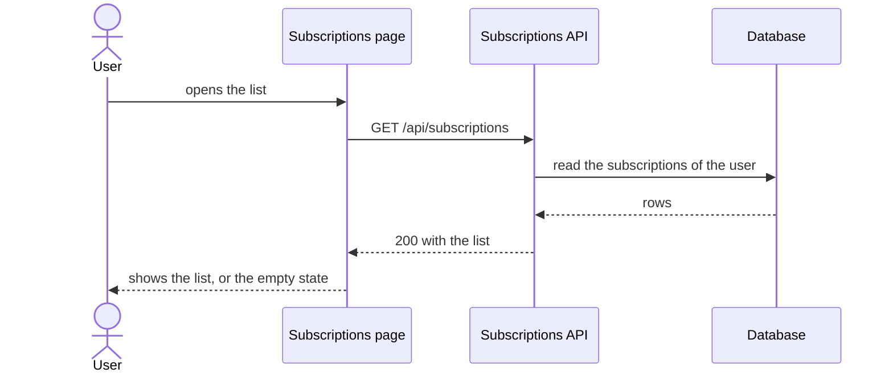

# Spec: <Feature Name>

<!--
The spec is the brief: what must be true when the work is done, how that is checked, and
what it looks like. Outside the Scaffold, leave out file lists, class and test method names,
line numbers and code; whoever builds a slice works the steps out from the Scaffold and the
current code. Exception: a contract that is itself the requirement (a route, a DTO shape, a
message name). Remove the sections the feature does not need. The What happens diagram,
Slices and the Scaffold always stay. The spec, Scaffold included, is approved in one approval.
-->

## Status

- <date>: branch `<spec branch>` from `<base>`.
- <date>: investigation done. Spec not written.
<!--
The first line names the spec's own branch; all work of this spec is done and committed there.
One line per event, oldest first: spec written, approved by the user, slice N built
(date, proof result, decisions), amended (what and why), amendment approved, shipped.
The state of each slice is in the Slices table. A shipped spec is history: the code is the truth.
-->

## Goal

**As a** <role>, **I want to** <action>, **so that** <benefit>.

<Or, for technical work: the gap, and why closing it matters.>

## Findings

<!-- Written by the investigate skill before the interview. Only what was verified, each with how it is known. -->

- **Reference feature**: `<from CLAUDE.md § Project settings>` <or the feature that is closer, and why>
- **What exists today**: <the behavior and components this feature starts from> (<file read, command run>)
- **What the request depends on**: <schema, API, page, library capability> (<how verified>)
- **Risk areas touched**: <from CLAUDE.md § Project settings, or none>
- **Options considered**: <the approaches that fit the code, and the one chosen with the user, with the reason>

## Constraints

- ⚠️ <Risk area touched and what the user must verify>
- <Invariants and things not to touch>

## Behavior

<What the system does, in the detail this feature needs. Use the sub-headings that apply.>

### Rules

| # | Rule | Error message |
|---|------|---------------|
| BR-1 | ... | "..." |

### Data

| Field | Type | Required | Constraints |
|-------|------|----------|-------------|
| ... | ... | ... | ... |

### API

`<VERB> /api/<route>`: purpose, auth, request and response shape, error responses.

### Events and messages

<Name, trigger, payload summary, effect when consumed.>

### Pages

`/<route>` (authenticated | anonymous): what the user does and sees, step by step; where they go next.

### Edge cases

| Case | Expected behavior |
|------|-------------------|
| ... | ... |

## Diagrams

<!--
One diagram, in Mermaid, at component level (never files or classes), at most about
fifteen nodes. Replace the example below. It must agree with Behavior and Slices. How the
feature is built is in the Scaffold, not in a diagram. Labels (messages, notes, node and edge
labels) never contain `;`, `#` or unbalanced quotes: a `;` ends a Mermaid statement and the
diagram does not render. Write the words instead (for example "semicolon") or Mermaid entity
codes (`#59;` for `;`, `#quot;` for `"`), and keep labels short.
-->

### What happens

The flow the user or the calling system goes through. Use a sequence diagram for an interaction, a flowchart for a process with decisions, a state diagram for a lifecycle.

## Acceptance criteria

Each criterion names how it is checked: a test at a given level (unit, UI, integration, end to end), an API call and its response, or a page action and its result. The check must fail if the behavior were broken. The tests that prove a criterion carry its id (`AC-1`) in their name or in a trait, tag or comment; ids do not change once the spec is approved.

| # | Criterion | Check |
|---|-----------|-------|
| AC-1 | Given ..., when ..., then ... | Integration test: ... |
| AC-2 | ... | Unit test: ... |

## Slices

Ordered and vertical: each slice is one increment the user can test, a functionality or an API call, named by what the user or the system can do afterwards. Its size follows from that, not from a count of criteria; `build-slice` builds it from the slice's Scaffold rows. ⚠️ marks a slice that touches a risk area. A UI behavior comes as a stub slice (the page on fake data, for the user to try) followed by its wire slice (the real backend from top to bottom). A UI change with nothing to judge on a stub is one slice, and its row says so. A security or personal-data criterion goes in the same slice as the functionality it protects (the CSV formula guard in the slice that produces the file). A security rule is stated in full, never weakened for readability or convenience.

- **Outer test**: the scenario that is written first and decides whether the slice works: at least one integration test that tests the behavior of the slice (more where useful); data-row cases count as tests. Every slice's outer test is an integration test, at least one per slice, at the Integration test level of Project settings (a Presentation integration test on the real DI container for a browser-only feature, an API integration test against the real backend host for an endpoint); for a stub slice the same test with the stub as the faked backend client. Mocked view models do not count. Describe the scenario, not a test name.
- The outer test of a security criterion covers every case the rule names, including a dangerous variant of each (for CSV injection: a value starting with `=`, `+`, `-`, `@`, tab and CR, and a malicious `+`/`-` value such as `-2+3+cmd|...`).
- **Human check**: the steps the user carries out to see it work, or "none" with the reason.
- **State**: todo, built (slice gate green, the build's record given, waiting for the user's check), accepted (checked and accepted by the user; never set by the build).

| # | Slice | Criteria | Outer test | Human check | State |
|---|-------|----------|------------|-------------|-------|
| 1 | <User sees the subscription list (stub)> | AC-1 | <Integration test: the page on the real view model and services, the stub as backend client with two subscriptions, shows both rows; on an empty stub it shows the empty state> | <Open `/subscriptions` with the stub on: see the two fake rows, judge layout and wording> | todo |
| 2 | <The subscription list shows real data (wire)> | AC-1 | <Integration test: GET the list as a user with two subscriptions: 200 and both returned; as a user with none: 200 and an empty list> | <Open `/subscriptions`, see the two seeded rows> | todo |
| 3 | <User fills in the create form (stub)> | AC-2, AC-3 | <Integration test, the stub as backend client: saving a valid form shows the new row; saving it empty shows the BR-1 message> | <Fill in the form, save, see the new row; save it empty, see the message> | todo |
| 4 | ⚠️ <Creating a subscription is saved (wire)> | AC-2, AC-3 | <Integration test: POST a valid subscription: 201 and it appears in the list; POST without a name: 400 with the BR-1 message> | <Create one, reload the page, see it is still there> | todo |
| 5 | <The list shows the renewal date (single slice: nothing to judge on a stub)> | AC-4 | <Integration test: GET the list: each subscription carries its renewal date, and the page shows it> | <Open `/subscriptions`, see the date column> | todo |

## Scaffold

<!--
Written by write-spec once the slices are cut, and approved with the rest of the spec in one
approval. Per slice, the files to create, modify or delete, one line each saying what changes
and why, plus one line for DI registrations and wiring. Check every row in the code: a file to
modify or delete exists, a new one says create. No steps and no code: build-slice works from the
slice's rows, the integration test first with only the stubs these rows name. amend-spec keeps it
true when behavior, a file or the wiring changes.
-->

Per slice: the files to create, modify or delete, and the DI registrations and wiring.

### Slice 1: <User sees the subscription list (stub)>

| File | Change | What changes and why |
|------|--------|----------------------|
| `<path of the page>` | create | <the list page with its empty state, on the service interface> |
| `<path of the service interface>` | create | <the contract the stub and the wire slice implement> |
| `<path of the stub>` | create | <fake data for the human check; deleted by the wire slice> |
| `<path of an existing file>` | modify | <what changes in it and why> |

- **DI registrations and wiring**: <the stub registered for the service interface when the stub is switched on; the page's route in the navigation>

### Slice 2: <The subscription list shows real data (wire)>

| File | Change | What changes and why |
|------|--------|----------------------|
| `<path of the stub>` | delete | <the real client replaces it> |

- **DI registrations and wiring**: <...>

## Out of scope

- ...

## Open questions

- [ ] <Question> <!-- Remove when answered; the answer goes to Behavior, Findings or Status. -->
