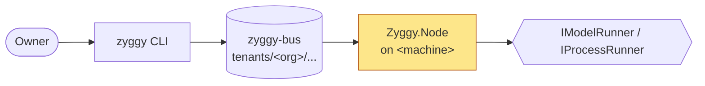
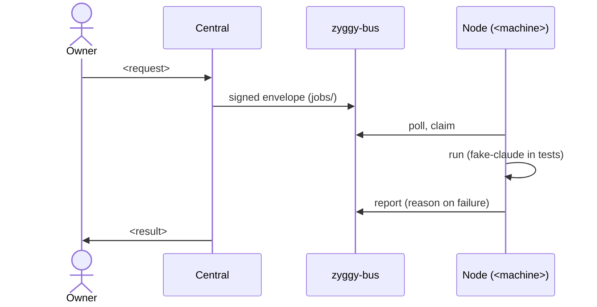

# Spec: <NN> — <Feature name>

<!--
The spec is the brief: what must be true when the work is done and how that is checked.
Leave out file lists, class and test method names, line numbers and code. Whoever builds
the feature works those out from the current code. Exception: a contract that is itself
the requirement (an envelope field, a reason code, a CLI verb and options, an MCP tool
signature, a config key, a bus path).
Remove the sections the feature does not need. Public repo: placeholders only.
-->

## Status

- <date>: spec written. Not approved.
<!-- One line per event: approved by the owner, slice N done (date, proof result), decision taken. The owner's commit of a slice is its acceptance. -->

## Goal

**As** <the owner | Central | a Node | the work node>, **I want** <capability>, **so that** <benefit / which §12 gate this enables>.

<Or, for technical work: the gap, and why closing it matters.>

## Context

- **Roadmap entry**: `_plans/ROADMAP.md` #<NN>
- **Founding-spec sections**: §<n> <title>, §<n> <title>
- **Reference feature**: <from CLAUDE.md § Project settings, or the closer feature and why>
- **Reference implementation elsewhere**: <repo and path, package README, or "none">
- <Facts the code does not show: machine behavior, decisions already taken, how each was verified>

## Constraints

- ⚠️ <Risk area touched (CLAUDE.md § Project settings) and what the reviewer must verify>
- <§9 design rules and §14 constraints that bite here; invariants and things not to touch>

## Diagrams

<!-- Mermaid, rendered by GitHub and VS Code. Roles and contracts, not classes or files. The text below stays authoritative. -->

### Components touched

### Round trip

<!-- Add when they apply: stateDiagram-v2 for state moves, a flowchart for refusal paths, the slice map (Fake → Wire). -->

## Behavior

<What the system does, in the detail this feature needs. Use the sub-headings that apply.>

### Envelope and bus

<Fields added or interpreted, bus paths (via `BusPaths`, tenant-prefixed), state moves. A change here also changes `PROTOCOL.md`.>

### CLI

`zyggy <verb> [options]` — arguments, options, exit codes, output.

### Hub tools

| Tool | Input | Output | Notes |
| --- | --- | --- | --- |

### Configuration

| Key | Where (`node.json` / options) | Default | Override rule |
| --- | --- | --- | --- |

### Failure modes

| Situation | Observable outcome (`reason` code, rejection move, log line) | Runbook entry |
| --- | --- | --- |

### Edge cases

| Case | Expected behavior |
| --- | --- |

## Decisions

| Founding-spec item (section) | Verdict (keep / reshape / library / defer) | Why |
| --- | --- | --- |

<New packages: name, licence, what bespoke code it removes. Deliberate deviations from the founding spec and the founding-spec wording the owner approved.>

## Acceptance criteria

Each criterion names how it is checked: a unit or integration test, a gate scenario, a `zyggy` command against a local bare repo and its output, or an owner-run check on a real machine. The check must fail if the behavior were broken.

| # | Criterion | Check |
| --- | --- | --- |
| AC-1 | Given ..., when ..., then ... | Unit test: ... |
| AC-2 | ... | Integration test (bare repo + fake-claude): ... |

## Slices

Ordered, vertical: each slice is one behavior across every project it needs, named by what the owner or the system can do afterwards. Fake (through the seams, unit tests) comes before its Wire (real edge, integration tests). ⚠️ marks a slice that touches a risk area. A phase-closing deliverable ends with the gate slice.

Each slice names its review check: the one thing the owner does to see it work before committing it — a test filter, a `zyggy` command, a gate scenario. Work with no review check of its own is not a slice; put it in the slice whose behavior it supports.

| # | Slice | Criteria | Review check |
| --- | --- | --- | --- |
| 1 | <Node does ... through the seam (fake)> | AC-1 | `dotnet test tests/Zyggy.Core.Tests --filter "FullyQualifiedName~<area>"` |
| 2 | ⚠️ <... against a local bare repo (wire)> | AC-1, AC-2 | `dotnet test tests/Zyggy.Integration --filter "FullyQualifiedName~<area>"` |

## Out of scope

- <everything deferred above, plus explicit exclusions>

## Open questions

- [ ] **Q1 — <title>.** Found: <what, with section/file refs>. Why it matters: <...>. Options: (a) ... (b) ... Recommendation: <...>. <!-- Remove when answered; the answer goes to Status, Behavior or Decisions. -->
