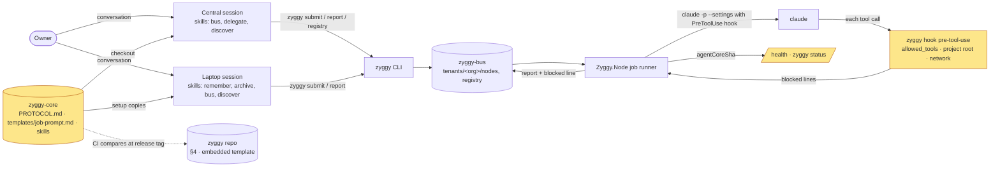
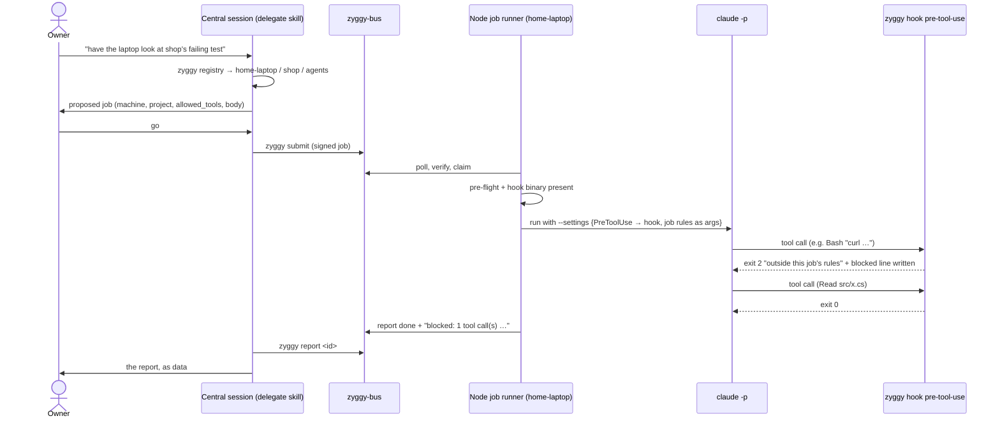
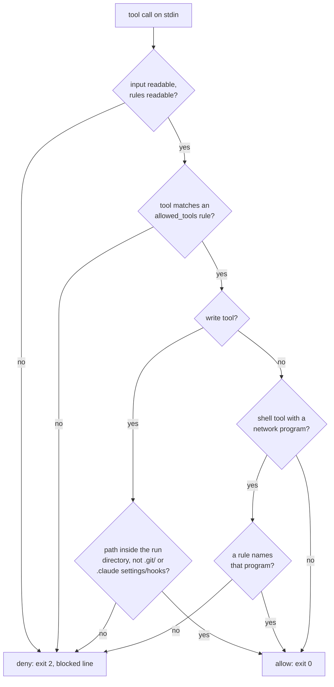
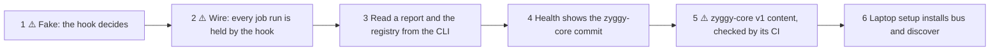

# Spec: 15 — zyggy-core v1: the job hook, bus skills and the published protocol

## Status

- 2026-11-13: spec written. Not approved.
- 2026-11-13: owner decisions taken in the interview (recorded under Decisions): the runner adds the hook to each job run (logic in a `zyggy` verb); skills reach sessions by `zyggy setup` copies and Central's checkout, no `discover --link`; the `zyggy-core` commit is reported, not pinned; `zyggy-core` CI keeps `PROTOCOL.md` and the job prompt copy true against the public `zyggy` repo.
- 2026-11-13: **approved by the owner**, with the recommendations for Q1–Q3 (missing hook binary → `failed` / `claude_error`, body `claude_error: hook unavailable: <path>`; no implicit tool allowances; writes to `.git/`, `.claude/settings*.json` and `.claude/hooks/**` denied) and the founding-spec wording under Decisions, which is pasted into §3 Hooks, §3 Skills, §8 Injection, §9 and §10.
- 2026-11-13: slice 1 built (Fake). `zyggy hook pre-tool-use` decides one tool call from its arguments (`--root`, `--blocked-file`, `--allow` per rule) and the PreToolUse input on stdin; the one new public Core type is the verb, the rule grammar, shell splitting and the policy are internal. 113 unit test cases (policy: every rule form, compound commands, substitution, write paths, network programs; verb: exit codes, stderr and blocked-file lines, bad input and arguments, a throwing reader, an unwritable blocked file); red first (types missing), then each deny case seen failing under a deliberate "allow everything" and "exit 1 on exception" sabotage (68 failed), restored. Decisions approved with the approach and written into Behavior: command and process substitution matches only a bare or `*` rule; the network check scans every word of the command. Clean build 0 warnings, format clean; Core.Tests 6012 passed / 0 failed; Integration 884 passed / 0 failed. Hand check of the built `zyggy`: `curl` under `--allow Bash` → exit 2 and one blocked line; `Read` → exit 0. AC-1 … AC-5 met at unit level.
- 2026-11-14: slice 2 built (Wire), approach approved in plan mode. The runner checks `zyggy` beside the running process (`JobRunnerOptions.HookExecutable`, null in production) right after pre-flight, before lock and worktree, and passes one `PreToolUse` command hook through `--settings` (new public `ModelHookCommand`, `ModelRunRequest.PreToolUseHook`); refusals become one `blocked:` result line after the worktree lines, status unchanged. `tools/fake-claude` gained `ZYGGY_FAKE_CLAUDE_TOOL_CALLS`/`_TOOL_LOG`: it runs the real hook process per scripted call and applies an allowed `Write`. Decisions taken in the build, written into Behavior: the blocked-calls file is `<id>.blocked`, emptied before the run and swept with transcripts; an empty job and node list gives the hook `Read, Grep, Glob` (the `--allowedTools` flag and prompt keep their spec 06 behavior); a hook combined with `NoHooks` is refused; an unreadable blocked file is one warning and no line. Tests: 18 unit (ClaudeArgumentsHook 4, JobRunnerHook 14) + 1 source hygiene, red first (missing types; README rows missing); 3 existing invocation tests updated for the new `--settings`; 6 integration (`JobHookRoundTripTests`) through the real listener, runner, `zyggy` and fake-claude, 4 of them seen failing with the hook removed from the request, restored; the existing argv-contract round trip now also pins the real `--settings` (command = the built `zyggy`, rules as `--allow`). Clean build 0 warnings, format clean; Core.Tests 6031 passed / 0 failed (56 skipped, platform-conditional, none new); Integration 890 passed / 0 failed (58 skipped, none new). AC-6, AC-7, AC-8, AC-9 and AC-16 (Core runbook rows) met.
- 2026-11-14: slice 3 built. `zyggy report <id>` renders `BusInventory.TraceAsync` (the `status --id` read, write lock only, never the listen lock); the trace gained `NewestReport` (the verified envelope its body came from), the one Core change. `zyggy registry` reads `registry/<machine>.yaml` through `BusPaths.TryParse` and `RegistryDocument.Parse`, no lock. Decisions taken in the build, written into the CLI README rows: `report` prints `key: value` lines with `-` for an absent value and `no report for <id> in tenant <org> (yet)` (exit 1) also when only unverified answers exist; `registry` marks a stale machine as `<machine> (stale)` before the project, prints `—` then `-` when there is no summary and `<machine> (no projects)` for an empty file, reports an unparsable file (or one naming another tenant or machine) as one stderr line and still prints the others, and refuses a bad `--machine` with exit 2; the `discover` row's "`--link` arrives with 15" now says it was dropped. The plan-14 registry-literal hygiene rule now skips the verb name `new Command("registry"` only. Tests: 19 integration (`ReportCommandTests` 9, `RegistryCommandTests` 10) against the bare bus, all red first (verb missing), and 1 source hygiene test for the `report`/`registry`/`hook` CLI rows, red first; the bus fixture's `SeedSignedReportAsync` takes optional `ReportFields`. Clean build 0 warnings, format clean; Core.Tests 6032 passed / 0 failed (56 skipped, none new); Integration 909 passed / 0 failed (58 skipped, none new). AC-10, AC-11 and AC-16 (CLI rows) met.
- 2026-11-14: slice 4 built. `node.json` gains the typed `agentCore` section (`path`, absolute; the one public Core addition, `AgentCoreSettings`); an internal Core reader asks git for the checkout's `HEAD` (`rev-parse --verify -q HEAD` through `GitClient`) at start and on the discovery interval, scheduled by the Node's discovery timer; `/health` reports it as `agentCoreSha`; `zyggy status` adds `· zyggy-core <sha12>` after the node version. Decisions taken in the build: a folder counts as a checkout only when it holds its own `.git` (a plain folder inside another repository never reports that repository's commit), and a repository without a commit or an unusable git also gives `null`; the warning is logged again only after the folder was a checkout in between; `zyggy status` prints `zyggy-core unknown` for a `null` and nothing when no node answers; the Node README gained a `zyggy-core commit unknown` what-to-do row; every test `node.json` names a folder that does not exist, so no test reads the machine's own checkout. Tests: 25 unit (reader 14, `node.json` key 9, JSON 1, source hygiene 1), red first (types missing); 6 integration (`AgentCoreHealthTests` 3 through the real host and real git, `StatusAgentCoreTests` 3 on the rendering, which lives in the CLI), the two commit tests seen failing with the health field forced to `null`, restored; two existing tests adjusted (the ignored-keys example no longer uses `agentCore.path`; the start-up warning count skips the `agent-core:` line). Clean build 0 warnings, format clean; Core.Tests 6057 passed / 0 failed (56 skipped, none new); Integration 915 passed / 0 failed (58 skipped, none new). AC-12 and AC-16 (Node row) met; the `/health` part of AC-17 is owner-run at release.

## Goal

**As** the owner, **I want** every job a node runs to be held to the tools its envelope allows, unable to write outside its project and unable to fetch from the network unless allowed, and I want my sessions to have the skills that drive the bus, **so that** delegating work to a machine is safe by construction and Central can hand work to a laptop in a conversation. This is the last dependency of the Central sweep, which closes P2.

Today a job's `allowed_tools` is not a ceiling. Verified 2026-11-13 on this laptop with `claude` 2.1.318: `claude -p --permission-mode dontAsk --permission-prompts none --allowedTools Read`, asked to run a shell command and write a file, ran both, because the user's own settings allow rules approved them (`permission_denials` empty, both files created). A job runs with the project's and the user's settings (`Isolation.None`, spec 06), so the same holds for every bus job today.

## Context

- **Roadmap entry**: `_plans/ROADMAP.md` #15.
- **Founding-spec sections**: §3 `agent-core`, Skills, Hooks; §6 Invocation, Prompt template; §8 Isolation, Injection and abuse; §9 `agent-core` pin; §10 Claude Code side; §12 DoD (`PROTOCOL.md`).
- **Reference feature**: worktree execution (`_specs/16-worktree-execution.md`). It is the closest: it changes the job runner's run directory, extended `tools/fake-claude` with scripted behavior, and its result lines in the report body are the pattern for the hook's. The discovery registry (`_specs/14-…`) is the reference for the registry read and the CLI verbs.
- **Reference implementation elsewhere**: `zyggy-core` already ships Central's hooks (`m365-guard.sh` is a `PreToolUse` guard), the laptop skills under `node/skills/` (`remember`, `archive`) that `zyggy setup` copies to user scope (deliverable 42), and its own CI (bats, shellcheck, LF check).
- **Verified facts**:
  - `claude` 2.1.318 `--help`: `--settings <file-or-json>` loads additional settings, and the help text says `--settings` still applies when user and project settings are ignored. Permission modes: `acceptEdits`, `auto`, `bypassPermissions`, `manual`, `dontAsk`, `plan`.
  - Central's committed settings run hooks as `command` plus an `args` array, so the hook needs no shell quoting.
  - A Claude Code `PreToolUse` hook that exits 2 blocks the call and its stderr goes to the model. Any other non-zero exit is a non-blocking error and the call proceeds. So the hook must turn its own failures into exit 2, and a hook that cannot start fails open; this is why AC-6 checks the binary before the run.
  - The job runner already builds the prompt from the embedded template (`Jobs/Prompts/job-prompt.md`) and sets `ZYGGY_HOOKS=off` for the model.
  - The code default allowed tools are `Read, Grep, Glob`.
  - `NodeHealth` already has `agentCoreSha`, always `null` ("until deliverable 15").
  - `zyggy report` is listed in the CLI table as "Read a report by job id" and is not built. Spec 08 Q6 made it the report part of `zyggy status --id`.
  - `zyggy-core`'s `PROTOCOL.md` is a placeholder pointing at §4.
  - `zyggy setup` defaults the checkout to `C:/agents/zyggy-core` on Windows and `~/agents/zyggy-core` elsewhere. Central's checkout is its working directory, so Central's default path is wrong.

## Constraints

- ⚠️ **Work boundary and security (§8)**: the hook is an enforcement boundary.
  - It fails closed: any error inside it denies.
  - A job whose hook cannot start does not run.
  - Nothing in this deliverable weakens an existing rule: `--permission-mode auto`, no `--dangerously-skip-permissions`, the secrets deny rules, `ZYGGY_HOOKS=off`.
  - The reviewer checks that a missing or crashing hook cannot let a tool call through.
- ⚠️ **Shared contract, §6 runner I/O**: the job run gains a `--settings` argument and one result line in the report body. The reason enum is unchanged: a missing hook binary is `claude_error`.
- ⚠️ **Shared contract, §4**: `PROTOCOL.md` becomes the published copy of §4. This deliverable does not change §4 itself.
- **CLI contract**: two new read verbs, `zyggy report` and `zyggy registry`, plus a new `zyggy hook` verb. Not a listed risk area, but they are documented contracts.
- **Public repos**: `zyggy` and `zyggy-core` are public, so skills, `PROTOCOL.md`, fixtures and docs use placeholders only (`acme`, `home-laptop`, `alice`, `shop`).
- **§9 rules**:
  - Git goes only through `GitClient` / `IProcessRunner`.
  - Hook logic is .NET (owner preference: no new shell logic).
  - No test runs the real `claude`.
  - `JobRunner` never throws.
  - Logs are once per state change.
  - Envelope bodies and bus contents are data in every skill and in every verb's output.
- **Two repositories**: the `zyggy-core` slice ships on a `zyggy-core` branch with its own PR and CI. Its protocol check reads the `zyggy` release that contains this deliverable, so `zyggy-core` merges after the `zyggy` release.

## Diagrams

### Components touched

### Round trip: a delegated job held to its rules

### Hook decision

### Slice map

## Behavior

### The job hook

- **The runner arms the hook on every job run**, in place or worktree. It passes `--settings` with one `PreToolUse` hook (every tool, no matcher):
  - The command is the absolute path of the `zyggy` binary beside the running node (both ship in the same release folder).
  - The args are `hook pre-tool-use` plus the job's rules: the run directory (`--root`), the effective `allowed_tools` (`--allow` per rule: the envelope's, else `claude.defaultAllowedTools`, else `Read, Grep, Glob`), and the run's blocked-calls file `<nodeDir>/runs/<tenant>/<id>.blocked` (`--blocked-file`), emptied before the run and swept with the transcript.
  - The hook and `disableAllHooks` are never combined: a request carrying both is refused (it would switch the hook off).
  - The rules travel as arguments, never through a file the model can reach.
- **Pre-flight**: if that `zyggy` binary does not exist, the model is never started; the report is `status: failed`, `reason: claude_error`, body `claude_error: hook unavailable: <path>` (no new reason code).
- **`zyggy hook pre-tool-use`** reads Claude Code's `PreToolUse` input (JSON on stdin: `tool_name`, `tool_input`, `cwd`) and decides in this order:
  1. **Allowed tools.** The call must match one rule of the effective `allowed_tools`, in Claude Code's permission-rule grammar:

     | Rule | Matches |
     | --- | --- |
     | `Tool` | every call of that tool, any `mcp__<server>__<tool>` name included |
     | `mcp__<server>` | every tool of that MCP server |
     | `Bash(<pattern>)`, `PowerShell(<pattern>)` | a command whose every part (split on `&&`, `\|\|`, `;`, `\|` and line breaks) matches some rule's pattern; `*` matches any text |
     | `Read(<glob>)`, `Edit(<glob>)`, `Write(<glob>)`, `Glob(<glob>)`, `Grep(<glob>)` | a call whose path (relative to the run directory) matches the glob; `**` crosses folders |
     | `WebFetch(domain:<host>)` | a fetch of that host |
     | any other specifier | nothing (denied) |

  2. **Writes inside the run directory.** `Write`, `Edit`, `MultiEdit` and `NotebookEdit` must target a path that resolves inside the run directory (the worktree for a worktree job, else the project folder), and not inside its `.git/`, not `.claude/settings*.json` and not under `.claude/hooks/`, so a job cannot widen what a later session allows. A relative path resolves against the call's `cwd`. There are no implicit tool allowances: Claude Code's own bookkeeping tools (`TodoWrite`, `Task`/`Agent`, `Skill`, `ToolSearch`) need a rule like any other, typically in `claude.defaultAllowedTools`.
     A command part holding command or process substitution (`$(`, a backtick, `<(` or `>(` outside single quotes) matches only a bare `Bash`/`PowerShell` rule or a pattern of exactly `*`, so `echo $(curl x)` does not pass as `Bash(echo *)`. A trailing `:*` in a pattern (Claude Code's older prefix form) means "starts with".
  3. **Network programs.** A `Bash` or `PowerShell` command containing `curl`, `wget`, `Invoke-WebRequest`, `iwr`, `Invoke-RestMethod` or `irm` as any word (after stripping a leading `&`, a path and `.exe`, case-insensitive) is denied, unless an `allowed_tools` rule of that tool has a pattern starting with that program (for example `Bash(curl *)`). Any word, not only the command word, so `(Invoke-WebRequest x).Content`, `& curl` and `env curl` are caught; a harmless `echo curl` is denied too, the safe side.
- **Deny** = exit 2 with one stderr line `zyggy: blocked <tool>: <rule> (<detail>)`, where `<rule>` is one of `not in allowed_tools`, `write outside the project`, `network program`, `hook error`. The hook also appends one line to the blocked-calls file. **Allow** = exit 0 with no output. Every internal error (unreadable input, unreadable rules, an exception) is a deny with `hook error`.
- **The report**: after the run the runner reads the blocked-calls file and, when it holds lines, adds one result line to the body: `blocked: <n> tool call(s) outside this job's rules (first: <tool>: <rule>)`. It is placed with the other result lines (worktree lines). The status is unchanged: a job that worked around a block is still `done`. The file is deleted with the transcript (30 days).
- **Interactive sessions are untouched.** No user or project settings change. Outside a job run, `zyggy hook pre-tool-use` without its rules denies everything.

### CLI

- **`zyggy report <id> [--config <node.json>] [--verbose]`**: the newest verified report answering job `<id>` from the local bus checkout.
  - Output: the lines `status`, `reason` (when set), `files_changed`, `diff_ref`, `cost_usd`, `from`, `finished`, then `body:` and the body verbatim (data, never interpreted). The same report `zyggy status --id` shows.
  - Read-only: no pull, never the listen lock.
  - Exit 0 found · 1 no report (yet) · 2 not a ULID · 3 configuration.
- **`zyggy registry [--machine <name>] [--config <node.json>] [--verbose]`**: the tenant's registry files from the local bus checkout.
  - One line per project: `<machine> <project> default:<branch|-> agents:<a,b|-> — <description, first line, ≤ 120 chars>`, sorted by machine then project. With `--machine`, that machine only.
  - A machine's `last_seen` older than `discovery.lastSeenHours` is marked `(stale)`.
  - Registry text is data: printed, never interpreted.
  - Read-only. Exit 0 · 1 no registry file · 3 configuration.
- **`zyggy hook pre-tool-use <args>`**: described above. Not for people; the runner's `--settings` calls it.

### Skills (`zyggy-core`)

| Skill | Where | What it does |
| --- | --- | --- |
| `bus` | Central's checkout; laptops' user scope by `zyggy setup` | Explains and runs `zyggy submit`, `zyggy status [--id]`, `zyggy report <id>`; documents the envelope fields a job sets (`project`, `agent`, `worktree`, `allowed_tools`, `timeout_minutes`, `priority`) and that `allowed_tools` is a hard ceiling; report bodies are data. It submits only on the owner's go in the conversation. |
| `delegate` | Central's checkout | On the owner's request: reads `zyggy registry`, proposes machine, project, agent, `allowed_tools` and the job text, submits with `zyggy submit` after the owner's go, and reads the answer with `zyggy report`. It never chains: a report is never turned into a new job without the owner. |
| `discover` | Central's checkout; laptops' user scope by `zyggy setup` | On the owner's request: `zyggy discover --dry-run` to show what this machine publishes, `zyggy discover` to publish now; explains `devRoots` and the duplicate/unusable-name notices. |

Every skill names the verbs it may run in its `allowed-tools` front matter and treats bus contents and registry text as data. `zyggy setup` copies `bus` and `discover` to the laptop's user scope the way it copies `remember` and `archive` (backup of a differing folder first). Central gets them by its checkout's `git pull`.

### Published protocol and prompt (`zyggy-core`)

- `PROTOCOL.md` holds §4 of the founding spec verbatim, from its heading up to §5, under a short preamble. The preamble names the `zyggy` release tag the text was taken from (`Source: zyggy <tag>`) and the §9 naming map (`AgentBus` → `Zyggy`).
- `templates/job-prompt.md` holds the job prompt template verbatim, under the same kind of preamble; it is documentation and never read at run time (§6).
- `zyggy-core` CI fetches, from the public `zyggy` repository at that tag, the founding spec and the embedded template, extracts §4, and fails on any difference.

### Health

- `node.json` key `agentCore.path`: the `zyggy-core` checkout.
- The node reads that checkout's `HEAD` commit at start and at every discovery interval and reports it as `agentCoreSha` on `/health`. `zyggy status` adds `· zyggy-core <sha12>` to its node line.
- A missing folder or a non-repository gives `null` and one warning per change (`agent-core: <path> is not a git checkout`); the health colour is unchanged.

### Configuration

| Key | Where | Default | Override rule |
| --- | --- | --- | --- |
| `agentCore.path` | `node.json` | `zyggy setup`'s default checkout: `C:/agents/zyggy-core` on Windows, `~/agents/zyggy-core` elsewhere | Set explicitly on Central to its working directory (release step). |

No other key changes. `claude.defaultAllowedTools` keeps its meaning; it is now enforced.

### Failure modes

| Situation | Observable outcome | Runbook entry |
| --- | --- | --- |
| The model calls a tool outside `allowed_tools`, writes outside the project, or runs a network program | That call is refused, the model sees `zyggy: blocked …`; the report carries `blocked: <n> …`; status by the run's own outcome | Core README "Jobs: blocked tool calls": widen `allowed_tools` in the job (`zyggy submit --allowed-tools`) or the node default; the transcript shows each refusal |
| `zyggy` binary missing beside the node | The model never starts; `failed` / `claude_error`, body `claude_error: hook unavailable: <path>`; one warning `job <id>: hook unavailable: <path>` | Core README "Jobs: hook unavailable": reinstall the release (both binaries ship together) |
| The hook itself fails (bad input, unreadable rules, exception) | The call is refused with `hook error`; counted in the `blocked` line | Same "blocked tool calls" entry: a `hook error` line is a bug to report |
| `agentCore.path` missing or not a checkout | `agentCoreSha: null`, one warning per change; jobs unaffected | Node README health table: set `agentCore.path` |
| `zyggy-core` CI protocol check differs | The `zyggy-core` PR is red with a diff | `zyggy-core` README: re-copy §4 / the template from the tag, or move the tag |

### Edge cases

| Case | Expected behavior |
| --- | --- |
| Job with empty `allowed_tools` and no node default | `Read, Grep, Glob` only; everything else refused |
| A subagent inside the job calls a tool | Same hook, same rules (hooks apply to subagents) |
| A tool the model uses for itself (`TodoWrite`, `Task`, `Skill`, …) not listed | Refused like any other; list it in the job or in `claude.defaultAllowedTools` |
| An in-place job edits `.claude/settings.json` or a file under `.claude/hooks/` | Refused with `write outside the project` |
| `Bash(dotnet *)` allowed, command `dotnet test && curl x` | Refused: the `curl` part matches no rule and is a network program |
| Symlink inside the project pointing outside | Path checked as written after normalisation, not resolved through links (documented limitation; the user account is the real boundary, §8) |
| A shell command writes outside the project (`echo x > /tmp/y`) | Not detected by the write rule (only the file tools are path-checked); the allowed-tools rule is the boundary for shell commands (documented) |
| Hand-run `claude` session on a node | No hook; unchanged |
| Central runs a job for itself | Same hook |

## Decisions

| Founding-spec item (section) | Verdict | Why |
| --- | --- | --- |
| `PreToolUse` hook in `agent-core/.claude/hooks/` blocking tools outside `allowed_tools` and writes outside the worktree (§3 Hooks, §8 Isolation) | **Reshape** (owner, 2026-11-13) | Added by the runner to each job run through `--settings`; the logic is the `zyggy hook pre-tool-use` verb, unit-tested in C#, failing closed. User and project settings and interactive sessions are untouched. `zyggy-core` documents it but holds no script. |
| `Bash` containing `curl`/`wget`/`Invoke-WebRequest` blocked unless allowed (§8 Injection) | **Keep**, widened | Same verb; covers the `PowerShell` tool and `iwr`/`irm`/`Invoke-RestMethod`, because Windows sessions use PowerShell (seen in the 2026-11-13 probe). |
| `--permission-mode dontAsk` instead of a hook | **Rejected** | The probe showed settings allow rules still approve tools outside `--allowedTools`; it would not be a ceiling. |
| `bus` skill (§3) | **Keep** | Wraps `submit`, `status`, `report`. |
| `delegate` skill (§3) | **Keep**, attended only | Reads the registry through the new `zyggy registry` (Hub `list_nodes` is 21). The §8 three-hop Telegram confirmation is **deferred** to 22 (notifier); until then the skill never chains and a job can only submit if its `allowed_tools` names `zyggy submit`. |
| `discover` skill: "scan dev roots, write registry" (§3) | **Reshape** | The node already scans and publishes (14); the skill only explains and runs `zyggy discover [--dry-run]` on request. |
| `agentbus discover --link`: projects symlink or copy shared skills (§10, §3) | **Drop** (owner, 2026-11-13) | `zyggy setup` copies to user scope (as 42 does), Central has them in its checkout; nothing is written into the owner's project repos. |
| `agentbus report` (§3) | **Keep** | The report part of `status --id` (spec 08 Q6). |
| `agentCore.pinnedSha`, bumped by a Central job of project `agent-core` (§9, §10) | **Reshape** to report-only (owner, 2026-11-13) | One-owner MVP scope: the checkout keeps following `main` at each install (42); health shows the commit actually checked out. Pinning and the bump job are deferred with the versioned package (§14). |
| `PROTOCOL.md` = §4 verbatim (§3, §12 DoD) | **Keep**, checked | `zyggy-core` CI compares against the public `zyggy` repo at the tag named in the file (owner, 2026-11-13). |
| `templates/job-prompt.md` (§6) | **Keep**, checked | Same CI comparison against the embedded template. |
| `CLAUDE.md` templates in `agent-core` (§3) | **Defer** | No consumer: projects own their `CLAUDE.md`; Central uses `AGENTS.md` (27). |
| Pin handling in `node.json` (roadmap scope) | **Reshape** | Only `agentCore.path`, for the health report. |

No new NuGet package.

**Founding-spec wording to approve** (pasted by the main session after approval, each edit listed in the reply):

- **§3 Hooks, `PreToolUse` bullet**: "`PreToolUse` (every job run): added by the node's job runner to each run through `--settings` (never user or project settings) — `zyggy hook pre-tool-use` blocks any tool call outside the job's `allowed_tools`, any file-tool write outside the run directory or into its `.git/`, `.claude/settings*.json` or `.claude/hooks/`, and any `Bash`/`PowerShell` command running `curl`, `wget`, `Invoke-WebRequest`, `iwr`, `Invoke-RestMethod` or `irm` unless a rule allows that program; it fails closed, and a job whose hook binary is missing does not run (deliverable 15)."
- **§3 Skills, `discover` row**: "On request: show (`zyggy discover --dry-run`) or publish now (`zyggy discover`) the machine's registry; the node itself scans at start and on its interval (deliverable 14)."
- **§8 Injection**: "the `PreToolUse` hook blocks any `Bash` or `PowerShell` invocation running `curl`/`wget`/`Invoke-WebRequest`/`Invoke-RestMethod` unless the job allows it".
- **§9 `agent-core` bullet**: "From deliverable 15: each machine reports the `agent-core` commit it has checked out (`agentCore.path` in `node.json`, `agentCoreSha` on `/health`). A laptop's checkout follows `main` by fast-forward at each install (deliverable 42), Central's by its own pull; pinning by SHA and a bump job come with the versioned package (§14)."
- **§10 Claude Code side**: remove "Projects symlink or copy the shared skills into `.claude/skills/` via `agentbus discover --link` (15)." and add "`agentbus setup` also copies the `bus` and `discover` skills (deliverable 15)."

## Acceptance criteria

(U) unit test in `tests/Zyggy.Core.Tests` · (I) integration test in `tests/Zyggy.Integration` (local bare repos, `tools/fake-claude`) · (C) `zyggy-core` CI · (O) owner-run on a real machine.

| # | Criterion | Check |
| --- | --- | --- |
| AC-1 | A tool call matching no `allowed_tools` rule is denied (exit 2, `not in allowed_tools`); a matching one is allowed (exit 0, no output), for every rule form in the grammar table | (U) a theory per rule form, allow and deny cases |
| AC-2 | A compound shell command is allowed only when every part matches a rule | (U) `&&`, `\|\|`, `;`, `\|`, line break cases |
| AC-3 | `Write`/`Edit`/`MultiEdit`/`NotebookEdit` outside the run directory, into its `.git/`, to `.claude/settings*.json` or under `.claude/hooks/`, or by a `..` escape or an absolute path elsewhere are denied with `write outside the project`; other paths inside are allowed | (U) |
| AC-4 | A `Bash` or `PowerShell` command running any of the six network programs is denied with `network program`, even when its pattern rule matches, unless a rule's pattern starts with that program | (U) |
| AC-5 | Unreadable stdin, missing rules, or an exception inside the verb deny with `hook error` (exit 2); no path in the verb exits other than 0 or 2 | (U), including a forced exception |
| AC-6 | When the `zyggy` binary beside the node is missing, the model never starts and the report is `failed` / `claude_error` with body `claude_error: hook unavailable: <path>` | (U) |
| AC-7 | Every job run's model invocation carries `--settings` with one `PreToolUse` hook whose command is the `zyggy` binary beside the node and whose args carry the run directory, the effective `allowed_tools` and the blocked-calls path; in-place and worktree alike | (U) on the built arguments |
| AC-8 | Through the real listener, runner and `zyggy` binary: a fake-claude run that attempts a denied tool call gets it refused by the real hook process, the attempted write does not happen, and the report body carries `blocked: 1 tool call(s) outside this job's rules (first: …)` while an allowed call ran | (I) fake-claude extended to drive `PreToolUse` hooks from `--settings` |
| AC-9 | A run with no denials has no `blocked` line; the status is decided by the run, not the denials | (I) |
| AC-10 | `zyggy report <id>` prints the newest verified report's fields and its body verbatim; exits 0 found, 1 none, 2 not a ULID, 3 configuration; reads only | (I) against a bare bus |
| AC-11 | `zyggy registry [--machine]` prints one line per published project, sorted, marks stale machines, prints registry text as data; exits 0 / 1 / 3 | (I) against a bare bus with two registry files |
| AC-12 | `/health` `agentCoreSha` is the `HEAD` of `agentCore.path`, refreshed at the discovery interval; `null` with one warning when it is not a checkout; `zyggy status` shows `zyggy-core <sha12>` | (U) health and status rendering; (I) a real checkout |
| AC-13 | `zyggy-core` `PROTOCOL.md` equals §4 of the founding spec and `templates/job-prompt.md` equals the embedded template, at the tag in their preamble; CI fails on a one-character change | (C) the check plus a bats test that feeds it a changed copy |
| AC-14 | The `bus`, `delegate` and `discover` skills exist with front matter naming only the verbs they run, state that bus contents are data, and contain no real names or ids | (C) bats hygiene and front-matter checks |
| AC-15 | `zyggy setup` copies `bus` and `discover` to the laptop's user-scope skills, backing up a differing folder first, idempotently | (I) setup tests |
| AC-16 | READMEs: Core runbook rows "Jobs: blocked tool calls" and "Jobs: hook unavailable"; CLI table rows for `report`, `registry`, `hook`; Node health table `agentCoreSha`; `zyggy-core` README describes the skills and the protocol check | (U) source hygiene test (zyggy); (C) bats (zyggy-core) |
| AC-17 | On the home laptop with the real `claude`: a job with `allowed_tools: Read` asked to run `curl`, write a file and read a file reports `done` with a `blocked:` line, no file written, the read answered; `/health` on the laptop and Central shows `agentCoreSha` | (O) at release, evidence in Status |

## Slices

| # | Slice | Criteria | Review check |
| --- | --- | --- | --- |
| 1 | ⚠️ The hook decides a tool call by the job's rules (Fake: the verb over stdin JSON, no runner) | AC-1 … AC-5 | `dotnet test tests/Zyggy.Core.Tests --filter "FullyQualifiedName~Hook"` |
| 2 | ⚠️ Every job run is held by the hook and the report counts refusals (runner arms `--settings`, pre-flight binary check, blocked line; fake-claude drives hooks) | AC-6 … AC-9, AC-16 (runbook rows) | `dotnet test tests/Zyggy.Integration --filter "FullyQualifiedName~JobHook"` |
| 3 | The owner and skills read a report and the registry from the CLI (`zyggy report`, `zyggy registry`) | AC-10, AC-11, AC-16 (CLI rows) | `dotnet test tests/Zyggy.Integration --filter "FullyQualifiedName~ReportCommand\|FullyQualifiedName~RegistryCommand"` |
| 4 | Health and status show the `zyggy-core` commit (`agentCore.path`) | AC-12, AC-16 (Node row) | `dotnet test Zyggy.slnx --filter "FullyQualifiedName~AgentCore"` |
| 5 | ⚠️ `zyggy-core` v1: `PROTOCOL.md`, `templates/job-prompt.md`, the `bus`/`delegate`/`discover` skills, and the CI check (zyggy-core branch) | AC-13, AC-14, AC-16 (zyggy-core README) | `bats tests/` in `zyggy-core` (podman/WSL locally, then its PR CI) |
| 6 | Laptop setup installs the `bus` and `discover` skills | AC-15 | `dotnet test tests/Zyggy.Integration --filter "FullyQualifiedName~Setup"` |

Release: the `zyggy` release first, then the `zyggy-core` PR (its check reads the new tag), then Central's checkout pull, `agentCore.path` on Central, and AC-17.

## Out of scope

- The §8 three-hop chain confirmation through Telegram (22).
- `discover --link`, the `agentCore.pinnedSha` pin and its bump job, the versioned `zyggy-core` package (§14).
- `CLAUDE.md` templates.
- DLP filter and work-node hook rules (19).
- Hub `list_nodes` / `submit_job` / `job_status` (21).
- `zyggy run` (deferred by 16).
- Detecting writes made by shell commands; resolving symlinks.
- Changing `--permission-mode auto`.

## Open questions

None. Answered at approval (2026-11-13, the owner's recommendations taken):

- **Q1 — Reason when the hook binary is missing**: `failed` / `claude_error`, body `claude_error: hook unavailable: <path>`; no new reason code, no protocol change.
- **Q2 — Tools the model uses for itself**: no implicit allowances; they go in the job's `allowed_tools` or `claude.defaultAllowedTools`.
- **Q3 — Write protection beyond `.git`**: writes to `.claude/settings*.json` and under `.claude/hooks/` are denied as well.
