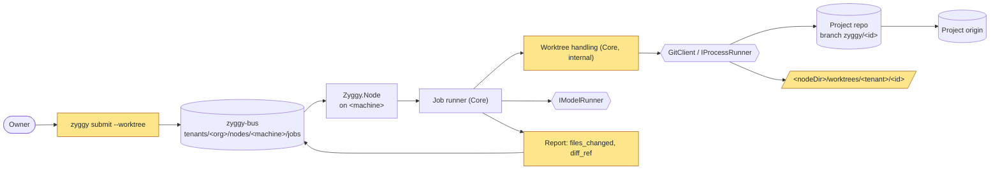
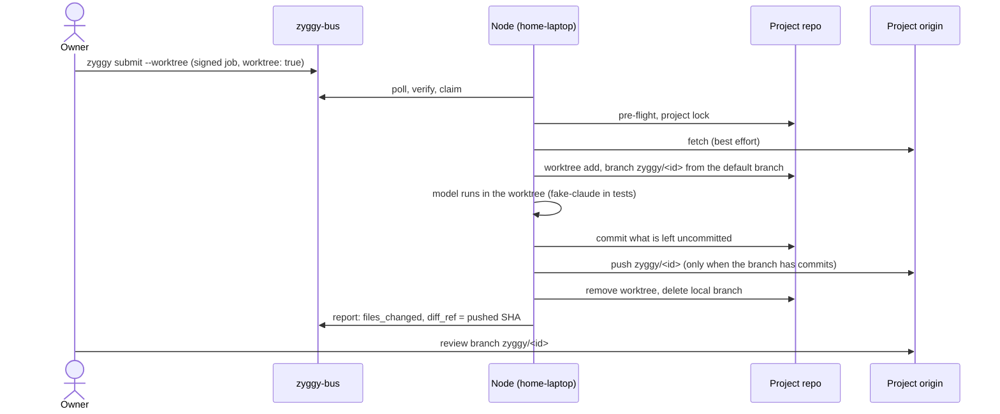
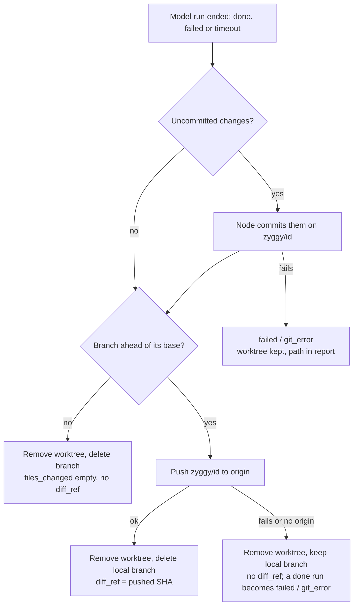
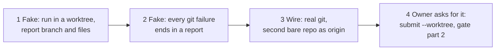

# Spec: 16 — Worktree execution and the pushed job branch

## Status

- 2026-11-12: spec written. Not approved.
- 2026-11-12: owner decisions taken in the interview (recorded under Decisions, D1–D6): the node commits leftover changes; a failed push is `failed` / `git_error` with the local branch kept; `zyggy run` and the fast path are deferred; the hook rule goes to the zyggy-core hooks feature; worktrees live under the node folder; the node's own commit skips the project's commit hooks.
- 2026-11-12: **approved by the owner**, including the founding-spec wording under Decisions; that wording is pasted into §5 Direct fast path, §6 Pre-flight step 4 and §6 Report assembly.
- 2026-11-12: slice 1 built (Fake). 21 unit tests (`WorktreeRunTests`) red then green; the old "worktree runs in place with a warning" runner test removed (it asserted the behavior this feature replaces). Build 0 warnings, format clean; Core.Tests 5874 passed / 0 failed; Integration 862 passed / 1 failed (`DiscoverCommandTests.Publish_CheckoutLockHeld_ExitOneBusy`, a timing race under full-suite load that passes alone and in the Registry folder — not touched by this slice). AC-1, AC-2, AC-3 (sequence), AC-4, AC-5, AC-12 met at unit level. Decisions approved with the approach: node commit also passes `commit.gpgsign=false`; the push keeps `pre-push` hooks; ahead = `rev-list --count base..tip`, files = `diff --no-renames base...tip`; host shutdown skips Finish. Found in the build: `worktree remove` is not forced (the `GitClient` source guard forbids `--force`, and after the node's commit the worktree is clean; ignored files do not block removal), so a worktree git still sees as dirty stays for the "stale worktree folder" runbook entry.
- 2026-11-12: slice 2 built (Fake). 22 unit test cases (`WorktreeFailureTests`), one per Failure-modes row plus AC-7, AC-8 (push refused and no origin), AC-13 (eight failing steps) and AC-14. The one new behavior (worktree removal failing → one warning, `branch -D` skipped) went red then green. The 21 cases that already held after slice 1 were seen failing by breaking the code on purpose (wrong reason, no fetch warning, no Finish after an unsuccessful run, throws on failure, a 3-minute limit), then restored. Clean build 0 warnings, format clean; Core.Tests 5896 passed / 0 failed; Integration 863 passed / 0 failed. AC-7, AC-8, AC-9, AC-13, AC-14 met at unit level. Decision (approved with the approach): AC-14's check reworded — the 2-minute limit is each git process's own limit, enforced by the process runner, not a second timer in the job runner.
- 2026-11-12: slice 3 built (Wire). `tools/fake-claude` gained `ZYGGY_FAKE_CLAUDE_EDITS` (file writes and deletes in its working directory before the delay; paths outside it refused, exit 5) with 4 test cases and a README row. 14 round trips (`WorktreeRoundTripTests`) through the real listener and job runner, real git, a project whose origin is a second bare repository: AC-1 … AC-11, AC-12 (in-place), AC-17 met. They were seen failing under two deliberate sabotages (skip the node commit / worktree for in-place jobs / ignore a failed add; worktree beside the project / model in the project / branch never deleted), then restored. Found by the wire run and fixed test-first: `files_changed` carried a stray `"\n"` entry, because captured stdout ends with a line end after git's last NUL (regression unit test in `GitClientTests`). Clean build 0 warnings, format clean; Core.Tests 5897 passed / 0 failed; Integration 881 passed / 0 failed.
- 2026-11-12: slice 4 built. Public surface: `JobRequest` gained one init property `Worktree` (no positional parameter, no caller changed); the submitter writes it and its read-back compares it with the request; `zyggy submit --worktree`. Tests red first, then green: the submitter unit test, two CLI round trips (`--worktree` → `worktree: true` on `main`, signed and verified; without it `false`), the hygiene test for AC-18, and P2 gate part 2 (`zyggy submit --project shop --worktree` through the production host → `done`, `files_changed` = `src/feature.txt`, `diff_ref` = `zyggy/<id>` on the project's origin, checkout still on `main`, `zyggy verify` clean). Runbook: four rows in the Core README's jobs runbook; the Core, Cli and Integration READMEs describe the worktree run, `--worktree` and gate part 2; the "Jobs: locked" row no longer mentions `zyggy run` (D3). Test infrastructure: `ScratchDirectory` now clears read-only git object files before deleting (a bare origin in the gate's scratch folder made its disposal throw on Windows). Clean build 0 warnings, format clean; Core.Tests 5899 passed / 0 failed; Integration 884 passed / 0 failed. AC-15, AC-16, AC-18 met.
- 2026-11-13: after-last-slice review (fresh reviewer, `main...HEAD`): AC-1 … AC-18 met, AC-19 owner-run; no design-rule or public-hygiene finding. Coverage follow-ups it named: AC-17's discovery test would pass even if broken (the worktree folder lies outside the scanned root); a failing node commit and an unremovable worktree are proven at unit level only. Owner approved the release.
- 2026-11-13: **released as v0.17.0** (PR #31 merged; tag CI run 43379225392 green on windows-latest and ubuntu-latest; GitHub release with the four assets). Instance pin 0.17.0 merged in the instance repo (its CI does not run: private Actions minutes). Central runs 0.17.0 (`/health` version 0.17.0, claude auth ok, node started); this laptop runs 0.17.0 (`/health`, `zyggy --version` 0.17.0+a7f2e7c). **AC-19 met** on this laptop with the real `claude`: `zyggy submit --worktree` against a private scratch repository with a GitHub remote → report `done`, `files_changed: [hello.txt]`, `diff_ref` bf05220e equal to `refs/heads/zyggy/<id>` on GitHub (commit by `zyggy (home-laptop)`, message `zyggy job <id>`, only `hello.txt`); the laptop checkout stayed on `main` at the same commit and clean; worktree folder and local branch removed. Unrelated finding: `zyggy verify` fails on the bus seed's `tenants/<org>/archive/.gitkeep` (`unexpected_path`, present since the October seed). Central's 0.16.0 upgrade, earlier recorded as unverified, is confirmed (`/opt/zyggy/0.16.0` exists).

## Goal

**As** the owner, **I want** a job submitted with `worktree: true` to run in its own git worktree on a branch `zyggy/<id>`, with whatever it changed pushed to the project's remote and named in the report, **so that** a machine can do real work in one of my repositories without touching my checkout, and I review the result as an ordinary branch. This is part 2 of the P2 gate (registry → worktree → sweep).

Today the `worktree` field is parsed and signed but ignored: the runner logs "worktree requested; running in place", every report carries `files_changed: []` and no `diff_ref`, and `zyggy submit` cannot set the field.

## Context

- **Roadmap entry**: `_plans/ROADMAP.md` #16.
- **Founding-spec sections**: §6 Job execution (Pre-flight step 3 and 4, Invocation, Streaming and limits, Report assembly); §4 job and report fields (`worktree`, `files_changed`, `diff_ref` — all exist already); §5 Git operations (commit identity) and Direct fast path; §3 hooks (`PreToolUse`); §9 design rules; §12 definition of done.
- **Reference feature**: routing by project name (`_specs/14-discovery-registry-routing.md`) for the Fake → Wire → gate shape; the job runner (`_specs/06-job-runner.md`) for the pipeline this feature extends — it is the closer feature for the runner's report mapping and failure table.
- **Facts verified in the code on 2026-11-12** (files read):
  - The runner ignores `worktree` and always replies `files_changed: []`, `diff_ref` absent (`Jobs/JobRunner`).
  - The reason `git_error` is already a member of the closed enum and its wire string exists; no report has used it yet. No enum member is added by this feature.
  - `GitClient` has no worktree, branch-delete or diff operations yet; it has fetch, push, rev-parse, status and the default-branch rule the discovery scan uses (`origin/HEAD`, else local `main`, else `master`, else the current branch).
  - The job submitter always writes `worktree: false` and its read-back check refuses a job whose `worktree` is true; `zyggy submit` has no `--worktree` option.
  - The discovery scanner lists every folder directly under a `devRoots` entry that contains `.claude/`. A worktree created beside the project would therefore be published as a project while the job runs (the reason for D5).
  - The project lock is `<project>/.claude/zyggy.lock`, held for the whole run.
  - The gate file `Gates/P2_RegistryWorktreeSweep` has part 1 (registry) and reserves a region for part 2 (this feature) and part 3 (the sweep).
- **Not verified**: whether `tools/fake-claude` can already change files and commit in its working directory on request. Slice 3 extends it if it cannot.
- **Credentials**: Zyggy holds credentials for the bus repository only (§5). The push of a job branch uses the project's own `origin` and whatever git credentials the node's account already has on that machine; Zyggy stores none for project repositories.

## Constraints

- ⚠️ **§6 runner I/O (shared contract).** `files_changed` and `diff_ref` get their first real values and `git_error` its first use. The reviewer verifies: no new reason code, no new envelope field, an in-place job's report is byte-for-byte what it is today.
- ⚠️ **Writes into the owner's real repositories.** Limited to: one worktree folder under the node folder, the local and remote branch `zyggy/<id>`, and `git worktree` bookkeeping inside the project's `.git`. Never: a commit on, a checkout of, or a reset of any other branch; never a force-push; never a change to the project's working copy or its git config.
- ⚠️ **Public surface.** The job request the CLI passes to `Zyggy.Core` gains the worktree flag, and `zyggy submit` gains an option (§3 CLI contract). The worktree handling itself stays internal to Core; it is not a sixth seam.
- ⚠️ **Founding spec.** §6 step 4 and Report assembly change (wording proposed under Decisions; only pasted after the owner approves it).
- §9: git only through `GitClient` / `IProcessRunner`; no test runs the real `claude` or reaches GitHub; the runner never throws to the loop; no static state; time through `TimeProvider`; log once per state change; envelope bodies are data.
- No git step may wait for input or run unbounded: every git command of this feature runs non-interactively and is abandoned after 2 minutes, ending in `git_error`.
- Public repo: placeholders only in fixtures and docs (`acme`, `home-laptop`, `/home/alice/src/shop`).

## Diagrams

### Components touched

### Round trip

### After the model stops

### Slice map

## Behavior

### Envelope and bus

No field, path or state move is added. The existing fields get their meaning:

- Job `worktree: true` → the run described below. `worktree: false` (the default) → exactly today's in-place run: no commit, `files_changed: []`, no `diff_ref`. The "running in place" warning disappears.
- Report `files_changed`: the repository-relative paths (forward slashes, ordinal order) that differ between the branch's base commit and its final tip, node commit included. At most 200 entries; when there are more, the body says how many in total. `[]` when nothing changed or no worktree was created.
- Report `diff_ref`: the full 40-character SHA of the tip of `zyggy/<id>` as pushed to `origin`. Absent unless the push succeeded.
- Report body: after the summary, one line naming the result — `branch zyggy/<id> pushed at <sha>`, `branch zyggy/<id> kept locally, not pushed: <git step>`, or `worktree kept at <path>: <git step>`. Nothing is added when the branch had no commits.

### The worktree run

1. Pre-flight and the project lock are unchanged and come first; the lock is held until cleanup has finished.
2. **Base.** `git fetch origin` is tried once when the project has an `origin`; a failed fetch is logged as a warning and does not fail the job. The default branch is determined by the same rule as the discovery scan, at run time from git (never from the bus copy of the registry). The base commit is `origin/<default>` when that ref exists, else the local `<default>`.
3. **Create.** The worktree folder is `<nodeDir>/worktrees/<tenant>/<id>`. A folder already there (an interrupted run) is removed and stale worktree records are pruned. If the local branch `zyggy/<id>` already exists (an interrupted run, or a branch kept after a failed push), the worktree is created on that branch as it stands; otherwise the branch is created from the base commit. An existing branch is never reset or deleted at this step.
4. **Run.** The model runs with the worktree as its working directory and as the project path named in the prompt. Everything else in the invocation is unchanged (tools, limits, transcript, `ZYGGY_HOOKS=off`). The prompt template text does not change.
5. **Finish** — always, whether the run ended `done`, `failed` or `timeout`:
   - Uncommitted changes (tracked or untracked, `.gitignore` respected) are committed by the node on `zyggy/<id>` with the message `zyggy job <id>`, the machine's commit identity (`zyggy (<machine>)`, §5) passed on the command and the project's commit hooks skipped.
   - If the branch tip equals the base commit: no push; the worktree is removed and the local branch deleted.
   - Otherwise `zyggy/<id>` is pushed once to `origin`, without force. On success the worktree is removed and the local branch deleted. On failure, or when the project has no `origin`, the worktree is removed and the local branch is kept.
6. The resulting status follows *Failure modes*. A run that timed out or failed keeps its own status and reason; a branch pushed from such a run still sets `diff_ref`, so partial work is reviewable.

### CLI

`zyggy submit ... --worktree` — a flag without a value; sets `worktree: true` in the signed job. Absent → `worktree: false` as today. No other verb changes; exit codes and output of `submit` are unchanged.

### Configuration

None. The worktree root derives from the existing `nodeDir`.

### Failure modes

| Situation | Observable outcome | Runbook entry |
| --- | --- | --- |
| No default branch can be determined, or the worktree cannot be created | `failed` / `git_error`, body `git_error: worktree_add` (or `default_branch`); the model is never started; `files_changed: []` | "Jobs: git_error before the run" — check the project has a default branch and that `<nodeDir>/worktrees` is writable; `git worktree prune` in the project |
| Fetch fails (offline, no credentials) | Warning logged once for the job; the run proceeds from the refs already present | — |
| The node's commit of leftover changes fails | `failed` / `git_error`, body names the kept worktree path; the worktree and branch stay; no push | "Jobs: worktree kept" — commit by hand in the kept folder, push, then `git worktree remove` |
| Push fails, or the project has no `origin`, after a `done` run with commits | `failed` / `git_error`, body `branch zyggy/<id> kept locally, not pushed: push`; `files_changed` listed; no `diff_ref`; worktree removed | "Jobs: branch not pushed" — on that machine: fix the remote or credentials, `git push origin zyggy/<id>` |
| Push fails after a run that ended `timeout` or `failed` | Status and reason of the run are kept; the same body line; no `diff_ref`; local branch kept | same |
| The model run times out | `timeout` as today; Finish still runs; the worktree is removed | — |
| The worktree folder cannot be removed (a file is held open) | Warning logged; the report is unaffected; the folder is removed at the next worktree run of that job id, else by hand | "Jobs: stale worktree folder" — `git worktree remove --force <path>`, `git worktree prune` |
| A git command hangs | Abandoned after 2 minutes; treated as that step failing | — |

### Edge cases

| Case | Expected behavior |
| --- | --- |
| The model commits its own work and leaves nothing uncommitted | No node commit; the model's commits are pushed; `files_changed` lists what they changed |
| The model changes nothing | `done`, `files_changed: []`, no `diff_ref`, no branch left anywhere |
| The model checks out another branch inside the worktree | Only `zyggy/<id>` is pushed; commits elsewhere are not the node's concern and are lost with the worktree |
| The owner has uncommitted work in the project checkout | Untouched and not part of the job: the worktree starts from the base commit |
| The project is itself a linked worktree | Works: the job worktree is added to the same repository |
| Untracked, ignored files in the project (`.claude/settings.local.json`, build output) | Not present in the worktree; a job that needs them fails on its own terms |
| The node restarts mid-run and re-runs its claimed job | Step 3: stale folder removed, existing `zyggy/<id>` reused, run starts again |
| Two worktree jobs for the same project | One at a time, as today (project lock) |
| `worktree: true` for a path-named project | Same behavior; the default branch comes from git, not from the registry |
| More than 200 changed paths | First 200 in ordinal order; the body states the total |

## Decisions

| Founding-spec item (section) | Verdict | Why |
| --- | --- | --- |
| Worktree at `../<project>-agentbus-<id>` (§6 step 4) | **Reshape** (D5): `<nodeDir>/worktrees/<tenant>/<id>` | Beside the project the discovery scan would publish it as a project; a crashed run would leave a stray folder in the source folder; node-folder paths are short on Windows |
| Branch `agentbus/<id>` (§6 step 4) | Keep, as `zyggy/<id>` | The §9 naming map (`AgentBus` → `Zyggy`), as for `zyggy.lock` |
| Branch from `<default_branch>` (§6 step 4) | Keep, made precise: fetch best effort, `origin/<default>` else local | A stale local default branch would otherwise base the work on old code |
| "Push the branch if there are commits" (§6 step 4) | **Reshape** (D1): the node first commits what the model left uncommitted | Otherwise uncommitted work is destroyed when the worktree is removed, and the model would need commit permission for every job |
| Node commit runs project hooks | **Skip hooks** (D6) | An unattended run cannot answer a prompting hook, and a failing linter must not lose the work; the branch is a proposal, the owner's hooks and CI apply at merge |
| `files_changed` = `git status --porcelain` of the run dir (§6 Report assembly) | **Reshape**: paths changed between base and final tip | `status` is empty once the work is committed, which is now always the case |
| `diff_ref` = pushed branch SHA, else null (§6) | Keep | — |
| Push failure | **Decided** (D2): `failed` / `git_error`, local branch kept | `diff_ref` must only name a commit Central can fetch |
| "Remove the worktree" (§6 step 4) | Keep; one exception: kept when the node's own commit fails | The only place the work would otherwise be lost |
| `zyggy run --job <file>` and the direct fast path (§3, §5) | **Defer** (D3) to its own roadmap entry | Optional in the founding spec; it races with the node service for the same job; nothing before the sweep needs it. The question forwarded by the registry feature (how a CLI run resolves a registry name) moves with it |
| Hook rule "block writes outside the project worktree" (§3 `PreToolUse`) | **Defer** (D4) to the zyggy-core skills and hooks feature | The hook lives in `zyggy-core`; this feature confines by construction (run directory, branch namespace) and states the rule that hook must enforce: the allowed write root of a worktree job is its worktree folder |
| `WorktreeManager` in `Jobs/` (§9) | Keep, internal | One implementation, not a seam |
| `report_back` (§4) | Defer | Still no consumer |
| `worktree: true` on the work laptop | Out of scope | That machine joins as a product node later, under policy and DLP |

No new package.

**Founding-spec wording proposed for approval** (pasted by the main session only after the owner approves this spec; every edit listed in the reply):

- §6 Pre-flight step 4 becomes: "If `worktree: true`: fetch `origin` (best effort), then `git worktree add <nodeDir>/worktrees/<tenant>/<id> -b zyggy/<id> <base>`, where `<base>` is `origin/<default_branch>` when it exists, else the local default branch; an existing `zyggy/<id>` is reused. Run there. On completion — also after a timeout or a failed run — the node commits whatever is uncommitted (`zyggy job <id>`, machine identity, commit hooks skipped), pushes `zyggy/<id>` to `origin` if the branch is ahead of its base, records the pushed SHA in `diff_ref`, and removes the worktree. A failed push leaves the local branch and reports `git_error` (amended 12 November 2026, deliverable 16). If `false`: run in the project directory, never commit."
- §6 Report assembly, `files_changed` line becomes: "`files_changed` = the paths changed between the worktree branch's base and its final tip (at most 200), or empty."
- §5 Direct fast path gains: "(Deferred on 12 November 2026: `zyggy run` is not part of deliverable 16.)"

## Acceptance criteria

Legend: (U) unit test in `tests/Zyggy.Core.Tests`, git and the model substituted; (I) integration test in `tests/Zyggy.Integration` with real git, a second bare repository as the project's `origin`, and `tools/fake-claude`; (G) P2 gate scenario, part 2; (O) owner-run on a real machine.

| # | Criterion | Check |
| --- | --- | --- |
| AC-1 | Given a job with `worktree: true`, the model is started with `<nodeDir>/worktrees/<tenant>/<id>` as working directory, on branch `zyggy/<id>` created from `origin/<default>` when that ref exists, else from the local default branch | (U) both base cases; (I) the fake model records its working directory and branch |
| AC-2 | Given the run left uncommitted changes, the node commits them on `zyggy/<id>` with message `zyggy job <id>`, the machine identity and hooks skipped; the project's own git config is unchanged | (U) command sequence; (I) commit author and message read from the origin; a failing pre-commit hook in the fixture does not stop it |
| AC-3 | Given the branch is ahead of its base after the run, it is pushed once to `origin` without force and the report carries `diff_ref` = the SHA that `origin` has for `zyggy/<id>`, and `status: done` | (I) `rev-parse` on the bare origin equals `diff_ref` |
| AC-4 | `files_changed` lists exactly the paths that differ between base and tip (repository-relative, forward slashes, ordinal order), capped at 200 with the total in the body | (U) cap and ordering; (I) a run that adds, edits and deletes files |
| AC-5 | Given the run changed nothing: `done`, `files_changed: []`, no `diff_ref`, no `zyggy/<id>` branch locally or on `origin`, no worktree folder | (I) |
| AC-6 | After every worktree run that reached Finish with a successful or unnecessary push, the worktree folder is gone, `git worktree list` in the project shows no entry for it, and the local branch is deleted | (I) done case and timeout case |
| AC-7 | Given the run times out: `status: timeout`, leftover changes are committed and pushed, `diff_ref` is set, the worktree is removed | (U) with `FakeTimeProvider`; (I) fake model that writes a file then hangs |
| AC-8 | Given the push fails or the project has no `origin` after a `done` run with commits: `failed` / `git_error`, the body names the kept local branch, no `diff_ref`, the local branch `zyggy/<id>` holds the commits, the worktree is removed | (U); (I) an origin that refuses the push, and a project without a remote |
| AC-9 | Given the worktree cannot be created or no default branch exists: `failed` / `git_error`, the model is never started, `files_changed: []` | (U); (I) one case |
| AC-10 | Given a leftover folder and branch from an interrupted run of the same job, the next run removes the folder, reuses the branch with its commits intact, and completes | (I) |
| AC-11 | The project's checkout is untouched by a worktree run: same branch, same HEAD, uncommitted and untracked files unchanged | (I) the fixture project carries a dirty file before the run |
| AC-12 | A job with `worktree: false` produces the same report as before this feature (`files_changed: []`, no `diff_ref`), creates no worktree or branch, and the "running in place" warning is no longer logged | (U) existing runner tests stay green unchanged; (I) one in-place run asserts no branch and no folder |
| AC-13 | No failure in any git step throws to the loop: each becomes a report per the Failure modes table, and no reason outside the closed enum appears | (U) one test per row of the table |
| AC-14 | Every git command of this feature goes through `GitClient` / `IProcessRunner`, runs non-interactively, and a command that does not return within 2 minutes ends as that step failing | (U) every git process of a worktree run carries the 2-minute limit and `GIT_TERMINAL_PROMPT=0`, and a timed-out process at a step ends as that step failing; the kill itself is the process runner's, covered by its integration tests |
| AC-15 | `zyggy submit --worktree` writes a signed job with `worktree: true` that verifies; without the flag the job is as today | (U) submitter; (I) `zyggy submit` against a local bare bus repository, then `zyggy verify` |
| AC-16 | Through the production host and the CLI: `zyggy submit --project <name> --worktree` from central → the node claims, runs in a worktree, pushes → a signed `done` report on the bus `main` whose `diff_ref` exists on the project's origin | (G) `Gates/P2_RegistryWorktreeSweep`, part 2, appended without restructuring part 1 |
| AC-17 | A discovery scan during a worktree run publishes no project for the worktree folder | (I) scan while the fake model is paused |
| AC-18 | The runbook section of the Core README (where the job runner's "Jobs: locked" entry lives) has an entry for each Failure modes row that names one, and the Core, Cli and Integration READMEs describe the worktree run and the `--worktree` option | Source hygiene test for the runbook headings named in the table |
| AC-19 | On a real laptop with the real `claude`: a `--worktree` job against a scratch repository with a GitHub remote ends in a `done` report whose `diff_ref` is visible as branch `zyggy/<id>` on GitHub, and the laptop checkout is unchanged | (O) at release, evidence recorded in Status |

## Slices

| # | Slice | Criteria | Review check |
| --- | --- | --- | --- |
| 1 | ⚠️ A worktree job runs in its own worktree and its report names the pushed commit and the changed files (Fake: git and model substituted) | AC-1, AC-2, AC-3 (sequence), AC-4, AC-5, AC-12 | `dotnet test tests/Zyggy.Core.Tests --filter "FullyQualifiedName~Worktree"` |
| 2 | ⚠️ Every way git can fail in a worktree run ends in a report, with the work kept (Fake) | AC-7, AC-8, AC-9, AC-13, AC-14 | `dotnet test tests/Zyggy.Core.Tests --filter "FullyQualifiedName~WorktreeFailure"` |
| 3 | ⚠️ The same round trips against real git: a project with a second bare repository as origin, `fake-claude` changing files (Wire) | AC-1–AC-11, AC-17 | `dotnet test tests/Zyggy.Integration --filter "FullyQualifiedName~Worktree"` |
| 4 | ⚠️ The owner asks for a worktree run with `zyggy submit --worktree` and gets a pushed branch back, through the production host; runbook and READMEs | AC-15, AC-16, AC-18 | `dotnet test tests/Zyggy.Integration --filter "FullyQualifiedName~P2_RegistryWorktreeSweep"` |

AC-19 is owner-run at release (the `ship` skill runs it on this laptop where it can).

## Out of scope

- `zyggy run --job <file>`, the Tailscale fast path, and how a CLI run resolves a registry name (new roadmap entry; D3).
- The `PreToolUse` hook rule for writes outside the worktree, `PROTOCOL.md`, the `delegate` skill (zyggy-core skills and hooks feature; D4).
- Opening a pull request for the pushed branch; merging or deleting `zyggy/<id>` branches on the remote; any clean-up of old remote branches.
- `report_back`, `deadline`; showing `diff_ref` in `zyggy status`; a `--worktree` default in `node.json`.
- The sweep re-queuing a failed worktree job (Central sweep feature).
- Worktree jobs on the work laptop.

## Open questions

None.
