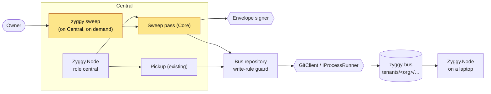
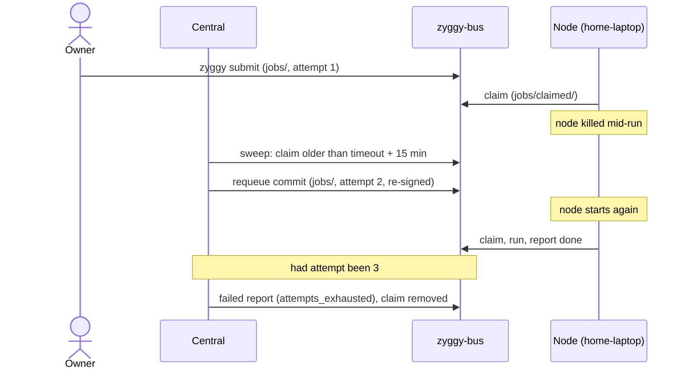
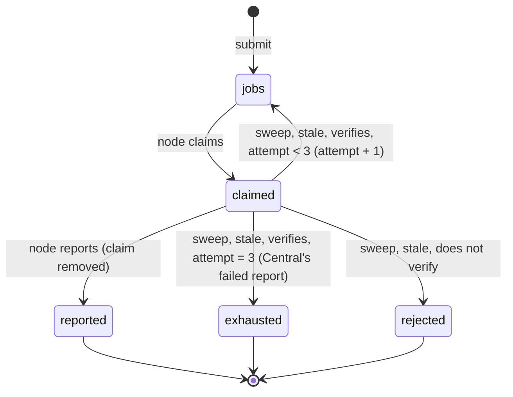

# Spec: 17 — The Central sweep: stale claims re-queued, three attempts, 14-day archive

## Status

- 2026-11-14: spec written. Not approved.
- 2026-11-14: critical read by a fresh reviewer, six blocking findings, all worked in: one rule for `attempt` above 3 (exhausted); the claim-time source, its failure case and AC-5a; the conflict recovery stated with AC-9a to AC-9c and Q2; the audit's rules for a re-queued job read from the code (no auditor change); observables and exit codes 6 and 7 covered (AC-10a, AC-16a); public surface and the shared write path marked as risk areas. Slices split from six to eight.
- 2026-11-14: owner decisions taken in the interview (recorded under Decisions, D1–D4): the sweep runs inside the node service on Central, with no model call and no systemd timer; the third stale claim ends in a `failed` report with the new reason `attempts_exhausted`; a node's late result for a re-queued claim is dropped and the job runs again; a stale claim that does not verify is rejected by Central. The roadmap update travels on this feature's branch.

- 2026-11-14: **approved by the owner**, including the founding-spec wording under Decisions (pasted in slice 8) and both recommendations on the open questions: Q1 — the seed file `archive/.gitkeep` is removed from the real bus by hand at release, `zyggy verify` is not changed; Q2 — the conflict recovery is approved as written, slice 4 starts with the git probe and stops for a spec change if git does not stop the rebase in that collision.
- 2026-11-15: **slice 1 built** (Central decides what happens to each stale claim, through the seams). Proof: 34 unit tests in the `SweepClaims` filter green; Verification Commands green (build, unit, integration, format; 0 warnings); golden files untouched. Independent slice check: every criterion's test failed when its behavior was broken; its two coverage gaps (an unexpected exception inside the pass; the guard on the exhausted write) were closed with tests seen failing first. Decisions, approved with the approach: stale means strictly older than the limit; "verifies" also covers type `job` (a mismatch of type or id is `malformed`, of `to` is `wrong_recipient`, no new reason); the signing key is checked once per pass and only when a claim is stale, and without it no claim is touched, a rejection without a report included; the exhausted report body is `machine:`, `attempts:`, `claimed:`. Public so far: the pass's result (`SweepResult`, `SweepAction`, `SweepActionKind`); the registration comes with the verb in slice 2. The pass does not pull by itself: each write pulls, and the pull before a pass belongs to the verb and the node (slices 2 and 7).
- 2026-11-15: **slice 2 built** (`zyggy sweep` re-queues a stale claim on a local bare repo and a node runs it). Proof: 5 integration tests in the `SweepRequeue` filter green, seen failing first (unknown verb); 1 unit test of the registration; Verification Commands green (build, 6251 unit and 929 integration passed, format; 0 warnings). Independent slice check: every criterion's test failed when its behavior was broken; its finding that AC-8 did not show the attempt intake accepted was closed with an assertion on the node's claim commit (`attempt` 2), seen failing at attempt 4. Decisions, approved with the approach: the pass itself is public (internal constructor, one run method, like the pickup) because the CLI cannot see Core's internals (Constraints updated); there is no `role` key, so Central is the machine named `central`, as for the pickup, and the refusal line is the spec's; `BusRepository.BusyDetail` became public so the verb tells a busy lock (exit 4) from a failed pull (exit 6). The summary prints `0 archived` until slice 6; `--dry-run` comes with slice 6.

## Goal

**As** the owner, **I want** Central to put a job back in the queue when the machine that claimed it died, to give up after three attempts with a report that says so, and to move old reports and context files out of the live folders, **so that** no job stays stuck without an answer and the bus stays small. This is part 3 of the P2 gate (registry → worktree → sweep) and closes P2.

Today a claim whose node was killed mid-run stays in `jobs/claimed/` until that node starts again and resumes it; a claimed file that no longer verifies stays there forever ("left for the sweep"); `reports/` and `context/` files the pickup does not take are never moved; the `attempt` field is parsed, signed and always `1`.

## Context

- **Roadmap entry**: `_plans/ROADMAP.md` #17.
- **Founding-spec sections**: §4 Bus protocol (layout, write rules, envelope `attempt`, mandatory fields, canonical form and re-signing, state machine rows 4 and 6); §5 Git operations (write sequence, commit subjects, claim resume); §10 Central units and `node.json`; §11 Alerts, Runbooks; §9 design rules; §12 definition of done; §13; §14.
- **Reference feature**: Central's pickup in the dream-reads-the-bus feature (`_specs/13-dream-pass.md`). It is closer than the default reference (routing by project name): the pickup is the existing Central-only pass that runs inside the node service after a pull, verifies files of other machines, moves them to `archive/` in one commit and writes Central's own signed reports, never calling a model and never throwing to the loop. The sweep is its sibling. Routing by project name (`_specs/14-discovery-registry-routing.md`) stays the reference for the hourly in-process timer and the CLI verb + gate shape.
- **Facts verified in the code on 2026-11-14** (files read):
  - `attempt` is an optional job field, default `1`, written by the envelope writer and read by the parser; the job submitter always writes `1` and its read-back refuses any other value. Nothing else reads it.
  - `BusPaths` already produces `archive/YYYY-MM`, `jobs/claimed` and `jobs/rejected` paths and parses them back.
  - The pickup lists `context/`, `reports/` and `items/` of every machine except Central, archives by the envelope's `created` month in one commit `<tenant> archive <n> central→archive`, and leaves (with one warning) every file that fails verification or a writer rule.
  - Every bus write runs under the checkout write lock and starts with a pull; a node's report write removes its claimed file in the same commit, so after a re-queue that write fails at the remove step and is logged (the node spec's edge case "the sweep re-queues a job this node is still running").
  - A re-run worktree job reuses an existing local branch `zyggy/<id>` and removes a leftover worktree folder (worktree execution spec, Behavior). The sweep needs no worktree rule of its own.
  - A node resumes its own verifying claims at start; a non-verifying one is left with the warning `claimed job {Id} does not verify; left for the sweep`.
  - The reason an item refusal carries (`archive_refused`) is written only by Central's pickup and is listed in §4, not in the runner's reason enum. `attempts_exhausted` follows that precedent.
  - The gate file `Gates/P2_RegistryWorktreeSweep` has parts 1 and 2 and reserves part 3 for this feature.
  - `deploy/systemd/` ships no sweep unit; the founding spec's `agent-sweep.timer` was never built.
  - The audit behind `zyggy verify` checks a file in `jobs/`, `jobs/claimed/` or `jobs/rejected/` for: parses, signature valid under a key of the tenant, file name = `id`, type `job`, `to` = the folder's machine. It does not compare `from` with anything and does not look at `attempt`. A re-queued job signed by Central therefore passes it unchanged; no auditor change is part of this feature.
  - The parser accepts any `attempt` of 1 or more; there is no maximum.
  - `GitClient` is internal to Core. It has no operation that returns the time of the last commit touching a path; this feature adds one (internal).
  - The bus repository's bus-write path does not abort a stopped rebase anywhere; only the memory publisher does. A rebase left in progress makes the next node start refuse (`RebaseInProgress`).
  - This repository has no scripted comparison of `PROTOCOL.md` against §4 (`PROTOCOL.md` lives in `zyggy-core`).
- **In this spec, "verifies"** means the audit's checks above: parses as a job, signature valid for the tenant, file name = `id`, `to` = the folder's machine.
- **Not verified**:
  - What git does when `pull --rebase` meets a local commit and a remote commit touching the same claimed file (a node's report against Central's re-queue). Expected from git's rules: a rename/delete conflict that stops the rebase. A probe in a scratch repository was not run in the spec session (the command was declined). See Q2; slice 4 runs that probe before any code.
  - Whether a claim a node resumed outside its work hours can wait in `jobs/claimed/` longer than the limit. If it can, the sweep re-queues it once and it then waits unclaimed; no rule is added for it.

## Constraints

- ⚠️ **§4 shared contract — state moves and write rules.** Central becomes a writer in other machines' `jobs/`, `jobs/claimed/` and `jobs/rejected/`, for stale claims only. The reviewer verifies: no other new write, every move inside one tenant subtree, the write-rule guard in the bus repository refuses anything else, and nothing moves a claim that is not stale.
- ⚠️ **Signing.** A re-queued job is rewritten and re-signed. The reviewer verifies: the only field that changes is `attempt` (plus `key_id` and `sig`), the body is byte-for-byte the same, `EnvelopeSigner.Canonicalize` and its golden files are untouched, a file that does not verify is never re-signed.
- ⚠️ **§4 reason list.** One new report reason, `attempts_exhausted`, written only by Central's sweep. `PROTOCOL.md` changes with §4.
- ⚠️ **§5 commit subjects.** One new action word, `requeue`.
- ⚠️ **Shared write path.** The bus write sequence every machine uses gains a recovery for a rebase that stops on a conflict (Behavior, "Conflicting commits"). The reviewer verifies: it triggers only on a stopped rebase, never force-pushes, never discards a commit that rebases cleanly, and leaves no rebase in progress.
- ⚠️ **Public surface and `node.json`.** Public in Core: one registration extension for the sweep, the pass itself (public type, internal constructor, one public run method, like the pickup — the CLI cannot see Core's internals) and the pass's result as the verb prints it; everything else (the repository's sweep writes, the git query for a path's last commit time) is internal. `node.json` gains `sweep.intervalMinutes`. Not a sixth seam.
- ⚠️ **Founding spec.** §4, §5 and §10 change (wording under Decisions; pasted only after the owner approves it).
- §9: bus paths only through `BusPaths`; git only through `GitClient` / `IProcessRunner`; time through `TimeProvider`; the pass never throws to the loop; no static state; log once per state change, never per pass; envelope bodies are data and are never shown to a model — the sweep calls no model at all.
- Idempotent: a second pass over an unchanged bus writes nothing.
- MVP scope: one tenant, taken from `node.json`; no loop over tenants, no per-tenant sweep settings.
- Public repo: placeholders only (`acme`, `home-laptop`).

## Diagrams

### Components touched

### Round trip: a claim goes stale

### Job states with the sweep

### Slice map

## Behavior

### The pass

One sweep pass does, in this order, under the tenant of `node.json`:

1. **Stale claims.** For every machine folder of the tenant (Central's included), every file in `jobs/claimed/`:
   - **Claim time** = the committer time of the newest commit on the bus branch, as pulled, that touched the claimed path (`git log -1` for the path, committer date). The envelope cannot supply it: `created` is the submit time, and a job may wait in `jobs/` for days before it is claimed. The bus checkout is a full clone. A claim commit a node rebased before pushing carries the rebase time, which is later, so the claim is never judged stale early.
   - Claim time unreadable (the git query fails or returns nothing): the claim is untouched this pass; one Warning per claim per process.
   - **Limit** = the job's `timeout_minutes`; when the field is absent or the file cannot be parsed, Central's own `claude.defaultTimeoutMinutes` (30 unless set); plus 15 minutes.
   - Not older than the limit by Central's clock: untouched. Clocks: the claim time is the claiming node's clock, the comparison Central's; a node whose clock runs ahead is re-queued that much later, one running behind that much earlier, and the 15-minute grace is the only allowance.
   - Older, verifies, `attempt` below 3: **re-queued**. The file is written to that machine's `jobs/` with `attempt` raised by one and signed with Central's `signWith` key; every other field and the body are unchanged (`from` stays the original sender); the claimed file is removed. One commit per job.
   - Older, verifies, `attempt` 3 or more: **exhausted**. Central writes a report in its own `reports/` folder — `from: central`, `to` the job's `from`, `in_reply_to` the job id, `status: failed`, `reason: attempts_exhausted` — and removes the claimed file. One commit per job. The report body is three data lines: the machine, the attempt count, the claim time.
   - Older, does not verify: **rejected**. The file moves unchanged to that machine's `jobs/rejected/`; when its `from` can be read, Central adds a `status: rejected` report in its own folder with the §4 rejection reason, `in_reply_to` the file name, `to` that `from`. One commit per file. It is never re-signed and never re-queued.
2. **Archive.** Every file in `reports/` and `context/` of every machine folder (Central's included) that is older than 14 days moves to `archive/YYYY-MM/`, all in one commit for the pass.
   - Age and month come from the envelope's `created`. For a file whose `created` cannot be read, both come from the commit that added the file.
   - A file the pickup still takes (verifies, written by another machine, addressed to Central) is skipped, whatever its age.
   - `items/` and `jobs/` folders are never archived.

A pass that finds nothing writes nothing and logs nothing.

### Where it runs

- **In the node service on Central** (`role: central`): the first pass after the start-up pull and pickup, then one pass every `sweep.intervalMinutes`, each right after a pickup pass. A node with `role: node` never sweeps.
- **On demand**: `zyggy sweep` runs the same pass once.
- Both take the checkout write lock every bus write takes, so a pass never interleaves with the pickup or the node's own writes.

### After a re-queue, on the node

- The node treats the re-queued file as any new job: verify, claim, run, report. Its report is a normal report; `attempt` is not copied into it.
- **Late result (D3).** A node that still holds a result for a claim Central re-queued cannot write its report: its write starts with a pull, the claimed file is gone, the remove step fails, the change is restored (existing behavior), one warning, the result is dropped, and the re-queued copy runs as the next attempt.
- A worktree job's next attempt reuses the branch `zyggy/<id>` if the previous attempt left one (existing behavior).

### Conflicting commits

The narrow case the pull-first rule does not cover: a machine has committed locally and, before its push, the other side pushed a commit touching the same claimed file. The push is rejected and the `pull --rebase` of the retry stops on a conflict. The bus write sequence then, on any machine:

1. aborts the rebase;
2. drops its own conflicting commit (the local branch goes back to where it was before that write), keeping earlier unpushed commits;
3. pulls again, logs one Warning naming the commit subject, and returns a failed write.

Outcomes by order:

| Pushed first | Loser | Result |
| --- | --- | --- |
| Central's re-queue | the node's report commit | the node's result is dropped (as the late result above); the re-queued job runs again |
| The node's report | Central's re-queue (or exhausted, or rejection) commit | Central's commit is dropped; the job is reported; the next pass finds no claim |

Either checkout ends on the bus branch, clean, with no rebase in progress. Nothing is force-pushed.

### Envelope and bus

- `attempt`: first value other than `1` on the bus; raised only by the sweep, which never writes a value above `3`. The parser keeps accepting any value of 1 or more; a stale claim at 3 or above is exhausted.
- New report reason `attempts_exhausted`, only in reports written by Central's sweep.
- New commit subject `<tenant> requeue <id> central→<machine>` for a re-queue. The exhausted report uses the existing `<tenant> report <ulid> central→<from>`, the rejection the existing `<tenant> reject <id> central→<from>`, the archive commit the pickup's `<tenant> archive <n> central→archive` with one body line per move.
- New write rule: Central's sweep may move or remove a stale claim in any machine's `jobs/claimed/`, write the re-queued file into that machine's `jobs/`, and move a non-verifying stale claim into that machine's `jobs/rejected/`. Nothing else changes in the write rules.

### CLI

`zyggy sweep [--dry-run]`

- Runs one pass against the bus checkout of `node.json`, starting with a pull like every bus write. Only on a machine with `role: central`.
- `--dry-run`: does not pull; reads the checkout as it is, prints what a pass would do and writes nothing (no file, no commit, no push). Its first line is `checkout at <short sha>`.
- Output, one line per action, then a summary line:
  - `requeued <id> <machine> attempt <n>`
  - `exhausted <id> <machine> after <n> attempts`
  - `rejected <id> <machine> <reason>`
  - `archived <n> file(s), oldest created <timestamp>`
  - `sweep: <r> re-queued, <e> exhausted, <j> rejected, <a> archived` (always printed; with `--dry-run` prefixed `dry run:`)
- Exit codes (the CLI's existing numbers): `0` pass completed, also when there was nothing to do; `3` configuration refused, including `role` not `central`; `4` the checkout lock stayed busy; `6` a git step failed; `7` the pass committed but the push is deferred.

### Configuration

| Key | Where | Default | Override rule |
| --- | --- | --- | --- |
| `sweep.intervalMinutes` | `node.json`, read only when `role` is `central` | `60` | integer 1–1440; an invalid value refuses the start like every other `node.json` key |

The 15-minute grace, the three attempts and the 14 days are §4 values, not settings.

### Logging

Phase `sweep`, with `tenant` and `machine` on every line.

| Event | Level | Line |
| --- | --- | --- |
| Start on Central | Information | `sweep every {Minutes} min` (once) |
| Re-queue | Warning | `job {Id} on {Machine} stuck since {ClaimTime}: re-queued, attempt {Attempt}` |
| Exhausted | Error | `job {Id} on {Machine} failed after {Attempts} attempts` |
| Rejected | Warning | `claimed job {Id} on {Machine} does not verify ({Reason}): rejected` |
| Archive | Information | `archived {Count} file(s) older than 14 days, oldest created {Oldest}; {pushed or deferred}` |
| Pass could not write | Error | `sweep: failed at {Stage}: {Detail}` (once per streak) |

The re-queue and exhausted lines are the §11 alert conditions "Job stuck" and "Job failed 3×" as evaluated; delivery is the Telegram alerts feature.

### Failure modes

| Situation | Observable outcome | Runbook entry |
| --- | --- | --- |
| Checkout lock busy for the whole wait | pass skipped; one Error per streak; `zyggy sweep` exits 4; next interval retries | "Sweep: nothing happens" |
| A git step fails (move, commit) | that job's change is restored — the claimed file is back in place, `git status` is clean, no commit was made for it — and the pass continues with the next file; one Error per streak; `zyggy sweep` exits 6 | "Sweep: nothing happens" |
| Central's signing key absent or unusable | no claim is re-queued, exhausted or rejected with a report (nothing unsigned is written); archive still runs; one Error | "Sweep: cannot sign" |
| Push rejected after the retries | the commit stays local and goes with the next write (existing §5 rule); `zyggy sweep` exits 7 | existing "push deferred" |
| A remote commit touches the same claimed file as a local unpushed commit (node reported while Central re-queued, or the reverse) | "Conflicting commits": the later commit is dropped; the checkout ends clean on the bus branch with no rebase in progress; one Warning naming the commit subject | "Sweep: a job ran twice" |
| Claim time cannot be read | the claim is untouched; one Warning per claim per process | "Sweep: nothing happens" |
| A job reached three stale claims | `failed` / `attempts_exhausted` report from Central; Error line | "Job failed 3 times" |

### Edge cases

| Case | Expected behavior |
| --- | --- |
| Claim younger than its limit | untouched |
| Job without `timeout_minutes` on a machine whose own default is longer than Central's | may be re-queued while it still runs; the late result is dropped (D3). Runbook: give such jobs an explicit timeout |
| The claiming node is off for days | re-queued once; the file waits in `jobs/` at the raised attempt; no further attempt is used while it is unclaimed |
| Central's own stale claim | same rule as any machine |
| Stale claim whose `attempt` is above 3 | exhausted, like 3 |
| Stale claim whose `attempt` is not a positive integer | does not parse as a job (invalid field) → rejected |
| Report or context file addressed to another machine than Central, older than 14 days | archived |
| Central's own reports and context, older than 14 days | archived |
| File in `reports/` or `context/` that does not parse | archived 14 days after the commit that added it, month of that commit |
| Second pass on an unchanged bus | no commit |
| `zyggy sweep` on a laptop | exit 3, one line `sweep: only Central sweeps (role is node)` |
| `zyggy status --id` for a job with a re-queue and two reports | unchanged: it already lists every report (CLI status spec) |

## Decisions

| Founding-spec item (section) | Verdict | Why |
| --- | --- | --- |
| `agent-sweep.timer` submits a sweep job whose body runs `agentbus sweep` (§10) | **reshape** (D1, owner 2026-11-14) | A model run every hour to move files adds cost and a Bash permission and nothing else. The pickup already runs in the node service without a model; the sweep joins it and shares its lock. No unit, no timer. |
| `agentbus sweep` verb (§3, §10; roadmap O6) | **keep** | On-demand pass and `--dry-run` for the owner; the review check of two slices. |
| Stale claim → `jobs/`, `attempt: n+1` (§4 row 4) | **keep**, wording made exact | Claim time, the limit when `timeout_minutes` is absent and the re-signing key were unstated. |
| "After 3 attempts → report `status: failed`" (§4 row 4) | **reshape** (D2) | Needs a reason, since `reason` is mandatory when not `done`: new `attempts_exhausted`, written by Central into its own `reports/`. |
| Re-sign after a field change (§4 canonical form) | **keep** | Central signs with its own `signWith`; keys are per tenant, so every node verifies it. |
| "A claimed file that no longer verifies is left for the sweep" (§5) | **keep**, defined (D4) | Rejected by Central like a bad incoming job; never re-signed. |
| A node's late result after a re-queue (node spec edge case) | **keep** (D3) | Dropped, job runs again; no new node logic and no new state move. |
| `reports/`, `context/` older than 14 days → `archive/YYYY-MM/` (§4 row 6) | **keep** | Age and month from `created` (same rule as the pickup); one commit per pass. |
| "Every move one commit" (roadmap) | **reshape** | One commit per job for claims (each names its job id in the subject, so the history answers "what happened to job X"); one commit per pass for archive moves, as the pickup does. |
| Pickup before sweep (forwarded from the dream-reads-the-bus spec) | **keep**, both ways | The pass follows a pickup pass in the node, and it skips files the pickup still takes, so `zyggy sweep` run alone is also safe. |
| Alert conditions "Job stuck", "Job failed 3×" (§11) | **reshape** | Evaluated as the sweep's own log lines; no stored alert state. Delivery belongs to the Telegram alerts feature. |
| Alert condition "Node silent" (§11) | **defer** | Not a sweep result; without delivery it would be a log line nobody reads. Goes with the Telegram alerts feature. |
| Per-machine default timeout known to Central | **defer** | Would need the value in the registry file; one owner sets the same default everywhere. Runbook note instead. |
| Archiving `jobs/rejected/` | **defer** | Not in §4; rejected files are rare and are the evidence of a refusal. |

No new package.

**Founding-spec wording proposed** (pasted only after approval):

- **§4 Write rules**, new bullet after "Only Central writes `archive/`…":
  > - Central's sweep is the only writer besides the target node that moves files in a machine's `jobs/` folders: it writes a stale claim back into that machine's `jobs/` with `attempt` raised and re-signed, removes a stale claim it answers with its own report, and moves a stale claim that does not verify into that machine's `jobs/rejected/` (deliverable 17).
- **§4 State machine**, the row "`jobs/claimed/` older than `timeout_minutes` + 15 min" replaced by three rows:
  > | `jobs/claimed/`, claimed more than `timeout_minutes` + 15 min ago (the claim commit's time; Central's `claude.defaultTimeoutMinutes` when the field is absent), verifies, `attempt` < 3 | `jobs/` | Central (sweep) | rewrite with `attempt: n+1`, re-sign with Central's `signWith`, `git mv`; one commit per job |
  > | the same, `attempt` = 3 | removed; `reports/<ulid>.md` in Central's folder, to the job's `from`, `in_reply_to` = job id, `status: failed`, `reason: attempts_exhausted` | Central (sweep) | add report + `git rm`; one commit per job |
  > | the same age, does not verify | `jobs/rejected/` of the same machine; when `from` is readable, a `status: rejected` report in Central's folder with the rejection reason | Central (sweep) | `git mv` (+ add report); one commit per file |
- **§4 State machine**, the row "`reports/`, `context/` older than 14 days" replaced by:
  > | `reports/`, `context/` whose `created` is more than 14 days ago (unreadable `created`: added more than 14 days ago), except files the pickup still takes | `archive/YYYY-MM/` (same tenant prefix, month of `created`, or of the adding commit) | Central (sweep) | `git mv`, one commit per pass |
- **§5 Git operations**, in the write-sequence sentence, `<action>` list: add `requeue` ("`requeue` (Central's sweep, `central→<machine>`)"); after the pickup's commit sentence: "Central's sweep archives with the same subject and body shape."
- **§10 Central units**: replace "`agent-sweep.timer` (hourly, submits a sweep job whose body runs `agentbus sweep`: stale claims, retries, archive, alert conditions)" by "no sweep unit: the node service on Central runs the sweep itself every `sweep.intervalMinutes`, and `agentbus sweep` runs one pass on demand (deliverable 17)".
- **§10 `node.json`** example, new line: `"sweep": { "intervalMinutes": 60 },   // Central only: how often the node service sweeps stale claims and old files (deliverable 17)`.

## Acceptance criteria

| # | Criterion | Check |
| --- | --- | --- |
| AC-1 | Given a claim younger than `timeout_minutes` + 15 min, a pass leaves it untouched; given one a second older, it acts. The limit uses Central's default timeout when the field is absent. | Unit test with `FakeTimeProvider`, both sides of the boundary and the absent-field case |
| AC-2 | A stale verifying claim with `attempt` 1 or 2 is written to the machine's `jobs/` with `attempt` + 1, signed with Central's key, verifying; every other front-matter field and the body are identical; the claimed file is gone; the commit subject is `<tenant> requeue <id> central→<machine>`. | Unit test (fields, signature); integration test (bare repo: paths and commit subject on the remote) |
| AC-3 | A stale verifying claim with `attempt` 3 is removed and Central's report exists in `nodes/central/reports/`: `status: failed`, `reason: attempts_exhausted`, `in_reply_to` the job id, `to` the job's `from`, verifying. | Unit test; integration test (bare repo) |
| AC-4 | A stale claim that does not verify is moved unchanged (same bytes) to that machine's `jobs/rejected/`; with a readable `from`, Central's `rejected` report carries the §4 reason; it is never re-signed. | Unit test (one case per unreadable / readable `from`); integration test |
| AC-5 | Without a usable signing key no claim is moved, removed or reported, one Error is logged, and the archive step of the same pass still moves its files. | Unit test asserting both halves |
| AC-5a | A claim whose claim time cannot be read is untouched and logged once per process; the other claims of the pass are still handled. | Unit test with a process runner whose path-log query fails for one path |
| AC-6 | The write-rule guard lets Central make exactly the sweep's moves and refuses them for a machine that is not Central and for a claim in another tenant's subtree. | Unit test on the guard |
| AC-7 | A second pass over the result of a first writes no commit. | Integration test: commit count on the remote unchanged |
| AC-8 | A node receiving the re-queued job claims it, runs it and reports `done`; the job with `attempt: 2` is accepted by intake. | Integration test: real listener, `tools/fake-claude`, bare repo |
| AC-9a | Central's re-queue is pushed while a node holds an unpushed report commit for the same claim: the node's write returns failed, its checkout is on the bus branch, `git status` clean, no rebase in progress, its report is not on the remote, one Warning names the commit; the re-queued job is then claimed and run. | Integration test: two checkouts of one bare repo, real git |
| AC-9b | A node's report is pushed while Central holds an unpushed re-queue commit for the same claim: Central's write returns failed, its checkout is on the bus branch, clean, no rebase in progress; the remote holds the report and no file for the job in `jobs/`; the next pass writes nothing. | Integration test: two checkouts of one bare repo, real git |
| AC-9c | An earlier unpushed commit that rebases cleanly survives the recovery and is pushed with the next write. | Integration test: a deferred commit on another path before the conflicting one |
| AC-10 | After a pass with a re-queue, an exhausted report, a rejection and an archive move, `zyggy verify` reports no drift caused by them. | Integration test: `zyggy verify` on the swept bare repo |
| AC-10a | `zyggy sweep` exits 6 when a git step of the pass fails and 7 when the pass committed but the push stayed rejected; in the first case the claimed file is still in place, `git status` is clean and the remote has no new commit. | Integration test through the verb: a remote that refuses pushes (7); a process runner that fails the move (6) |
| AC-11 | `reports/` and `context/` files with `created` more than 14 days ago are selected; younger ones are not; a file the pickup still takes is never selected; `items/` and `jobs/` are never selected; an unparsable file is selected by its adding commit's date. | Unit test with `FakeTimeProvider`, one case per rule |
| AC-12 | The archive move puts each file under `archive/<YYYY-MM of created>/` in one commit `<tenant> archive <n> central→archive` with one body line per move; file bytes are unchanged; a file that does not parse lands in the month of the commit that added it. | Integration test (bare repo): paths, commit subject and body, blob ids equal, one unparsable file |
| AC-13 | `zyggy sweep` prints the action lines and the summary and exits 0; `--dry-run` prints `checkout at <sha>`, the same actions and the `dry run:` summary, does not pull, and leaves the remote, the checkout's HEAD and its working tree unchanged. | Integration test through the verb; `zyggy sweep --dry-run` against a local bare repo |
| AC-14 | `zyggy sweep` with `role: node` exits 3 with the one line and writes nothing; a busy lock exits 4. | Integration test through the verb |
| AC-15 | The node service with `role: central` runs a pass after start and again after `sweep.intervalMinutes`, each after a pickup pass; with `role: node` it never does; an out-of-range `sweep.intervalMinutes` refuses the start. | Integration test through the real node host with a fake clock; unit test of the configuration reader |
| AC-16 | The sweep never throws to the caller: when a git step fails for one claim, the pass returns a result, the remaining claims are handled, and one Error is logged per streak. | Unit test with a process runner failing one step |
| AC-16a | A pass that fails inside the node service leaves the host running: `/health` still answers and the next interval runs a pass. | Integration test through the real node host |
| AC-17 | Each log line in the Logging table is written once per event with `tenant`, `machine` and phase `sweep`; an empty pass logs nothing. | Unit test on captured log entries |
| AC-18 | Gate P2 part 3: with tenant `acme`, a job claimed by a node that is then stopped is re-queued by Central's pass after the clock moves past the limit, is run by the restarted node and reported `done`; a job stale at `attempt: 3` ends in Central's `attempts_exhausted` report shown by `zyggy status --id`; a 15-day-old report is in `archive/`; `zyggy verify` is clean. | Gate scenario `Gates/P2_RegistryWorktreeSweep` part 3 |
| AC-19 | `PROTOCOL.md` in `zyggy-core` equals §4 after the approved wording is pasted. | A text diff of `PROTOCOL.md` against the §4 section of the founding spec, run for the `zyggy-core` pull request; its empty output is pasted into Status |
| AC-20 | Runbook rows exist for "Job failed 3 times", "Sweep: nothing happens", "Sweep: cannot sign", "Sweep: a job ran twice"; the Core, Cli and Node READMEs describe the sweep, the verb and the `sweep.intervalMinutes` key. | Hygiene test asserting the runbook row titles and the verb in the READMEs |
| AC-21 | No published string, fixture or doc of this feature carries a real machine name, tenant or id. | The existing source-hygiene test, extended fixtures included |
| AC-22 | On the real machines: a job submitted to the home laptop with a 1-minute timeout, the laptop's node stopped mid-run; after 16 minutes `zyggy sweep` on Central prints `requeued <id> home-laptop attempt 2`; the laptop's node, started again, reports `done`. | Owner-run at release, evidence in Status |

## Slices

| # | Slice | Criteria | Review check |
| --- | --- | --- | --- |
| 1 | ⚠️ Central decides what happens to each stale claim — re-queue with a re-signed `attempt`, exhausted report, rejection — through the seams (Fake) | AC-1, AC-2 (fields), AC-3, AC-4, AC-5 (claims half), AC-5a, AC-6, AC-16, AC-17 | `dotnet test tests/Zyggy.Core.Tests --filter "FullyQualifiedName~SweepClaims"` |
| 2 | ⚠️ `zyggy sweep` re-queues a stale claim on a local bare repo and a node runs the re-queued job (Wire) | AC-2 (wire), AC-7, AC-8, AC-14 | `dotnet test tests/Zyggy.Integration --filter "FullyQualifiedName~SweepRequeue"` |
| 3 | ⚠️ `zyggy sweep` ends a third stale claim with Central's report and rejects a claim that does not verify (Wire) | AC-3, AC-4 (wire), AC-10, AC-10a | `dotnet test tests/Zyggy.Integration --filter "FullyQualifiedName~SweepSettle"` |
| 4 | ⚠️ A report and a re-queue of the same claim, pushed at the same moment, leave both checkouts clean (Wire; starts with the git probe of Q2) | AC-9a, AC-9b, AC-9c | `dotnet test tests/Zyggy.Integration --filter "FullyQualifiedName~SweepConflict"` |
| 5 | Central selects the reports and context files to archive (Fake) | AC-11, AC-5 (archive half) | `dotnet test tests/Zyggy.Core.Tests --filter "FullyQualifiedName~SweepArchive"` |
| 6 | `zyggy sweep` archives old files in one commit, and `--dry-run` shows a pass without writing (Wire) | AC-12, AC-13 | `zyggy sweep --dry-run` then `zyggy sweep` against a local bare repo (steps in the slice report); the `SweepArchive` integration tests are its proof |
| 7 | ⚠️ The node service on Central sweeps after start and every `sweep.intervalMinutes` (Wire; `node.json` key) | AC-15, AC-16a | `dotnet test tests/Zyggy.Integration --filter "FullyQualifiedName~SweepHost"` |
| 8 | ⚠️ P2 closes: gate part 3 green; with it the runbooks and READMEs, the founding-spec wording pasted, the `PROTOCOL.md` pull request | AC-18, AC-19, AC-20, AC-21 | `dotnet test tests/Zyggy.Integration --filter "FullyQualifiedName~P2_RegistryWorktreeSweep"` (the proof also runs the hygiene tests of AC-20 and AC-21 and the diff of AC-19) |

AC-22 is owner-run at release.

## Out of scope

- Delivery of any alert, the "Node silent" condition, stored alert state (Telegram alerts feature).
- A systemd timer or a bus job for the sweep.
- Retrying a job that already has a report (`failed`, `timeout`, any reason): a report is final.
- Publishing a machine's default timeout to Central.
- Archiving `jobs/rejected/` or `items/`; pruning `archive/` itself.
- `lastSweepUtc` in `/health` or in `zyggy status`.
- A sweep on any machine but Central; a second tenant.
- `zyggy run` and the direct fast path (their own roadmap entry).

## Open questions

Both answered by the owner at approval (2026-11-14): option (a) each. Kept for the reasoning; an owner-run step at release removes the seed file.

- [x] **Q1 — the seed file `archive/.gitkeep`.** Found: `zyggy verify` reports `unexpected_path` for `tenants/<org>/archive/.gitkeep` on the real bus (worktree execution spec, Status 2026-11-13); present since the October seed. Why it matters: AC-22's bus will show that drift line next to the sweep's results, and once the sweep creates month folders the seed has no purpose. Options: (a) remove the file from the real bus by hand at release (one `git rm`, no code); (b) teach `zyggy verify` to accept `.gitkeep` directly under `archive/`. Recommendation: (a) — no product behavior changes, and the seed is not part of §4.
- [x] **Q2 — recovery when a report and a re-queue collide.** Found: the bus write path never aborts a stopped rebase (only the memory publisher does), and a rebase left in progress makes the next node start refuse. Git's behavior for this exact collision (a rename with an edit on one side, a delete on the other) was not probed in the spec session: the scratch-repository command was declined. Why it matters: the recovery under "Conflicting commits" changes the write path every machine uses, including a node's report. Options: (a) approve the recovery as written; slice 4 starts with the probe and stops for a spec change if git does not stop the rebase there (for example, if it applies both commits and leaves a report next to a re-queued job); (b) run the probe before approving. Recommendation: (a) — the required end state (clean checkout, no rebase in progress, nothing forced) holds whatever the probe shows, and the build cannot pass AC-9a to AC-9c without it.
