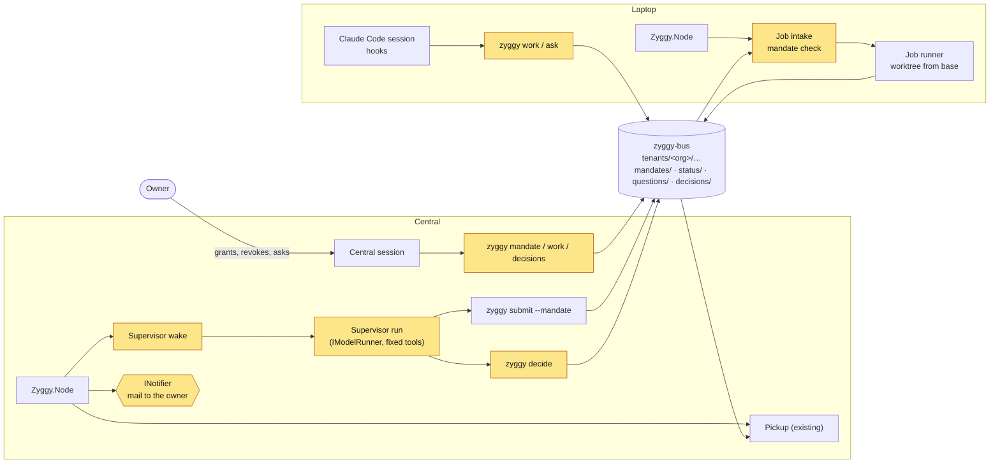
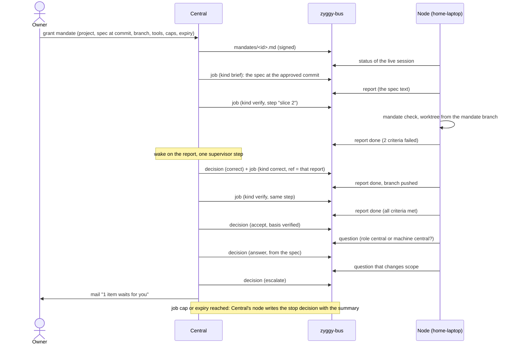
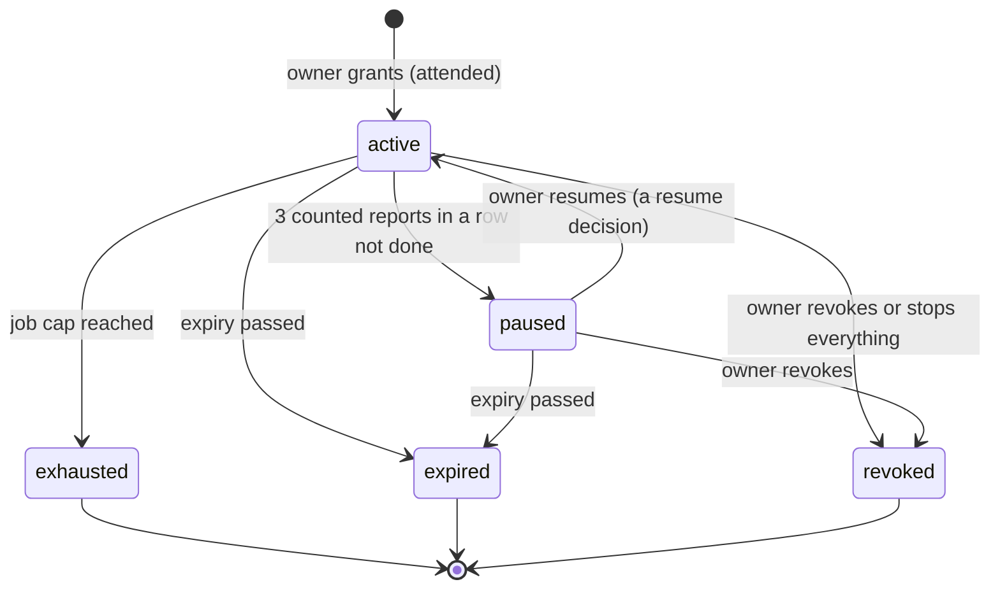
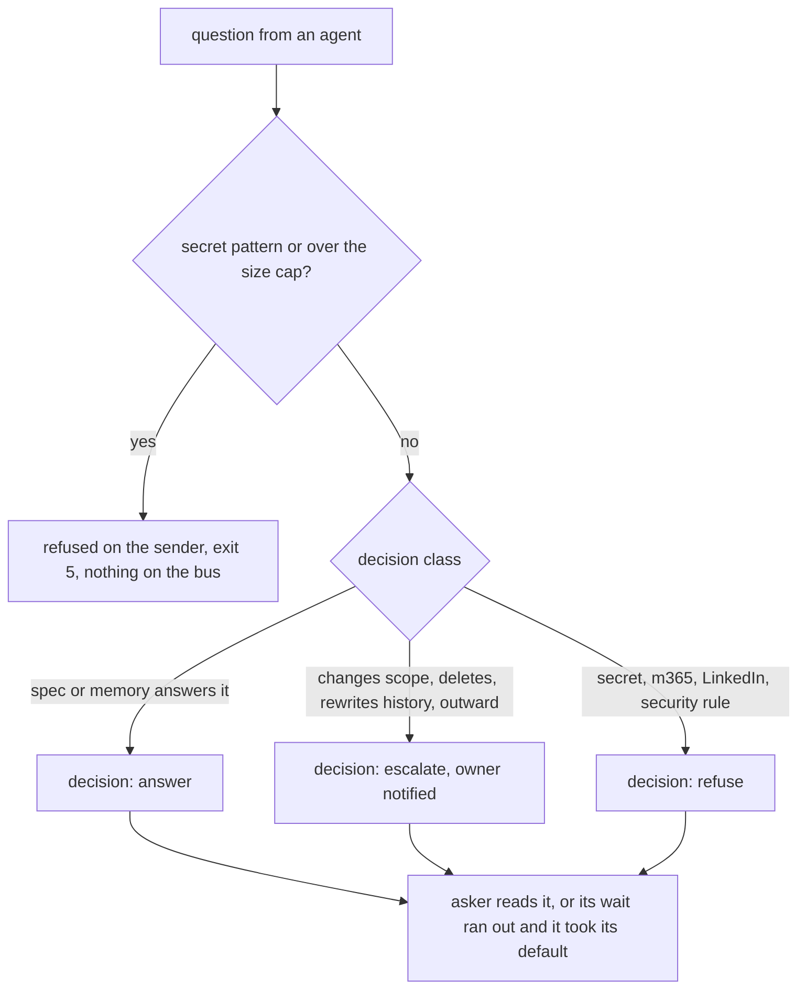

# Spec: 18 — Central supervises and coordinates the owner's agents

## Status

- 2026-11-15: spec written from the handover `_specs/handover-central-supervision.md`. Not approved.
- 2026-11-15: owner decisions taken in the interview (recorded under Decisions, D1–D8): this deliverable is number 18 and "Policy as data" moves to 44; the Central sweep is finished and released first; `work-laptop` is supervised in this deliverable with narrow built-in limits; Central may also send work into a live session; a merge, release or deploy needs the owner's words in a conversation or an explicit line in the mandate; the decision classes are a fixed list plus the mandate, no `policy.yaml`; the owner is told by a mail to himself; a supervised job may push the mandate's feature branch and `zyggy/<id>` branches.
- 2026-11-15: critical read by a fresh reviewer, nine blocking findings, all worked in: a work machine's status defaults to the fixed fields; the read restriction is named as a new guard capability with its own slice; how a grant is confirmed is Q6; pause and resume have a stored form and one counting rule (AC-11, AC-12); a job under a mandate has no free-text body, only a template kind and a reference; a late decision has one route (session start); Central's two writes into other machines' folders have guard rules; `zyggy verify` support moved into the slices that add each folder; documents and founding-spec wording travel with each of the three groups. Slices went from thirteen to fifteen.
- 2026-11-15: **approved by the owner**, including the founding-spec wording under Decisions (pasted with the group that builds it) and the recommended option on each open question: Q1 — `work-laptop` gets visibility, questions and session tasks here, and jobs run by its node wait for the product-node entry; Q2 — the owner confirms the employer's policy before the owner-run check on `work-laptop`, the build does not wait; Q3 — the live-session slice starts with the hook probe and stops for a spec change if it fails; Q4 — the mail is sent for a work-machine item, without project name or text; Q5 — three releases, one per group; Q6 — a grant is confirmed by the permission prompt, with the mandate shown in full and every grant named in the next mail. The handover is committed unchanged at the owner's request.
- 2026-11-15: the owner asked to start the build before the Central sweep is released, in a worktree of its own (`feature/18-central-supervision` from `main`). This replaces D2 for group A, which needs no sweep code; the branch is rebased on `main` when the sweep merges. Built in the session that wrote the spec, not a fresh one.
- 2026-11-15: **slice 1 built** (a session's state becomes a signed status only its own machine may write, through the seams). Proof: 85 unit tests in the `WorkStatus` filter green, seen failing first (the status types did not exist); Verification Commands green (build, unit, integration, format; 0 warnings); the existing golden files untouched, one new golden case `status` (canonical form by hand, signature by openssl). Independent slice check: every break it made was caught by a test except removing the path guard in the publish write, which cannot fire there because the path is built from the machine's own identity; it is kept as the second line of defence the context write also has. It did not break the "another machine's files never touched", "other session kept" and other-tenant cases; their tests exist. Decisions, approved with the approach: field shapes — `project` 1–100 of `[a-z0-9-]`, `session` 8 of `[a-z0-9]`, `branch` 1–200 without control characters, `head` 7–40 lowercase hex, `dirty` ≥ 0, `spec` a repository-relative path with `/` separators and no `..`, `step` as the spec says; an empty optional value counts as absent (the envelope's existing null rule); under `detail: fixed` the five extra values are dropped before the secret check, so they are never refused and never written; hooks-off is a flag the caller passes (Core does not read the environment); a status file older than 24 hours is judged by the time in its id; removing a session's status when there is none writes nothing. Public so far: the status fields, the publisher with its request, options and results (internal constructor; registration comes with the verb in slice 2), `SupervisionSettings` and `SupervisionDetail`. `node.json` keys read: `supervision.enabled`, `supervision.statusMinutes`, `supervision.detail`. Not in this slice, as planned: `zyggy verify` for the status folder (AC-9, slice 2), the `statusMinutes` throttle, the hook verb, the README rows.
- 2026-11-15: **slice 2 built** (`zyggy work` on Central shows a laptop session and its jobs over a local bare repo). Proof: 20 integration tests in the `WorkStatus` filter green through the real verb, real git and two checkouts, seen failing first (the verb did not exist); 131 unit tests under the same filter and the auditor's; Verification Commands green (build, 6339 unit and 944 integration passed, format; 0 warnings). Two failures seen once and not again: one unnamed integration test in the first full run (a complete rerun passed) and the discovery loop's `ScanThrows` unit test (passed three reruns; registry code untouched) — both taken as timing flakes on a loaded machine. Independent slice check: pass; eleven breaks, each caught by a test. Its gaps: the auditor's "status not addressed to Central" rule had no test — the rule was unreachable (the parser refuses such a status first), so it was removed and a test now shows the parser's refusal reaching `zyggy verify`; it did not break the same-session replace, the signature check alone or the last-report line, whose tests exist. Decisions, approved with the approach: the hook logic sits in Core behind one public class because the CLI cannot see Core's internals; hook lines are wired in `zyggy-core` (slice 4), so no machine publishes yet; laptop setup now also denies the three `zyggy work` hook modes; `--step` needs `--session <id>`; a job's age is counted from its creation, since the claim time needs a git query that arrives with the Central sweep; `supervision.workMachines` is read on any machine that lists. Hook failures are reported once per streak through a flag in the session's local state. `zyggy work` does not print the mandate, the waiting list or "waiting for Central" yet: those come with the slices that create them.
- 2026-11-15: **slice 3 built** (a question and Central's decision exist as signed envelopes with their limits, through the seams). Proof: 96 unit tests in the `AskDecide` filter green, seen failing first (the types did not exist); Verification Commands green (build, unit, integration, format; 0 warnings); two new golden cases `question` and `decision` (canonical form by hand, signature by openssl), existing golden files untouched. Independent slice check: fourteen breaks caught; it reported three limits without a test of their own — the evidence cap of 10, an option over 200 characters, a question of another tenant handed to the archive move — each now has a test, and the first and last were seen failing with the behavior broken; its fourth point, the unexercised machine check in the path guard, is the same second line of defence as in slice 1. Decisions, approved with the approach: the limits now listed under Behavior ("Limits"); the archive move of a question has its own role in the archive guard, so the pickup's general archive write still cannot move a question; a decision whose question file is no longer in its asker's folder is written without a move; the body is stored with exactly one final newline, which is not counted. Public so far: the question and decision fields, the two enums, `QuestionAsker` and `DecisionWriter` with their requests and results (internal constructors; registration comes with the verbs in slice 4). Found while testing: a long run of one letter is refused by the secret patterns as token-shaped, so a question of that form is refused. Not in this slice, as planned: `zyggy ask`, `zyggy decide`, `zyggy decisions`, the wait, and `zyggy verify` for the two folders.
- 2026-11-15: **slice 4 built** (an agent asks with `zyggy ask` and gets Central's `zyggy decide` answer, or its default; group A documents). Proof: 14 integration tests in the `AskDecide` filter green through the real verbs, real git and two checkouts, all seen failing first (the verbs did not exist); 25 unit tests for the lookups, the board, the auditor and the local state, with three behaviors broken on purpose and seen failing; build, 6474 unit tests and format green, 0 warnings. **No clean full integration run**: two full runs failed in timing tests of the node host outside this slice (five in a run that took over 13 minutes, one other in the next); each of the six passes on its own, twice; taken as machine load, not shown otherwise. Independent slice check: verdict fail — the job-cap test was flaky (the fake clock was driven in real time), now rewritten so the clock never moves and seen failing with the cap broken; the two refusal tests could hang instead of fail, now guarded by a two-minute limit; eleven other breaks were each caught. Its remaining remarks: the misplaced-status part of AC-9 is proven by slice 2's test, not repeated here; `zyggy decide` off Central is refused in the verb and again in the writer, so each check alone is unproven. Decisions: the job run's environment carries `ZYGGY_JOB`, `ZYGGY_JOB_PROJECT` and `ZYGGY_JOB_ENDS` (the project value was added during the build: a job runs in a worktree folder whose name is not the project); who asks, the wait and the extra exit codes as now written under Behavior; `zyggy decisions` pulls first; a session's folder is `CLAUDE_PROJECT_DIR` when set, else the current directory. Founding spec §4, §5, §10 and §11 carry the group A wording (nine edits, listed in the approval report; the field paragraphs and table rows are this spec's lists in the founding spec's form). `zyggy-core`: local branch `feature/18-supervision-see-and-answer` with the three status hook launchers, the laptop wiring, the `bus` skill and tests (its node and bus tests pass in the container; its repository-wide sweeps run in its CI). **AC-34 moves to the group's release**: `zyggy-core` checks `PROTOCOL.md` against a released `zyggy` tag, so the copy follows the tag. Open after the rebase on the Central sweep: the sweep must archive `decisions/` after 14 days.
- 2026-11-15: slice 4 approved by the owner and committed; the branch rebased on `main` after the Central sweep merge (`v0.19.0`), conflicts only where both sides added a line (the `node.json` reader, the command list, the Node README, founding spec §5 and §10), both kept. Verification Commands green on the rebased branch, the full integration suite included, which closes the gap of the slice 4 line.
- 2026-11-15: **decisions archived by the sweep** (a step the owner approved after the rebase; the Behavior line "Decisions are archived after 14 days by the sweep, like reports" had no slice). The sweep's archive step now also takes Central's own `decisions/` folder; the archive guard accepts a decision as a source only from that folder; a `decisions/` folder of another machine and an unanswered question are never moved. Proof: 4 unit tests and 1 integration test through `zyggy sweep` (the archived decision keeps its bytes and `zyggy decisions` still lists it), seen failing first (the sweep did not select decisions). Founding spec §4: the archive write rule and the 14-day sweep row name `decisions/`.
- 2026-11-15: **group A released as v0.20.0** after the reviewer pass (every in-scope criterion met; its one finding, two documentation commits missing from the branch, was closed by a second rebase without conflict).
  - **zyggy:** PR #40 merged (`9d4a775`), tag `v0.20.0`, tag CI run 43764269083 green on windows-latest and ubuntu-latest including the smoke step; GitHub release published with the four assets.
  - **AC-34 met for group A:** `tests/protocol-check.sh` in `zyggy-core` prints `PROTOCOL.md: matches §4 of zyggy v0.20.0` against the published tag (exit 0, no diff); its CI ran the same check. **AC-35 (A) met:** zyggy-core PR #16 merged (`fe4d314`) with the three status launchers, the laptop wiring, the `bus` skill and the stale sentence. One red CI run on the way: a test that pins the list of shell scripts did not know the three launchers; the list was extended.
  - **Instance:** PR #12 merged (`5720f0a`): the template merge plus pin 0.20.0; a local bats container gave 231 ok, 0 failed (that repository runs no Actions).
  - **Central:** `/health` version 0.20.0, node active, instance checkout at `5720f0a`.
  - **This laptop:** `install.ps1` upgraded it to 0.20.0, health green, `zyggy-core` fast-forwarded to `fe4d314`, the three `zyggy work` deny rules and the new `bus` skill installed. `zyggy work` and `zyggy decisions` run against the real bus (`no decisions`); `zyggy verify` reports 165 ok and the one known FAIL, `archive/.gitkeep`.
  - **Left for the owner:** the three `work-*.sh` hook lines on each laptop by hand (`zyggy-core/node/README.md`, "Wiring"); until then no machine publishes a status and `zyggy ask` in a session exits 2. Then AC-38 on `work-laptop`. No live question-and-decision round trip was run on the real bus, since it needs a wired session.
- 2026-11-16: **slice 5 built** (a mandate decides whether a job may be submitted and whether a node may run it, through the seams; first slice of group B, on `feature/18-supervision-mandate` from `main` after v0.20.0). Proof: 127 unit tests in the `Mandate` filter green; Verification Commands green (build, 6683 unit tests, the full integration suite, format; 0 warnings) before the last test was added, unit tests and format again after it. The tests were written before the code but could not compile without the new types, so none was run red; instead five rules were broken on purpose afterwards (rejected reports counted, pause after four, a job counted against itself, the hourly window dropped, the hourly boundary) and each was caught. Three new golden cases `mandate`, `job-mandate`, `report-mandate` (canonical form by hand, signature by openssl); existing golden files untouched, and a job without the new fields canonicalises as before. Independent slice check: pass, 24 breaks caught; its one gap, the hourly cap at exactly 60 minutes, now has a case that fails with the boundary broken; it did not break the revoked, absent and unverified refusals, the golden bytes or the missing `allowed_tools` path, whose tests exist. Decisions: a report carries `mandate` and `step` copied from its job (owner decision, see Envelope and bus) — the fields exist here, the writers that copy them come with slice 7; the named limits and their order as now written under The mandate; the node's check ignores pause, hourly and step caps; a job under a mandate must name its tools; the registry document reads and writes `capabilities` (nodes publish `supervision` from slice 7); `mandates/` sits at tenant level beside `registry/`. Public so far: the mandate fields and three enums, `MandateLedger`, `MandateRules` with its request and verdict, `BusInventory.MandateLedgerAsync`, two repository writes. Not in this slice, as planned: the verbs, the node's intake and `mandate_invalid`, `zyggy verify` rules for `mandates/`, the founding-spec wording (with the group's documents).
- 2026-11-16: **slice 6 built** (the owner grants, shows and revokes a mandate; Central submits a template job inside it and is refused outside; approach approved in plan mode). Proof: 18 integration tests in the `MandateGrant` filter green through the real verbs, real git and two checkouts; 36 unit tests (`MandateGrant`, `MandateSubmit`) green, first seen failing to compile (the types did not exist); the `zyggy verify` case was seen red for the right reason (a job in `mandates/` passed as ok) before the auditor learned the folder. Verification Commands green on the final code: build 0 warnings, 6715 unit and 1005 integration tests passed, format clean (one unused `using` fixed after the first run). `zyggy-core` (AC-15): local branch `feature/18-supervision-mandate` with the two ask rules and a `repo.bats` test, seen red ("not asked"), then 228 of 228 bats tests green in the container. Independent slice check: pass; every break it made was caught. Its remarks: the grant's machine check exists in the verb and again in Core, so the laptop test fails only when both are removed; the per-hour and per-step range cases, an expired mandate in `show` and a broken file move in `revoke` were not broken on purpose; the AC-15 test skips an absent `instance/settings.local.json`, so the instance file was not exercised in that worktree. Decisions (owner, 2026-11-16): a job under a mandate carries the mandate's whole `allowed_tools` and its project, and a body, `--project`, `--allowed-tools`, `--agent`, `--timeout`, `--priority` or `--worktree` with `--mandate` is exit 3; `zyggy mandate resume` and `zyggy decide` on a mandate move to slice 7; `--expires` takes a UTC timestamp or `Nd` / `Nh`. Taken in the build: `revoke` is refused in an unattended run like `grant`; `--kind correct` needs `--ref` (exit 2); a session task gets `timeout_minutes: 60` and no worktree; `zyggy verify` accepts only mandates in `mandates/` and `mandates/revoked/`; the seven job templates are shipped in the binary as a first version, and their full checks (AC-20) come with slice 9; the check and the write are two lock holds, so two racing submits on Central could pass a cap by one, which the node's own total-cap check (slice 7) still holds. Public: `MandateGranter`, `MandateSubmission` with `MandateJobRequest` and `MandateSubmitOutcome`, `MandateJobTemplates`, `BusInventory.MandatesAsync`, `AskDecideNotFound`, four `JobRequest` properties. No README or runbook rows yet (group B documents, slice 11).
- 2026-11-16: **slice 7 built** (a node runs a job it can match to a mandate and rejects any other; three failures pause it until `zyggy mandate resume`; approach approved in plan mode). Proof: 16 integration tests in the `MandateIntake` filter green through the real verbs, the production listener and job runner, `tools/fake-claude` and a bare repo, seen failing first for the expected reasons (mandate jobs ran unchecked, reports had no `mandate`/`step`, the `resume` verb did not exist); 8 unit tests (wire name, `supervision` capability, supervision off, absent mandate, sweep reports copying the fields), written after the code and each seen failing with its behavior broken. Verification Commands green: build 0 warnings, unit tests, the full integration suite, format. The first full run failed on the wire-name table, which pins the number of rejection reasons (now 11 with `mandate_invalid`), and once on a pickup timing test outside this slice (passed alone three times and in the full rerun). Independent slice check: pass; every break it made was caught, except two weak checks it named, both since tightened and seen failing with their behavior broken: the `zyggy verify` test now also needs the refused job verified in `jobs/rejected/`, and the resume test first proves the submit is refused while paused. Decisions: the check runs on fresh inbox jobs only, not on claims resumed after a restart; a refusal is field `mandate` with the limit's name in the node log (`job <id> refused under mandate <id>: <limit>`); a busy checkout lock leaves the job for the next pass; `supervision.enabled: false` refuses every job under a mandate (`supervision_off`) and the registry then leaves out the `supervision` capability; the rejection, the run report and both sweep reports copy `mandate` and `step`; `zyggy mandate resume` writes a `resume` decision with basis `reported`, a fixed text and undo `zyggy mandate revoke <id>` (exit 3 off Central or unattended, 1 for no live mandate); `zyggy decide --reply-to` finds a live or revoked mandate and addresses the mandate's machine. Public: `EnvelopeRejectionReason.MandateInvalid`, `RejectedJob.Mandate`/`.Step`, `MandateGranter.ResumeAsync`.
- 2026-11-17: **slice 8 built** (a job under a mandate builds on the mandate's branch in a worktree and pushes it without touching the owner's checkout; approach approved in plan mode). Proof: 7 integration tests in the `MandateBranch` filter green through the real `mandate grant` and `submit` verbs, the production listener and job runner, `tools/fake-claude` and a project with a bare origin, 5 seen failing first (the runner ignored `base`); the two checkout-unchanged cases passed from the start and were seen failing with the owner's checkout rebased on purpose. 7 unit tests in `WorktreeRunTests`, written after the code, each seen failing with its behavior broken (base ignored, branch deleted before the base push, default-branch guard removed). Verification Commands green: build 0 warnings, 6732 unit tests, the full integration suite, format (after one unused `using` was removed). Independent slice check: pass; six breaks caught (start from the default branch, base push skipped, refusal taken as success, the refusal line changed, a forced refspec, the default-branch guard); its two unproven points, the checkout cases and the push order, are the breaks named above. "Moved meanwhile" is made by a `post-receive` hook on the origin that moves `base` when `zyggy/<id>` arrives; the test cannot tell a refusal for that reason from a broken base push, which the fast-forward test catches. Decisions (owner, 2026-11-17, with the approach): the node never pushes the project's default branch as `base` (the line reads `branch <base> not updated: default branch`; the merge kind revisits this when it is built). Taken in the build: `base` is taken only from the origin, never a local branch, and an absent one fails the job `git_error: base` before the model starts; the start point is a SHA, so no upstream is written into the project's config; a default branch that cannot be determined also leaves `base` alone (`default branch unknown`); any refusal of the base push keeps status `done` with the line `branch <base> not updated (moved meanwhile); the result is zyggy/<id>`; a failed `zyggy/<id>` push skips the base push and stays `git_error: push`. No public API change.
- 2026-11-17: **slice 9 built** (Central picks the next event and renders the supervisor step and the job templates with no report text; approach approved in plan mode). Proof: 34 unit tests in the `SupervisorStep` filter green on bus fixtures (real files, real signing, fake clock); 8 seen failing first against stubs (no selection, empty template, the sequential job-template render); the tests that expect "nothing selected" passed against the stubs and were each seen failing with their rule broken (decision ignored, mandate state ignored, archive not read, writer-folder check, oldest-first order, addressed to Central, header id). Verification Commands green: build 0 warnings, unit tests, the full integration suite, format. Independent slice check: fail on two uncaught breaks (a report addressed to another machine, a signed report under another file name); each now has a test, seen failing with the rule broken. Its remaining note: no body reaches the prompt by construction (the event holds ids and names only), so the marker test cannot be made to fail from the production side; the placeholder test guards the template. Decisions (owner, with the approach): the wake takes a report only while its mandate is `active`, as written — a report of an exhausted mandate is not judged (noted for slice 10's `stop`). Taken in the build: the wake reads `reports/` **and** the archive, because Central's pickup archives a mandate job's report before the wake looks; a question counts only in its writer's own `questions/` folder, a report only when addressed to Central; the supervisor prompt is an embedded template with four values — event id, kind, machine, mandate id or `none`; the job templates now render in one pass, so a value holding `{{step}}` stays literal (output for every earlier input unchanged). No public API change (new types internal).
- 2026-11-18: **slice 10 built** (Central's node wakes after every pickup pass, writes the decisions that need no model and starts one supervisor run on the oldest open event; approach approved in plan mode, on the branch after `main` with v0.22.1 was merged in). Proof: 11 integration tests in the `SupervisorWake` filter green through the production node host as Central, a bare repo, `tools/fake-claude` behind the real tool guard and the real `zyggy decide` and `zyggy submit --mandate`; 16 unit tests (stop and pause text, hourly cap, the two `node.json` keys), 13 of them seen failing first against stubs. The integration tests were written before the code but first run after it; with the wake switched off on purpose two sampled tests failed, and the independent check broke each rule in turn. Verification Commands green (build 0 warnings, unit, the full integration suite, format) before the two test changes below; the wake filter and the format check again after them. Independent slice check: fail on one weak test — the node's own escalate was only tried with no blocked call, so a count fixed at 0 passed; the test now blocks a call in both runs and was seen failing with the count broken. Its second note, that only a model exiting non-zero was tried for AC-23, got a second case in which the runner itself throws; that case was not seen failing with the catch removed (the build refuses that edit). Every other break was caught: wake never called, a second run started beside the first, the hourly cap ignored, the blocked count dropped, a failed run never released, the pause escalate skipped, the "stop already written" check dropped. Decisions (owner, with the approach): the record of a supervisor run is its node log line and its blocked-calls file and transcript, not a report envelope (AC-22 reworded); the run may take `claude.defaultTimeoutMinutes`; an event from a machine in `supervision.workMachines` wakes no run until slice 11; a mandate that expires on a quiet bus gets its stop at the next pass after a pull; the retry count and the hourly cap live in memory; a stop summary is cut with "and n more". Taken in the build: an exhausted mandate gets its stop once its last job has reported, so the summary holds every step; the run's tool rules name each verb form (`zyggy work`, `zyggy work --waiting`, `zyggy report *`, `zyggy mandate show`, `zyggy decisions`, `zyggy decide *`, `zyggy submit *--mandate *`) plus `Read`, `Grep`, `Glob` and the Hub's `get_context`; a run does not start when the guard binary is missing or fails its self-test; `supervision.enabled: false` registers no wake; a node-written decision on a question archives it in the same commit, like `zyggy decide`. `tools/fake-claude`: a scripted call the guard allows may carry `run`, the arguments of a `zyggy` verb it then starts. Public: `AddSupervisorWake`, `SupervisionSettings.Project` and `.RunsPerHour`. No README or runbook rows yet (group B documents, slice 11).
- 2026-11-18: **slice 11 built** (a work machine is answered from the outbound paths only: the guard's read root; group B documents; approach approved in plan mode). Proof: 46 unit tests in the `ReadRoot` filter (the guard, the option parser) and 9 on the configuration, the guard's first 37 seen failing against a stub that ignored the roots; 4 integration tests in the `ReadRoot` filter through the production node host as Central with `tools/fake-claude` behind the real guard, first run after the code and then seen failing with the read roots dropped on purpose (2 of 4; after the change below, the canary test too). Verification Commands: build 0 warnings, 7246 unit tests, format clean. The full integration suite ran once before the last guard change: 1083 passed, 1 failed — an older `zyggy work` test configured Central with a work machine and no outbound folder, which Central now refuses; the test names a folder now. After that change and the two below only the classes they touch were run again (81 integration tests green), not the whole suite. Independent slice check: pass with findings; eleven breaks caught. Its findings, all worked in: the canary test could not fail (the fake never passed on what it read) — the fake now carries what its allowed `Read` calls returned into a `{read}` argument, and the test was seen failing with the canary in the decision; a `Glob` pattern or `Grep` glob could climb out of the root — refused now, with 8 cases; a quoted path with a blank that exists on disk is a path now. Left as stated limits: links are not followed, and a shell command that names no path is not judged. Decisions (owner, with the approach): the run may read the one question it answers besides the outbound folders; what "a shell command naming a path" means, as now under Behavior; an empty `outboundPaths` refuses the start on Central only; AC-34 at the group's release; one approval for the slice. Taken in the build: the job field `deliver` is documented in §4 now, because the parser and the node's mandate check already read it (its delivery is slice 14); the older hygiene test for the plain submit row now looks for that row by its `--project` start. Founding spec: 17 edits in §4, §5, §6, §8, §10 and §11, listed in the approval report. `zyggy-core`: local branch `feature/18-supervision-supervisor` (not committed) with the `supervise` skill, `delegate`, `security.md`, `operations.md`, `AGENTS.md`, README rows and one `repo.bats` test, which passes in a container; its repository-wide sweeps need a real clone and run in its CI. **Upgrade note**: a Central whose `node.json` lists `supervision.workMachines` needs `supervision.outboundPaths` before it starts on this version, and `supervision.project` for the wake. **Open for the owner**: the supervisor prompt (slice 9) tells a run to read a question "in the bus checkout" without naming its path; a run in Central's project has to find it. Proposal for the reviewer pass: add the question's path to the fixed prompt as a fifth value. Public: `SupervisionSettings.OutboundPaths`. No new package.
- 2026-11-18: **reviewer pass on group B** (slices 5–11, `main..HEAD`): every in-scope criterion met (AC-1 and AC-2 for the mandate, AC-10 to AC-25, AC-35 B, AC-36); the founding spec's §4, §5, §6, §8, §10 and §11 agree with the code for the group. Its weak checks, left as they are: AC-20's "no byte of a body in the prompt" cannot fail (the event holds ids only), AC-23's runner-throws case was not seen failing, AC-15's instance-file half is skipped where that file is absent. Its first finding, the prompt that named no path for a question, is fixed on the owner's decision (2026-11-18): the fixed prompt has a fifth value, the path of the question's file in Central's bus checkout (`none` for a report); 34 unit tests in the `SupervisorStep` filter, 2 seen failing first; AC-20 reworded. The slice 11 line's "`zyggy-core` … (not committed)" is out of date: that branch is committed (`4dc9947`). The last full integration run on the group's code gave 1083 passed and 1 failed, a pickup timing test ("filed within ten seconds") that passes alone three times in a row; no clean full run was obtained locally. Owner decisions for the release (2026-11-18): release the group now as v0.23.0; Claude looks up and sets `supervision.project` and, where Central lists work machines, `supervision.outboundPaths` on Central during the upgrade. A new deliverable follows right after it: Central maintains its routing knowledge and its own `node.json` settings from what the owner says in a conversation.
- 2026-11-18: **group B released as v0.23.0.**
  - **zyggy:** PR #56 merged (`becd041`); its CI ran the full suite clean on ubuntu-latest. Tag `v0.23.0`, tag CI run 44323218328 green on windows-latest and ubuntu-latest including the smoke step; GitHub release published with the four assets, archive contents checked against `SHA256SUMS` before upload.
  - **Instance:** the pin `0.23.0` merged (that repository runs no Actions).
  - **Central:** installed under `/opt/zyggy/0.23.0`, `/health` version 0.23.0, instance checkout pulled to the new pin. **The supervisor run does not start there yet.** Setting `supervision.project` needs Central's own working directory to be a published project; adding its parent folder to `devRoots` (depth 1, the home folder excluded) also published the service user's home folder, because `discovery.exclude` does not apply to a project's own name. The previous `node.json` was put back within two minutes: no `devRoots`, no `supervision` block, registry back to no projects, one Warning `supervisor: no run starts, supervision.project is not set`. The node-written decisions (escalate on pause, stop on close) work without it. Central lists no work machines, so `supervision.outboundPaths` was not needed.
  - **Home laptop:** `install.ps1` upgraded it to 0.23.0, health green, its registry file carries `capabilities: [supervision]`.
  - **`zyggy-core`:** pull request #21 (the `supervise` skill, `delegate`, `security.md`, `operations.md`, `AGENTS.md`, README rows, one test) open. Its first CI run was red: the added section put `security.md` over that repository's 200-line limit for a rule file, and a sentence of `operations.md` that another test pins had been reworded. Fixed on the branch (the mandate rules moved to their own rule file `supervision.md`, the sentence restored); the second run was not finished when this line was written. **AC-34 not met for group B:** `PROTOCOL.md` there is still the v0.20.0 copy; an older open pull request (the job-branch-names copy from v0.22.1) has a red check and comes first.
  - **Left for the owner:** AC-37 on real machines (grant a mandate for the home laptop on a scratch project and leave); the work-laptop upgrade; the three session hook lines on each laptop.
  - **Next:** the supervisor run on Central needs either a way to leave a project out of discovery by name or a `supervision.project` that names a folder; it goes with the new deliverable "Central maintains its routing knowledge and its own settings" (roadmap), which the owner placed before group C.
- 2026-11-20: **slice 12 built** (Central knows what waits for the owner and notifies once per change through the notifier seam, Fake; approach approved in plan mode on 2026-11-20 with three decisions: a paused mandate counts once, keyed by mandate id and the third failing report, and an `escalate` on a report of a paused or later-resumed mandate is not listed again; the "already mailed" state lives in a small file in the node directory, a lost or corrupt file means one more mail; the brief section is built now as a pure part and fed with real decisions in slice 13). Proof: 32 unit tests in the `OwnerView` filter green (`OwnerViewTests` 14 cases for AC-26, `OwnerViewNotifyTests` 16 for AC-27, `OwnerViewBriefTests` 2 for AC-28), 22 of them seen failing first against stubs; Verification Commands green through `verify.mjs` (build 0 warnings, the unit and the full integration suite, format clean; the script prints no counts). Broken on purpose and seen failing: the 30-minute window ignored (2 tests), a decision text carried into the item (3 tests, among them the marker test), the resume rule dropped (1 test); each restored. Decision on the seam: `INotifier.NotifyAsync(OwnerNotice, CancellationToken)` with `OwnerNotice(Subject, Lines)` is public in `Zyggy.Core`, no implementation and no DI registration yet (slice 13: the mail implementation and the wiring into the supervisor wake); the Core README seam row is updated. Taken in the build: the subject is the literal `Zyggy: <n> item(s) wait for you`; a line is `kind, machine, project, id, age` (project left out for a work machine), age as `n min`, `n h` or `n d`; a failed send leaves the named keys as they were, is tried again after one minute and logs one Error per streak; `OwnerView` and `OwnerNotifier` are internal. Public: `INotifier`, `OwnerNotice`. Slice verifier: one weak check fixed before the report — AC-28 had no one-decision case (the section hidden for a single decision passed every test); `OwnerViewBriefTests` gained it and it fails under that break; the first-notice test now reuses one item across the window, so the filter holds 33 tests.
- 2026-11-21: **slice 13 built** (the owner gets the mail, sees the list, the brief lists the decisions since the previous brief, one command stops everything; Wire). Approach of 2026-11-20 taken with the suggested option on each of its six decisions (owner's go "implement slice 13"): Graph `sendMail` from the owner's mailbox to itself, plain text, no Sent Items copy, no new package; the §8 sentence on the notification mail is pasted with slice 15; the node hands decisions to the brief in `decided.json` (14 days; time, kind, machine, project, id; never the text; no project for a work machine); a session start on Central prints `<n> item(s) wait for you: zyggy work --waiting` when n > 0; `supervise stop` also runs unattended (kill switch), `start` attended only (exit 3); stop writes `supervision-stopped` in the node folder first, then on Central revokes every live mandate, and while it is there Central starts no supervisor run (node-written decisions and the mail go on) and any node rejects a mandate job `mandate_invalid` with limit `supervision_stopped`. Taken in the build: `decided.json` lives in the brief directory (`<ZYGGY_STATE_DIR or ~/.local/state/zyggy>/brief`), not the node folder, so the brief needs no node configuration; the mail and the file exist only on a Central with `ZYGGY_INSTANCE_DIR`; the mail edge opens on the first send (`LazyNotifier`), a Central without M365 logs one Error per streak; between pulls the node runs the owner pass once a minute; "since the previous brief" is the previous brief's `generated`, else 24 hours. Design of the RED tests that job `01M7YQJGX1VHAG26PN8HTDWGE1` (mandate `01M7WJ7X6CM5E2EWY4C5MSM1KW`) pushed as `741ffc5` adopted (`MailNotifier(tokens, http, mailbox)`, `LazyNotifier`, `BriefRun`'s "decided since" callback); its test file needed one missing `using`. Public: `SupervisionSwitch`, `OwnerItem`/`OwnerItemKind` with `Describe`, `BusInventory.WaitingAsync`. Proof: unit `OwnerView|BriefRunTests` 67 green; integration `OwnerView` 15 green plus `BriefEndToEndTests.Brief_DecidedFileBesideTheBrief_…`; Verification Commands green through `verify.mjs`. Broken on purpose and seen failing: wake ignoring the stop marker, intake ignoring it, owner pass off, decided file not written (node tests); one Error per failed send instead of per streak; decided-file `since`, work-machine project and 14-day rules (unit); recipient address, 403 status (unit, the job's tests); each restored. Slice verifier: 14 of 17 breaks caught; the three gaps (previous-brief rule, the brief verb's reading of `decided.json`, the session-start count) got an end-to-end brief test and two session-start tests, each seen failing under its break. Note: the slice reached `f3c2dfe` (owner's identity, pushed) while the verifier had the owner pass broken in `SupervisorWake.cs`; the restored line goes in the next commit.
- 2026-11-21: **slice 14 built** (Central hands a task to a live session and gets its result; no session ends in `no_session`; Wire). Q3 hook probe first, on Claude Code 2.1.318: a `Stop` hook answering `{"decision":"block","reason":…}` made a `claude -p` session go on and do the reason's task (it replied the planted word), so no spec change. Approach approved in plan mode on 2026-11-21. The node service skips a verified `deliver: session` job after the verify and mandate steps (no claim, no report). `zyggy work --turn-end` runs the session-task step on every turn end, not throttled: nothing on `stop_hook_active`, with an open task (`<nodeDir>/work/<tenant>/session-task.json`), under the stop marker or with supervision off; otherwise pull, take the oldest verified session job of this machine whose project is the session folder's name and whose mandate passes the node check plus `sessions: true`, claim it, print `{"decision":"block","reason":<fixed frame + body>}`. `zyggy work --done/--failed <id> [--why]` writes the report (mandate, step copied) and removes the claim; body `status`, `files_changed` (diff from the head at claim plus untracked), `head`, plus `why` off a work machine (`supervision.detail: fixed`). Central's sweep removes a verified unclaimed session job past `created` + `timeout_minutes` (60) with its `failed` / `no_session` report addressed to the job's sender, one commit; the guard (`ExpireSessionTaskAsync`) refuses a non-Central caller, another tenant, a path outside `jobs/`, a `run` job and one inside its timeout. Taken in the build: a failed session task carries reason `claude_error` (a failed report needs a reason, §4; no new code); the sweep's interval sets how late a task is cleared (60–120 minutes); a session task claimed by a session that then ended is a stale claim the sweep re-queues after its timeout. Proof: unit `SessionTask` 22 green (19 new, seen failing against stubs), integration `SessionTask` 13 green (8 seen failing first; the 4 'nothing happens' cases proven by breaking the listener skip, the `sessions` check, the open-task check, `stop_hook_active` and the sweep timeout, each failing its test); Verification Commands green through `verify.mjs` (one regression fixed on the way: a failed pull at turn end added a second stderr line next to the status hook's once-per-streak line; the session-task step is now silent there). Slice verifier: every criterion's check fails under its break; one unproven rule (no delivery while `zyggy supervise stop` holds) got `TurnEnd_AfterSuperviseStop_NothingDelivered`, seen failing with the marker check removed.

## Goal

**As** the owner, **I want** Central to see the work of my agents on every machine, answer their questions, check what they built against the approved spec, start the next job inside limits I granted beforehand, record every decision it takes for me and tell me when something needs me, **so that** a deliverable advances slice by slice while I am away and I am asked only about decisions that matter.

Today (0.18.0) Central cannot see an interactive session, has no way to receive a question, needs the owner's go for every job, is not woken by a report, has no rule for which decisions it may take, keeps no record of them and cannot reach the owner. On 2026-11-15 five jobs each needed a proposal and a go, and nothing moved between the owner's messages.

## Context

- **Roadmap entry**: `_plans/ROADMAP.md` #18 (added 2026-11-15; first in the build order after the Central sweep).
- **Input**: `_specs/handover-central-supervision.md`, written by Central at the owner's request. Its sections 1 and 8 are the owner's words; the rest was a proposal and is replaced by this spec.
- **Founding-spec sections**: §4 Bus protocol (layout, write rules, envelope, mandatory fields, state machine); §5 Git operations (commit subjects); §6 Job execution (pre-flight, worktree, hooks, `ZYGGY_HOOKS`); §7 Hub and memory; §8 Work boundary, Injection and abuse ("Reports are never re-fed as jobs automatically"), the m365 action rule (D7 of 3 October 2026); §9 design rules and seams; §11 Alerts; §13; §14 (policy as data is not built in v1).
- **Reference feature**: Central's pickup (`_specs/13-dream-pass.md`) and the Central sweep (`_specs/17-central-sweep.md`) for everything Central does in its node service after a pull, under the write lock, with its own signed writes and no exception to the loop. Context envelopes from laptop sessions (`_specs/12-context-envelopes-from-nodes.md`) for what a session hook may publish. Routing by project name (`_specs/14-discovery-registry-routing.md`) stays the reference for the verb + gate shape.
- **Facts verified on 2026-11-15** (code read on `feature/17-central-sweep`, bus checkout read on `home-laptop`):
  - The envelope types are `job`, `report`, `context`, `item`. An unknown `type` is rejected as `invalid_field`. `BusPaths` knows only `registry/`, `nodes/<machine>/{jobs, jobs/claimed, jobs/rejected, reports, context, items}` and `archive/`; its parser refuses any other path.
  - The write-rule guard lets a machine write its own folders, a sender write another machine's `jobs/`, and Central archive and sweep. No rule exists for any other folder.
  - Central's pickup takes `context/`, `reports/` and `items/` addressed to Central, after every successful pull. Nothing is triggered or notified when a report arrives; a report becomes one `[observed]` line in the memory inbox.
  - `zyggy submit` has no field or option that names an authorisation. No code refuses a submit from an unattended run; that rule lives only in the `bus` and `delegate` skills.
  - A job run sets `ZYGGY_HOOKS=off` for its child; the session hooks do nothing under it. The tool guard (`zyggy hook pre-tool-use`) checks `allowed_tools`, keeps file writes inside the run folder and blocks network programs; it does not restrict reads. A refused call is counted in the report (`blocked:`).
  - The session hooks are options of `zyggy context`: the `Stop` hook writes one line to a local spool (no network), `SessionEnd` ships the spool as one signed context envelope in a bus write made by the verb itself, without the node service. The envelope carries no branch and no state.
  - A node rejects a bad job by moving it to `jobs/rejected/` with a `status: rejected` report in the same commit (§4).
  - Central is the machine named `central`; `node.json` has no `role` key.
  - `IPolicySource` has one implementation that reads `node.json`. No `INotifier` exists in `src/`. The only filter on outgoing text is the secret patterns (`ZYGGY_SECRET_PATTERNS`), applied to context and report text, not to job bodies. `dlp_filter` is never emitted. Nothing in `src/` implements `work-boundary.json` or treats a machine as a work machine, except `discovery.detail: names`.
  - A worktree job starts from the default branch, on `zyggy/<id>`, and pushes that branch when it is ahead. A job without `--worktree` runs in the project folder itself. The project lock excludes other Zyggy runs only; nothing detects a live session.
  - A usage limit ends a job as `failed`, `claude_error`, body starting `claude_error: rate_limit`; the text markers are not confirmed against a live run.
  - The Hub has `get_context` and `remember`, stdio only.
  - HMAC keys are per tenant and shared by every machine of the tenant. A signature proves "a machine of this tenant", not "Central".
  - `work-laptop` on the real bus: the 10 rejected files are probe jobs of 2026-10-15 (transport proof), rejected for `invalid_signature`; the 19 reports are probe answers of the same day. It has no registry file and its last bus write is one archive item of 2026-11-02. It has never run a product job.
- **Not verified**:
  - That a Claude Code `Stop` hook can make a live session continue with text the hook supplies, in the installed version. The session-task slice starts with that probe (Q3).
  - That .NET code on Central can send a mail with the existing Graph certificate. The founding spec lists `Application Mail.Send` scoped to the owner's mailbox; no sending code was read.
  - The reachability checks of `_specs/spec-work-boundary.md` Part C are still recorded as not run.

## Constraints

- ⚠️ **§4 shared contract.** Four new envelope types (`status`, `question`, `decision`, `mandate`), four new job fields (`mandate`, `step`, `base`, `deliver`), new folders and write rules, new state moves. `PROTOCOL.md` changes with §4. The reviewer verifies: every new write is inside one tenant subtree, each folder has the writers of the table under "Envelope and bus" and no other, and the guard refuses everything else.
- ⚠️ **Signing.** New types go through `EnvelopeSigner.Canonicalize` unchanged; new golden files are added, existing ones untouched. A mandate is an envelope, not a new signed format.
- ⚠️ **What a signature proves.** Keys are per tenant, so a node cannot prove a mandate was written by Central rather than by another machine of the tenant. The mandate check protects against Central's model stepping outside what the owner granted; it is not a defence against a compromised machine, which could already submit any job today. The spec claims no more than that.
- ⚠️ **§8 deliberately loosened, with the owner's approval of the wording under Decisions.** Today a report never leads to a job without the owner, and a chain longer than three hops needs his confirmation. Under a mandate up to `max_jobs` jobs (at most 200) may follow each other for up to 7 days without him. What replaces his confirmation: the mandate he granted, the caps, the pause after three failures, the expiry, and job bodies that hold no model-written text.
- ⚠️ **§8 work boundary.** `work-laptop` sends statuses with fixed fields only, questions and results under the secret patterns and a size cap; Central answers it from the `outbound` memory paths only; nothing a work machine sends starts an m365, LinkedIn or GitHub action. National register numbers, patient and medical information never leave the client (owner decision D4 of 2026-10-31): the reviewer verifies no free text of a work machine reaches the bus outside a question or a session-task refusal line, and that both are filtered.
- ⚠️ **New guard capability: a read root.** Today the tool guard restricts writes, not reads. For a supervisor run that answers a work machine the guard gains a read root: file-tool reads and shell commands that name a path outside the listed folders are refused and counted. This is new enforcement, built and proven in its own slice.
- ⚠️ **§8 injection.** Reports, statuses, questions and spec text read by a supervisor run are data. A job under a mandate has no free-text body: it is a template kind, a step label and at most one reference id. No tool, branch, cap or expiry is ever widened by a run. Enforced by the binary on both ends, not by the model.
- ⚠️ **§8 m365 rule.** The notification mail is sent by the binary, never by a model, with a fixed text and one fixed recipient. This changes the rule that nothing is sent outside the owner's conversation (wording under Decisions).
- ⚠️ **Secrets.** The Graph certificate becomes readable by the node service on Central for sending. Nothing secret appears in a status, question, decision, mandate, mail or log.
- ⚠️ **§6 runner and reason lists.** One new rejection reason `mandate_invalid`, one new report reason `no_session`. A job under a mandate always runs in a worktree.
- ⚠️ **New seam.** `INotifier` (one of the five §9 seams) gets its first implementation: mail to the owner. Nothing outside it references Graph mail sending.
- ⚠️ **Public surface and `node.json`.** New `supervision.*` keys; new public registrations in Core for the CLI.
- ⚠️ **Founding spec.** §4, §5, §6, §8, §10 and §11 change (wording under Decisions; pasted only after the owner approves it, with the group that builds it).
- §9: bus paths only through `BusPaths`; git only through `GitClient` / `IProcessRunner`; time through `TimeProvider`; nothing throws to the node loop; no static state; log once per state change.
- One writer per checkout: a supervised job never builds or edits in the owner's checkout.
- Honest reporting: a decision says what Central verified by a check and what it only read in a report.
- MVP scope: one tenant, one owner. No `policy.yaml`, no cost cap.
- Public repo: placeholders only (`acme`, `home-laptop`, `work-laptop`).

## Diagrams

### Components touched

### Round trip: a mandate carries a slice while the owner is away

### Mandate states

### What happens to a question

### Slice map

```mermaid
flowchart LR
  subgraph A [See and answer]
    s1["1 Fake: status"] --> s2["2 Wire: zyggy work"] --> s3["3 Fake: question, decision"] --> s4["4 Wire: ask, decide"]
  end
  subgraph B [Mandate and supervisor]
    s5["5 Fake: mandate limits"] --> s6["6 Wire: grant, submit"] --> s7["7 Wire: node check, pause"] --> s8["8 Wire: mandate branch"] --> s9["9 Fake: next step"] --> s10["10 Wire: wake"] --> s11["11 Wire: work-machine answer"]
  end
  subgraph C [Owner view, sessions, away run]
    s12["12 Fake: what waits"] --> s13["13 Wire: mail, stop"] --> s14["14 Wire: session task"] --> s15["15 Gate: away run"]
  end
  s4 --> s5
  s11 --> s12
```

## Behavior

### Live work is visible

- **Sessions.** A Claude Code session on a laptop publishes a signed `status` envelope from its hooks, through `zyggy work`, in a bus write the verb makes itself (as the session notes are shipped today), so it works without the node service:
  - at session start;
  - at the end of a turn, at most once per `supervision.statusMinutes` (10) per session;
  - at session end the status file is removed.
- The hook verb always returns 0 to Claude Code. When the bus cannot be reached the write is skipped, logged once per streak, and the next turn end tries again; nothing is queued.
- One live status file per session: a new status replaces the session's previous file in the same commit. A machine's write also removes its own status files older than 24 hours (sessions that crashed).
- **Fields**: `project` (registry name), `session` (8 characters), `since` (session start), `activity` (time of the last turn end), and, with `supervision.detail: full`, `branch`, `head` (short sha), `dirty` (count of uncommitted files), `spec` (the path of the one `_specs/<NN>-*.md` the branch name `feature/<NN>-…` matches, when there is exactly one) and `step` (only when the session stated it with `zyggy work --step`). The body is empty. With `supervision.detail: fixed` only `project`, `session`, `since` and `activity` are written.
- `supervision.detail` defaults to `fixed` on a machine whose `discovery.detail` is `names` (the work-laptop setting) and to `full` otherwise. Central, when it lists a status of a machine in `supervision.workMachines`, shows the four fixed fields only, whatever the file carries.
- A status never carries prompt text, code or a file name. Every value passes the secret patterns; a status with a matching value is not written.
- Under `ZYGGY_HOOKS=off` (a job run) no status is written: a job's state is already on the bus.
- **Hooks.** The three hook lines live in the `zyggy-core` template (`SessionStart`, `Stop`, `SessionEnd` calling `zyggy work --session-start`, `--turn-end`, `--session-end`). Laptop setup denies a session running these three by hand, as it already does for the context hooks. A session's local state (start time, last publish, stated step) is kept under the node directory, never on the bus. A job's age in the listing is counted from the job's creation (the time in its id).
- **Reading.** `zyggy work` lists, per machine and project: sessions (`working` when `activity` is less than 10 minutes old, `idle` when older, `silent` when the file is older than 60 minutes, `waiting for Central` when an open question names the session), open questions (id, project, asker and age, never the text), jobs (queued, claimed with its age, last report with status and reason), the mandate in force and what waits for the owner. A status whose signature or writer rule fails is not shown and is counted in one line.

### Questions and decisions

- **Asking.** `zyggy ask` writes a signed `question` to Central into the asker's own `questions/` folder: the question (body, at most 600 characters), `project`, `session` (from a session) or `job` (from a job run), `options` (0–5 one-line options) and `default` (one line: what the agent does when no answer comes). Text matching a secret pattern, or over the cap, is refused on the sender (exit 5) and nothing is written. It works from a session and from a job whose `allowed_tools` name it.
- **Limits.** `default`, `undo` and each option are one line of at most 200 characters; a question names exactly one of `session` and `job`; `evidence` holds at most 10 items, each an envelope id or a commit sha, never free text; a decision that is not `from: central` does not parse, so a laptop cannot place one that verifies.
- **Who asks.** In a session the question names the live session of that project on this machine that was heard from last (from the session hooks' local state; the project is the working folder's name, as for a status); with two sessions in one project it may name the other one. In a job run the node sets `ZYGGY_JOB` (the job id), `ZYGGY_JOB_PROJECT` (its project's registry name) and `ZYGGY_JOB_ENDS` (when the run times out, UTC) in the model's environment beside `ZYGGY_HOOKS=off`, and the question names the job. With neither a live session nor a job run the verb exits 2. With `supervision.enabled: false` nothing is written and the exit is 8 with the default line.
- **Waiting.** `--wait <minutes>` (1–60; default 5 in a job, 10 in a session; never beyond the job's remaining time) pulls the bus every 20 seconds and returns when the decision is on the bus or the wait ran out. Exit 0 prints the decision; exit 8 prints `no answer; default: <default>`. An agent that got exit 8 follows its stated default and says so in its report.
- **Late decision.** A decision that arrives after the wait is printed at the next session start in that project (once), and is always visible in `zyggy work` and `zyggy decisions`. There is no other route into a running session.
- **Deciding.** Central answers with a signed `decision` in its own `decisions/` folder, written by `zyggy decide`. A decision is the answer and the record at once:
  - `in_reply_to` (the id of the question, report, job or mandate it settles), `mandate` (when it acts under one), `project`, `step`;
  - `kind`: `answer | accept | correct | next | stop | escalate | refuse | resume`;
  - `basis`: `verified` (Central read the result of a check that ran) or `reported` (Central only read an agent's account);
  - `evidence` (report ids, commit shas), `undo` (one line: how to reverse it, or `nothing to undo`);
  - body: what was decided and why, at most 1200 characters, secret patterns applied.
- `zyggy decide` pulls first and addresses the decision to the machine that asked the question, wrote the report or received the job named by `--reply-to` (a mandate from group B on); an id nothing on the bus has is exit 1. `zyggy decisions` pulls first too, so a laptop without the node service sees the record.
- The question file moves to `archive/` (Central's write) in the commit that adds its decision. Decisions are archived after 14 days by the sweep, like reports; `zyggy decisions` reads the archive too.
- **Decision classes** (fixed list, shipped in `zyggy-core`; the binary enforces the last two rows by never giving a supervisor run the tools for them):

| Class | Decisions | Kind |
| --- | --- | --- |
| Central decides and records | naming, file placement, order of slices, re-running a failed check, a correction that brings code back to the approved spec, an answer the approved spec or memory already gives, accepting a slice whose checks passed | `answer`, `accept`, `correct`, `next` |
| Central does it on the owner's request | merge or push to a default branch, release, deploy: only when the owner says so in a conversation, or the mandate's `grants` names the action | `next` with the grant named in `evidence` |
| Central proposes, the owner decides | anything that changes the spec's meaning or scope, deleting data, rewriting history, anything outward (mail, posts, GitHub writes outside the bus) | `escalate` |
| Never | secrets, the m365 and LinkedIn action tools, relaxing a security rule | `refuse` |

- A question needs no mandate to be answered. Everything that starts a job does.
- **Work machines.** For a question from a machine listed in `supervision.workMachines`, the supervisor run has the read root set to the `outbound` memory paths (`supervision.outboundPaths`) plus the one file of the question it answers, no Hub tool, and its decision passes the secret patterns. A read outside the root is refused by the guard and counted in the run's record.
- **The read root.** `zyggy hook pre-tool-use` takes `--read-root <path>` (an absolute folder or file, repeatable). With it, a `Read`, `Grep` or `Glob` outside every root is refused (a search without a path reads the run directory), and so is a `Bash` or `PowerShell` command with a word that names a path outside every root; the rule in the blocked-calls file is `read outside the read root`. A search pattern (`Glob`'s `pattern`, `Grep`'s `glob`) that holds a `..` segment, starts with `~` or is rooted is refused too. A word names a path when it has no blank and holds a path separator or starts with `~` or `.`, or when it exists on disk; a quoted sentence with blanks is text unless it exists on disk. A shell command that names no path at all is not judged: which programs may run is the allow rules' business, and the supervisor run's rules name `zyggy` verbs only. A command that is not simple is refused whole. Symbolic links are not followed, as for the write rule. A one-word text with a slash can be refused wrongly; that fails safe (the run is retried, then escalated). Without the option reads are not restricted.

### The mandate

- **Granting.** The owner grants a mandate in a conversation on Central; Central runs `zyggy mandate grant`, which the owner approves at a Claude Code permission prompt that shows the full command (Q6). The verb refuses in an unattended run (`ZYGGY_HOOKS=off`) and on any machine but Central. The `zyggy-core` settings put `zyggy mandate grant` and `zyggy mandate resume` under an ask rule and carry no allow rule for them. The mandate is a signed `mandate` envelope in `mandates/`, `from: central`, `to` the machine:

| Field | Shape | Meaning |
| --- | --- | --- |
| `project` | registry name | the project on that machine |
| `goal` | one line, 1–200 characters | always present |
| `spec`, `spec_commit` | repository-relative path; 40-character sha | optional, both or neither: the spec and the commit at which the owner approved it |
| `branches` | list of 0–5 branch names | branches a job may start from and push; `zyggy/<id>` is always allowed; a default branch never, unless `grants` has `merge` |
| `allowed_tools` | list, same format as a job's | the ceiling: each tool of a job must be an entry of this list, compared as text |
| `max_jobs` | 1–200 | total jobs under the mandate |
| `max_jobs_per_hour` | 1–60, default 6 | |
| `max_jobs_per_step` | 1–20, default 4 | |
| `expires` | timestamp | mandatory, at most 7 days after the envelope's `created` |
| `grants` | subset of `accept`, `merge`, `release`, `deploy`; default `[accept]` | what Central may close without asking |
| `sessions` | `true` or `false` (default) | tasks may be delivered into a live session |

- There is no cost limit (owner decision 3 of the handover).
- **The mandate as permission.** A mandate with `accept` is the owner's permission for supervised jobs to commit on its branches and for Central to accept a slice whose checks passed. It replaces, inside the mandate, the per-job go and the rule that each slice is accepted by the owner's own commit. Outside a mandate today's rule stays: every job needs a go.
- **A job under a mandate has no free text.** `zyggy submit --mandate <id> --kind <kind> --step <label> [--ref <id>] [--base <branch>] [--session]` renders the job body from a template shipped with the binary. Kinds: `brief` (return the spec at `spec_commit`), `build`, `verify`, `correct` (`--ref` = the verify report the job must read itself, as data), `merge`, `release`, `deploy` (each of the last three only with its grant). The template is filled only with the mandate's `spec`, `spec_commit`, the step label and the reference id. `step` is 1–60 characters of `[a-z0-9 -]`. The job's project is the mandate's `project` and its `allowed_tools` are the mandate's whole ceiling (owner decision 2026-11-16); a body argument, `--project`, `--allowed-tools`, `--agent`, `--timeout`, `--priority` or `--worktree` together with `--mandate` is refused. A job is `worktree: true`, or `deliver: session` with `timeout_minutes: 60` for `--session`.
- **Counting, one rule for both ends.** A job *counts* under a mandate when it carries the mandate id and sits in `jobs/` or `jobs/claimed/`, or has a report that is not `rejected` (also in `archive/`). Every kind counts, session tasks included. Rejected jobs never count. Total: counted jobs. Per hour: counted jobs whose `created` is within the last 60 minutes. Per step: counted jobs with that `step`. Central refuses a submit when the count has reached the cap. The node, checking job J, counts the other jobs and rejects J when that count has reached `max_jobs`.
- **Pause.** A mandate is paused when its three newest reports — taken over counted jobs and rejected jobs, after the newest `resume` decision if there is one — all have a status other than `done`. A verify job that ran and found failing criteria reports `done` and does not count towards a pause. `zyggy mandate resume <id>` (attended, Central) writes a `decision` of kind `resume` with `in_reply_to` the mandate id; reports before it no longer count. A step at its cap does not pause the mandate: submits for that step are refused and Central escalates.
- **Showing and revoking.** `zyggy mandate show` lists every mandate with its state, jobs used and time left. `zyggy mandate revoke <id>` moves it to `mandates/revoked/`.
- **Enforced on Central.** `zyggy submit --mandate` refuses (exit 3, one line naming the limit) when: the mandate is absent, revoked, expired, paused or at its total cap; the machine or project differs; a tool is outside the ceiling; `base` is not in `branches`; the hourly or step cap is reached; the kind needs a grant the mandate lacks; the newest report under the mandate is a usage limit less than 60 minutes old; the target is in `supervision.workMachines` and `--session` is absent (Q1); the target's registry file does not list the capability `supervision`. In an unattended run `zyggy submit` without `--mandate` is refused.
- **Enforced on the node.** At intake a job carrying `mandate` is checked against the mandate file in the node's own bus checkout: it exists outside `revoked/`, verifies, is `from: central`, is not expired, names this machine and the job's project, covers the job's tools and `base`, and the total cap is not reached. Otherwise the job is rejected with `mandate_invalid` before any model call. A job with `mandate` and neither `worktree: true` nor `deliver: session` is rejected the same way. A job under a mandate names its tools: one without `allowed_tools` is outside the ceiling (the node's default tools never apply to it). The node does not look at the pause, the hourly cap or the step cap; those are Central's to refuse a submit on.
- **One check, named limits.** Both ends run the same check on what their own bus checkout says about the mandate, and a refusal names one limit: `absent`, `unverified` (the file does not verify as a mandate of Central), `revoked`, `expired`, `paused`, `max_jobs`, `machine`, `project`, `allowed_tools`, `branches`, `max_jobs_per_hour`, `max_jobs_per_step`, `grants`, `sessions` (a session task under a mandate without `sessions: true`), `usage_limit`, `work_machine`, `capability`, `worktree`. When several apply the mandate's own state wins, in the order revoked, expired, paused, exhausted. A mandate is expired from the instant of `expires`; a tool is inside the ceiling only when it equals an entry of the mandate's `allowed_tools` as text.

### A job under a mandate

- Runs in a worktree on `zyggy/<id>`, started from `base` (the remote branch of that name) instead of the default branch. Without `base` the existing rule holds.
- On finish the job's branch is pushed as today. With `base` set, the same commits are also pushed to `base` when that is a fast-forward; when it is not, `zyggy/<id>` stays the result and the report says so. Never a force-push, never a default branch unless the mandate grants `merge` and the job's kind is `merge`.
- The owner's checkout is never touched. Uncommitted work there is visible in the status (`dirty`) and cannot be verified by a job; Central says so instead of guessing.
- A job that is running when its mandate expires, is exhausted or is revoked finishes and reports.

### Verification before progress

- Central never accepts a slice on the builder's word. A slice counts when a `verify` job ran the project's independent check (its slice verifier, build and tests) and a `decision` of kind `accept` with `basis: verified` names that report.
- The reference is the spec at the mandate's `spec_commit`, which Central reads through the `brief` job's report. A working copy of the spec is never the reference.

### The supervisor run

- **Wake.** After a pickup pass, Central's node looks for unhandled events: a report answering a job that carries a mandate which is active, and a question addressed to Central. An event is handled once a decision has it as `in_reply_to`. This is read from the bus, so nothing is lost at a restart and nothing is handled twice.
- **One bounded step.** For the oldest unhandled event the node starts one model run through `IModelRunner`, in Central's own project (`supervision.project`), with a fixed prompt template that names the event by id, and a fixed tool list: read tools, `zyggy work`, `zyggy report`, `zyggy mandate show`, `zyggy decisions`, `zyggy decide`, `zyggy submit --mandate`, and the Hub's `get_context` (not for a work-machine event). No other tool, no m365, LinkedIn, browser, GitHub or memory write. The run reads the event, checks the work against the spec, writes exactly one decision, and submits at most one job. Then it stops.
- A run that ends without a decision is retried once; after that the node writes a decision of kind `escalate` itself, in reply to the event ("supervisor could not decide", with the count of blocked calls). The retry count lives in memory: a restart gives an event two runs again.
- A supervisor run answers no job, so it has no report envelope. Its record is one line in the node log (event, attempt, outcome, `blocked:` count) and, beside the job transcripts under the node directory, its transcript and blocked-calls file. It may take `claude.defaultTimeoutMinutes`.
- One run at a time, started in the background so the poll loop goes on; at most `supervision.runsPerHour` (20) starts within 60 minutes, counted in memory. With no active mandate, only questions wake a run. When a run ends the node looks for the next event at once.
- An event from a machine in `supervision.workMachines` wakes a run under the read root (see "Work machines").
- This is the one unattended run that may submit, and only with `--mandate`. Every other unattended prohibition stays.
- **Written by the node, without a model.** When a mandate pauses, the node writes an `escalate` decision in reply to the third failing report. When a mandate is exhausted, expired or revoked, the node writes one `stop` decision in reply to the mandate id, once; its body lists the steps accepted with their evidence ids, the count of decisions per kind and the ids of what waits for the owner, cut with "and n more" where it would pass 1200 characters. An exhausted mandate gets its `stop` once its last job has reported; an expired or revoked one at the next pass after a pull, at the latest one sweep interval after the fact.

### Work into a live session

- With `sessions: true` in the mandate, `--session` writes a job with `deliver: session`. The node service never runs such a job.
- At the end of a turn the session's hook looks in the bus checkout for a verified `deliver: session` job for this machine and project with a valid mandate. It claims the job and makes the session continue with a fixed frame followed by the rendered template. A session receives at most one task at a time and none while a task is open.
- The session finishes with `zyggy work --done <id>` (or `--failed <id> --why <line>`), which writes the report and removes the claim. On a work machine the report body is replaced by fixed fields (status, count of files changed, `head`); the `--why` line passes the secret patterns and a 200-character cap.
- The task runs under the session's own permission settings: the mandate's tool ceiling is not enforced inside a live session, and a permission prompt waits for the owner.
- A `deliver: session` job still unclaimed after its `timeout_minutes` (default 60 for a session task): Central's node removes it from that machine's `jobs/` and writes a `failed` report with reason `no_session` in its own folder, in one commit. A claimed task whose session ended is a stale claim and follows the sweep.

### The owner's view

- **Waiting list.** An item waits for the owner when the newest decision on an event is `escalate`, or a mandate is paused. `zyggy work --waiting` prints the list; the session-start digest on Central shows its count.
- **Mail.** Central's node sends a mail to the owner's own mailbox through `INotifier` when the list holds an item that no mail has named yet, and no mail was sent in the last 30 minutes; an item that arrives inside that window is named in the mail sent when the window ends. Subject `Zyggy: <n> item(s) wait for you`; one line per item with kind, machine, project, id and age; no text written by an agent. For an item from a work machine the line has no project name. A failed send is logged once per streak and tried again a minute later.
- **Record.** `zyggy decisions [--since <date>] [--mandate <id>]` prints the decisions, newest first, with kind, basis, evidence and undo. The morning brief gains a section "Decided for you" with the decisions since the previous brief, one line each (kind, machine, project, id; never the decision text); slice 12 builds the section as a pure part of the brief document, slice 13 feeds it with the real decisions.
- **Stop.** `zyggy supervise stop` on Central revokes every mandate and stops the wake until `zyggy supervise start`. On a laptop the same verb writes a stop marker in the node's own folder: the node rejects every job that carries a mandate (`mandate_invalid`) and delivers no session task until `zyggy supervise start` removes it.

### Envelope and bus

- New folders (all under `tenants/<org>/`):

| Path | Type | Writers |
| --- | --- | --- |
| `nodes/<machine>/status/<id>.md` | `status`, `to: central` | that machine: add, replace, remove its own |
| `nodes/<machine>/questions/<id>.md` | `question`, `to: central` | that machine adds; Central moves it to `archive/YYYY-MM/` in the commit of its decision |
| `nodes/central/decisions/<id>.md` | `decision`, `to` the machine concerned | Central; the sweep archives it after 14 days |
| `mandates/<id>.md`, `mandates/revoked/<id>.md` | `mandate`, `to` the machine | Central |
| `nodes/<machine>/jobs/<id>.md` with `deliver: session`, unclaimed past its timeout | `job` | Central removes it, with its `no_session` report in `nodes/central/reports/` |

- New job fields, all optional: `mandate` (ULID), `step`, `base` (branch name), `deliver` (`run` default, or `session`; `run` is never written).
- New report fields, both optional: `mandate` and `step`, copied from the job by whoever writes the report (the node that ran or rejected it, Central's sweep). A job's file is deleted when its report is written, so the report is what keeps the job counted under its mandate (owner decision 2026-11-16). A report without them — from a node older than this — is not counted, which is why a submit under a mandate needs the target's `supervision` capability.
- Shapes: a branch name (`base`, each of `branches`) is 1–200 characters, no control character, space, `~ ^ : ? * [ \`, `..`, `//` or `@{`, not starting with `-`, `/` or `.`, not ending with `/` or `.`; `spec` is a repository-relative path as in a status; `spec_commit` is 40 lowercase hexadecimal characters; `grants` holds distinct members; a mandate's body is empty.
- New reasons: rejection `mandate_invalid`; report `no_session`, written only by Central's node.
- New commit subjects: `<tenant> status <id> <machine>→central`, `<tenant> question <id> <machine>→central`, `<tenant> decision <id> central→<machine>`, `<tenant> mandate <id> central→<machine>`, `<tenant> revoke <id> central→<machine>`.
- Registry file: new key `capabilities` (list; `supervision` when the node's version checks mandates).
- `zyggy verify` accepts each new folder under its writer rule, from the slice that adds it, and reports anything else as today.

### CLI

| Verb | Where | Exit codes beyond the existing ones |
| --- | --- | --- |
| `zyggy work [--waiting]` | any machine | — |
| `zyggy work --session-start \| --turn-end \| --session-end` | hooks on a laptop | always 0 |
| `zyggy work --step <label> --session <id>`, `--done <id>`, `--failed <id> --why <line>` | a session | 2 bad label or session id; 5 secret pattern |
| `zyggy ask [--wait <min>] [--option <line>]… --default <line> <question>` | session or job | 2 no live session and no job run; 5 secret pattern or size; 8 no answer |
| `zyggy decide --reply-to <id> --kind <kind> --basis <basis> [--mandate <id>] [--step <label>] [--evidence <id>]… --undo <line> <text>` | Central | 1 nothing on the bus has that id; 3 not Central; 5 secret pattern or size |
| `zyggy decisions [--since <date>] [--mandate <id>]` | any machine | — |
| `zyggy mandate grant --to <machine> --project <name> --goal <line> [--spec <path> --spec-commit <sha>] [--branch <name>]… --allowed-tools <rules>… --max-jobs <n> [--max-jobs-per-hour <n>] [--max-jobs-per-step <n>] --expires <UTC timestamp \| Nd \| Nh> [--grant <grant>]… [--sessions]`, `show`, `revoke <id>`, `resume <id>` | Central (`show` anywhere) | 1 `revoke`: no live mandate has that id; 3 not Central, unattended (`grant`, `revoke`, `resume`), or a field out of range |
| `zyggy submit --to <machine> --mandate <id> --kind <kind> --step <label> [--ref <id>] [--base <branch>] [--session]` | Central | 2 `--kind correct` without `--ref`; 3 not Central, outside the mandate, or a body, project, tools, agent, timeout, priority or worktree given |
| `zyggy supervise stop \| start` | any machine | — |

### Configuration

| Key | Where | Default | Rule |
| --- | --- | --- | --- |
| `supervision.enabled` | `node.json` | `true` | `false`: no status, no mandate job accepted, no wake |
| `supervision.detail` | `node.json` (laptop) | `fixed` when `discovery.detail` is `names`, else `full` | `full` or `fixed` |
| `supervision.statusMinutes` | `node.json` (laptop) | `10` | 1–120 |
| `supervision.workMachines` | `node.json` (any machine that lists; Central for the answers) | `[]` | machine names |
| `supervision.outboundPaths` | `node.json` (Central) | `[]` | absolute folders a work-machine answer may read; on Central, empty with a non-empty `workMachines` refuses the start (a laptop may list work machines for its own `zyggy work` view) |
| `supervision.project` | `node.json` (Central) | none | required for the wake; absent: no supervisor run, one Warning at start |
| `supervision.runsPerHour` | `node.json` (Central) | `20` | 1–120 |

An invalid value refuses the start like every other `node.json` key. The mail recipient is the owner's mailbox the Graph certificate is scoped to; there is no address setting.

### Failure modes

| Situation | Observable outcome | Runbook entry |
| --- | --- | --- |
| Job claims a mandate the node cannot verify, or outside it | rejected, `mandate_invalid`, before any model call | "Mandate refused" |
| Submit outside the mandate, or unattended without one | exit 3, one line naming the limit, nothing written | "Mandate refused" |
| Three reports in a row not `done` | mandate `paused`, node-written `escalate`, mail | "Mandate paused" |
| A step at its cap | submit refused; the supervisor escalates | "Mandate paused" |
| Usage limit reached (`claude_error: rate_limit`) | no submit under that mandate for 60 minutes; one Warning | "Usage limit" |
| Supervisor run fails twice on one event | decision `escalate` written by the node; mail | "Supervisor could not decide" |
| `supervision.project` absent or unknown | no wake; one Warning at start | "Supervisor does not start" |
| Status or question text matches a secret pattern | not written; exit 5 for `ask`; one Warning | "Refused text" |
| Bus unreachable from a session hook | hook returns 0; one Warning per streak; next turn end retries | "No status from a laptop" |
| Mail cannot be sent | one Error per streak; the waiting list still shows the item | "No mail from Central" |
| Target node older than this feature | `zyggy submit --mandate` refuses: capability missing | "Upgrade before a mandate" |
| No live session for a session task | `failed`, `no_session` after the timeout | "Session task not picked up" |
| Push to `base` is not a fast-forward | `zyggy/<id>` kept and named in the report, status `done` | "Branch moved under a job" |

### Edge cases

| Case | Expected behavior |
| --- | --- |
| Two sessions in one project | two status files; a session task goes to the first that ends a turn |
| A session asks, then ends | the decision is still written; printed at the next session start in that project |
| A question arrives with no mandate | answered when its class allows; never starts a job |
| A report says "run this next" or asks for more tools | it cannot reach a job: a job under a mandate has no free text |
| The spec changed on the branch after `spec_commit` | the reference stays `spec_commit`; a difference is escalated, not followed |
| The owner works in the checkout while a mandate runs | jobs stay in worktrees; a non-fast-forward push to `base` keeps `zyggy/<id>` |
| A job started with an agent needs the `Agent` tool | the mandate's ceiling must name `Agent`; otherwise the guard blocks it as today |
| A read-only check needs to see a change | the `verify` template's tool set includes `Bash(git status *)`, `Bash(git diff *)`, `Bash(git log *)` |
| `deploy` granted but memory holds no deploy note for the project | Central escalates instead of deploying |
| Mandate expires while a job runs | the job finishes and reports; nothing new is submitted |
| Decision for a machine that is off | stays on the bus; read when the machine is back |
| A work machine's `node.json` has no `supervision.detail` | `fixed`, through `discovery.detail: names`; Central shows fixed fields for it in any case |

## Decisions

| Item | Verdict | Why |
| --- | --- | --- |
| D1 — this deliverable is 18; "Policy as data" becomes 44 (owner 2026-11-15) | **keep** | The owner asked for spec 18; no other number moves. |
| D2 — the Central sweep is finished and released first (owner) | **keep** | No half-built branch; decisions are archived by the sweep; stale claims of supervised jobs are re-queued. |
| D3 — `work-laptop` supervised here, with narrow built-in limits (owner) | **keep** | Fixed-field status, filtered and capped questions, answers from `outbound` only. The DLP filter stays its own deliverable. |
| D4 — Central may send work into a live session (owner) | **keep**, bounded | Only under a mandate with `sessions: true`, one task at a time, at a turn end. The tool ceiling cannot be enforced there (stated in Behavior). |
| D5 — merge, release, deploy: the owner's words in a conversation or an explicit `grants` line (owner) | **keep** | A report, a spec or an agent can never trigger them. |
| D6 — decision classes as a fixed list plus the mandate (owner) | **keep** | `policy.yaml` stays a §14 item (now roadmap 44). |
| D7 — the owner is told by a mail to himself (owner) | **reshape** | Sent by the binary with a fixed text, not by a model with the mail tool; needs the §8 wording below. |
| D8 — a supervised job may push the mandate's feature branch and `zyggy/<id>` (owner) | **keep** | Fast-forward only. |
| Handover: slices accepted by Central, merge and deploy on request (owner decision 1 there) | **keep** | Through `grants`. |
| Handover: no cost limit (owner decision 3 there) | **keep** | Loop caps instead: per hour, per step, three failures, expiry. |
| "Reports are never re-fed as jobs automatically … a chain longer than 3 hops requires the user's confirmation via Telegram" (§8) | **reshape** | The mandate is the confirmation given beforehand; the caps replace the hop count. A deliberate loosening (Constraints). Outside a mandate the rule stays. |
| A job's status as its own envelope (handover 5.1) | **reshape** | A job's state is already on the bus (queued, claimed, report). Only sessions publish a status. |
| Session states `working`, `waiting for owner`, `waiting for Central` published by the session (handover 5.1) | **reshape** | A commit per turn is too much traffic. The session publishes its last activity; Central derives working, idle and silent from its age and "waiting for Central" from an open question. |
| A separate answer envelope (handover 5.2) | **reshape** | One `decision` envelope is the answer and the log row. |
| Supervisor wakes on a timer every minute (owner's first request) | **reshape** | Central's node sees the bus within seconds; the wake is event-driven after a pickup pass. |
| Central builds the next job's text (handover 6.1) | **reshape** | No text at all: a template kind, a step label, a reference id. |
| `INotifier` = Telegram (§9, §11) | **reshape** | First implementation is mail to the owner; Telegram stays its own roadmap entry behind the same seam. |
| Policy as data (§14) | **defer** | Roadmap 44. |
| DLP filter on reports (§6) | **defer** | Its own roadmap entry; see Q1 for what that means for jobs on `work-laptop`. |
| A worktree job that does not push (handover friction) | **defer** | Not needed for the away run; no entry. |
| Verifying uncommitted work in the owner's checkout | **defer** | Breaks one writer per checkout. |

No new package expected; the mail goes through `HttpClient` with the existing Graph token code. If the build finds that code cannot send, that is a spec change, not a new library.

**Founding-spec wording proposed** (pasted only after approval, each with the group that builds it):

- **§4 layout**: add `mandates/` (and `mandates/revoked/`), `nodes/<machine>/status/`, `nodes/<machine>/questions/`, `nodes/central/decisions/` with the writers of the table under "Envelope and bus"; `type` becomes `job | report | context | item | status | question | decision | mandate`; the mandatory-field table gains the four types and the job fields `mandate`, `step`, `base`, `deliver`, exactly as listed in this spec.
- **§4 write rules**, new bullets: "Central moves a `questions/` file of another machine to `archive/` in the commit that adds its decision" and "Central removes an unclaimed `deliver: session` job from a machine's `jobs/` after its timeout, in the commit of its `no_session` report (deliverable 18)."
- **§4 rejection reasons**: add `mandate_invalid`. **Report reasons written by Central**: add `no_session`.
- **§5** `<action>` list: add `status`, `question`, `decision`, `mandate`, `revoke`.
- **§6**: "A job that carries `mandate` runs in a worktree started from `base`; its branch is also pushed to `base` when that is a fast-forward. The tool guard takes an optional read root: with it, reads outside the listed folders are refused."
- **§8 Injection and abuse**, replace the last bullet by:
  > - Reports are never re-fed as jobs automatically. Central starts a job without the owner's go only under a mandate the owner granted in a conversation (deliverable 18): a signed file naming machine, project, branches, the tool ceiling, job caps and an expiry of at most 7 days, checked by the binary on Central and on the receiving node. A job under a mandate carries no free text: its body is a template shipped with the binary, filled with the mandate's spec, a step label and at most one reference id. Outside a mandate every job needs the owner's go.
- **§8 m365 rule**, add after "unattended runs deny them outright":
  > One exception: Central's node service sends the owner a notification mail to his own mailbox, with a fixed text that carries no content written by an agent (deliverable 18). No model can send it or change its text or recipient.
- **§10 `node.json`**: the `supervision` keys of the Configuration table. **§11**: the runbook entries of the Failure modes table.

## Acceptance criteria

| # | Criterion | Check |
| --- | --- | --- |
| AC-1 | The four new types parse, sign and verify; a missing or misshapen mandatory field is `missing_field` / `invalid_field`; existing golden files are byte-identical. | Unit tests per type; a golden file for one envelope of each new type |
| AC-2 | The guard allows exactly the writers of the "Envelope and bus" table — a machine in its own `status/` and `questions/`, Central in `decisions/` and `mandates/`, Central's move of a question to `archive/`, Central's removal of an unclaimed session job past its timeout — and refuses each for another machine, for a job that is not `deliver: session` or not past its timeout, and for another tenant's subtree. | Unit test on the guard, one case per rule and per refusal |
| AC-3 | A status with `detail: fixed` carries only `project`, `session`, `since`, `activity`; with `full` the further fields; the default is `fixed` when `discovery.detail` is `names`; a value matching a secret pattern prevents the write; under `ZYGGY_HOOKS=off` nothing is written. | Unit tests, one per rule |
| AC-4 | A session start writes one status commit; a second turn end inside `statusMinutes` writes none; a later one replaces the file in one commit; session end removes it; a file older than 24 hours of the same machine is removed with the next write; with the remote unreachable the hook verb exits 0 and the next turn end writes. | Integration test (bare repo, fake clock) through the verb |
| AC-5 | `zyggy work` on a second checkout shows the session as `working`, then `idle`, then `silent` as the clock moves, and `waiting for Central` while a question naming the session has no decision; shows a claimed job with its age and the last report; does not show a status whose signature fails; shows only the four fixed fields for a machine in `workMachines` even when the file carries more. | Integration test through the verb |
| AC-6 | `zyggy ask` with text matching a secret pattern, or over 600 characters, exits 5 and writes nothing. | Unit test; integration test (remote unchanged) |
| AC-7 | `zyggy ask --wait` returns 0 with the decision text when Central's `zyggy decide` reaches the bus within the wait, and 8 with the default line when it does not; the question file is in `archive/` after the decision. | Integration test: two checkouts, fake clock |
| AC-8 | `zyggy decide` refuses on a machine that is not Central (exit 3) and refuses a body matching a secret pattern; it writes `kind`, `basis`, `evidence` and `undo` as given; `zyggy decisions` lists it, also once it is archived; a decision that arrived after the wait is printed once at the next session start in that project. | Integration test through the verbs |
| AC-9 | `zyggy verify` reports no drift on a bus holding status, question and decision files, and reports a status written into another machine's folder. | Integration test |
| AC-10 | For every limit of the mandate (machine, project, tool outside the ceiling, `base` outside `branches`, kind without its grant, expired, revoked, paused, usage-limit back-off, capability missing, work machine without `--session`) the check refuses and names the limit; a request inside all of them passes. | Unit tests with `FakeTimeProvider`, one per limit |
| AC-11 | Counting follows the one rule: with `max_jobs` 3 the third submit passes and the fourth is refused; a rejected job does not count; an archived report still counts; the node accepts the third job and rejects a fourth; the hourly and step caps refuse at their boundary and pass after the hour moved or for another step. | Unit tests on bus fixtures, both ends, at each boundary |
| AC-12 | Three newest reports not `done` (failed, timeout or rejected) pause the mandate; a `done` verify report between them does not; a `resume` decision makes the mandate active and earlier reports no longer count. | Unit test on bus fixtures |
| AC-13 | `zyggy mandate grant` refuses under `ZYGGY_HOOKS=off`, on a laptop, with `expires` more than 7 days ahead and with a field out of its range; `show` prints state, jobs used and time left; `revoke` moves the file and the next submit is refused. | Integration test through the verb |
| AC-14 | `zyggy submit` under `ZYGGY_HOOKS=off` without `--mandate` exits 3 and writes nothing; `--mandate` with a body argument exits 3; a valid submit writes a job whose body equals the rendered template byte for byte and that carries `mandate`, `step` and `base`. | Integration test through the verb, comparing the body with the template rendered in the test |
| AC-15 | The `zyggy-core` settings carry an ask rule for `zyggy mandate grant` and `zyggy mandate resume` and no allow rule that matches them. | Check in the `zyggy-core` pull request (its settings test) |
| AC-16 | A node rejects with `mandate_invalid`, before any model call, a job whose mandate is absent, revoked, expired, for another machine or project, exceeded in tools, at its total cap, or that has neither `worktree: true` nor `deliver: session`; a valid one is claimed and run; `zyggy verify` reports no drift on the mandate files. | Integration test: real listener, `tools/fake-claude` (asserting it was not started in the refusal cases), bare repo |
| AC-17 | Over a bare repo: three failing jobs under a mandate pause it, the next submit exits 3, `zyggy mandate resume` writes the `resume` decision and the next submit passes. | Integration test through the verbs and the listener |
| AC-18 | A job with `base` runs in a worktree started from that branch, pushes `zyggy/<id>` and fast-forwards `base` on the remote; when `base` moved meanwhile the remote `base` is unchanged, `zyggy/<id>` is pushed and the report says so; the project checkout's HEAD and working tree are unchanged in both cases. | Integration test with a project repository and its bare remote |
| AC-19 | The wake selects the oldest unhandled event, treats an event as handled once a decision replies to it, ignores a report of a mandate that is not active, and selects nothing on an unchanged bus or after a restart with the same bus. | Unit test |
| AC-20 | The supervisor prompt is the fixed template with the event id and, for a question, the path of its file in Central's bus checkout; a report and a question carrying a marker string leave no byte of their body in it; each job template renders with only the spec path, the commit, the step label and the reference id. | Unit tests comparing rendered text with the shipped templates |
| AC-21 | Central's node, after a pickup pass that brings a report of a mandate job, starts one supervisor run; the run's `zyggy decide` and `zyggy submit --mandate` land on the bus; a second event waits until the first run ended; no more than `runsPerHour` runs start. | Integration test through the real node host with `tools/fake-claude` scripted to call the verbs, fake clock |
| AC-22 | A supervisor run that tries a tool outside the fixed list is blocked and the run's record — its line in the node log and its blocked-calls file beside the job transcripts — carries the `blocked:` count; a run that ends twice without a decision leaves a node-written `escalate` decision in reply to the event, naming the blocked count. | Integration test with a `fake-claude` scenario for each |
| AC-23 | With a failing supervisor run the node host stays up: `/health` answers and the next event is handled. | Integration test through the real node host |
| AC-24 | A pause leaves a node-written `escalate` in reply to the third failing report; a mandate that is exhausted, expired or revoked gets exactly one node-written `stop` decision in reply to the mandate id, also after a restart. | Integration test through the node host, fake clock |
| AC-25 | With a read root set, the guard refuses a file-tool read and a shell command naming a path outside the root and allows both inside it; a supervisor run answering a machine in `workMachines` runs with the root at `outboundPaths` and without the Hub tool; a canary line in a file outside the root never appears in the decision. | Unit tests on the guard; integration test with a `fake-claude` scenario that tries the read |
| AC-26 | An event whose newest decision is `escalate`, and a paused mandate, are on the waiting list; a later decision of another kind, or a resume, removes the item. | Unit test |
| AC-27 | A new waiting item sends one notification; a second item inside 30 minutes sends none until the window ends and is then named in one notification; the message has the fixed subject and one line per item, without project name for a work machine and without any body text of a question or report. | Unit test with a substituted `INotifier` and `FakeTimeProvider` |
| AC-28 | The morning brief shows "Decided for you" with one line per decision since the previous brief, and no section when there is none. | Unit test on the brief's section |
| AC-29 | The mail implementation posts one message to the owner's own mailbox with that subject and text; a failed send is logged once per streak and does not stop the node. | Integration test with a mocked `HttpMessageHandler` |
| AC-30 | `zyggy supervise stop` on Central revokes every mandate and no run starts on a new event until `start`; on a laptop a mandate job is rejected with `mandate_invalid` after `stop` and accepted again after `start`. | Integration test through the verb and the node host |
| AC-31 | With `sessions: true`, a turn end in a live session claims the `deliver: session` job and returns the fixed frame with the rendered template; `zyggy work --done` writes the report and removes the claim; without `sessions: true`, or with an open task, nothing is delivered; the node service never runs such a job. | Integration test through the hook verb and the listener |
| AC-32 | A session task still unclaimed after its timeout is removed by Central with a `failed` / `no_session` report in one commit; on a work machine a finished task's report body holds only the fixed fields. | Integration test with a fake clock |
| AC-33 | The away run: with tenant `acme`, a granted mandate with `max_jobs` 5, a session status on the bus, a `brief` job, a `verify` job reporting two failed criteria, a `correct` job, a second `verify` that passes, a question the spec answers, a question that changes scope — the bus ends with decisions `correct`, `accept`, `answer`, `escalate` and a node-written `stop`, one notification, no sixth job, and `zyggy verify` clean. | Gate scenario `Supervision_AwayRun` under `tests/Zyggy.Integration/Gates/` |
| AC-34 | `PROTOCOL.md` in `zyggy-core` equals §4 after each group's approved wording is pasted. | `git diff --no-index` of `PROTOCOL.md` against the §4 section extracted from the founding spec, run for each `zyggy-core` pull request; its empty output pasted into Status |
| AC-35 | For each group: the runbook has a row for every Failure-modes entry the group builds; the Core, Cli and Node READMEs describe its verbs and keys; `zyggy-core` carries its skill and rule changes (group A: `bus` skill and the stale statements that laptop jobs do not exist; group B: the `supervise` skill, `delegate`, `security.md`, `operations.md`, `AGENTS.md`; group C: the owner view). | Hygiene test on row titles and verbs; the checks of each `zyggy-core` pull request |
| AC-36 | No published string, fixture or document of this feature carries a real machine name, tenant, person or id. | The existing source-hygiene test |
| AC-37 | On the real machines, after group B: the owner grants a mandate for `home-laptop` on a scratch project with a two-step spec and leaves; afterwards `zyggy decisions` shows both steps accepted with `basis: verified` and the branch is on the remote. After group C: one mail arrived for a planted question that changes scope. | Owner-run at the release of groups B and C, evidence in Status |
| AC-38 | On `work-laptop`, after group A: a session shows in `zyggy work` on Central with the fixed fields only; `zyggy ask` there gets an answer; a text with a planted secret-shaped string is refused locally. | Owner-run at the release of group A, after Q2; evidence in Status |

## Slices

Three groups, each usable alone (Q5). The last slice of a group carries that group's runbook rows, READMEs, founding-spec wording and `zyggy-core` pull request.

| # | Slice | Criteria | Review check |
| --- | --- | --- | --- |
| | **A — see and answer** | | |
| 1 | ⚠️ A session's state becomes a signed status only its own machine may write (Fake) | AC-1 (status), AC-2 (status), AC-3 | `dotnet test tests/Zyggy.Core.Tests --filter "FullyQualifiedName~WorkStatus"` |
| 2 | ⚠️ `zyggy work` on Central shows a laptop session and its jobs over a local bare repo (Wire) | AC-4, AC-5 (without the question state), AC-9 (status) | `dotnet test tests/Zyggy.Integration --filter "FullyQualifiedName~WorkStatus"` |
| 3 | ⚠️ A question and Central's decision exist as signed envelopes with their limits (Fake) | AC-1 (question, decision), AC-2 (questions, decisions, archive move), AC-6 (unit) | `dotnet test tests/Zyggy.Core.Tests --filter "FullyQualifiedName~AskDecide"` |
| 4 | ⚠️ An agent asks with `zyggy ask` and gets Central's `zyggy decide` answer, or its default when none comes (Wire; group A documents) | AC-5 (question state), AC-6, AC-7, AC-8, AC-9, AC-34, AC-35 (A) | `dotnet test tests/Zyggy.Integration --filter "FullyQualifiedName~AskDecide"` |
| | **B — mandate and supervisor** | | |
| 5 | ⚠️ A mandate decides whether a job may be submitted and whether a node may run it, with one counting rule (Fake) | AC-1 (mandate), AC-2 (mandates), AC-10, AC-11, AC-12 | `dotnet test tests/Zyggy.Core.Tests --filter "FullyQualifiedName~Mandate"` |
| 6 | ⚠️ The owner grants, shows and revokes a mandate; Central submits a template job inside it and is refused outside (Wire) | AC-13, AC-14, AC-15 | `dotnet test tests/Zyggy.Integration --filter "FullyQualifiedName~MandateGrant"` |
| 7 | ⚠️ A node runs a job it can match to a mandate and rejects any other; three failures pause it until the owner resumes with `zyggy mandate resume` (Wire) | AC-16, AC-17 | `dotnet test tests/Zyggy.Integration --filter "FullyQualifiedName~MandateIntake"` |
| 8 | ⚠️ A job under a mandate builds on the mandate's branch in a worktree and pushes it without touching the owner's checkout (Wire) | AC-18 | `dotnet test tests/Zyggy.Integration --filter "FullyQualifiedName~MandateBranch"` |
| 9 | ⚠️ Central picks the next event and renders the supervisor step and the job templates with no report text (Fake) | AC-19, AC-20 | `dotnet test tests/Zyggy.Core.Tests --filter "FullyQualifiedName~SupervisorStep"` |
| 10 | ⚠️ Central's node wakes on a report or a question and takes one step that decides and submits; it closes a mandate itself (Wire) | AC-21, AC-22, AC-23, AC-24 | `dotnet test tests/Zyggy.Integration --filter "FullyQualifiedName~SupervisorWake"` |
| 11 | ⚠️ A work machine is answered from the `outbound` paths only: the guard's read root (Wire; group B documents) | AC-25, AC-34, AC-35 (B) | `dotnet test tests/Zyggy.Integration --filter "FullyQualifiedName~ReadRoot"` |
| | **C — owner view, live sessions, the away run** | | |
| 12 | ⚠️ Central knows what waits for the owner and notifies once per change through the notifier seam (Fake) | AC-26, AC-27, AC-28 | `dotnet test tests/Zyggy.Core.Tests --filter "FullyQualifiedName~OwnerView"` |
| 13 | ⚠️ The owner gets the mail, sees the list, the brief lists the decisions made since the previous brief, and the owner stops everything with one command (Wire) | AC-29, AC-30 | `dotnet test tests/Zyggy.Integration --filter "FullyQualifiedName~OwnerView"` |
| 14 | ⚠️ Central hands a task to a live session and gets its result; no session ends in `no_session` (Wire; starts with the hook probe of Q3) | AC-2 (session job removal), AC-31, AC-32 | `dotnet test tests/Zyggy.Integration --filter "FullyQualifiedName~SessionTask"` |
| 15 | ⚠️ The away run is green (Gate; group C documents) | AC-33, AC-34, AC-35 (C), AC-36 | `dotnet test tests/Zyggy.Integration --filter "FullyQualifiedName~Supervision_AwayRun"` (the proof also runs the hygiene tests and the diff of AC-34) |

AC-37 and AC-38 are owner-run at the releases named in them. AC-36 is also part of every slice's Verification Commands.

## Out of scope

- A signed `policy.yaml` (roadmap 44) and the DLP filter on job reports.
- `work-laptop` running jobs as a product node (its own roadmap entry); see Q1.
- A push to the owner's phone; Telegram (its own roadmap entry, behind the same `INotifier`).
- A cost limit per mandate or per day.
- Central scheduling recurring jobs on laptops outside a mandate.
- Sending mail to anyone but the owner, posting, or any other outward action.
- Changing what a work machine may send to or read from memory beyond the kinds named here.
- Replacing the owner's approval of a spec; merging, releasing or deploying without his request or grant.
- A worktree job that does not push; verifying uncommitted work; reading a session's transcript.
- Enforcing the tool ceiling inside a live session; pushing a late decision into a running session.
- Checking a step label against the slice names of a spec.
- A Hub tool for any of this; a second tenant.

## Open questions

All six answered by the owner at approval (2026-11-15): the recommended option each. Kept for the reasoning.

- [x] **Q1 — jobs under a mandate on `work-laptop`.** Found: `work-laptop` has no registry file and has never run a product job; its only bus traffic is the probe of 2026-10-15 and one archive item. Making it run jobs is the roadmap entry "work laptop joins as a product node", which depends on policy and the DLP filter, and a job report is free text written by an agent working on client code. Why it matters: the owner named `work-laptop` the primary target, and D3 covers statuses, questions and answers, not job reports. Options: (a) in this deliverable `work-laptop` gets visibility, questions and answers, and session tasks with fixed-field results; mandate jobs run by its node wait for the product-node entry, which is then built right after this one; (b) this deliverable also lets its node run mandate jobs, with the report body replaced by fixed fields (status, files changed, `head`) on a work machine; (c) as (b) with the full report under the secret patterns only. Recommendation: (a) — it gives the owner supervised work on that machine through his own sessions from the first release, and keeps free text of unattended runs on client code off the bus until the filter exists. Behavior, AC-10 and the slices assume (a).
- [x] **Q2 — the employer's policy.** Found: `policy_checked` records that the employer's IT policy allows this agent and its traffic; nothing records that it covers an outside machine directing work on the employer's laptop (handover, open point 9). Why it matters: AC-38 and every session task on `work-laptop`. Options: (a) the owner confirms and the date is recorded in the instance's `work-boundary.json` before AC-38 is run; (b) `work-laptop` stays visibility-only until he has. Recommendation: (a); the build does not wait for it, the owner-run check does.
- [x] **Q3 — making a live session continue.** Found: delivery of a session task relies on the `Stop` hook returning text that makes the session go on; this was not tried in the installed Claude Code version. Why it matters: slice 14. Options: (a) approve as written; slice 14 starts with the probe and, when the hook cannot do it, comes back with a spec change before code (the fallback would be printing the task at the next session start); (b) probe before approving. Recommendation: (a).
- [x] **Q4 — the mail for a work-machine item.** Found: the work-boundary rules say no m365 action is run because of something a work machine sent; the notification is an m365 send. Why it matters: a question from `work-laptop` that needs the owner is the main case. Options: (a) the mail is sent, with machine name and no project name or text (as specified); (b) work-machine items appear only on the waiting list and in the brief. Recommendation: (a) — the mail carries nothing the work machine wrote.
- [x] **Q5 — one release or three.** Found: fifteen slices, about twice the Central sweep. Groups A, B and C are each usable alone and each carries its own documents. Why it matters: group A would put visibility of `work-laptop` in the owner's hands weeks earlier. Options: (a) one feature, one release after slice 15; (b) three releases, each after its group's reviewer pass. Recommendation: (b). The slices work for either.
- [x] **Q6 — how a grant is confirmed.** Found: the grant is protected by a Claude Code permission prompt (the protection the mail send tool has today), by the binary's refusal in an unattended run, and by the settings check of AC-15. A permissive allow rule added later, or an attended session acting on injected text while the owner approves without reading, would get past it. Why it matters: the mandate is the ceiling for everything else. Options: (a) as written; (b) the binary also asks for confirmation on a terminal of Central (`zyggy mandate confirm <id>` refuses without one), which the owner cannot do from his phone over remote control. Recommendation: (a), with the mandate printed in full in the prompt and listed by `zyggy mandate show`, and every grant named in the next mail to the owner.
