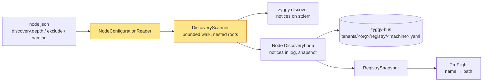
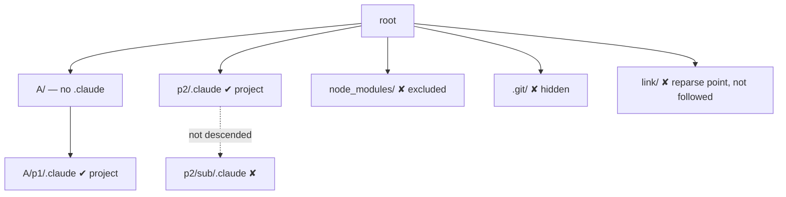

# Spec: 45 — Discovery of projects in nested folders

## Status

- 2026-11-16: spec written as a draft from the owner's request (owner text reformatted to the spec template; §1's claim checked against the code, see Context). Not approved. No roadmap entry yet (number 45 is the next free one after 44; the project-manager adds the row). `spec-critic` not yet run.

## Goal

**As** the owner, **I want** discovery to find Claude Code projects that sit in sub-folders of a `devRoots` entry (for example `<root>/Repos/Common/<repo>`), **so that** those projects are published in the registry and can be routed by name like any other.

Today discovery scans only the **direct children** of each `devRoots` entry (deliverable 14). Owners who group repositories in sub-folders cannot publish those projects:

1. A project two or more levels below a root is never found.
2. Adding the sub-folder as a second root does not help: when one `devRoots` entry lies under another, the nested root is **skipped silently** — the scanner's Debug line reads `discover: scanned <n> projects, 0 notices`, there is no `root missing` and no other notice. Observed on zyggy 0.20.0 (Windows): roots `D:/…/Repos` and `D:/…/Repos/Common` → only `Repos` children published; `D:/…/Repos/Common` alone → its 10 projects published.

### Goals

- G1. Find Claude Code projects (a folder holding `.claude/`) at any depth up to a configured limit below a root.
- G2. Nested `devRoots` entries are either scanned or refused **with a notice** — never silently ignored.
- G3. Default behaviour is unchanged for existing machines (depth 1), so no registry changes on upgrade (but see Q4: a machine that already lists nested roots does change).
- G4. Scans stay bounded in time and size on large trees (`node_modules`, build output, network drives).
- G5. Project names stay unique and routable; collisions are reported as today.

Non-goals: following links outside a root; changing job routing rules (a job path must still lie under a root; a name still resolves only through the node's own snapshot); changing the registry schema version.

## Context

- **Roadmap entry**: none yet — proposed `_plans/ROADMAP.md` #45 (project-manager).
- **Founding-spec sections**: §4 "Registry file" (as amended by A14-1: "scans the direct children of every `devRoots` entry"), §6 step 1 (as amended by A14-3), §10 `node.json` (`devRoots`, `discovery`), §11 Logging (phase `discover`).
- **Reference feature**: the discovery registry and routing by project name (`_specs/14-discovery-registry-routing.md`) — this spec extends its scanner, configuration and notices directly.
- **Reference implementation elsewhere**: none.
- **Cause of §1 item 2, checked in the code (2026-11-16)** — the claim holds, and the skip is deliberate, not a bug:
  - `src/Zyggy.Core/Registry/DiscoveryScanner.cs:147-148` (`NormaliseRoots`): after de-duplication, every root that lies under another root is removed from the list (`roots.Where(r => !roots.Any(other => … IsUnder(r, other)))`), with the comment "A root lying under another root is scanned as part of that root only (Edge Cases)". No `ScanNotice` is added for the removed root.
  - `DiscoveryScanner.cs:156-205` (`ListProjects`) then lists only the direct children of the outer root, so the nested root (`Repos/Common`) is looked at only as a candidate project itself (it is published only if `Repos/Common/.claude/` exists); its own children are never listed.
  - This implements spec 14's Edge Case "a root that is a child of another root is scanned once as a child project, not as a root (its own children are not projects)" (`_specs/14-discovery-registry-routing.md:307`). That same spec's Decision row (P1, line 66) says "a nested layout is handled by listing the inner folder as a root" — which works only when the outer folder is **not** also a root. The two rows contradict each other for exactly the owner's layout, and none of the shipped documents (Cli README `devRoots` row, Node README "Discovery", Core README "Troubleshooting — Discovery and registry") mentions that a nested root is dropped.
  - The line `discover: scanned <n> projects, <m> notices` the owner saw is the scanner's Debug log (`DiscoveryScanner.cs:233`), shown with `--verbose`; it is not a stdout line of `discover`.
- **Already true today**: a job naming a **path** under a nested root resolves (pre-flight accepts a path under any `devRoots` entry, `src/Zyggy.Core/Jobs/PreFlight.cs:96`); only name resolution is affected, because the snapshot never holds those projects.

## Constraints

- ⚠️ A new public `Zyggy.Core` surface is likely (`DiscoveryOptions` keys, new `ScanNoticeKind` members): public-API risk area — approach in plan mode before code.
- ⚠️ The work-laptop boundary (§8): in `names` detail nothing beyond names and default branches is published; a deeper walk must not leak folder structure (`path` naming publishes relative segments in the name — see Q5).
- Scans never throw (spec 14): every file-system failure becomes a notice. No file content in any notice or log line.
- Log once per state change, never per scan tick (existing `DiscoveryLoop` notice de-duplication).
- `node.json` validation goes through the existing reader: a wrong value is exit 3 with its dotted key named.
- Founding-spec §4 text (A14-1, "scans the direct children") changes: only the owner edits the founding spec (Q6).

## Diagrams

### Components touched

### Walk under one root (depth 2)

## Behavior

### Configuration (`node.json`)

| Key | Where | Default | Override rule |
| --- | --- | --- | --- |
| `discovery.depth` | `node.json`; integer 1 … 6 | `1` | How many folder levels below each root are searched. `1` = today's behaviour. |
| `discovery.exclude` | `node.json`; array of folder-name globs | see Scan rules "Never descended into" | Extra folder names never descended into (added to the built-in list; Q3). |
| `discovery.naming` | `node.json`; `leaf` \| `path` | `leaf` | How a project's name is derived (Names). |

A wrong value is refused with its dotted key named, as today (`zyggy: configuration error: discovery.depth: must be an integer from 1 to 6`, exit 3 — the existing range message).

### Scan rules

**Walk**

- Breadth-first from each root, down to `discovery.depth` levels (root children = level 1).
- A folder holding `.claude/` is a **project**. The walk **does not descend into a project** (a repository's own sub-folders are never separate projects). The root itself is never a project by name (unchanged).
- Folder order is ordinal (stable output, stable caps).

**Nested roots**

- When a `devRoots` entry lies inside another entry, the scanner **still scans it** and merges the result; a project reached from both roots is counted once (by full, case-normalised path).
- One notice per nested root, Informational (not an error): CLI stderr `discover: root nested <root> under <parent>`, node log `discovery: root nested <root> under <parent>` — the existing prefixes (the CLI prints notices as `discover: …`, the node logs them as `discovery: …`). The dry run prints it on stderr like the other notices. Note: the node logs every notice at Warning today; this one is the first at Information.
- Effective depth under a nested root is measured from that root (so `Repos` depth 1 + `Repos/Common` depth 1 finds the children of both, which is what the owner meant on 0.20.0).

**Never descended into**

- Hidden folders (name starting with `.`), plus the built-in list: `node_modules`, `bin`, `obj`, `dist`, `out`, `target`, `packages`, `TestResults`, `__pycache__`, `*.worktrees`; plus `discovery.exclude`.
- Reparse points (Windows junctions and symbolic links) and Unix symbolic links are **not followed** (no loops, no escape from the root).
- A `.claude` that is itself a link still counts as present (it only marks the project). **This changes current behaviour**: today a `.claude` reparse point disqualifies the folder (`DiscoveryScanner.cs:185`) — see Q7.
- Folders the node cannot read: `discovery: folder unreadable <path>` once per change; the scan continues.

**Bounds**

- Existing caps stay: 500 projects, 100 agents/skills per project.
- New cap: 20,000 folders visited per scan → `discovery: folder cap reached (<n>)`; projects found so far are published; narrow `devRoots` or lower `discovery.depth`.
- Slow-scan notice stays at 30 s.

### Names

- `leaf` (default): the project folder's own name, folded as today (`My-Core-Audit` → `my-core-audit`). Collisions anywhere in the tree → `duplicate name <name>: <paths>`, neither published (unchanged), and the notice adds `- set discovery.naming to path or rename one`.
- `path`: the path relative to its root, segments folded and joined with `-` (`Common/devops` → `common-devops`). For a project directly under a root, `leaf` and `path` give the same name. (For a project reached from both an outer and a nested root, which root the relative path is taken from is open — Q4.)
- Changing `discovery.naming` renames projects in the registry; jobs already queued by the old name are rejected `unknown_project: unknown name` (documented, not migrated).

### Registry

- Schema stays `1`. In `full` detail the published `path` is the project's absolute path (already the case). In `names` detail nothing extra is published (no relative path, no folder structure).
- `last_seen` / publish-on-change rules unchanged.

### CLI and logs

- `zyggy discover --dry-run --verbose` prints `discover: scanned <n> projects, <m> notices, <f> folders visited, depth <d>` (today this is the scanner's Debug log line without the last two fields).
- All new notices go to stderr, one line each, and to the node log with `phase=discover`.

### Failure modes

| Situation | Observable outcome | Runbook entry |
| --- | --- | --- |
| A root lies under another root | `root nested <root> under <parent>` (Information); both scanned | Core README "Troubleshooting — Discovery and registry", new row |
| A folder below a root cannot be listed | `folder unreadable <path>` once per change; the scan continues | same, new row |
| More than 20,000 folders visited | `folder cap reached (<n>)`; partial publish; `discover` exits 0 | same, new row |
| Two projects derive one name | `duplicate name <name>: <paths> - set discovery.naming to path or rename one`; neither published | existing row, text extended |

### Edge cases

| Case | Expected behavior |
| --- | --- |
| A nested root is itself a project of its outer root (`Repos/Common/.claude/` exists) | Open — Q4 (the walk does not descend into a project, but the nested root asks for its children). |
| A link loop under a root | Not followed; the scan terminates. |
| `discovery.depth` larger than the tree | The walk ends where the tree ends; no notice. |

## Decisions

| Item | Verdict | Why |
| --- | --- | --- |
| Spec 14 P1 "direct children only; a depth knob, exclude list or alias is Defer" (`_specs/14-…:66`, Out of scope line 325) | **Reshape** — reopened by the owner's request | The owner's layout groups repositories in sub-folders; the documented remedy (list the inner folder as a root) does not work while the outer folder is also a root. Spec 14 is a feature spec, not a §13 decision. |
| Spec 14 Edge Case "a root under another root is scanned as a child project only" (`_specs/14-…:307`) | **Reshape** | Silent and undocumented; replaced by "scanned, with a notice" (G2). |
| Founding spec §4 A14-1 "scans the direct children of every `devRoots` entry" | **Reshape** — wording to be approved by the owner (Q6) | The text becomes "scans every `devRoots` entry to `discovery.depth` levels". |

## Acceptance criteria

| # | Criterion | Check |
| --- | --- | --- |
| AC-1 | Depth 1, one root: output identical to 0.20.0. | Unit test: golden comparison on an existing scanner fixture. |
| AC-2 | Roots `A` and `A/B`, depth 1: children of both published, one `root nested` notice, no duplicates. | Unit test (temporary tree). |
| AC-3 | Depth 2, root `A`: `A/B/p` (with `.claude`) found; `A/p2/sub` (inside project `A/p2`) not found. | Unit test. |
| AC-4 | `node_modules/x/.claude`, `.git/…`, `foo.worktrees/…` never published. | Unit test. |
| AC-5 | A junction / symlink loop under a root: scan terminates, the link is not followed. | Unit test (per OS). |
| AC-6 | Two `devops` folders at different depths: `leaf` → duplicate notice, neither published; `path` → both published with distinct names. | Unit test. |
| AC-7 | Folder cap reached → notice, partial publish, exit 0. | Unit test (scanner) + integration test (`zyggy discover`). |
| AC-8 | Invalid `discovery.depth` (0, 7, `"2"`) → configuration error naming the key, exit 3. | Unit test (configuration reader) + integration test (`zyggy discover --config <bad>`). |
| AC-9 | A job by name for a level-2 project resolves; a job by path under a nested root resolves (already true today); outside every root → `outside devRoots` (unchanged). | Integration test (node host, bare bus, fake-claude). |
| AC-10 | Windows and Linux path handling (case-insensitive fold on Windows, separators). | Unit tests on both CI runners. |
| AC-11 | The documents listed under Slices / documents carry the new keys, rules and runbook rows. | Review of the diff. |

## Slices

Proposed, for the owner to confirm with the spec.

| # | Slice | Criteria | Review check |
| --- | --- | --- | --- |
| 1 | ⚠️ Nested roots are scanned with a notice (depth 1 unchanged otherwise) | AC-1, AC-2, AC-10 (part) | `dotnet test tests/Zyggy.Core.Tests --filter "FullyQualifiedName~DiscoveryScanner"` |
| 2 | ⚠️ `discovery.depth` and the bounded walk (exclusions, links, folder cap, unreadable folders) | AC-3, AC-4, AC-5, AC-7, AC-8, AC-10 | same filter + the configuration reader tests |
| 3 | `discovery.naming` (`leaf` / `path`) and the extended duplicate notice | AC-6 | same filter |
| 4 | Wire: `zyggy discover` and the node publish and route the deeper projects; documents updated | AC-7, AC-8, AC-9, AC-11 | `dotnet test tests/Zyggy.Integration --filter "FullyQualifiedName~Discover"` |

### Documents to update

The release ships `docs/Zyggy.Node.md`, `Zyggy.Cli.md` and `Zyggy.Core.md` as copies of `src/Zyggy.<Project>/README.md` (`.github/workflows/ci.yml:91-93`); the edits go into those READMEs: Node README "node.json" and "Discovery"; Cli README `discover` and "node.json" (the `devRoots` row says "direct children"); Core README "Troubleshooting — Discovery and registry" (new rows: root nested, folder unreadable, folder cap; the "direct children" intro sentence). In `zyggy-core` (another repository, not checked here): the `discover` skill "What gets published", both Central and `node/skills/discover/`.

## Out of scope

- Following links outside a root; changing job routing rules; changing the registry schema version.
- Migrating queued jobs when `discovery.naming` changes.

## Open questions

- [ ] **Q1 — Default depth.** Stays `1` (safe upgrade) — or `2`?
- [ ] **Q2 — Default naming.** `leaf` — or `path` for machines whose roots overlap?
- [ ] **Q3 — Built-in exclude list.** Overridable (remove an entry), or only extendable?
- [ ] **Q4 — Nested roots and G3.** Found: scanning a nested root at depth 1 changes the registry of any machine that already lists nested roots (this owner's laptop), contrary to G3's "no registry changes on upgrade"; and when the nested root is itself a project of its outer root, the rule "never descend into a project" conflicts with "still scan it". Also: under `path` naming, which root does a project reached from both take its relative path from (shortest relative path, or the innermost root)? Recommendation: accept the registry change for nested-root machines (it is the fix); the nested root's own listing wins over the "project" rule; take the relative path from the innermost root.
- [ ] **Q5 — `path` naming and `names` detail.** Found: with `discovery.naming: path` the name itself carries folder segments (`common-devops`), so "no folder structure" in `names` detail (the work laptop, §8) is not fully true. Options: (a) allow, documented; (b) refuse `path` when `detail: names`. Recommendation: (a), with a sentence in the Cli README.
- [ ] **Q6 — Founding-spec wording.** §4 (A14-1) says discovery "scans the direct children of every `devRoots` entry"; approve replacement wording so the main session can paste it.
- [ ] **Q7 — `.claude` as a link.** Found: the draft says a `.claude` that is itself a link still marks a project; the scanner today skips such a folder (`DiscoveryScanner.cs:185`, spec 14 AC-1 "symbolic links are never followed"). Options: (a) keep today's rule (link `.claude` → not a project); (b) count it as present, read nothing through it beyond what is read today. Why it matters: the scanner reads `.claude/agents/*.md` and `.claude/skills/*/SKILL.md` through that folder in `full` detail, so (b) would follow a link after all. Recommendation: (a), unless the owner has projects whose `.claude` is a link.
- [ ] **Q8 — Notice level.** The node logs every discovery notice at Warning today; `root nested` would be the first at Information. Confirm.
