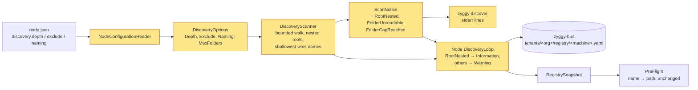
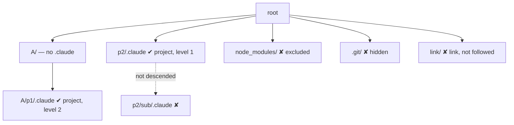
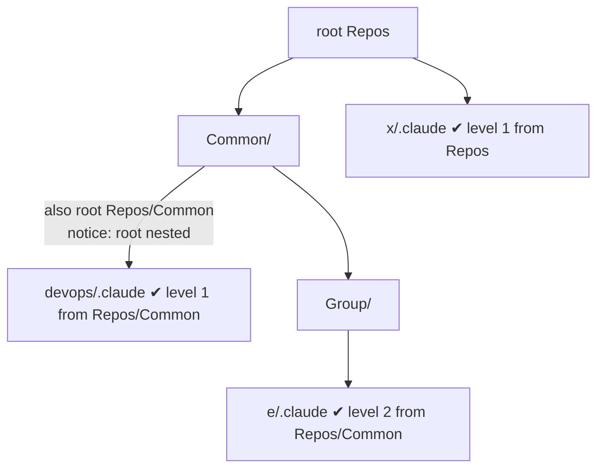
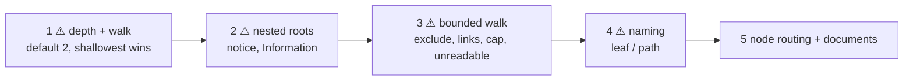

# Spec: 45 — Discovery of projects in nested folders

## Status

- 2026-11-16: draft written from the owner's request; §1's claim checked against the code (Context). No roadmap entry yet (45 is the next free number; the project-manager adds the row).
- 2026-11-16: owner answered Q1–Q9 (Decisions). `spec-critic` run; its findings fixed: slices reordered (depth first) and made vertical through `zyggy discover --dry-run`, the bounded walk split from depth, a slice map added, every Behavior rule given a failing check, notice level and notice fields pinned down.
- 2026-11-16: **approved by the owner.** Roadmap row 45 added; founding spec §4 (A14-1) sentence replaced with the Q6 wording ("default 2").

## Goal

**As** the owner, **I want** discovery to find Claude Code projects that sit in sub-folders of a `devRoots` entry (for example `<root>/Repos/Common/<repo>`), **so that** those projects are published in the registry and can be routed by name like any other.

Today discovery scans only the **direct children** of each `devRoots` entry (deliverable 14). Owners who group repositories in sub-folders cannot publish those projects:

1. A project two or more levels below a root is never found.
2. Adding the sub-folder as a second root does not help: when one `devRoots` entry lies under another, the nested root is **skipped silently** — the scanner's Debug line reads `discover: scanned <n> projects, 0 notices`, there is no `root missing` and no other notice. Observed on zyggy 0.20.0 (Windows): roots `D:/…/Repos` and `D:/…/Repos/Common` → only `Repos` children published; `D:/…/Repos/Common` alone → its 10 projects published.

### Goals

- G1. Find Claude Code projects (a folder holding `.claude/`) up to a configured depth below a root; **default depth 2**.
- G2. Nested `devRoots` entries are scanned **with a notice** — never silently ignored.
- G3. Upgrading never takes a project that 0.20.0 published out of the registry: a newly found deeper project never displaces a shallower one with the same name (shallowest wins). The registry does **gain** projects (level-2 projects, children of nested roots).
- G4. Scans stay bounded in time and size on large trees (`node_modules`, build output, network drives).
- G5. Project names stay unique and routable; collisions are reported.

Non-goals: following links; changing job routing rules (a job path must still lie under a root; a name still resolves only through the node's own snapshot); changing the registry schema version.

## Context

- **Roadmap entry**: none yet — proposed `_plans/ROADMAP.md` #45 (project-manager).
- **Founding-spec sections**: §4 "Registry file" (as amended by A14-1: "scans the direct children of every `devRoots` entry"), §6 step 1 (as amended by A14-3), §10 `node.json` (`devRoots`, `discovery`), §11 Logging (phase `discover`).
- **Reference feature**: the discovery registry and routing by project name (`_specs/14-discovery-registry-routing.md`) — this spec extends its scanner, configuration, notices and tests directly (scanner unit tests on a temporary tree with `ScanTree`, CLI tests through `CliHarness`, node routing through `NodeHostHarness`).
- **Reference implementation elsewhere**: none.
- **Cause of §1 item 2, checked in the code (2026-11-16)** — the claim holds, and the skip is deliberate, not a bug:
  - `src/Zyggy.Core/Registry/DiscoveryScanner.cs:147-148` (`NormaliseRoots`): after de-duplication, every root that lies under another root is removed from the list, with the comment "A root lying under another root is scanned as part of that root only (Edge Cases)". No `ScanNotice` is added for the removed root.
  - `DiscoveryScanner.cs:156-205` (`ListProjects`) then lists only the direct children of the outer root, so the nested root (`Repos/Common`) is looked at only as a candidate project itself; its own children are never listed.
  - This implements spec 14's Edge Case "a root that is a child of another root is scanned once as a child project, not as a root" (`_specs/14-discovery-registry-routing.md:307`). That spec's Decision row P1 (line 66) says "a nested layout is handled by listing the inner folder as a root" — which works only when the outer folder is **not** also a root. None of the shipped documents mentions that a nested root is dropped.
  - The line `discover: scanned <n> projects, <m> notices` the owner saw is the scanner's Debug log (`DiscoveryScanner.cs:233`), shown with `--verbose`.
- **Code facts the slices build on (checked 2026-11-16)**:
  - `ScanNotice(Kind, Subject, Detail)` has no severity; `DiscoveryLoop.LogNotices` logs every new notice through one `[LoggerMessage(Level = Warning)]` (`DiscoveryLoop.cs:163-199`); `DiscoverCommand.NoticeLine` is an exhaustive switch over `ScanNoticeKind` (`DiscoverCommand.cs:143`).
  - `NodeConfigurationReader.TryRangedInt` already produces `<section>.<key>: must be an integer from <min> to <max>` and refuses a JSON string (`NodeConfigurationReader.cs:461-473`).
  - `DiscoveryOptions` carries `MaxProjects`, `MaxEntriesPerProject`, `SlowScanThreshold` as settable caps; the duplicate rule is `DiscoveryScanner.cs:77-82` (two candidates → neither).
  - `ScanTree.Link` creates a directory symbolic link and returns `false` when the OS refuses (no privilege) — the existing pattern for link tests.
- **Already true today**: a job naming a **path** under a nested root resolves (pre-flight accepts a path under any `devRoots` entry, `src/Zyggy.Core/Jobs/PreFlight.cs:96`); only name resolution is affected.

## Constraints

- ⚠️ New public `Zyggy.Core` surface (public-API risk area, approach in plan mode before code, per slice): `DiscoveryOptions.Depth`, `.Exclude`, `.Naming`, `.MaxFolders`; `ScanNoticeKind.RootNested`, `.FolderUnreadable`, `.FolderCapReached`; a naming enum.
- ⚠️ The work-laptop boundary (§8): in `names` detail nothing beyond names and default branches is published; a deeper walk publishes no paths or folder structure. Exception accepted by the owner (Q5): with `discovery.naming: path` the name carries the relative segments.
- Scans never throw (spec 14): every file-system failure becomes a notice. No file content in any notice or log line.
- Log once per state change, never per scan tick (existing `DiscoveryLoop` notice de-duplication).
- `node.json` validation goes through the existing reader: a wrong value is exit 3 with its dotted key named.
- **Nothing is released between slices**: the feature ships as one release after the last slice.

## Diagrams

### Components touched

### Walk under one root (depth 2)

### Nested roots (`Repos` and `Repos/Common` both in `devRoots`, depth 2)

A project reached from both roots is listed once; its level and its `path` name are taken from the **innermost** root.

### Slice map

## Behavior

### Configuration (`node.json`)

| Key | Where | Default | Override rule |
| --- | --- | --- | --- |
| `discovery.depth` | `node.json`; JSON integer 1 … 6 | `2` | Folder levels below each root that are searched (root children = level 1). `1` = the 0.20.0 behaviour. |
| `discovery.exclude` | `node.json`; JSON array of non-empty strings (folder-name globs, `*` and `?`) | empty | Folder names never descended into, **added to** the built-in list; the built-ins cannot be removed (Q3). |
| `discovery.naming` | `node.json`; `"leaf"` \| `"path"` | `"leaf"` | How a project's name is derived (Names). |

Wrong values are refused with the dotted key named, exit 3, through the existing reader messages: `discovery.depth: must be an integer from 1 to 6` (0, 7, a string, a fraction); `discovery.exclude: must be an array of non-empty strings`; `discovery.naming: must be leaf or path`.

### Scan rules

**Walk**

- Breadth-first from each root, down to `discovery.depth` levels.
- A folder holding `.claude/` (a real folder, not a link — Q7) is a **project**. The walk does not descend into a project. The root itself is never a project of its own scan.
- Folder order is ordinal (stable output, stable caps).

**Nested roots**

- When a `devRoots` entry lies inside another entry, both are scanned and the results merged; a project reached from both is listed once (full path, case-folded on Windows), with its level and `path` name taken from the **innermost** root.
- Effective depth under a nested root is measured from that root.
- The nested root is scanned even when it is itself a project of its outer root (`Repos/Common/.claude/` exists): it is published as a project, and its children are scanned as a root (Q4).
- One notice per nested root: `RootNested`, Subject = the nested root, Detail = the outer root. CLI stderr `discover: root nested <root> under <parent>`; node log `discovery: root nested <root> under <parent>` at **Information** (Q8). The level is chosen by notice kind in the node (`RootNested` → Information, every other kind → Warning, as today).

**Never descended into**

- Hidden folders (name starting with `.`), plus the built-in list: `node_modules`, `bin`, `obj`, `dist`, `out`, `target`, `packages`, `TestResults`, `__pycache__`, `*.worktrees`; plus `discovery.exclude`. A project's own name is never checked against this list (a project named `out` directly under a root is still found).
- Links (Windows junctions and symbolic links, Unix symbolic links) are not followed.
- A folder the node cannot list: `FolderUnreadable`, Subject = the folder; CLI `discover: folder unreadable <path>`, node `discovery: folder unreadable <path>` (Warning, once per change); the scan continues.

**Bounds**

- Existing caps stay: 500 projects, 100 agents/skills per project.
- New cap `DiscoveryOptions.MaxFolders` = 20,000 folders visited per scan (settable, like the other caps): `FolderCapReached`, Detail = the count; `discover: folder cap reached (<n>)`; the projects found so far are published and `discover` exits 0.
- Slow-scan notice stays at 30 s.

### Names

- `leaf` (default): the project folder's own name, folded as today (`My-Core-Audit` → `my-core-audit`).
- `path`: the path relative to its (innermost) root, segments folded and joined with `-` (`Common/devops` → `common-devops`). For a project at level 1, `leaf` and `path` give the same name.
- **Shallowest wins** (Q9): when projects derive the same name, the one with the lowest level keeps it and is published; the deeper ones are left out. Two or more at the **same lowest level** → none published, as today. Either way one `DuplicateName` notice: `duplicate name <name>: <paths> - set discovery.naming to path or rename one` (paths of all candidates, the published one first when there is one).
- `path` is allowed with `detail: names` (Q5); the Cli README says the name then carries the folder segments below the root.
- Changing `discovery.naming` renames projects in the registry; jobs already queued by the old name are rejected `unknown_project: unknown name` (documented, not migrated).

### Registry

- Schema stays `1`. In `full` detail the published `path` is the project's absolute path (as today). In `names` detail nothing extra is published.
- `last_seen` / publish-on-change rules unchanged.

### CLI and logs

- `zyggy discover --dry-run --verbose` logs `discover: scanned <n> projects, <m> notices, <f> folders visited, depth <d>`.
- New notices go to stderr, one line each, and to the node log with `phase=discover`.

### Failure modes

| Situation | Observable outcome | Runbook entry |
| --- | --- | --- |
| A root lies under another root | `root nested <root> under <parent>` (Information); both scanned | Core README "Troubleshooting — Discovery and registry", new row |
| A folder below a root cannot be listed | `folder unreadable <path>` (Warning) once per change; the scan continues | same, new row |
| More than 20,000 folders visited | `folder cap reached (<n>)`; partial publish; `discover` exits 0 | same, new row |
| Two projects derive one name | shallowest published, or none at equal level; `duplicate name … - set discovery.naming to path or rename one` | existing row, text extended |

### Edge cases

| Case | Expected behavior |
| --- | --- |
| A nested root is itself a project of its outer root | Published as a project; its children scanned as a root (Q4). |
| A link loop under a root | Not followed; the scan terminates. |
| `discovery.depth` larger than the tree | The walk ends where the tree ends; no notice. |
| A project whose `.claude` is a link | Not a project (Q7), as today. |

## Decisions

| Item | Verdict | Why |
| --- | --- | --- |
| Spec 14 P1 "direct children only; a depth knob, exclude list or alias is Defer" (`_specs/14-…:66`, Out of scope line 325) | **Reshape** — reopened by the owner | The owner's layout groups repositories in sub-folders; the documented remedy fails while the outer folder is also a root. Spec 14 is a feature spec, not a §13 decision. |
| Spec 14 Edge Case "a root under another root is scanned as a child project only" (`_specs/14-…:307`) | **Reshape** | Silent and undocumented; replaced by "scanned, with a notice" (G2). |
| Spec 14 duplicate rule "two candidates → neither" | **Reshape** — shallowest wins (Q9) | With depth 2 by default, a new deeper folder (`api`, `docs`) would otherwise take an existing project out of the registry on upgrade. Equal level keeps today's rule. |
| Q1 default depth | `2` (owner) | Grouped layouts work without configuration; G3 holds through Q9. |
| Q2 default naming | `leaf` | Unchanged names at level 1. |
| Q3 exclude list | only extendable | No way to un-exclude `node_modules` by mistake. |
| Q4 nested roots | scanned; nested root's listing wins over the project rule; innermost root for level and `path` names | It is the fix the owner asked for; one rule gives one name per folder. |
| Q5 `path` + `names` detail | allowed, documented | Owner's choice; the work laptop keeps `leaf` unless set. |
| Q6 founding spec §4 A14-1 | Reshape — owner-approved wording, pasted after spec approval | "scans every `devRoots` entry to `discovery.depth` levels (default 2), not descending into projects, hidden or excluded folders, or links; a `devRoots` entry inside another is scanned too, with a notice". (Owner approved it with "default 1"; changed to 2 to match Q1.) |
| Q7 `.claude` as a link | not a project, as today | Nothing is read through a link. |
| Q8 `root nested` level | Information, chosen by kind in the node | `ScanNotice` stays without a severity field; the CLI prints every notice the same way. |

## Acceptance criteria

| # | Criterion | Check |
| --- | --- | --- |
| AC-1 | `discovery.depth: 1`, no nested roots: output identical to 0.20.0. | Unit: the existing `DiscoveryScannerTests` and `DiscoveryScannerContentTests` pass unchanged with `Depth = 1`; and a tree with a level-2 project yields it at depth 2 but not at depth 1. |
| AC-2 | Depth 2, root `A`: `A/B/p` (with `.claude`) found; `A/p2/sub/.claude` (inside project `A/p2`) not found. | Unit (temporary tree). |
| AC-3 | No `discovery.depth` in `node.json` → `DiscoveryOptions.Depth` is 2; `discovery.depth` 0, 7, `"2"`, `1.5` → `discovery.depth: must be an integer from 1 to 6`, exit 3. | Unit (configuration reader) + integration (`zyggy discover --dry-run --config <bad>` → exit 3, key on stderr). |
| AC-4 | Shallowest wins: `A/devops` (level 1) and `A/G/devops` (level 2) → `A/devops` published, notice names both with the published one first; `A/G/devops` and `A/H/devops` (both level 2) → neither published, one notice. The notice ends `- set discovery.naming to path or rename one`. | Unit. |
| AC-5 | A level-2 project appears in `zyggy discover --dry-run` output. | Integration (`CliHarness`, temporary tree). |
| AC-6 | Roots `A` and `A/B`, depth 1: children of both published, no duplicates, one `root nested A/B under A` notice; on Windows, `d:/x/A/B` and `D:/X/a/b` are the same folder. | Unit (case-fold part runs on the Windows CI runner) + integration (`zyggy discover --dry-run` prints `discover: root nested …` on stderr). |
| AC-7 | Nested root that is itself a project (`A/B/.claude` exists): `b` published **and** `A/B/c/.claude` published. | Unit. |
| AC-8 | The node logs `discovery: root nested …` at Information and `discovery: duplicate name …` at Warning, each once while unchanged. | Unit (`DiscoveryLoopTests`, captured logger). |
| AC-9 | `node_modules/x/.claude`, `.git/x/.claude`, `foo.worktrees/x/.claude`, `bin/x/.claude` never published; with `discovery.exclude: ["archive*"]`, `archive-2024/x/.claude` not published; an `exclude` that tries to name a built-in does not re-enable it; a project folder named `out` at level 1 is still found. | Unit. |
| AC-10 | `discovery.exclude` not an array, or holding an empty or non-string value → `discovery.exclude: must be an array of non-empty strings`, exit 3. | Unit (configuration reader). |
| AC-11 | A directory link under a root (to a folder holding a project, and a link loop to an ancestor): the scan terminates and nothing behind the link is published; a project whose `.claude` is a link is not published. | Unit; uses `ScanTree.Link` and is skipped with a reason when the OS refuses to create a link. |
| AC-12 | A folder below a root that cannot be listed → `folder unreadable <path>`, other projects still published. | Unit (folder made unreadable through the scanner's file-system access in the test, or skipped with a reason where the OS cannot deny it). |
| AC-13 | `MaxFolders = 5` on a tree with more folders → `folder cap reached (5)`, the projects found so far published; `zyggy discover --dry-run` with the cap reached exits 0. | Unit + integration (cap set through the test's options override). |
| AC-14 | `zyggy discover --dry-run --verbose` stderr contains `folders visited` and `depth 2`. | Integration. |
| AC-15 | `naming: path`: `A/Common/devops` → `common-devops`, `A/devops` → `devops`, both published; a project reached from `Repos` and the nested root `Repos/Common` is named from `Repos/Common`; `discovery.naming: "full"` → `discovery.naming: must be leaf or path`, exit 3. | Unit (scanner + configuration reader). |
| AC-16 | A job by name for a level-2 project resolves and runs; a job by path under a nested root resolves (already true today); a path outside every root → `outside devRoots` (unchanged). | Integration (node host, bare bus, fake-claude). |
| AC-17 | No README under `src/` describes `devRoots` scanning as "direct children"; the Node, Cli and Core READMEs name `discovery.depth`, `discovery.exclude`, `discovery.naming`, and the Core README has the rows `root nested`, `folder unreadable`, `folder cap reached`. | `grep -rn "direct children" src/*/README.md` returns nothing; `grep -c` for each key and row returns ≥ 1. |
| AC-18 | Every scanner, reader and loop test above runs on both CI runners (`windows-latest`, `ubuntu-latest`). | CI green on both for the feature PR. |

## Slices

Each slice is reviewed through `zyggy discover --dry-run` on a scratch tree. Nothing is released between slices.

| # | Slice | Criteria | Review check |
| --- | --- | --- | --- |
| 1 | ⚠️ `discovery.depth` (default 2), the walk, shallowest-wins names | AC-1, AC-2, AC-3, AC-4, AC-5 | Make `<tmp>/A/G/p/.claude/` and `<tmp>/A/q/.claude/`, a `node.json` with `devRoots: ["<tmp>/A"]`; `zyggy discover --dry-run --config <node.json>` lists `p` and `q`; with `"discovery": {"depth": 1}` only `q`. |
| 2 | ⚠️ Nested roots are scanned, with a notice (Information in the node) | AC-6, AC-7, AC-8 | `devRoots: ["<tmp>/A", "<tmp>/A/G"]`, depth 1 → `p` and `q` listed, stderr `discover: root nested …/A/G under …/A`. |
| 3 | ⚠️ Bounded walk: exclusions, links, unreadable folders, folder cap, verbose line | AC-9, AC-10, AC-11, AC-12, AC-13, AC-14 | Add `<tmp>/A/node_modules/x/.claude/` → not listed; `--verbose` shows `folders visited` and `depth 2`. |
| 4 | ⚠️ `discovery.naming` (`leaf` / `path`) | AC-15 | Add `<tmp>/A/G/q/.claude/` → `duplicate name q` notice, `q` (level 1) still listed; with `"naming": "path"` → `q` and `g-q`. |
| 5 | The node publishes and routes the deeper projects; documents updated | AC-16, AC-17, AC-18 | `dotnet test tests/Zyggy.Integration --filter "FullyQualifiedName~Discover\|FullyQualifiedName~RoutingByName"`; the AC-17 greps. |

### Documents to update (slice 5)

The release ships `docs/Zyggy.Node.md`, `Zyggy.Cli.md` and `Zyggy.Core.md` as copies of `src/Zyggy.<Project>/README.md` (`.github/workflows/ci.yml:91-93`); the edits go into those READMEs: Node README "node.json" and "Discovery"; Cli README `discover` and "node.json" (the `devRoots` row says "direct children"; the `path` + `names` sentence); Core README "Troubleshooting — Discovery and registry" (new rows: root nested, folder unreadable, folder cap; the duplicate-name row; the "direct children" intro sentence). Release notes: depth 2 is the new default and the registry gains projects. In `zyggy-core` (another repository): the `discover` skill "What gets published", both Central and `node/skills/discover/` — done at release by the `ship` skill.

## Out of scope

- Following links; changing job routing rules; changing the registry schema version.
- Migrating queued jobs when `discovery.naming` changes.
- A severity field on `ScanNotice` (the node chooses the level by kind).

## Open questions

None. Q1–Q9 answered by the owner on 2026-11-16; the answers are in Decisions.
