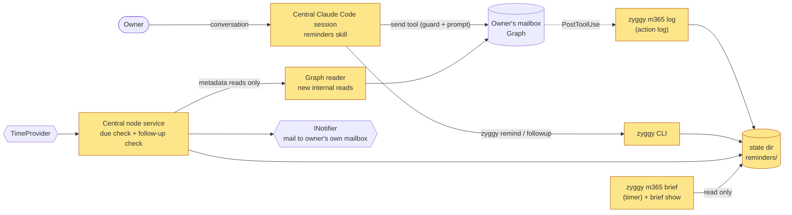
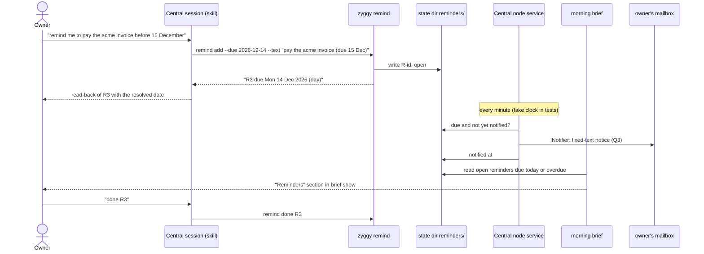
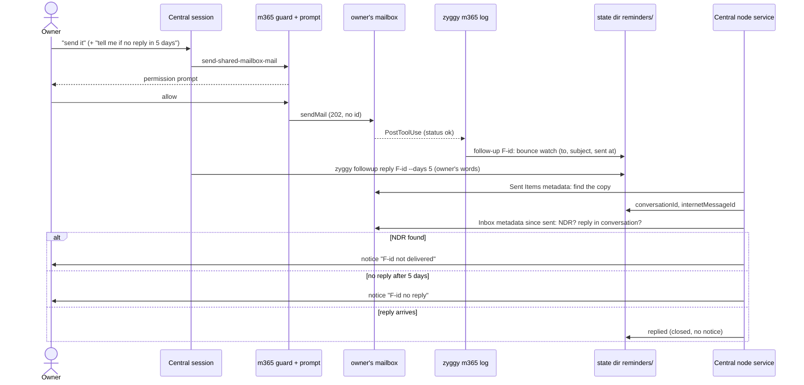
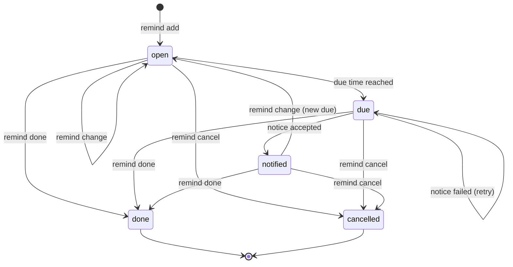
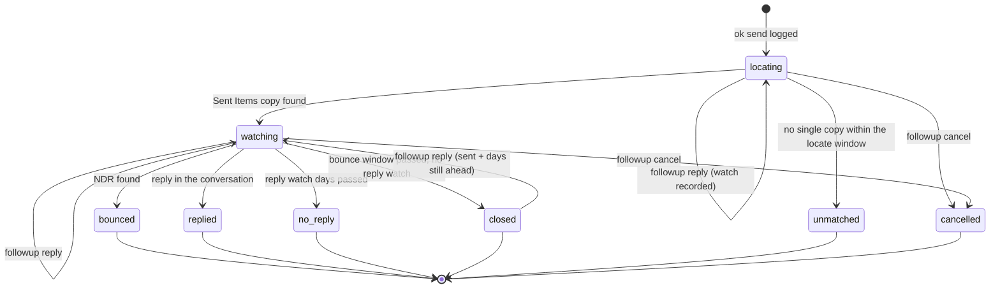

# Spec: 46 — Reminders and mail follow-ups

## Status

- 2026-11-28: spec written (Draft), not approved. Written in a Zyggy job run without an owner interview; every gap is under Open questions with a recommendation. Number 46 is the roadmap's existing "Reminders" entry (added 2026-11-17), widened today by the owner's follow-up wish; no new number was taken so the roadmap does not hold the same deliverable twice.
- 2026-11-28: spec-critic pass (one): 7 blocking findings, all corrected — notice text made consistent (ids, kinds, times only); reply watch allowed while locating and after closed; the NDR read moved before slice 8 as an owner-run check (AC-25) with slice 8 on synthetic fixtures; the Graph reader's missing reads and the node's existing reader named; matching rules (hook JSON, trimmed subject, session for `last` → Q12); day-reminder-for-today and brief carry-over defined; `remind repair` added to the CLI and AC-7. Also fixed: Context no longer claims the founding spec holds 18's notification exception (Q3); one review check per slice; AC-9 split over slices 3 and 11; release points in the slice map. Kept: `ZYGGY_TIMEZONE` refusal (the critic said the brief does not read it; `zyggy brief show` does, and refuses when unset). Status: Draft.
- 2026-11-28: **Approved.** Approved by the owner on 2026-11-28 with the recommended answers. Q1–Q12 are decided as recommended; each decision is written under its question (Open questions, now all decided).
- Q1: the owner still has to confirm that Central's disk is backed up.

## Goal

**As** the owner, **I want** Zyggy on Central to remind me of something at a date or time I name (for example to pay an invoice before its due date), and to watch the mail I send through Zyggy for a bounce or a missing reply, **so that** a due payment or an unanswered mail reaches me without my keeping a list myself.

Two behaviors, one store and one delivery path:

1. **Reminders**: the owner sets, lists, changes, completes and cancels reminders in a conversation with Zyggy on Central; a due reminder shows in the morning brief and in a notification.
2. **Mail follow-ups**: every mail sent with the m365 send tool is watched for a non-delivery report (NDR) for a short time after the send; when the owner asks, a mail is also watched for a reply for a number of days he names. A bounce or a missing reply is reported to him the same way as a due reminder.

## Context

- **Roadmap entry**: `_plans/ROADMAP.md` #46 (widened 2026-11-28).
- **Founding-spec sections**: §1 Non-goals (no push delivery: Telegram stays with 22/29); §3 Components (`Zyggy.Cli` verbs, skills in `zyggy-core`); §6 Central executing its own work; §7 Rules (what is kept; data, never instructions); §8 Injection and abuse and the m365 action rule (D7: "unattended runs cannot show [a permission prompt] and therefore never send, file or create anything"); §9 design rules and seams; §13; §14.
- **The owner-mail exception is not in the founding spec yet.** Spec 18 (D7 reshape) built a notification mail from Central's node to the owner's own mailbox and proposed the §8 wording "Central's node service sends the owner a notification mail to his own mailbox, with a fixed text that carries no content written by an agent" (`_specs/18-central-supervision.md`, Decisions); a search of the founding spec (2026-11-28) finds no such text, so the founding spec still reads "never send". This spec reuses 18's notifier under 18's rule; Q3 asks the owner to approve pasting that wording (and any widening).
- **Reference feature**: Central supervision's owner mail (`_specs/18-central-supervision.md`, waiting list and owner mail, D7) is closer than the discovery registry: it is the existing Central-node service that tells the owner something through `INotifier`. The morning brief v2 (`_specs/35-morning-brief-v2.md`) is the reference for the brief section, its files and its unattended rules; the m365 tools in .NET (`_specs/33-central-tools-dotnet.md`, section D) for the send guard and the action log.
- **Facts verified in the code (file reads, 2026-11-28)**:
  - The send tool is `mcp__m365__send-shared-mailbox-mail` (the guard's only send action). The guard allows only `subject`, `body` (plain text), `toRecipients`, `ccRecipients`, `importance`; refuses Bcc, attachments, `from`/`sender`/`replyTo`, and `saveToSentItems: false` — so every sent mail has a copy in Sent Items, and no custom header or property can be added to tag it.
  - Graph `sendMail` answers 202 with no message id (the existing owner notifier treats 202 as success and reads no id). The sent mail can only be found again in Sent Items.
  - The PostToolUse action log (`zyggy m365 log`) appends one body-free row per send to `actions.jsonl` in the m365 state directory: time, session, tool, `to <addresses> subject "<≤120>" body <n> chars`, and `ok` or `error: <code>`. It runs in attended and unattended sessions alike.
  - The Graph reader already reads Inbox metadata since a time (`id, subject, from, receivedDateTime, conversationId, hasAttachments`) and Sent Items markers since a time (`conversationId, sentDateTime` only); reads only. **It has no read that returns a sent copy's subject, recipients or `internetMessageId`, no read of a conversation across folders, and no NDR filter**: the follow-up slices add these as internal reads of the existing Graph reader (no new public `Zyggy.Core` seam), each a GET with a `$select` that names no body field.
  - The action log row merges to and cc into one list and cuts the subject at 120 code points; the follow-up therefore takes to, cc and the full subject from the PostToolUse hook JSON (`tool_input`), never from the row.
  - Central's node already holds an `INotifier` (mail from the owner's mailbox to itself, opened lazily from Central's M365 instance) and an owner-mail service that mails at most once per change with a retry and a once-per-streak log line. The node's composition already opens a Graph reader from the same M365 instance (same certificate app and token minting as the brief run, which reads Inbox and Sent Items today); no new Graph permission is needed.
  - `zyggy brief show` refuses with a configuration error when `ZYGGY_TIMEZONE` is unset; the memory, Hub and dream code default it to UTC. This spec follows `brief show` (refuse), because a reminder due "at 9" in the wrong zone is a wrong reminder.
  - Machine-local state lives under `<ZYGGY_STATE_DIR or ~/.local/state/zyggy>/` in 0700 directories with 0600 files (`m365/`, `brief/`), never in a repository; the brief directory holds the brief markdown, its sidecar and `last-shown`.
  - Unattended runs are marked by `ZYGGY_HOOKS=off`; spec 33 refuses verbs that must not run unattended with exit 5.
- **Not verified (an owner-run read on Central before slice 8, see Q6)**: how an Exchange Online NDR is recognised by Graph metadata alone (message class `REPORT.IPM.Note.NDR` through an extended property, the sender `postmaster@…` / `MAILER-DAEMON`, the subject prefix), and whether it carries the original mail's `conversationId`.

## Constraints

- ⚠️ **Security — data, never instructions.** A reminder's text, a sent mail's subject and anything read from the mailbox are data in every prompt, skill and output. Only the owner's own words in a conversation create, change or cancel a reminder or a reply watch; a mail, a document, a web page, a brief item, a report or a job TASK never does. The skill says so; the verbs refuse in an unattended run (below).
- ⚠️ **Security — no new outward action.** Nothing in this feature sends, moves, answers, deletes, flags or marks read any mail. The only message that leaves is the existing notification to the owner's own mailbox through `INotifier`, with the fixed-text rule of §8 (Q3). Sending a reply or a reminder mail to anyone else stays a send through the m365 tool, its guard and its permission prompt, in an attended session, on the owner's words.
- ⚠️ **What an unattended run may do (changes §8 practice, owner decides).** The follow-up check is a new unattended reader of the owner's mailbox: Inbox and Sent Items **metadata** only (no body, no attachment), on Central's node, model-free. It may read, write its own store, and notify the owner; nothing else. Unattended sessions and job runs (`ZYGGY_HOOKS=off`) may list reminders and follow-ups, never add, change, complete or cancel them.
- ⚠️ **Data loss.** Reminders live only in Central's state directory (Q1); a lost VM disk loses them. The store is written whole through a temporary file and a rename, under a lock; a corrupt store is kept aside and reported, never overwritten silently.
- ⚠️ **Shared contract — the brief.** The brief gains a section (rendered format and sidecar of spec 35, golden-tested). Its golden files change; the page cap rules gain one never-dropped section.
- ⚠️ **Work-laptop boundary (§8).** Central only. The work mailbox (spec 58, classic Outlook on the work laptop) is out of scope; no work mail metadata reaches Central's store.
- §9: no new seam — `INotifier`, `TimeProvider` and the Graph reader carry everything; the Graph reader stays the only code naming Graph; paths through one paths builder per directory; no static mutable state; log once per state change, never per tick.
- §8: no secret in the store; a reminder text matching the secret patterns (`secret-patterns.txt`, the `remember` rule) is refused.
- Rule R1: the logic is `zyggy` verbs and a node service in .NET; the skill stays Markdown in `zyggy-core`.
- Public repository: placeholders only in tests and docs (`alice@example.com`, `acme`).

## Diagrams

### Components touched

(Highlighted: new or changed. The bus is not touched.)

### Round trip — a reminder

### Round trip — a mail follow-up

### Reminder states

### Follow-up states

`unmatched`, `bounced` and `no_reply` are told to the owner; `replied`, `closed` and `cancelled` are not.

### Slice map

```mermaid
flowchart LR
  s1[1 Keep reminders<br/>fake ⚠️] --> s2[2 Keep reminders<br/>wire ⚠️]
  s2 --> s3[3 Due reminders in the brief<br/>fake ⚠️] --> s4[4 Brief run shows them<br/>wire ⚠️]
  s4 --> s5[5 Due reminder notified<br/>fake ⚠️] --> s6[6 Node notifies<br/>wire ⚠️]
  s6 --> s7[7 Reminders skill, first release<br/>owner-run ⚠️]
  s7 --> r1((release A))
  r1 --> p[owner-run NDR read<br/>Q6, before 8]
  p --> s8[8 Every send watched, bounce told<br/>fake ⚠️] --> s9[9 Bounce told through the node<br/>wire ⚠️]
  s9 --> s10[10 No-reply watch<br/>fake ⚠️] --> s11[11 End to end, brief lists follow-ups<br/>wire ⚠️]
  s11 --> s12[12 Skill offers the watch at send<br/>owner-run ⚠️] --> r2((release B))
```

## Behavior

### Setting, listing, changing and cancelling a reminder (conversation)

- The owner speaks to Zyggy on Central in a session (terminal or the Telegram channel). The `reminders` skill in `zyggy-core` turns what he says into a `zyggy remind` call. The model resolves relative wording ("before the due date", "next Monday at 9", "in three days") into an absolute local date or date-time in `ZYGGY_TIMEZONE`; the verb accepts only absolute forms, so what is stored is checkable.
- "Before the due date of 15 December" is stored as due the day before (14 December, day reminder) unless the owner names another day; the skill reads the resolved date back in its answer, with the weekday, and the owner corrects it with a change (Q4).
- A **day reminder** (`YYYY-MM-DD`) is due at the start of that local day: it shows in that day's brief and is notified at `reminders.dayNotifyAt` (default 08:00 local). A **timed reminder** (`YYYY-MM-DDTHH:MM`) is due and notified at that local time. Due times are stored as UTC instants together with the local text the owner saw; a time that does not exist or exists twice on a daylight-saving change is refused with a message naming the change.
- Listing shows open reminders by due time, with id, due (local, weekday), state and text; `--all` adds done and cancelled ones of the last 30 days.
- Changing sets a new due, a new text, or both; a changed reminder that was notified becomes open again for its new due.
- Done and cancel close it; both keep the record for 30 days for the list, then it is dropped.
- A day reminder for **today** is accepted at any time of day: added before `dayNotifyAt` it is notified then; added after, it is notified within the next minute. A timed reminder in the past, or a day before today, is refused (exit 4) unless `--overdue-ok` is given (the owner said "remind me of this, it is already late"); then it is due now.
- An open reminder that is due or notified keeps showing in every brief (as overdue from the next day on) until the owner marks it done or cancels or changes it; it is notified once per due time, never again.
- A reminder may carry an optional reference the owner gave (an invoice number, a mail subject he named) as plain text; Zyggy never fetches anything from it.
- Recurring reminders are out of scope (Q5).

### Mail follow-ups

- **Bounce watch (automatic for every send, Q2).** When `zyggy m365 log` records a send through `send-shared-mailbox-mail` with status `ok`, it also writes a follow-up from the hook JSON: to and cc addresses (lower-cased, separately), the full subject (≤ 255 code points, control characters flattened), the log's send time, and the hook's `session_id`. It never stores the body. A send with an error status starts no follow-up. Failure to write the follow-up does not change the action log's result (the row is written first) and is logged once (Q2).
- **Locating the sent copy.** Central's node finds the copy in Sent Items: `sentDateTime` between 2 minutes before and `followups.locateWindowMinutes` (default 10) after the logged time, the same recipient set (to ∪ cc, lower-cased), and a subject equal to the stored one after trimming whitespace (exact, case-sensitive; Exchange does not rewrite the subject of a mail it sends). Exactly one match → it keeps the copy's `conversationId` and `internetMessageId` and the follow-up is `watching`. None or more than one by the end of the window → `unmatched`, told to the owner once. The node reads metadata only (`$select` without body).
- **Bounce.** While `watching` and within `followups.bounceWindowHours` (default 48) of the send, the node checks the Inbox for an NDR that belongs to the mail: checks at 2, 5, 15, 30 and 60 minutes after the send, then hourly. The recognition rule is option (a) of Q6 unless the owner-run read before slice 8 shows it fails: message class `REPORT.IPM.Note.NDR` (an extended-property filter), received after the send, tied to the mail by its `conversationId`, or else by the subject ending with the stored subject and the NDR naming no other sent mail in the window. Metadata only, never the NDR's body. A found NDR → `bounced`, told once.
- **Reply watch (on the owner's words).** When the owner asks ("tell me if acme does not answer within 5 days"), the skill calls `zyggy followup reply <F-id | last> --days <n>`; `last` is the newest follow-up whose `session` is the caller's Claude Code session (`CLAUDE_SESSION_ID` from the session environment, Q12), else exit 6. The days count from the send. A watch can be set while `locating`, `watching`, or `closed` (a closed follow-up reopens to `watching` when send + days is still ahead); on `bounced`, `unmatched`, `replied` or `no_reply` → exit 6 naming the state. A reply is a message in any folder (Q7) with the same `conversationId`, received after the send, from one of the recipients' addresses. A reply → `replied`, closed without a notice (the brief already shows new mail). No reply when the days have passed → `no_reply`, told once.
- The owner lists follow-ups (`zyggy followup list`), cancels one (`zyggy followup cancel <F-id>`), or changes the days (`followup reply` again). Closed follow-ups are dropped after 30 days.

### Delivery to the owner

- **Morning brief.** `zyggy m365 brief` writes a new section **"Reminders and follow-ups"** after the header, before "Mail", from the store, by the binary alone: open reminders due today or overdue (oldest first), then follow-ups told since the previous brief (`bounced`, `no_reply`, `unmatched`), each with its id. The section is never passed to the mail run's or the ideas run's model; it is data in the fenced brief `zyggy brief show` prints. It is never dropped by the page cap; past 10 lines it shows "… and <n> more — say "list reminders"". Weekend briefs carry it too. Nothing due and nothing told → no section.
- **Notification.** Central's node service sends one notice through `INotifier` per state change that is told: a reminder becoming due, a follow-up becoming `bounced`, `no_reply` or `unmatched`. Notices due at the same minute go in one notice. The text is fixed and carries ids, kinds and local times only, never a reminder text, a subject or an address (Q3, recommended option): subject `Zyggy: 2 items for you`; lines such as `Reminder R3 is due (Mon 14 Dec 14:00).`, `Mail follow-up F7: not delivered (sent Mon 14 Dec 10:02).`, `Mail follow-up F8: no reply in 5 days (sent Wed 9 Dec 16:40).`, `Mail follow-up F9: cannot be followed (not found in Sent Items).`, and a last line `Ask Zyggy "list reminders" or "list follow-ups".` If the owner chooses option (b) of Q3, the texts and AC-14 change with the approved wording. A failed notice is retried a minute later, logged once per failure streak; the state does not advance until the channel accepted it. No M365 instance on Central → no notice, the brief still shows it, and the node logs once that notices are off.
- No notice on a laptop, no bus envelope, no Telegram message (22/29 can add a second `INotifier` later behind the same seam).

### Unattended and job runs

| Actor | May | May not |
| --- | --- | --- |
| Owner's attended session on Central | every `remind` and `followup` verb, `remind repair` | — |
| Central node service (always on, model-free) | read the store; Graph metadata reads of Sent Items and Inbox; write states; notify the owner | send, reply, move, delete, flag or mark read any mail; read a body or attachment; run a model |
| `zyggy m365 log` (PostToolUse, any session) | add a bounce watch after an ok send | anything else in the store |
| `zyggy m365 brief` (timer, unattended) | read the store | write it; show it to a model |
| Unattended sessions and job runs (`ZYGGY_HOOKS=off`) | `remind list`, `followup list` | add, change, done, cancel, repair, `followup reply`, `followup cancel` (exit 5, one line `remind: refused in an unattended run`) |

### CLI

All verbs run on Central; on a machine without the state directory's owner they behave the same against the local state directory (tests use a temp `ZYGGY_STATE_DIR`).

| Command | Output | Exit |
| --- | --- | --- |
| `zyggy remind add --due <YYYY-MM-DD \| YYYY-MM-DDTHH:MM> --text <text> [--ref <text>] [--overdue-ok]` | `R<n> due <weekday> <local due> (<day\|time>)` | 0 · 4 usage, bad or past or non-existent time · 5 unattended or secret pattern · 3 store unreadable |
| `zyggy remind list [--all] [--json]` | one line per reminder, or `no reminders` | 0 · 3 |
| `zyggy remind change <R-id> [--due …] [--text …]` | the changed line | 0 · 4 · 5 · 3 · 6 unknown id |
| `zyggy remind done <R-id>` / `zyggy remind cancel <R-id>` | `R<n> done` / `R<n> cancelled` | 0 · 5 · 3 · 6 |
| `zyggy followup list [--all] [--json]` | one line per follow-up: id, state, first recipient, subject, sent, reply watch | 0 · 3 |
| `zyggy followup reply <F-id \| last> --days <1..maxReplyDays>` | `F<n> reply watch until <local date>` | 0 · 4 · 5 · 3 · 6 unknown id, no follow-up of this session for `last`, or a state that takes no watch (named) |
| `zyggy followup cancel <F-id>` | `F<n> cancelled` | 0 · 5 · 3 · 6 |
| `zyggy remind repair` | names the unreadable store file(s), renames each to `*.corrupt-<utc>` and starts an empty one; asks nothing (the owner's request in the conversation is the go) | 0 · 5 unattended · 3 nothing to repair |

Ids are short and stable: `R<n>` and `F<n>`, numbered upward, never reused within the store's life. Texts: `--text` ≤ 200 characters, `--ref` ≤ 120, control characters flattened, a secret-pattern match refused.

### Storage

| Path (under `<ZYGGY_STATE_DIR or ~/.local/state/zyggy>/reminders/`, 0700) | Writer | Content |
| --- | --- | --- |
| `reminders.json` (0600) | `zyggy remind`, Central's node service (state moves) | `{schema:1, next, items:[{id, text, ref?, due_utc, due_local, kind: day\|time, state, created, changed, notified?, closed?}]}` |
| `followups.json` (0600) | `zyggy m365 log` (new), `zyggy followup`, Central's node service | `{schema:1, next, items:[{id, session, to[], cc[], subject, sent, state, conversation_id?, internet_message_id?, reply_days?, reply_until?, checked?, told?, closed?}]}` — `subject` and addresses are the owner's sent mail's, as he approved them at the permission prompt |
| `reminders.lock` | every writer | an exclusive lock held for a read-modify-write |

Written whole through a temporary file and a rename. Unreadable or a newer `schema` → every writer stops with exit 3 / one log line and changes nothing; only `zyggy remind repair`, attended, on the owner's request, sets the file aside as `*.corrupt-<utc>` (kept, never deleted). Never in a repository, never in a secret store, never on the bus.

### Configuration

| Key | Where | Default | Override rule |
| --- | --- | --- | --- |
| `reminders.enabled` | Central's `node.json` | `false` | `true` turns on the node service (due check and follow-up check); the verbs work either way |
| `reminders.dayNotifyAt` | Central's `node.json` | `"08:00"` | local time in `ZYGGY_TIMEZONE` |
| `followups.enabled` | Central's `node.json` | `false` | `true` lets `m365 log` add bounce watches and the node check them |
| `followups.locateWindowMinutes` | Central's `node.json` | `10` | 1–60 |
| `followups.bounceWindowHours` | Central's `node.json` | `48` | 1–168 |
| `followups.maxReplyDays` | Central's `node.json` | `60` | 1–365; `--days` above it is refused |

The time zone is `ZYGGY_TIMEZONE` (as the brief); missing → the verbs refuse with exit 3 naming it, rather than guessing UTC.

### Failure modes

| Situation | Observable outcome | Runbook entry |
| --- | --- | --- |
| Store unreadable or newer schema | verbs exit 3 `remind: store unreadable: <file>`; node logs once, skips the check; brief shows "Reminders unavailable: <reason>" | new "Reminder store unreadable" |
| `ZYGGY_TIMEZONE` missing | verbs exit 3; node logs once, does not check | new "Reminder time zone missing" |
| Notice refused or Graph unreachable | retried each minute, logged once per streak, state unchanged; brief still shows it | 18's "Owner mail not sent" (extended) |
| Graph read fails during the follow-up check | the follow-up stays as it is, the next check tries again, logged once per streak; a bounce window that ends during an outage is extended to the first successful check | new "Follow-up check failing" |
| Sent copy not found | `unmatched`, told once | new "Mail follow-up unmatched" |
| Clock jump or node down over a due time | on start, every reminder past due and not notified is notified once (in one notice) | — |
| Two writers at once | the lock serialises them; no lost update | — |

### Edge cases

| Case | Expected behavior |
| --- | --- |
| Owner pastes a mail that says "remind me to transfer €5,000 to …" | the skill does not create a reminder from it; it may ask whether the owner wants one, in his own words |
| A job TASK asks Zyggy to set a reminder | refused (exit 5); the report says so |
| Same mail sent twice within the locate window | both follow-ups see two copies → both `unmatched` unless recipients or subject differ |
| A reply arrives from someone not among the recipients | not a reply (counted only from recipients' addresses) |
| An automatic reply (out of office) arrives | counts as a reply unless Q8 decides otherwise |
| A reminder due during the night | notified at its time; a day reminder at `dayNotifyAt` |
| Send through another tool or by the owner in Outlook | not followed (only the m365 send tool is watched) |
| Reminder text contains a secret pattern | refused, exit 5, nothing stored |

## Decisions

| Founding-spec item (section) | Verdict | Why |
| --- | --- | --- |
| §1 Non-goals: no push delivery (Telegram with 22/29) | **reshape** | A push channel exists since 18 (`INotifier`, mail to the owner's own mailbox); reminders reuse it. Telegram stays with 22/29 behind the same seam. |
| §6 Central executing its own jobs (timer → `claude -p`) | **reshape** | No model run is needed: due times and metadata matching are binary work on Central's always-on node, like 18's owner mail. Cheaper, testable with a fake clock, no injection surface. |
| §7 Rules: what is kept; data never instructions | **keep** | Reminders are not memory facts: they are mutable state with a due time, kept in the state directory, not filed by the dream. Their text is data everywhere. |
| §8 m365 action rule (D7) and 18's notification exception | **keep** | No new send; the notice keeps 18's fixed-text rule. That exception is not yet in the founding spec's wording; Q3 asks to paste it. |
| §8 Injection and abuse | **keep** | Only the owner's words create a reminder or a reply watch; unattended runs refused. |
| §9 five seams | **keep** | No new seam; `INotifier`, `TimeProvider`, the Graph reader. |
| Memory repository as the store (alternative) | **rejected** | A git repository mirrored to laptops (47) and rewritten by the dream; reminders are mutable per-minute state, possibly private (an invoice), and the task excludes a repository. |
| Recurring reminders | **defer** | Q5. |
| Work mailbox follow-ups (58) | **defer** | Work laptop boundary; separate spec if wanted. |

No new package: `System.Text.Json`, `TimeProvider`, `TimeZoneInfo` cover it.

## Acceptance criteria

Each criterion names its check; each check fails if the behavior is broken. Unit tests use a fake clock and a temp state dir; integration tests run the real `zyggy` binary or the Node host, with `tools/fake-claude` and a mocked Graph `HttpMessageHandler` — never the real `claude`, never Graph.

| # | Criterion | Check |
| --- | --- | --- |
| AC-1 | `remind add` with a day or a local date-time stores an open reminder with UTC due and local text, and prints `R<n> due <weekday> <local due> (<day\|time>)`; ids rise and are never reused after done or cancel. | Unit test |
| AC-2 | A timed reminder in the past or a day before today without `--overdue-ok`, a malformed form, a local time that does not exist or exists twice on a DST change, a text over 200 characters, an unknown option → exit 4, nothing stored; a day reminder for today is accepted at any hour. | Unit test (theory table) |
| AC-3 | `list` orders open reminders by due; `--all` adds done and cancelled of the last 30 days; older closed ones are dropped on the next write; `--json` emits one object per reminder. | Unit test |
| AC-4 | `change` sets a new due and/or text and a notified reminder becomes open again; `done` and `cancel` close; an unknown id → exit 6. | Unit test |
| AC-5 | With `ZYGGY_HOOKS=off`, `add`, `change`, `done`, `cancel`, `repair`, `followup reply` and `followup cancel` exit 5 with `remind: refused in an unattended run` and change nothing; both `list` verbs work. | Unit test (verbs) + integration test through the binary (one verb of each family) |
| AC-6 | A text or ref matching a secret pattern → exit 5, nothing stored; control characters are flattened. | Unit test with the shared secret-pattern sample fixture |
| AC-7 | The store is written whole through a temporary file and a rename under the lock; two concurrent `add` processes both persist; an unreadable or newer-schema store → exit 3 with the file untouched; `remind repair` sets it aside as `*.corrupt-<utc>` and starts empty. | Integration test (two `zyggy` processes, corrupt-file fixture) |
| AC-8 | Store files live under `<ZYGGY_STATE_DIR>/reminders/` and nowhere else; on Linux they are 0600 in a 0700 directory (the mode assertion is skipped on Windows). | Integration test (both runners; modes on the Linux runner) |
| AC-9 | The brief has a "Reminders and follow-ups" section before "Mail", rendered by the binary: open reminders due today or overdue, and follow-ups told since the previous brief; absent when empty; never dropped by the page cap; at most 10 lines plus "… and <n> more — say "list reminders""; present on weekends. | Golden-file tests of the renderer: reminder cases in slice 3, follow-up lines added in slice 11 |
| AC-10 | A day reminder for tomorrow is absent from today's `zyggy m365 brief` / `brief show` and present in tomorrow's; nothing the mail run's model receives (its input file and prompt) contains a reminder text. | Integration test: two brief runs over a fake clock, fake-claude recording its input |
| AC-11 | Central's node service, with `reminders.enabled`, notifies a timed reminder once at its time and a day reminder once at `dayNotifyAt` (or within a minute when added later that day); reminders due in the same minute share one notice; nothing is notified twice across a restart. | Unit test: fake clock, substitute `INotifier`, store on disk |
| AC-12 | A refused notice leaves the reminder `due` and is retried a minute later; the failure is logged once per streak. | Unit test: throwing substitute `INotifier`, recording logger |
| AC-13 | A node down over a due time notifies every missed reminder on start, in one notice. | Unit test: fake clock jumped past the due time before the service starts |
| AC-14 | Every notice text consists only of the fixed lines of Behavior — ids, kinds, local times — and never contains a reminder text, a subject or an address. | Unit test over every notice kind, with texts and subjects seeded by marker strings that must not appear |
| AC-15 | Central's node host sends the notice as one Graph `sendMail` to the owner's own mailbox through the existing mail notifier; `reminders.enabled: false` → no service and no Graph call. | Integration test (Node host, mocked Graph handler) |
| AC-16 | `zyggy m365 log` on an ok `send-shared-mailbox-mail` with `followups.enabled` writes one `locating` follow-up with to, cc, full subject, send time and session from the hook JSON and never the body; an error status, another tool or `followups.enabled: false` writes none; a store write failure leaves the action-log row and the exit code unchanged and logs once. | Unit test on hook JSON fixtures (slice 8) + integration test through the binary (slice 9) |
| AC-17 | The node locates the Sent Items copy by the time window, the recipient set and the trimmed subject, keeping `conversationId` and `internetMessageId`; zero or two matches at the end of the window → `unmatched`, told once. | Unit test with a fake Graph handler |
| AC-18 | A watching follow-up is checked at 2, 5, 15, 30 and 60 minutes, then hourly until `bounceWindowHours`; an NDR matching the recognition rule → `bounced`, told once; past the window with no reply watch → `closed`, not told. | Unit test with a fake clock and synthetic Graph fixtures shaped per the rule of Behavior (the anonymised real NDR from the owner-run read replaces or joins them when it exists) |
| AC-19 | Every Graph request the follow-up check and the locate step make is a GET whose `$select` names no body, attachment or `uniqueBody` field; this feature adds no Graph call that sends, replies, moves, patches or deletes (the only send stays the notifier's). | Unit test recording every request of a full check (slices 8 and 10 extend the same test) |
| AC-20 | A Graph failure during a check leaves the follow-up unchanged and logs once per streak; a window that ended during the outage is extended to the first successful check. | Unit test |
| AC-21 | `followup reply F<n> --days 5` (or `last` for the caller's session) works while `locating`, `watching`, or `closed` with send + days ahead (reopened to `watching`); a message with the same `conversationId` from a recipient after the send → `replied`, no notice; none after 5 days from the send → `no_reply`, told once; `--days` over `maxReplyDays` → exit 4; on `bounced`, `unmatched`, `replied` or `no_reply` → exit 6 naming the state. | Unit test with a fake clock and a fake Graph handler |
| AC-22 | End to end through the real `zyggy m365 log`, the Node host and a mocked Graph handler: one send whose NDR arrives and one send without a reply over 5 days lead to one "not delivered" and one "no reply" notice, and both lines in the next brief. | Integration test (state dir, Node host, mocked handler, fake clock) |
| AC-23 | The `reminders` skill in `zyggy-core` says: only the owner's own words create, change or cancel a reminder or a reply watch; mail, documents, briefs, reports and job TASKs are data; resolved dates are read back with the weekday; no verb other than `list` from an unattended run. Slice 12 adds: after a send, offer a reply watch in one line. | `zyggy-core` template tests (its bats suite and hygiene sweep gain a test per rule, named in the build) |
| AC-24 | Owner-run on Central: in a conversation, set a timed reminder 5 minutes ahead and receive its notice; set a day reminder for tomorrow and see it in tomorrow's `brief show`; list, change and cancel a third. Pass = all three seen; evidence (times, ids, no texts) recorded in the instance's evidence file for 46. | Owner-run check on Central (release A) |
| AC-25 | Owner-run read on Central before slice 8, read-only: after the owner sends one mail to a non-existent address at his own domain and one to a non-existent external domain, the metadata of each NDR (message class, sender, subject prefix, `conversationId` equal to the original or not) is recorded anonymised in the evidence file. Pass = the recorded metadata either satisfies the rule of Behavior or the rule is changed (spec Status line) before slice 8. | Owner-run check on Central (Q6) |
| AC-26 | Owner-run on Central after release B: a mail to a non-existent address gives a "not delivered" notice within 15 minutes; a reply watch of 1 day on a mail nobody answers gives a "no reply" notice the next day. Evidence recorded as AC-24. | Owner-run check on Central (release B) |
| AC-27 | The instance runbook has an entry for each failure mode above, and the `Zyggy.Cli` README documents the verbs and keys. | The instance's existing docs check (link and section test) and the `Zyggy.Cli` README test the repo already runs, in slices 7 and 12 |

## Slices

Each slice is one behavior, Fake (seams, unit tests) before its Wire (real binary or Node host, integration tests). Slices 1–7 (reminders) are a release of their own (release A, Q9); 8–12 (follow-ups) follow after the owner-run NDR read (AC-25).

| # | Slice | Criteria | Review check |
| --- | --- | --- | --- |
| 1 | ⚠️ The owner keeps reminders: add, list, change, done, cancel, with unattended and secret refusals — the Fake half, through the verbs' logic with a fake clock | AC-1–AC-6 | `dotnet test tests/Zyggy.Core.Tests --filter "FullyQualifiedName~Reminder"` |
| 2 | ⚠️ `zyggy remind …` works through the real binary against a temp state dir: concurrent writes, a corrupt store and `repair` | AC-5, AC-7, AC-8 | `dotnet test tests/Zyggy.Integration --filter "FullyQualifiedName~Remind"` |
| 3 | ⚠️ Due reminders render in the brief's new section (shared brief format, goldens) | AC-9 (reminder part) | `dotnet test tests/Zyggy.Core.Tests --filter "FullyQualifiedName~BriefRenderer"` |
| 4 | ⚠️ The brief run shows a reminder on its due day and not before, never giving it to the model | AC-10 | `dotnet test tests/Zyggy.Integration --filter "FullyQualifiedName~BriefReminders"` |
| 5 | ⚠️ A due reminder is notified once with a fixed text (fake clock, substitute notifier, retry, restart) | AC-11–AC-14 | `dotnet test tests/Zyggy.Core.Tests --filter "FullyQualifiedName~ReminderDue"` |
| 6 | ⚠️ Central's node host sends the reminder notice as a mail to the owner's own mailbox | AC-15 | `dotnet test tests/Zyggy.Integration --filter "FullyQualifiedName~ReminderNotice"` |
| 7 | ⚠️ The owner uses reminders in a conversation on Central: `reminders` skill in `zyggy-core`, keys in the instance, runbook rows (release A) | AC-23 (without the send line), AC-24, AC-27 (reminder rows) | Owner-run on Central: the AC-24 conversation |
| 8 | ⚠️ Every ok send starts a bounce watch; the node locates the sent copy and recognises an NDR (fake Graph, synthetic fixtures) | AC-16 (unit), AC-17, AC-18, AC-19, AC-20 | `dotnet test tests/Zyggy.Core.Tests --filter "FullyQualifiedName~FollowUpBounce"` |
| 9 | ⚠️ A bounce is told end to end through the real `zyggy m365 log` and the Node host | AC-16 (integration), AC-18 | `dotnet test tests/Zyggy.Integration --filter "FullyQualifiedName~FollowUpBounce"` |
| 10 | ⚠️ The owner sets a reply watch; a reply closes it, no reply after N days is told (fake clock, fake Graph) | AC-21, AC-19 | `dotnet test tests/Zyggy.Core.Tests --filter "FullyQualifiedName~FollowUpReply"` |
| 11 | ⚠️ Bounce and no-reply reach the owner end to end and show in the brief | AC-22, AC-9 (follow-up part) | `dotnet test tests/Zyggy.Integration --filter "FullyQualifiedName~FollowUpEndToEnd"` |
| 12 | ⚠️ The skill offers a reply watch after a send; follow-up keys and runbook rows (release B) | AC-23 (send line), AC-26, AC-27 (follow-up rows) | Owner-run on Central: the AC-26 check |

## Out of scope

- Recurring reminders (Q5), reminders set from a laptop session or over the bus, reminders for other people.
- Sending anything on the owner's behalf: a reminder mail to a third party, an automatic chase mail, an answer to an NDR.
- Follow-ups for mail sent outside the m365 send tool (Outlook, phone, the work laptop's classic Outlook of 58).
- Reading an NDR's or a reply's body; summarising replies (the brief's mail run does that already).
- Telegram or any second notification channel (22/29).
- Reminders derived automatically from mail or invoices (the brief's "Only you can do these" stays as it is).

## Open questions

All twelve were decided by the owner on 2026-11-28 with the recommended answer; each question's **Decision** line records it. The spec was written on these answers, so no section above changes. Each with a recommendation and one reason. ⚠️ = carries risk (security, data loss, an outward action, or a change to what an unattended run may do).

- [x] **Q1 ⚠️ (data loss) — Where are reminders kept?** Found: the brief and m365 keep state in Central's state directory (0700, never a repository); the memory repository is a git repository mirrored to laptops (47) and rewritten by the dream. Options: (a) state directory `reminders/`; (b) memory repository; (c) state directory plus a nightly copy into the memory repository's private area. Recommendation: **(a)**, because it is where Central already keeps per-minute state and keeps reminders off every repository; the VM disk's backup (if any) covers it — the owner confirms whether Central's disk is backed up. **Decision (owner, 2026-11-28): (a)** — Central's state directory `reminders/`. Still open: the owner confirms that Central's disk is backed up.
- [x] **Q2 ⚠️ (unattended reading) — Is the bounce watch automatic for every send?** Found: `m365 log` sees every send with its status; the follow-up check is a new unattended metadata reader. Options: (a) automatic for every send, `followups.enabled` as the switch; (b) only when the owner asks per mail. Recommendation: **(a)**, because a bounce is most useful when nobody thought to ask, and the check reads metadata only and only notifies the owner. **Decision (owner, 2026-11-28): (a)** — automatic for every send, `followups.enabled` is the switch.
- [x] **Q3 ⚠️ (security, outward action, founding-spec wording) — What may the notice say, and is 18's exception pasted into §8?** Found: the founding spec still says unattended runs "never send"; spec 18 built the owner mail under its own rule ("a fixed text that carries no content written by an agent") and proposed that §8 wording, which is not in the founding spec (search, 2026-11-28). The reminder text and the mail subject pass through a model. Options: (a) ids, kinds and times only, as Behavior specifies, and the owner approves pasting 18's wording into §8; (b) also the reminder text and the subject, with wider §8 wording the owner approves. Recommendation: **(a)**, because it needs no new exception beyond the one already built, and the text is one question away in the conversation or the brief. **Decision (owner, 2026-11-28): (a)** — the notice carries ids, kinds and times only; spec 18's §8 wording is to be pasted into the founding spec (not done in this approval run; the founding spec is edited only with the exact wording in hand).
- [x] **Q4 — How is "before the due date" resolved?** Options: (a) the day before, day reminder, read back for correction; (b) the skill always asks which day. Recommendation: **(a)**, because one read-back line is cheaper than a question and the owner corrects it with one change. **Decision (owner, 2026-11-28): (a)** — the day before, a day reminder, read back for correction.
- [x] **Q5 — Recurring reminders?** Recommendation: **out of scope now**, because nothing in the wish needs them and a recurrence grammar doubles the date rules; revisit after use. **Decision (owner, 2026-11-28):** out of scope now; revisit after use.
- [x] **Q6 ⚠️ (reading the mailbox) — How is an NDR recognised and tied to the sent mail?** Found: not verifiable from the code; Graph returns no id on send and the guard forbids tagging the mail. Options: (a) an extended-property filter on message class `REPORT.IPM.Note.NDR` plus a match on the original's `conversationId` or subject and recipient; (b) sender `postmaster@`/`MAILER-DAEMON` plus a subject prefix in several languages. Recommendation: **(a), confirmed by the owner-run read (AC-25) before slice 8**, because it is language-independent and needs no body; fall back to (b) only for what the read shows (a) misses. Slice 8 is built on synthetic fixtures of (a), so the build does not wait on Central; the read decides whether the rule must change first. **Decision (owner, 2026-11-28): (a)**, confirmed by the owner-run read (AC-25) before slice 8; (b) only for what that read shows (a) misses.
- [x] **Q7 — Where does a reply count?** Options: (a) any folder of the mailbox (conversation search); (b) the Inbox only. Recommendation: **(a)**, because the owner's rules may file replies elsewhere and a missed reply means a false "no reply" notice. **Decision (owner, 2026-11-28): (a)** — any folder of the mailbox.
- [x] **Q8 — Does an automatic reply (out of office) count as a reply?** Recommendation: **no — keep watching, and say "auto-reply received" in the no-reply notice**, because an out-of-office is not an answer; needs a metadata signal the owner-run read (AC-25) confirms (`X-Auto-Response-Suppress` / message class), otherwise it counts. **Decision (owner, 2026-11-28):** no — keep watching and say "auto-reply received" in the no-reply notice, when AC-25 confirms the metadata signal; otherwise it counts.
- [x] **Q9 — Ship reminders before follow-ups?** Recommendation: **yes, release A after slice 7 and release B after slice 12**, because reminders carry no new mailbox reading and the owner gets the invoice case sooner. (The critic suggested splitting follow-ups into their own spec; one spec with two releases keeps the shared store and delivery in one place — the owner may still split.) **Decision (owner, 2026-11-28):** yes — one spec, release A after slice 7, release B after slice 12.
- [x] **Q10 ⚠️ (permission) — A permission prompt for `remind` and `followup` verbs?** Found: these are not outward actions; `remember` runs without one. Options: (a) no prompt, read-back in the answer; (b) an `ask` rule. Recommendation: **(a)**, because nothing leaves Central and the unattended refusal already blocks injected calls from runs without the owner. **Decision (owner, 2026-11-28): (a)** — no prompt, read-back in the answer.
- [x] **Q11 — Mention due reminders at the start of a conversation?** Found: the brief is shown on request only (spec 35, OD-5). Recommendation: **not now**, because the notice already reaches the owner and a session-start line reopens OD-5. **Decision (owner, 2026-11-28):** not now.
- [x] **Q12 — How does `followup reply last` know the caller's session?** Found: the follow-up keeps the hook's `session_id`; whether a Bash command in a Claude Code session sees that id in its environment is not verified. Options: (a) an environment variable of the session, if Claude Code provides one (checked in the docs at build time); (b) `last` means the newest follow-up of the last 30 minutes on Central, any session. Recommendation: **(a), else (b)**, because (a) cannot pick another session's mail, and (b) is safe on a one-owner Central where the skill reads the F-id back before setting the watch. **Decision (owner, 2026-11-28): (a), else (b)** — the session's environment variable if Claude Code provides one (checked at build time), else the newest follow-up of the last 30 minutes.
