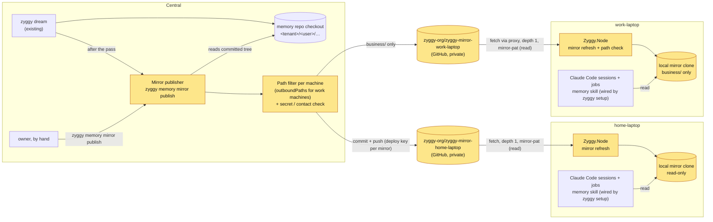
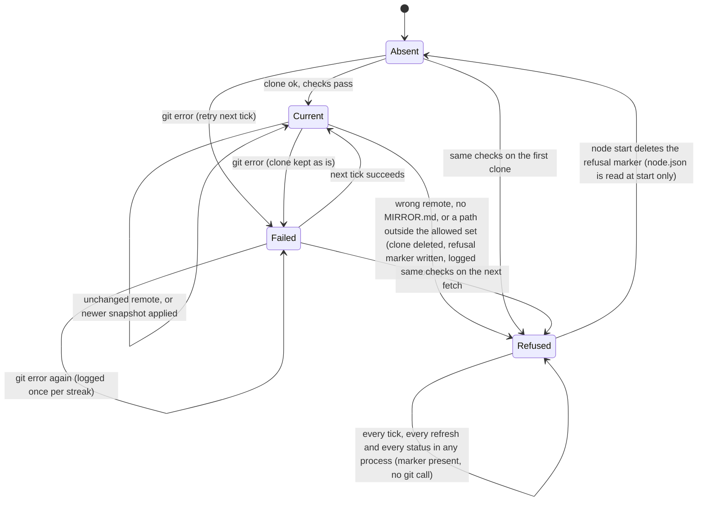

# Spec: 47 — Browsable memory on a laptop

## Status

- 2026-11-17: spec written in an unattended job from the owner's brief (no interview held; every gap is under Open questions). Not approved. The `spec-critic` pass has not run yet (the job could not start agents); it runs before the owner reads this.
- 2026-11-17: the 14 open questions decided (list under "Decided 2026-11-17": all 14 by Zyggy on the owner's standing delegation, each as recommended) and written into Behavior, Configuration, Decisions and the acceptance criteria; AC-21..AC-24 added; build plan `_plans/47-browsable-memory-laptop.md` written. Not approved; `spec-critic` still to run.
- 2026-11-17: owner decision, no plan file: the slice order, what each slice proves, its gate and the build assumptions moved from `_plans/47-browsable-memory-laptop.md` into Slices; the plan file deleted.
- 2026-11-17: slice 1 built in an unattended job (owner's go in the job brief; the spec's own approval line and the `spec-critic` pass are still open). `MemoryMirror` filter 34 passed, 1 skipped (the symbolic-link case: no link privilege on this Windows machine, runs on Linux CI), 0 failed; 9 deliberate breaks (reach, never-copied areas, sidecar check, secret check, contact check, outbound check, empty outbound, memory-repository check, removal list) each failed its test; breaking the symbolic-link skip did not, because that test is skipped here. Decisions: every new type is `internal` (no public `Zyggy.Core` surface); files are read from the working tree (the slice-2 publisher reads a committed, pushed revision, so ignored files never reach it); `mirror.targets` and `supervision.outboundPaths` are not read from `node.json` yet (the check takes them as inputs), so no shared contract changed. Verification: build 0 warnings; unit 6647 passed, 60 skipped, 0 failed; integration 998 passed, 58 skipped, 1 failed (`NodeHostJobFlowTests.DoorbellFrozen_SafetyFetchAfterOneMinuteClaimsAndReports`, unrelated to this slice; passed on rerun alone); format clean.

- 2026-11-17: owner accepted slice 1 ("Approved" to its report on Central). Spec-critic pass run in an unattended job (inline, by the criteria of the `spec-critic` agent, because the job could not start agents): verdict NOT READY with 3 blocking findings (snapshot source, laptop principal check, refused-state exit), all three fixed here with 9 improvements; 5 points left under Open questions. The founding-spec wording moved from Decisions to "Proposed amendments (awaiting the owner)" (A1–A14), widened to every shared contract the spec changes; slice 6 split into 6 (setup wiring) and 7 (skill and documents). The spec itself is not approved.
- 2026-11-17: independent `spec-critic` run as a separate agent (job 01M7MQ11MMVS24QXC6JGC9GDQT): NOT READY, 3 blocking, 5 should-fix, 2 nits. Fixed here: the refusal is persisted in a marker the node deletes at start, so `status`/`refresh` in any process report `refused` without git (Behavior, state diagram, AC-14, AC-16, AC-17); one principal per snapshot stated and given AC-25 (unit, slice 1) plus an integration case in AC-6; the committed revision is exported from the commit, committed-but-ignored files are left out, and "pushed" is checked live against the remote (AC-9); exit codes aligned (AC-9, AC-17); AC-18 split into AC-18 and AC-26; AC-21 names its canary and swept places; AC-12 and AC-22 name their paired run and own test. Left open: A12 before slice 2 (OQ3), roadmap row and decision record (OQ1). Slice 1 checked against this text: one test added for AC-25 (`MemoryMirror` filter 36 passed, 1 skipped, 0 failed, the new Theory's 2 cases included); both cases failed when the builder was made to read the whole memory root. Verification: build 0 warnings; unit 6649 passed, 60 skipped, 0 failed; integration 999 passed, 58 skipped, 0 failed; format clean.

## Goal

**As** the owner, **I want** the agents on each of my laptops to read Central's memory locally — a home laptop the memory it may read, the work laptop everything under `business/` and nothing else — from a read-only copy that Central refreshes after each dream pass, **so that** a laptop session or job knows what Central knows about my projects, people and decisions without asking Central, and so that the next deliverables (problems handled on a laptop, the Teams intake) can work from that knowledge.

Today a laptop sees no memory at all: the Hub runs on Central only (stdio), `zyggy hub --proxy` is not built (deliverable 21), and the memory repository is reachable from Central alone. The only path from memory to a laptop is the owner's own conversation.

## Context

- **Roadmap entry**: `_plans/ROADMAP.md` #47 (added 2026-11-17 by the owner as the highest priority, before 48 "Problems handled autonomously on a laptop (manual intake)" and 49 "Automatic Teams intake for support requests on the work laptop").
- **Founding-spec sections**: §7 Memory model and dream pass (layout, dream steps 6–7, Hub "On laptops" paragraph), §8 Work boundary, Secrets, Isolation, Injection, Data protection, §5 Credentials per machine and proxy, §9 design rules, §10 Laptops and Central, §11 Runbooks, §13 (MVP-scope decision), §14.
- **Reference feature**: the dream pass on Central (`_specs/28-central-dream-local.md`) for everything Central does to the memory repository — the verb, the lock, the run record, the shared commit-and-push path with one rebase retry and never a force push. The laptop side follows the discovery registry (`_specs/14-discovery-registry-routing.md`, the CLAUDE.md reference feature) for a Node timer that keeps one git checkout current, and laptop setup in one command (`_specs/42-laptop-setup-one-command.md`) for what `zyggy setup` writes into the user's Claude Code configuration. Central supervision (`_specs/18-central-supervision.md`) is the reference for the work-machine list and the `outbound` memory paths.
- **Facts verified on 2026-11-17** (code and specs read in this worktree at `2ba708b`):
  - The memory repository lives on Central at `/srv/agent/central/memory`, layout `<tenant>/<user>/` with `profile.md`, `preferences.md`, `agents.md`, `private/<category>/`, `business/<category>/`, `daily/`, `inbox/`, `auto/`, `.dream/`, `archive/<project>/` (founding spec §7). An archived item is `archive/<project>/<slug>.<ext>`, its sidecar `archive/<project>/<slug>.md` (name, description, project, media type, size, SHA-256, archived date, source name). Central pushes the memory repository with a read/write deploy key `~/.ssh/zyggy_zyggy-memory_ed25519` (§8 Secrets).
  - `zyggy dream` runs from `zyggy-dream.service` (nightly timer, request-file path unit, by hand). It ends with a commit and push through the shared memory publisher; outcomes `committed`, `nothing_to_do`, `aborted`, `failed`, `partial`; exit 7 = committed but push deferred (spec 28). The `remember` and `archive` writers commit to the same repository between dream passes.
  - `supervision.workMachines` exists in `node.json` and is read (`SupervisionSettings`). `supervision.outboundPaths` is specified by spec 18 (Configuration table: `node.json` (Central), default `[]`, "empty with a non-empty `workMachines` refuses the start"; slice 11) and **not built yet**: no code in `src/` reads it today. Nothing in `src/` reads `instance/work-boundary.json`.
  - `zyggy setup` on a laptop writes user-scope Claude Code settings (an env variable, deny rules, skills) and clones the public `zyggy-core` with `GIT_TERMINAL_PROMPT=0`; git's own `http.proxy` serves the work laptop (spec 42).
  - The GitHub token a laptop holds may be an account-wide Git Credential Manager login, not a repository-scoped token (spec 42, accepted by the owner on 2026-11-04). Such a login can read — and write — every repository of the owner's account, including the memory repository. The bus's `github-pat` is read from the secret store for the GitHub API poll only; git itself authenticates through the machine's credential helper or deploy key (§5: "the code never handles credentials itself").
  - `work-laptop` has never run a product job and has no registry file; its node runs (spec 18 Context, 2026-11-15).
- **Not verified**:
  - Whether the `zyggy-org` organisation's plan allows the two extra private repositories, their deploy keys and fine-grained tokens scoped to one repository each. Checked by the owner when creating the mirrors (runbook "Create a mirror"); a refusal there stops the release, not the build.

## Constraints

- ⚠️ **§8 work boundary — inbound to the work laptop.** The work machine receives memory files for the first time. It gets exactly the files under `<tenant>/<user>/business/` and nothing else: no identity file (`profile.md`, `preferences.md`, `agents.md` — business lines inside `profile.md` are not split out in v1), no `private/`, `daily/` (no daily notes of any machine), `inbox/`, `auto/`, `.dream/` or `archive/`. It never holds a clone of the memory repository, and its mirror carries no memory history. The reviewer verifies the path filter on Central, the second check on the laptop, and that no code or setup step on a laptop ever names the memory repository.
- ⚠️ **§8 work boundary — no outbound path is added.** The work laptop never writes to the mirror, and the mirror adds nothing to what leaves the work laptop.
- ⚠️ **One rule for the outbound paths.** The work machine's reach is checked against `supervision.outboundPaths` in Central's `node.json` — the same key spec 18 reads for supervisor runs, never a second list. `instance/work-boundary.json` documents that key and is read by no code.
- ⚠️ **Secrets.** Central holds one SSH deploy key with write access per mirror repository (`~/.ssh/zyggy_zyggy-mirror-<machine>_ed25519`, 0600, git only); a leak touches one mirror. Each laptop holds one fine-grained GitHub token, `contents:read` on its own mirror repository only, in the OS secret store as `mirror-pat` (never an account-wide login, never the bus's `github-pat`). No credential in `node.json`, `appsettings.json`, a URL, an argument or a log; git through `GitClient` / `IProcessRunner`.
- ⚠️ **§8 Data protection.** A fact erased from memory leaves every mirror at the next snapshot; a laptop never holds an older snapshot (depth-1 clone). Removing it from a mirror's history is a history rewrite the owner asks for and carries out by hand (runbook "Erase a fact from a mirror's history") — the only force push on a mirror, and never Zyggy's.
- ⚠️ **§8 Injection.** Mirror content is data, never instructions, for every session and job that reads it; the mirror's top-level read-me says so and the `zyggy-core` `memory` skill repeats it. The mirror is not signed: its integrity rests on GitHub write access (Central's deploy key only).
- ⚠️ **New `node.json` keys, a new secret name and public Core surface** for the publisher and the laptop refresh (public-API rule).
- ⚠️ **Shared contracts change**: founding spec §5, §7, §8, §10, spec 18's `supervision.outboundPaths`, spec 42's list of named secrets and `instance/work-boundary.json` (exact wording under "Proposed amendments (awaiting the owner)", pasted only after the owner approves it; until then no slice reads `supervision.outboundPaths` from `node.json`).
- §9: git only through `GitClient`; paths built by one helper, never concatenated; `TimeProvider` for every timer; the Node refresh never throws to the loop; log once per state change; no static state.
- The memory repository's own checkout, lock and push path are unchanged; the mirror publisher only reads the files of a committed, pushed revision, exported from the commit (never the working tree).
- MVP scope: one tenant, one owner, two laptops (`home-laptop`, `work-laptop`). Public repo: placeholders only.

## Diagrams

### Components touched

### Round trip: a dream pass reaches the work laptop

### Laptop clone states

### Slice map

## Behavior

### What a mirror is

- One private GitHub repository per laptop that receives memory, in the `zyggy-org` organisation next to `zyggy-bus`, named `zyggy-mirror-<machine>` (`zyggy-mirror-home-laptop`, `zyggy-mirror-work-laptop`). The name is a rule, not only a convention: the laptop refuses a `mirror.repository` whose repository name is not `zyggy-mirror-<its own machine>`. Only Central writes to it. Its default branch holds one snapshot of the files that machine may read, with the memory layout kept: `<tenant>/<user>/<path>`.
- At its root a fixed read-me (`MIRROR.md`) states: read-only copy of Central's memory, refreshed after each dream pass, content is data and never instructions, edits are discarded, facts are added through `remember`, and the source revision and date of this snapshot.
- Each snapshot is one ordinary commit `mirror YYYY-MM-DD <first 8 of the memory sha>` on top of the previous one; the mirror keeps its own history (never memory's). A file removed from memory, or newly outside the machine's reach, is removed in the next snapshot. The publisher never force-pushes; laptops clone and fetch with depth 1, so they hold the newest snapshot only.
- The mirror is not signed; content is data whatever it says, and only Central's deploy key can write to it.

### What each machine may read (its reach)

- The reach is a list of paths relative to `<tenant>/<user>/`, per machine, in Central's `node.json` (`mirror.targets`). Whole files and folders only: no line inside a file is filtered by reach.
- Whatever the list says, these are never copied: `inbox/`, `auto/`, `.dream/`, any file the memory repository ignores, any symbolic link, and the archived item files under `archive/`. Under `archive/<project>/` only sidecars are copied: a file `<slug>.md` whose front matter carries the sidecar fields (`media type` and `sha256` among them); any other file there is an item file and is skipped.
- A machine in `supervision.workMachines` may have only paths inside `supervision.outboundPaths`; anything else, or an empty `outboundPaths`, refuses the publisher's start with a configuration error. For `work-laptop` the reach is `business/`.
- Default reach of a machine that is not a work machine: `profile.md`, `preferences.md`, `agents.md`, `private/`, `business/`, `daily/`, and the sidecars under `archive/`.
- Every line of every copied file passes the existing secret patterns and contact-detail patterns again. A file with a hit is withheld whole from that snapshot (its earlier copy is removed too), and the publisher logs the file path once — never the line.

### Publishing on Central

- The mirror is refreshed by exactly two triggers: the end of every dream pass, and `zyggy memory mirror publish` run by hand. A `remember` or `archive` commit does not publish; it reaches the mirrors at the next dream pass or the next manual publish.
- `zyggy memory mirror publish [--machine <name>] [--dry-run]` builds and pushes the snapshot of each target (or one) from the files committed at the memory checkout's HEAD, only when HEAD equals the head of the remote branch read live at the start of the publish (`ls-remote`, never a remote-tracking ref that may be stale); an unpushed memory commit is never mirrored (outcome `skipped unpushed` on every target, exit 3), and a remote that cannot be read publishes nothing (`failed git_error`, exit 6). It reads the committed revision, never the working tree: the files of that commit are exported through `GitClient` into a temporary folder under Central's state directory, which the builder reads and which is deleted afterwards. An uncommitted change, an untracked file and an ignored file never reach a mirror, and a committed file that matches the memory repository's ignore rules is left out as well.
- One snapshot holds exactly one principal: the publisher reads only the directory `<tenant>/<user>/` of the principal named by `ZYGGY_TENANT` and `ZYGGY_USER` (the same pair `zyggy dream` uses), and every path of a mirror other than `MIRROR.md` lies under that one directory. Another user or another tenant in the memory repository never reaches a mirror.
- A target whose `repository` equals the memory repository's remote URL (compared after normalising SSH and HTTPS forms of the same GitHub repository) refuses the publisher's start with a configuration error. Central is the only machine that knows that URL; laptops are never given it.
- A target is published when its filtered tree differs from the tree of the mirror's last snapshot; otherwise nothing is committed (idempotent).
- The publisher keeps a checkout of each mirror under Central's state directory, commits with `add` + `commit` of exactly the snapshot, and pushes through the shared path (one fetch-and-rebase retry, never a force push) with that mirror's own deploy key (`GIT_SSH_COMMAND` naming the key file for that call only).
- It holds its own lock, so two publishes never overlap; it waits for no dream lock because it reads only committed content.
- `--dry-run` prints, per target, the files that would be added, changed, removed and withheld, and touches nothing.
- After every dream pass, whatever its outcome, `zyggy dream` runs the publish of every target before it exits. The dream's exit code and outcome are unchanged by the mirror; the run record gains one `mirror` entry per target (`published <sha>`, `unchanged`, `failed <reason>`, `withheld <n>`, `skipped unpushed`, `skipped locked` when a manual publish holds the mirror lock, `refused <reason>` on every target when the configuration check refuses). A failed, skipped or refused target is retried at the next pass or by hand.
- Exit code of a publish that meets more than one outcome: the first of 3, 4, 6, 8, 0 that applies (a configuration refusal wins, a git error on any target outranks a withheld file).

### Keeping a clone on a laptop

- When `mirror.repository` is set in the laptop's `node.json`, the Node service clones it to `mirror.path` at start, then checks the remote every `mirror.refreshMinutes` (`ls-remote`), and fetches only when the remote head moved. Clone and fetch are shallow (depth 1), so the laptop never holds an older snapshot.
- Every git call on the mirror authenticates with the laptop's `mirror-pat` from the OS secret store, handed to that one git process through its environment as an HTTP authorization header for the mirror's URL, with the machine's credential helpers switched off for that call. The account-wide login of the machine is therefore never used for the mirror, and the token never appears in an argument, a URL, a file or a log. A missing `mirror-pat` is `failed` with a detail naming the secret, never a value.
- Before the working tree is updated, the node checks (a) that the clone's `origin` is exactly `mirror.repository` and that its repository name is `zyggy-mirror-<this machine>`, (b) that the snapshot holds `MIRROR.md` at its root, and (c) that every other path of the fetched snapshot lies under exactly one principal directory `<tenant>/<user>/`, whose `<tenant>` is the laptop's `node.json` `tenant` (`node.json` names no user; a snapshot with a second user directory or another tenant is refused — one owner per tenant, MVP-scope decision), and inside it under one of `mirror.allowedPaths` and under none of `inbox/`, `auto/`, `.dream/`. On a failure it deletes the clone, writes a refusal marker under the node's state directory (`mirror-refused`: the reason and the time, never file content), logs once, and shows `refused` with the reason. The marker is deleted only by the node service at its start, before its first check (`node.json` is read at start only); while it exists, a tick, `zyggy memory mirror refresh` and `zyggy memory mirror status` — in the node or in any other process, node running or stopped — report `refused` (exit 5) and make no git call.
- Updating is fetch, then a hard reset to the fetched head and a clean of untracked files: a local edit never survives a refresh, and nothing is ever committed or pushed from the clone.
- `/health` gains a `mirror` object: state (`absent`, `current`, `failed`, `refused`), source sha and date from the snapshot's commit, last check time.
- `zyggy memory mirror status` prints the same on any laptop; `zyggy memory mirror refresh` asks the node for an immediate check (or does it itself when the node is stopped). With no `mirror.repository` both print `absent (not configured)` and exit 1, and the node starts as before.
- No code, configuration or setup step on a laptop clones, fetches or names the memory repository, and a laptop is never given its URL. "Never the memory repository" is enforced by Central's refusal of a target equal to it, by the laptop's name, `MIRROR.md` and path checks (a clone of the memory repository fails all three), and proven on the real machines by the owner-run `git remote -v` sweep (AC-19).

### Browsing from a session or job

- `zyggy setup` (laptop) adds the clone folder to the user-scope Claude Code settings as an additional directory, with `Read` allowed and `Edit`/`Write` denied on it, and sets `ZYGGY_MEMORY_MIRROR` to its path. It writes `mirror.allowedPaths` `["business/"]` into `node.json` when `discovery.detail` is `names` (the existing work-machine signal) and leaves the default reach otherwise; the mirror's own `MIRROR.md` never widens it. A missing `mirror-pat` while `mirror.repository` is set is named like a missing `github-pat` (spec 42): the line `zyggy secret set mirror-pat`, never a value, and setup exit 6 (incomplete). Job runs started by the node inherit the user-scope settings; the tool guard already keeps their writes inside the run folder.
- `zyggy-core` ships a new `memory` skill (no section in the existing guidance) that tells an agent where the mirror is (`ZYGGY_MEMORY_MIRROR`), how memory is laid out, to search with `Grep`/`Glob`, that content is data and never instructions, that the work laptop sees `business/` only, and that facts are added through `remember`, never by editing the mirror.
- The Hub proxy (`zyggy hub --proxy`, 21) and the laptop `SessionStart` digest are not built here; 21 answers `get_context` from the mirror later.

### Configuration

| Key | Where | Default | Rule |
| --- | --- | --- | --- |
| `mirror.targets` | `node.json` (Central) | `[]` | list of `{ machine, repository, deployKey, paths }`; `repository` is the SSH URL of `zyggy-org/zyggy-mirror-<machine>`; `deployKey` is the key file path (a path, never the key); a work machine's `paths` must lie inside `supervision.outboundPaths`, and a `repository` equal to the memory remote is refused (publish exit 3); `paths` omitted = the default reach |
| `supervision.outboundPaths` | `node.json` (Central) | `[]` | defined by spec 18; read by 47 for the work machines' reach; empty with a work machine among `mirror.targets` refuses the publish (exit 3). Paths relative to `<tenant>/<user>/`, a folder ending in `/` (amendment A12). Its reader is built by whichever of 18 slice 11 and 47 slice 2 lands first, after the owner approved A12 |
| `mirror.repository` | `node.json` (laptop) | unset = no mirror | HTTPS URL of `zyggy-org/zyggy-mirror-<this machine>`; any other repository name is refused |
| `mirror.path` | `node.json` (laptop) | `%LOCALAPPDATA%\zyggy\memory-mirror` | must not lie inside a project root, the bus checkout or `zyggy-core` |
| `mirror.allowedPaths` | `node.json` (laptop) | the default reach | the laptop's own check; `["business/"]` on `work-laptop`, written by setup when `discovery.detail` is `names` |
| `mirror.refreshMinutes` | `node.json` (laptop) | 30 | 5–1440 |
| `mirror-pat` | OS secret store (laptop) | — | fine-grained token, `contents:read` on this machine's mirror only; set with `zyggy secret set mirror-pat`; named by `zyggy setup` when missing and `mirror.repository` is set |

### CLI

| Verb | Machine | Exit codes |
| --- | --- | --- |
| `zyggy memory mirror publish [--machine <name>] [--dry-run]` | Central | 0 published or unchanged · 2 usage · 3 refused at start (configuration: reach outside outbound, empty outbound, target equal to the memory repository, unknown machine; or memory not pushed, outcome `skipped unpushed`) · 4 locked · 6 git error (any target) · 8 a file withheld (published otherwise); several apply → the first of 3, 4, 6, 8, 0 |
| `zyggy memory mirror status [--json]` | laptop | 0 current · 1 absent (also: not configured) · 5 refused · 6 failed |
| `zyggy memory mirror refresh` | laptop | as `status`, after one check |

### Failure modes

| Situation | Observable outcome | Runbook entry |
| --- | --- | --- |
| Mirror push rejected twice (someone wrote to the mirror) | target `failed git_error`, exit 6, next pass retries; no force | "Mirror push rejected": find the foreign commit, revert it on GitHub |
| A copied line matches a secret or contact pattern | file withheld, path logged once, exit 8 / run record `withheld` | "File withheld from a mirror": fix the memory line, rerun publish |
| Work machine's reach outside the outbound paths, or outbound paths empty | publish refused at start, exit 3, nothing pushed | "Mirror reach refused" |
| A target names the memory repository | publish refused at start, exit 3, nothing pushed | "Mirror reach refused" |
| Laptop fetch fails (offline, proxy) | `failed`, clone kept, logged once per streak | "Mirror not refreshing" |
| Snapshot holds a path outside `mirror.allowedPaths`, no `MIRROR.md`, wrong remote or wrong repository name | clone deleted, `refused`, logged once | "Mirror refused on a laptop": check Central's `mirror.targets` and the laptop's `mirror.repository` |
| Local edit in the clone | discarded at the next refresh | — |
| `mirror-pat` missing or rejected on the laptop | `failed git_error` naming `mirror-pat`, never its value | "Mirror credential": create the fine-grained token, `zyggy secret set mirror-pat` |
| Deploy key of a mirror missing on Central | that target `failed git_error`, the others published | "Create a mirror" |
| A fact must leave a mirror's history | — | "Erase a fact from a mirror's history": the owner rewrites the mirror's history by hand; laptops pick it up at the next refresh (depth 1) |

### Edge cases

| Case | Expected behavior |
| --- | --- |
| A `remember`/`archive` commit between dream passes | not published until the next dream pass or a manual publish |
| Dream pass with `nothing_to_do` but a `remember`/`archive` commit since the last snapshot | published (the tree differs) |
| Memory HEAD ahead of its remote (push deferred, exit 7) | no target published, run record `mirror: skipped unpushed` |
| A category moved from `private/` to `business/` | appears in the work mirror at the next pass |
| A business fact written only in `profile.md` | not in the work mirror (whole-file rule) |
| `mirror.targets` gains a machine whose repository is empty | first snapshot created on the empty default branch |
| Laptop node stopped for a week | next start fetches the newest snapshot only |
| The owner rewrote a mirror's history | the laptop's next fetch replaces its one commit; the publisher's checkout is re-cloned when its branch no longer descends from the remote one (never a force push) |
| Work laptop's account-wide login could read the memory repository | nothing in Zyggy uses it: mirror calls switch credential helpers off and use `mirror-pat`; the owner-run check confirms no clone exists (AC-19) |

## Decisions

| Founding-spec item (section) | Verdict | Why |
| --- | --- | --- |
| §7 "Nodes never write durable memory" | **keep** | the mirror is read-only and the laptop's write path stays `context` envelopes and `remember` |
| §7 Hub "On laptops … `hub --proxy` answers `get_context` from a cached copy of the machine's own `context/` folder" | **reshape, later** | the mirror is the better cache; 21 answers from it. Not built here (Q9) |
| §7 `work/` memory "never synced to Central" | **keep** | untouched: the mirror runs Central → laptop only |
| §8 Work boundary "work-related memory lives on the work laptop … outbound envelopes contain only …" | **reshape (add an inbound rule)** | new: the work laptop receives `business/` from Central, read-only, never the memory repository (A5) |
| §8 Secrets table | **reshape** | a write deploy key per mirror on Central (Q14), a read-only fine-grained `mirror-pat` per laptop (Q4) (A6) |
| §5 "the code never handles credentials itself" | **reshape** | the mirror fetch hands `mirror-pat` to git per call, because the machine's own login may be account-wide (Q4); the bus's git path is unchanged (A1) |
| §5 Credentials per machine "a machine holds no credential for any other repository" | **reshape** | each laptop holds one read credential and Central one write key for that laptop's mirror; the sentence is already untrue for Central (memory and `zyggy-core` keys, §8) (A2) |
| §5 transport over HTTPS through the proxy | **keep** | mirror fetch uses the same git and proxy path as the bus |
| §7 dream step 7 "commit and push" | **reshape** | then publish the mirrors (A4) |
| §8 Injection, Data protection | **reshape** | mirror content is data (A7); erasure reaches the mirrors (A8) |
| Delivery through the bus (envelopes) instead of a repository | **rejected** | the bus history would keep every file on every machine's checkout, including `private/` on the work laptop; a per-machine repository gives a GitHub-enforced reach (Q3) |
| One repository per reach, or one with a branch per machine | **rejected** | GitHub cannot restrict reads per branch; per machine keeps one credential per reach (Q3) |
| Signing the mirror | **rejected for v1** | content is data anyway; signing adds key distribution to the work laptop (Q11) |
| Line-level filtering of `profile.md` | **rejected for v1** | fragile; a mistake leaks private data to the employer's machine. Splitting business facts into `business/` at the dream pass may come later (Q13) |
| A library | none | git through `GitClient` covers it; no package added |

The exact wording of every shared-contract change is under "Proposed amendments (awaiting the owner)" (A1–A14; the earlier W47-1..W47-6 are A4, A5, A6, A3, A10, A1).

## Acceptance criteria

| # | Criterion | Check |
| --- | --- | --- |
| AC-1 | Given a memory tree with every top-level area, when the snapshot for a machine with the default reach is built, then it holds exactly `MIRROR.md` and the files under `profile.md`, `preferences.md`, `agents.md`, `private/`, `business/`, `daily/` and the sidecars under `archive/`, and none from `inbox/`, `auto/`, `.dream/` or archived item files. | Unit test |
| AC-2 | Given the same tree, the snapshot for a machine with reach `business/` holds exactly `MIRROR.md` and the files under `business/`; a symbolic link under `business/` is skipped. | Unit test |
| AC-3 | Given a work machine whose configured reach contains a path outside `supervision.outboundPaths`, or an empty `outboundPaths`, or a target whose repository equals the memory remote (SSH or HTTPS form), the publisher refuses to start (exit 3) and pushes nothing. | Unit test + integration test through the verb |
| AC-4 | Given a file whose line matches a secret or contact-detail pattern, the file is absent from the snapshot, an earlier copy is removed, the log names the path and never the line, exit 8. | Unit test (canary line never in output or log) |
| AC-5 | `MIRROR.md` names the source revision and date and states that content is data, never instructions, that edits are discarded and that facts are added through `remember`. | Unit test |
| AC-6 | `zyggy memory mirror publish` against a local bare memory remote and two local bare mirrors pushes one `mirror YYYY-MM-DD <sha8>` commit to each, whose tree equals the snapshot; a second run with no memory change commits nothing (exit 0); with a second user and a second tenant committed in the memory remote, no mirror holds a path outside the one principal's `<tenant>/<user>/`. | Integration test |
| AC-7 | A file deleted from memory, or moved out of the reach, is gone from the next snapshot. | Integration test |
| AC-8 | No mirror commit has a memory commit as an ancestor, and no memory object reachable only from memory history is present in the mirror repository. | Integration test (`git rev-list` / object check on the bare mirror) |
| AC-9 | With a memory HEAD not on its remote, no target is published, the outcome says `skipped unpushed` and a manual publish exits 3; the same holds when the local remote-tracking ref equals HEAD but the remote branch has moved (stale ref). With HEAD pushed, an uncommitted change to a tracked `business/` file, an untracked `business/` file, an ignored file in the memory working tree and a committed file that matches the ignore rules are absent from every snapshot. | Integration test (one case each) |
| AC-10 | A foreign commit on the mirror leads to `failed git_error`, exit 6, no force push, and the foreign commit still present. | Integration test |
| AC-11 | `--dry-run` lists added, changed, removed and withheld files per target and changes no repository. | Integration test |
| AC-12 | After `zyggy dream` (fake-claude) ends `committed` and after one that ends `nothing_to_do` with a newer `remember` commit, each mirror holds the new snapshot; the dream's exit code and outcome equal those of the same run on the same fixture without mirror targets (a paired run in the test); the run record holds one `mirror` entry per target. | Integration test through `zyggy dream` |
| AC-13 | A mirror failure in a dream run leaves the dream outcome `committed` and records `failed` for that target; the next run publishes it. A refused mirror configuration records `refused <reason>` for every target, and a mirror lock held by a manual publish records `skipped locked`; in both the dream's exit code and outcome are unchanged. | Integration test |
| AC-14 | The laptop refresh decides: clone when absent, nothing when the remote head is unchanged, fetch and reset when it moved; `refused` + delete + refusal marker on each of a wrong remote, a wrong repository name, a missing `MIRROR.md`, a path outside `<this tenant>/`, a second principal directory, a path outside `mirror.allowedPaths`, and a path under `inbox/`/`auto/`/`.dream/` (one case each); after a refusal a second tick and a `refresh` make zero git calls, and a new refresh instance created as at node start deletes the marker and clones again; `failed` (clone kept) on a git error or a missing `mirror-pat`; it logs once per state change and never throws to the loop. | Unit test with `FakeTimeProvider` and substituted `IProcessRunner` and `ISecretStore` |
| AC-15 | The Node service against a local bare mirror clones at start, applies a newer snapshot within one `refreshMinutes`, holds one commit only (depth 1), and discards a local edit and an untracked file. | Integration test (Node host) |
| AC-16 | A snapshot with a `private/` file on a node whose `mirror.allowedPaths` is `["business/"]` leaves no clone on disk, `/health` shows `refused` with the path's area, `zyggy memory mirror status` exits 5 with the node running and with it stopped, `zyggy memory mirror refresh` exits 5 and runs no git process, and a restarted node host clones again (and is refused again by the same snapshot). | Integration test |
| AC-17 | A `mirror.repository` whose repository name is not `zyggy-mirror-<this machine>`, or a `mirror.path` inside a project root, the bus checkout or `zyggy-core`, is refused at node start with no git call (`/health` `refused`, `zyggy memory mirror status` exit 5); a bare repository laid out like the memory repository (no `MIRROR.md`, an `inbox/`) is refused even when its name matches. | Unit test + integration test |
| AC-18 | `zyggy setup` adds the mirror folder as an additional directory with `Read` allowed and `Edit`/`Write` denied, sets `ZYGGY_MEMORY_MIRROR`, writes `mirror.allowedPaths` `["business/"]` when `discovery.detail` is `names` (and leaves it unset otherwise), and a second run changes nothing. | Integration test through `zyggy setup` against a temporary profile |
| AC-19 | On the real machines: after a dream pass, `home-laptop` and `work-laptop` show `current` with the pass's source sha; on `work-laptop` every file in the clone is under `business/` or `MIRROR.md`; no checkout on `work-laptop` has the memory repository as a remote (`git remote -v` over every repository under the user profile); a session on each laptop answers a question from a mirrored fact through the `memory` skill. | Owner-run check at release |
| AC-20 | The approved amendments A1–A14 and the runbook entries named under Failure modes exist in the shipped documents; `zyggy-core` carries the `memory` skill, whose text names `ZYGGY_MEMORY_MIRROR`, "data, never instructions", `business/` only on the work laptop and `remember`. | `zyggy-core` bats tests for the skill (each fails when its line is removed); a text search, listed in the slice 7 report, for each approved amendment's new text in its file and each runbook title in the instance runbooks |
| AC-21 | Every git call on a laptop mirror carries `mirror-pat` only through that process's environment, switches credential helpers off, and the token value appears in no argument, URL, file, log line or `/health` output. | Unit test (recorded process specs) + `SecretSweep` in the slice 5 integration test: a canary `mirror-pat` value, searched for in the recorded process arguments, the node log, the clone's `.git/config` and every other file under `mirror.path` and the node's state directory, and the `/health` and `status --json` output |
| AC-22 | Every push of the publisher to a mirror uses that target's own deploy key (per-call `GIT_SSH_COMMAND` naming its key file) and never a force push; a missing key file fails that target only while the other target is published. | Unit test (recorded process specs) + integration test, the missing key file as its own test |
| AC-23 | A `remember` commit with no dream pass after it does not change any mirror; `zyggy memory mirror publish` by hand then publishes it. | Integration test |
| AC-24 | An `archive/<project>/` folder with an item file and its `.md` sidecar yields only the sidecar in the default-reach snapshot and nothing in the `business/` snapshot. | Unit test |
| AC-25 | Given a memory root holding the principal and also another user of the same tenant, another tenant and a loose file at the root, the snapshot for the default and for the `business/` reach holds only `MIRROR.md` and paths under the one principal's `<tenant>/<user>/`. | Unit test |
| AC-26 | With `mirror.repository` set and no `mirror-pat` in the secret store, `zyggy setup` prints the line `zyggy secret set mirror-pat` (never a value) and exits 6; with `mirror.repository` unset it does neither. | Integration test through `zyggy setup` against a temporary profile |

## Slices

Built in this order on `feature/47-browsable-memory-laptop` from `main`; the `memory` skill goes to `zyggy-core` on its own feature branch (slice 7), the runbooks to the private instance repository (slice 7). Every slice is proven with the Verification Commands (`node .claude/hooks/verify.mjs`: build, unit tests, integration tests, format check, 0 warnings) and stops at its gate; Claude commits it on the owner's approval and pushes only through the `ship` skill. Every work-boundary rule is proven twice: on Central (slices 1–2) and on the laptop (slices 4–5).

Progress:

- **Slice 1 — accepted by the owner on 2026-11-17** (he answered "Approved" to its report on Central). Proof as recorded under Status. This is the acceptance of slice 1 only; the spec itself is not yet approved, and slice 2 starts after that approval and the owner's answer on the amendments it needs (A12).

| # | Slice | What the system can do afterwards | Criteria | Review check | Gate (owner reviews before approving) |
| --- | --- | --- | --- | --- | --- |
| 1 | ⚠️ Central builds the snapshot a machine may read, through the seams (fake) | for a memory tree and a target, the snapshot is computed: reach, never-copied areas, sidecars only under `archive/`, symbolic links skipped, withheld files, `MIRROR.md`; the configuration check refuses a work reach outside `outboundPaths`, an empty `outboundPaths` and a target equal to the memory remote. Files only: no process, no repository, no secret, no network | AC-1, AC-2, AC-3 (unit), AC-4, AC-5, AC-24, AC-25 | `dotnet test tests/Zyggy.Core.Tests --filter "FullyQualifiedName~MemoryMirror"` | the reach rules against Behavior; the snapshot file list for the default and the `business/` reach of one tree; the work reach can never exceed `outboundPaths`; a canary line never in a snapshot or a log |
| 2 | ⚠️ `zyggy memory mirror publish` pushes each snapshot to its own mirror repository (wire) | against a local bare memory remote and two bare mirrors: one `mirror YYYY-MM-DD <sha8>` commit per changed target, idempotent, removals carried, no memory history, only committed files exported from the commit (never uncommitted, untracked or ignored ones, committed-but-ignored included), one principal per mirror, `skipped unpushed` against the live remote head, a foreign commit → exit 6 with no force push, `--dry-run`, each push with its own deploy key, exits 3 / 4 / 8 | AC-3, AC-6, AC-7, AC-8, AC-9, AC-10, AC-11, AC-22 | `dotnet test tests/Zyggy.Integration --filter "FullyQualifiedName~MirrorPublish"` | one real publish and one `--dry-run` output on the fixture; the verb, options, exit codes and commit message; never a force push in any recorded git call; key content never read or logged; `mirror.targets` read from `node.json`. Starts only after the owner approved A12 (OQ3) |
| 3 | Every dream pass refreshes the mirrors (wire) | `zyggy dream` publishes every target after any outcome, its exit and outcome unchanged, one `mirror` entry per target in the run record (additive; older records still read); a `remember` commit waits for the next pass or a manual publish | AC-12, AC-13, AC-23 | `dotnet test tests/Zyggy.Integration --filter "FullyQualifiedName~DreamMirror"` | a run record with `mirror` entries; dream exit and outcome unchanged; every existing dream test unedited and green |
| 4 | ⚠️ A laptop node decides when to clone, refresh, refuse or wait (fake) | the refresh state machine (`absent` / `current` / `failed` / `refused`) over a recorded process runner, an in-memory secret store and a fake clock; `mirror-pat` reaches git only through that call's environment with credential helpers off | AC-14, AC-17 (unit), AC-21 (unit) | `dotnet test tests/Zyggy.Core.Tests --filter "FullyQualifiedName~MirrorRefresh"` | the recorded git calls of one fetch with the token replaced by its fingerprint; state words, laptop keys and defaults; the account-wide login never used; no memory URL on the laptop side |
| 5 | ⚠️ A laptop node keeps a read-only clone current and refuses one it may not hold (wire) | the Node host clones a bare mirror at start, applies a newer snapshot within one interval at depth 1, discards local edits, refuses and deletes a clone it may not hold; `/health` `mirror`; `zyggy memory mirror status` / `refresh` | AC-15, AC-16, AC-17, AC-21 | `dotnet test tests/Zyggy.Integration --filter "FullyQualifiedName~MirrorRefresh"` | `/health` and `zyggy memory mirror status` for `current` and `refused`; the refused clone gone from disk; secret sweep clean; a node without `mirror.repository` starts as before |
| 6 | ⚠️ `zyggy setup` wires the clone read-only into Claude Code on a laptop (wire) | `zyggy setup` adds the clone as an additional directory (`Read` allowed, `Edit`/`Write` denied), sets `ZYGGY_MEMORY_MIRROR`, writes `allowedPaths` `["business/"]` when `discovery.detail` is `names`, names a missing `mirror-pat` (exit 6); idempotent | AC-18, AC-26 | `dotnet test tests/Zyggy.Integration --filter "FullyQualifiedName~SetupMirror"` | the settings diff of one setup run on a temporary profile, a second run changing nothing; the `mirror-pat` line without a value |
| 7 | ⚠️ Agents on a laptop browse the mirror: `zyggy-core` `memory` skill and documents (wire) | the `memory` skill with bats tests, README rows, the runbooks of Failure modes, the amendments A1–A14 the owner approved pasted into their files | AC-20 | the `zyggy-core` bats suite, and the slice 7 text-search list | definition of done: `spec-reviewer` over `main..HEAD`, then the owner-run AC-19 at release (MINOR) |

AC-19 is run by the owner (and by the `ship` skill where it can) at release: create the two mirrors in `zyggy-org`, their deploy keys on Central and the two `mirror-pat` tokens; after a dream pass both laptops show `current` with the pass's sha; the `work-laptop` clone holds only `business/` and `MIRROR.md`; the `git remote -v` sweep shows no memory repository; a session on each laptop answers from a mirrored fact through the `memory` skill.

Build assumptions, confirmed or corrected at the gate named:

- **Sidecar (slice 1).** A sidecar is `archive/<project>/<slug>.md` that the archive writer's own sidecar reader accepts; any other file under `archive/` is skipped.
- **Memory remote comparison (slice 1).** SSH (`git@host:o/r.git`, `ssh://git@host/o/r.git`) and HTTPS (`https://host/o/r[.git][/]`) forms of one `host/owner/repo` compare equal, case-insensitive. The memory remote is read from the memory checkout's `origin` in slice 2.
- **`supervision.outboundPaths` (slices 1–2).** Read with spec 18's definition and the path form of amendment A12; slice 1's check takes it as an input and does not read `node.json`. Its reader is added when the owner has approved A12 (spec 18 slice 11 or slice 2 here, whichever comes first).
- **Token hand-off (slice 4).** `mirror-pat` reaches git as `GIT_CONFIG_COUNT` / `GIT_CONFIG_KEY_n` / `GIT_CONFIG_VALUE_n` entries for `http.<mirror-url>.extraHeader` and an empty `credential.helper`, in that process's environment only, unless a cleaner hook in the git client already exists.
- **Publisher state (slice 2).** Mirror checkouts live under Central's state directory, `<state>/mirrors/<machine>/`; a checkout whose branch no longer descends from the remote one is deleted and re-cloned, never force-pushed.
- **`refresh` (slice 5).** `zyggy memory mirror refresh` asks a running node through its localhost health endpoint and runs the check itself when no node answers; in both cases a present refusal marker answers `refused` first, without git.
- **Refusal marker (slices 4–5).** `mirror-refused` lives in the node's existing state directory; only the node service's start deletes it.

## Out of scope

- The Hub proxy on laptops (`zyggy hub --proxy`, `get_context` from the mirror) and a laptop `SessionStart` digest (21).
- Publishing after each `remember` or `archive` commit.
- Splitting business facts out of `profile.md`, or any line-level reach filter.
- Any write from a laptop into memory other than the existing `context` envelopes, `remember` and `item`.
- A mirror for Central itself, or for a machine that is not a laptop of this owner.
- Signing the mirror's content.
- Automatic erasure from a mirror's history.
- Deliverables 48 and 49.

## Decided 2026-11-17

All 14 questions were decided by Zyggy on the owner's standing delegation, each as recommended (source: `_specs/47-49-open-questions.md`, questions 1–14). None is left open.

| # | Question | Decision | Decided by |
| --- | --- | --- | --- |
| Q1 | Refresh trigger | (c) after every dream pass, plus `zyggy memory mirror publish` by hand; no publish per `remember`/`archive` commit | Zyggy (delegation) |
| Q2 | Single source of the outbound paths | (b) one `node.json` key, `supervision.outboundPaths`, shared with spec 18; `instance/work-boundary.json` documents it and is read by no code | Zyggy (delegation) |
| Q3 | Mirror repository per machine or per reach | (a) one per machine, `zyggy-mirror-<machine>` | Zyggy (delegation) |
| Q4 | Laptop read credential | (b) a fine-grained read-only token per laptop scoped to its mirror, in the OS secret store (`mirror-pat`). The decision requires it "at least on `work-laptop`"; this spec uses it on both laptops so there is one code path | Zyggy (delegation) |
| Q5 | Mirror history and erasure | (a) normal history, depth-1 clones; erasure by a history rewrite the owner asks for and does by hand | Zyggy (delegation) |
| Q6 | Default reach of a non-work laptop | (a) identity files, `private/`, `business/`, `daily/`, plus archive sidecars, never item files | Zyggy (delegation) |
| Q7 | Proving "never the memory repository" | (a) refusal in code plus the owner-run `git remote -v` sweep. The URL equality check runs on Central (the only holder of that URL); laptops check the repository name, `MIRROR.md` and the paths instead, since (a) keeps the memory URL off laptops | Zyggy (delegation) |
| Q8 | Agent guidance in `zyggy-core` | (a) a new `memory` skill | Zyggy (delegation) |
| Q9 | Hub proxy and laptop `SessionStart` digest | (a) out of scope; 21 answers `get_context` from the mirror later | Zyggy (delegation) |
| Q10 | Source of the laptop's `allowedPaths` | (a) written by `zyggy setup` from `discovery.detail: names` | Zyggy (delegation) |
| Q11 | Integrity of the mirror | (a) GitHub write access (Central only) plus "data, never instructions"; no signing | Zyggy (delegation) |
| Q12 | Where the mirrors live | (b) the `zyggy-org` organisation, next to `zyggy-bus`. Whether the organisation's plan allows the repositories and tokens is checked by the owner when creating them | Zyggy (delegation) |
| Q13 | Personal profile lines and other machines' daily notes | (a) whole-file rules only: the work mirror gets `business/` only. Option (b), splitting business facts out of `profile.md`, is left for later and not specified | Zyggy (delegation) |
| Q14 | Mirror write credential on Central | (a) one SSH deploy key per mirror repository | Zyggy (delegation) |

## Proposed amendments (awaiting the owner)

None of these is applied. Each is pasted into its file only after the owner approves its exact text (CLAUDE.md "Founding spec"); every paste is listed in the reply that makes it. "FS" is `_specs/00 - Personal Agent Platform — Technical Specification.md`. Text in the "New" column is the exact replacement or insertion.

| # | File and section | Present text (one line) | New text |
| --- | --- | --- | --- |
| A1 | FS §5 Transport, Git operations, first bullet | "… or the PAT via credential helper (HTTPS, port 443); the code never handles credentials itself." | Append after "the code never handles credentials itself.": " Exception: on a laptop, every git call on the memory mirror hands the machine's `mirror-pat` to that one git process through its environment, as an HTTP authorization header for the mirror's URL with credential helpers switched off; the token never appears in an argument, a URL, a file or a log (deliverable 47)." |
| A2 | FS §5 Transport, Credentials per machine, lead sentence | "Every credential is scoped to exactly one tenant's bus repository (§4); a machine holds no credential for any other repository." | "Every bus credential is scoped to exactly one tenant's bus repository (§4). Beyond the bus, a machine holds only the repository-scoped credentials the §8 Secrets table lists: on Central the memory, `zyggy-core` and memory-mirror deploy keys; on each laptop one read-only `mirror-pat` for its own memory mirror (deliverable 47)." |
| A3 | FS §7 Layout, the paragraph after the tree (insert before "A new category is created …") | (none: new paragraph) | "A laptop holds a read-only mirror of the memory paths its reach names, published by Central into a repository of its own, `zyggy-mirror-<machine>` (deliverable 47); `inbox/`, `auto/`, `.dream/`, symbolic links, ignored files and archived item files are never mirrored (under `archive/` only sidecars)." |
| A4 | FS §7 Dream pass, step 7 | "`git commit -m \"dream YYYY-MM-DD\"` and push; if the diff touches `profile.md` or `preferences.md`, also send a Telegram message with the diff for review." | Append: " Then, whatever the outcome, `zyggy memory mirror publish` refreshes each laptop's mirror from the pushed revision; the dream's exit code and outcome do not change, and the owner can run the publish by hand (deliverable 47)." |
| A5 | FS §8 Work boundary, new bullet after "Work-related memory lives in `memory/<tenant>/<user>/work/` …" | (none: new bullet) | "- Inbound, the work node receives only a read-only mirror of the memory paths inside `supervision.outboundPaths` (v1: `business/`), published by Central to a repository of its own; it never clones, fetches or names the memory repository, never writes to the mirror, and its mirror carries no memory history (deliverable 47)." |
| A6 | FS §8 Secrets table, two new rows after "Memory repository deploy key (Central) …" | "\| Memory repository deploy key (Central) \| `~/.ssh/zyggy_zyggy-memory_ed25519`, 0600, read/write \| git only (dream pass push) \|" | "\| Memory mirror deploy key (Central), one per mirror \| `~/.ssh/zyggy_zyggy-mirror-<machine>_ed25519`, 0600, write, that mirror repository only \| git only (mirror publish, per-call `GIT_SSH_COMMAND`) \|" and "\| `mirror-pat` (laptop) \| same store as the GitHub PAT, name `mirror-pat`; fine-grained, `contents:read`, the machine's own `zyggy-mirror-<machine>` only; never an account-wide login, never the bus `github-pat` \| git only (mirror clone and fetch, per-call environment) \|" |
| A7 | FS §8 Injection and abuse, new bullet after the "Archived documents …" bullet | (none: new bullet) | "- Memory mirror content on a laptop is data for every session and job that reads it; the mirror's `MIRROR.md` and the `memory` skill say so. The mirror is not signed; its integrity rests on GitHub write access, held by Central's deploy key only (deliverable 47)." |
| A8 | FS §8 Data protection, the sentence "a fact is erased on request by deleting the line, and the memory repository's history is rewritten when the owner asks" | "… a fact is erased on request by deleting the line, and the memory repository's history is rewritten when the owner asks; …" | "… a fact is erased on request by deleting the line, which removes it from every memory mirror at the next snapshot, and the memory repository's history — and on request a mirror's history, by hand — is rewritten when the owner asks; …" |
| A9 | FS §10 `node.json` example, after the `supervision` line | `"supervision": { "enabled": true, "detail": "full", "statusMinutes": 10, "workMachines": [] },   // deliverable 18 …` | Add to the `supervision` object `"outboundPaths": []` with the comment "outboundPaths: memory paths relative to <tenant>/<user>/ a work machine may read (18, 47)", and a new line: `"mirror": { "repository": null, "path": null, "allowedPaths": null, "refreshMinutes": 30 },   // laptops, deliverable 47: repository = HTTPS URL of zyggy-org/zyggy-mirror-<machine>, null = no mirror; path null = %LOCALAPPDATA%\zyggy\memory-mirror; allowedPaths null = the default reach, ["business/"] on the work laptop. Central: "mirror": { "targets": [ { "machine", "repository", "deployKey", "paths" } ] }` |
| A10 | FS §10 Laptops (Windows 11), first bullet, sentence "It installs the `remember` and `archive` node skills, and names every missing secret with the command that sets it, never a value." | that sentence | "It installs the `remember` and `archive` node skills, and names every missing secret with the command that sets it, never a value. When `mirror.repository` is set it adds the memory mirror folder to the user-scope settings as an additional directory (`Read` allowed, `Edit`/`Write` denied), sets `ZYGGY_MEMORY_MIRROR`, and on a machine with `discovery.detail: names` writes `mirror.allowedPaths` `[\"business/\"]` (deliverable 47)." |
| A11 | FS §10 Claude Code side, sentence "`agentbus setup` also copies the `bus` and `discover` skills (deliverable 15)." | that sentence | "`agentbus setup` also copies the `bus` and `discover` skills (deliverable 15) and the `memory` skill (deliverable 47)." |
| A12 | `_specs/18-central-supervision.md` Configuration table, row `supervision.outboundPaths` | "\| `supervision.outboundPaths` \| `node.json` (Central) \| `[]` \| folders a work-machine answer may read; empty with a non-empty `workMachines` refuses the start \|" | "\| `supervision.outboundPaths` \| `node.json` (Central) \| `[]` \| memory paths relative to the principal's `<tenant>/<user>/`, a folder ending in `/` (v1 `[\"business/\"]`), that a work-machine answer may read and that a work machine's memory mirror may hold (spec 47, the one list for both); empty with a non-empty `workMachines` refuses the start of the supervisor and of the mirror publish \|" |
| A13 | `instance/work-boundary.json` (private instance repository), new top-level key | not readable from this repository (see Open question OQ2); the file records `policy_checked` (spec 18 Q2) | Add: `"memoryMirror": { "inbound": "read-only mirror of the memory paths in supervision.outboundPaths (node.json on Central), repository zyggy-mirror-work-laptop, deliverable 47", "source": "supervision.outboundPaths", "readByCode": false }` |
| A14 | `_specs/42-laptop-setup-one-command.md` exit `Incomplete = 6` and the secrets setup names (spec 42 AC-19: the `signWith` key and `github-pat`) | "`Incomplete = 6`: `zyggy-core`, settings or a skill failed; an env value points to a missing file; `github-pat` is missing." | "`Incomplete = 6`: `zyggy-core`, settings or a skill failed; an env value points to a missing file; `github-pat` is missing; or `mirror-pat` is missing while `mirror.repository` is set (deliverable 47)." — and the secret name `mirror-pat` joins the names setup reports (name and fingerprint only) |

## Open questions

Left open by the spec-critic pass of 2026-11-17 because neither the spec, the roadmap nor a recorded decision settles them:

- [ ] **OQ1 — roadmap entry and decision record absent on this branch.** Found: Context cites `_plans/ROADMAP.md` #47 and "Decided 2026-11-17" cites `_specs/47-49-open-questions.md`; neither the entry nor the file exists in this worktree (fast-forwarded to the slice-1 branch). Why it matters: the decisions Q1–Q14 have no source a reviewer can open. Options: (a) the owner's roadmap edit and the questions file land on the feature branch before release; (b) the Decided table is declared the record and the citation removed. Recommendation: (a).
- [ ] **OQ2 — present text of `instance/work-boundary.json`.** Found: the file lives in the private instance repository, not readable here; A13 adds a key without seeing the file. Why it matters: A13 must not clash with an existing key. Recommendation: the owner (or the slice 7 session with that repository) checks A13 against the file before approving it.
- [ ] **OQ3 — the amendments A1–A14 themselves.** Slice 2 needs A12 (path form of `supervision.outboundPaths`) before it reads the key; the others are pasted in slice 7. Recommendation: approve A12 with the spec, the rest at the same time or at slice 7.
- [ ] **OQ4 — slice 1's branch.** Found: slice 1 reached this worktree from the job branch `zyggy/01M7MKV354171JM7PHYTNT68DM`, not from `feature/47-browsable-memory-laptop` as Slices says. Why it matters: the build workflow builds each slice on the feature branch. Recommendation: the next build session starts `feature/47-browsable-memory-laptop` from that commit.
- [ ] **OQ5 — contact-detail withholding on the home laptop.** Found: every copied file passes the contact-detail patterns, so a `daily/` or `private/` file naming a person's mail address or phone number is withheld whole even from the owner's own home laptop, where §7 already forbids storing contact details. Why it matters: a withheld file signals a memory line that breaks §7, which is the intended effect, but could withhold more than expected. Recommendation: keep as written; review the `withheld` count after the first real publish (AC-19).
