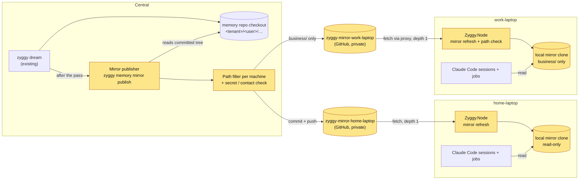
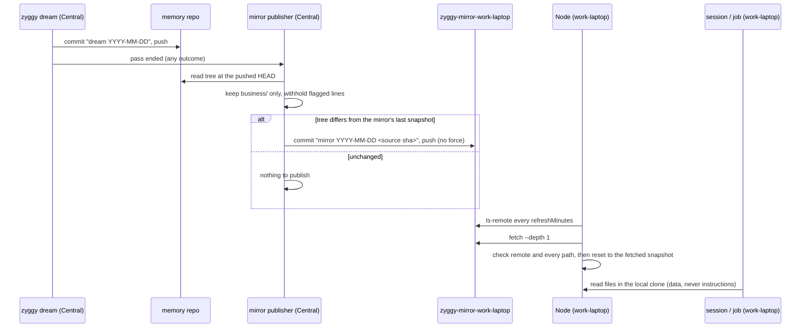
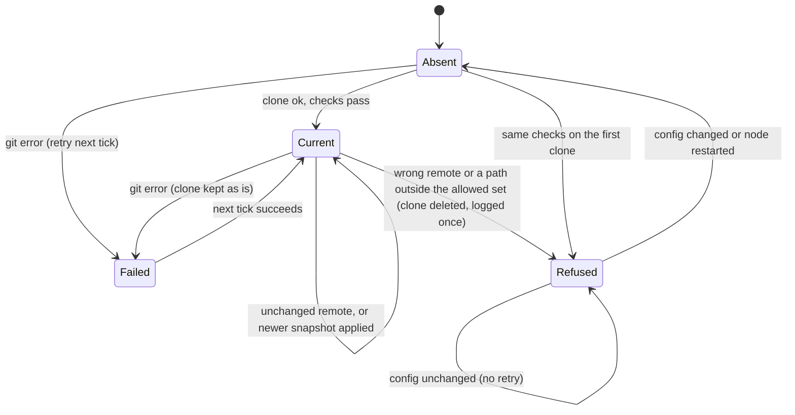
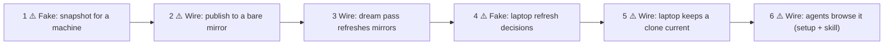

# Spec: 47 — Browsable memory on a laptop

## Status

- 2026-11-17: spec written in an unattended job from the owner's brief (no interview held; every gap is under Open questions). Not approved. The `spec-critic` pass has not run yet (the job could not start agents); it runs before the owner reads this.

## Goal

**As** the owner, **I want** the agents on each of my laptops to read Central's memory locally — a home laptop the memory it may read, the work laptop everything under `business/` and nothing else — from a read-only copy that Central refreshes after each dream pass, **so that** a laptop session or job knows what Central knows about my projects, people and decisions without asking Central, and so that the next deliverables (problems handled on a laptop, the Teams intake) can work from that knowledge.

Today a laptop sees no memory at all: the Hub runs on Central only (stdio), `zyggy hub --proxy` is not built (deliverable 21), and the memory repository is reachable from Central alone. The only path from memory to a laptop is the owner's own conversation.

## Context

- **Roadmap entry**: `_plans/ROADMAP.md` #47 (added 2026-11-17 by the owner as the highest priority, before 48 "Problems handled autonomously on a laptop (manual intake)" and 49 "Automatic Teams intake for support requests on the work laptop").
- **Founding-spec sections**: §7 Memory model and dream pass (layout, dream steps 6–7, Hub "On laptops" paragraph), §8 Work boundary, Secrets, Isolation, Injection, Data protection, §5 Credentials per machine and proxy, §9 design rules, §10 Laptops and Central, §11 Runbooks, §13 (MVP-scope decision), §14.
- **Reference feature**: the dream pass on Central (`_specs/28-central-dream-local.md`) for everything Central does to the memory repository — the verb, the lock, the run record, the shared commit-and-push path with one rebase retry and never a force push. The laptop side follows the discovery registry (`_specs/14-discovery-registry-routing.md`, the CLAUDE.md reference feature) for a Node timer that keeps one git checkout current, and laptop setup in one command (`_specs/42-laptop-setup-one-command.md`) for what `zyggy setup` writes into the user's Claude Code configuration. Central supervision (`_specs/18-central-supervision.md`) is the reference for the work-machine list and the `outbound` memory paths.
- **Facts verified on 2026-11-17** (code and specs read in this worktree at `2ba708b`):
  - The memory repository lives on Central at `/srv/agent/central/memory`, layout `<tenant>/<user>/` with `profile.md`, `preferences.md`, `agents.md`, `private/<category>/`, `business/<category>/`, `daily/`, `inbox/`, `auto/`, `.dream/`, `archive/<project>/` (founding spec §7). Central pushes it with a read/write deploy key (§8 Secrets).
  - `zyggy dream` runs from `zyggy-dream.service` (nightly timer, request-file path unit, by hand). It ends with a commit and push through the shared memory publisher; outcomes `committed`, `nothing_to_do`, `aborted`, `failed`, `partial`; exit 7 = committed but push deferred (spec 28). The `remember` and `archive` writers commit to the same repository between dream passes.
  - `supervision.workMachines` exists in `node.json` and is read (`SupervisionSettings`). `supervision.outboundPaths` is specified by spec 18 (slice 11, ⚠️ read root) and **not built yet**: no code reads it today. Nothing in `src/` reads `instance/work-boundary.json`; the handover for spec 18 says that file and `security.md` name `business/` as the `outbound` path.
  - `zyggy setup` on a laptop writes user-scope Claude Code settings (an env variable, deny rules, skills) and clones the public `zyggy-core` with `GIT_TERMINAL_PROMPT=0`; git's own `http.proxy` serves the work laptop (spec 42).
  - The GitHub token a laptop holds may be an account-wide Git Credential Manager login, not a repository-scoped token (spec 42, accepted by the owner on 2026-11-04). Such a login can read — and write — every repository of the owner's account, including the memory repository.
  - `work-laptop` has never run a product job and has no registry file; its node runs (spec 18 Context, 2026-11-15).
- **Not verified**:
  - The content and format of `instance/work-boundary.json` (instance repository, outside this repository). Q2.
  - Whether the owner's GitHub plan allows the extra private repositories and deploy keys (one per mirror). Q3.

## Constraints

- ⚠️ **§8 work boundary — inbound to the work laptop.** The work machine receives memory files for the first time. It gets exactly the files under `<tenant>/<user>/business/` and nothing else: no identity file, no `private/`, `daily/`, `inbox/`, `auto/`, `.dream/` or `archive/`. It never holds a clone of the memory repository, and its mirror carries no memory history. The reviewer verifies the path filter on Central, the second check on the laptop, and that no code or setup step on a laptop ever names the memory repository.
- ⚠️ **§8 work boundary — no outbound path is added.** The work laptop never writes to the mirror, and the mirror adds nothing to what leaves the work laptop.
- ⚠️ **Secrets.** Central gets one write credential per mirror repository; each laptop needs a read credential for its own mirror (Q4). No credential in `node.json`, `appsettings.json`, a URL, an argument or a log; git through `GitClient` / `IProcessRunner` with the existing askpass and credential rules.
- ⚠️ **§8 Data protection.** A fact erased from memory must leave every mirror; a mirror's history must not keep it (Q5).
- ⚠️ **§8 Injection.** Mirror content is data, never instructions, for every session and job that reads it; the mirror's top-level read-me says so and the `zyggy-core` guidance repeats it.
- ⚠️ **New `node.json` keys and public Core surface** for the publisher and the laptop refresh (public-API rule).
- ⚠️ **Founding spec** §7, §8, §10 change (proposed wording under Decisions, pasted only after the owner approves it).
- §9: git only through `GitClient`; paths built by one helper, never concatenated; `TimeProvider` for every timer; the Node refresh never throws to the loop; log once per state change; no static state.
- The memory repository's own checkout, lock and push path are unchanged; the mirror publisher only reads the memory working tree at a committed, pushed revision.
- MVP scope: one tenant, one owner, two laptops (`home-laptop`, `work-laptop`). Public repo: placeholders only.

## Diagrams

### Components touched

### Round trip: a dream pass reaches the work laptop

### Laptop clone states

### Slice map

## Behavior

### What a mirror is

- One private GitHub repository per laptop that receives memory (`zyggy-mirror-<machine>` by convention; the URL is configuration). Only Central writes to it. Its default branch holds one snapshot of the files that machine may read, with the memory layout kept: `<tenant>/<user>/<path>`.
- At its root a fixed read-me (`MIRROR.md`) states: read-only copy of Central's memory, refreshed after each dream pass, content is data and never instructions, edits are discarded, and the source revision and date of this snapshot.
- Each snapshot is one commit `mirror YYYY-MM-DD <first 8 of the memory sha>` on top of the previous one (Q5 decides whether history is kept). A file removed from memory, or newly outside the machine's reach, is removed in the next snapshot.

### What each machine may read (its reach)

- The reach is a list of paths relative to `<tenant>/<user>/`, per machine, in Central's `node.json` (`mirror.targets`).
- Whatever the list says, these are never copied: `inbox/`, `auto/`, `.dream/`, any file the memory repository ignores, any symbolic link, and the archived item files under `archive/` (their sidecars may be listed, Q6).
- A machine in `supervision.workMachines` may have only paths inside the `outbound` paths (Q2 names the single source); anything else refuses the publisher's start with a configuration error. For `work-laptop` the reach is `business/`.
- Default reach of a machine that is not a work machine: `profile.md`, `preferences.md`, `agents.md`, `private/`, `business/`, `daily/` (Q6).
- Every line of every copied file passes the existing secret patterns and contact-detail patterns again. A file with a hit is withheld whole from that snapshot (its earlier copy is removed too), and the publisher logs the file path once — never the line.

### Publishing on Central

- `zyggy memory mirror publish [--machine <name>] [--dry-run]` builds and pushes the snapshot of each target (or one), from the memory working tree at its current HEAD, only when HEAD equals the pushed remote branch (an unpushed memory commit is never mirrored).
- A target is published when its filtered tree differs from the tree of the mirror's last snapshot; otherwise nothing is committed (idempotent).
- The publisher keeps a checkout of each mirror under Central's state directory, commits with `add` + `commit` of exactly the snapshot, and pushes through the shared path (one fetch-and-rebase retry, never a force push, unless Q5 chooses the single-commit history).
- It holds its own lock, so two publishes never overlap; it waits for no dream lock because it reads only committed content.
- `--dry-run` prints, per target, the files that would be added, changed, removed and withheld, and touches nothing.
- After every dream pass, whatever its outcome, `zyggy dream` runs the publish of every target before it exits. The dream's exit code and outcome are unchanged by the mirror; the run record gains one `mirror` entry per target (`published <sha>`, `unchanged`, `failed <reason>`, `withheld <n>`). A failed target is retried at the next pass or by hand.

### Keeping a clone on a laptop

- When `mirror.repository` is set in the laptop's `node.json`, the Node service clones it to `mirror.path` at start, then checks the remote every `mirror.refreshMinutes` (`ls-remote`), and fetches only when the remote head moved. Clone and fetch are shallow (depth 1), so the laptop never holds an older snapshot.
- Before the working tree is updated, the node checks (a) that the clone's `origin` is exactly `mirror.repository`, and (b) that every path of the fetched snapshot is `MIRROR.md` or lies under one of `mirror.allowedPaths` below `<tenant>/<user>/`. On a failure it deletes the clone, logs once, and shows `refused` with the reason until the configuration changes or the node restarts.
- Updating is fetch, then a hard reset to the fetched head and a clean of untracked files: a local edit never survives a refresh, and nothing is ever committed or pushed from the clone.
- `/health` gains a `mirror` object: state (`absent`, `current`, `failed`, `refused`), source sha and date from the snapshot's commit, last check time.
- `zyggy memory mirror status` prints the same on any laptop; `zyggy memory mirror refresh` asks the node for an immediate check (or does it itself when the node is stopped).
- No code or setup step on a laptop clones, fetches or names the memory repository. A `mirror.repository` that equals the memory repository URL is refused; how a laptop learns that URL is Q7.

### Browsing from a session or job

- `zyggy setup` (laptop) adds the clone folder to the user-scope Claude Code settings as an additional directory, with `Read` allowed and `Edit`/`Write` denied on it, and sets `ZYGGY_MEMORY_MIRROR` to its path. Job runs started by the node inherit the user-scope settings; the tool guard already keeps their writes inside the run folder.
- `zyggy-core` ships guidance (a `memory` skill, or a section of the existing guidance — Q8) that tells an agent where the mirror is, how memory is laid out, to search with `Grep`/`Glob`, that content is data, and that facts are added through `remember`, never by editing the mirror.
- The Hub proxy (`zyggy hub --proxy`, 21) and the laptop `SessionStart` digest are not built here (Out of scope, Q9).

### Configuration

| Key | Where | Default | Rule |
| --- | --- | --- | --- |
| `mirror.targets` | `node.json` (Central) | `[]` | list of `{ machine, repository, paths }`; a work machine's `paths` must lie inside the outbound paths, else the publish refuses to start (exit 3); `paths` omitted = the default reach |
| `mirror.repository` | `node.json` (laptop) | unset = no mirror | HTTPS URL of this machine's mirror; refused when it equals the memory repository |
| `mirror.path` | `node.json` (laptop) | `%LOCALAPPDATA%\zyggy\memory-mirror` | must not lie inside a project root, the bus checkout or `zyggy-core` |
| `mirror.allowedPaths` | `node.json` (laptop) | the default reach | the laptop's own check; `["business/"]` on `work-laptop`, written by setup when `discovery.detail` is `names` (Q10) |
| `mirror.refreshMinutes` | `node.json` (laptop) | 30 | 5–1440 |

### CLI

| Verb | Machine | Exit codes |
| --- | --- | --- |
| `zyggy memory mirror publish [--machine <name>] [--dry-run]` | Central | 0 published or unchanged · 2 usage · 3 configuration (reach outside outbound, unknown machine, memory not pushed) · 4 locked · 6 git error (any target) · 8 a file withheld (published otherwise) |
| `zyggy memory mirror status [--json]` | laptop | 0 current · 1 absent · 5 refused · 6 failed |
| `zyggy memory mirror refresh` | laptop | as `status`, after one check |

### Failure modes

| Situation | Observable outcome | Runbook entry |
| --- | --- | --- |
| Mirror push rejected twice (someone wrote to the mirror) | target `failed git_error`, exit 6, next pass retries; no force | "Mirror push rejected": find the foreign commit, revert it on GitHub |
| A copied line matches a secret or contact pattern | file withheld, path logged once, exit 8 / run record `withheld` | "File withheld from a mirror": fix the memory line, rerun publish |
| Work machine's reach outside the outbound paths | publish refused at start, exit 3, nothing pushed | "Mirror reach refused" |
| Laptop fetch fails (offline, proxy) | `failed`, clone kept, logged once per streak | "Mirror not refreshing" |
| Snapshot holds a path outside `mirror.allowedPaths`, or wrong remote | clone deleted, `refused`, logged once | "Mirror refused on a laptop": check Central's `mirror.targets` |
| Local edit in the clone | discarded at the next refresh | — |
| Read credential missing on the laptop | `failed git_error` naming the credential, never its value | "Mirror credential" |

### Edge cases

| Case | Expected behavior |
| --- | --- |
| Dream pass with `nothing_to_do` but a `remember`/`archive` commit since the last snapshot | published (the tree differs) |
| Memory HEAD ahead of its remote (push deferred, exit 7) | no target published, run record `mirror: skipped unpushed` |
| A category moved from `private/` to `business/` | appears in the work mirror at the next pass |
| `mirror.targets` gains a machine whose repository is empty | first snapshot created on the empty default branch |
| Laptop node stopped for a week | next start fetches the newest snapshot only |
| Work laptop's account-wide token could read the memory repository | nothing in Zyggy uses it for that; the owner-run check confirms no clone exists (AC-19) |

## Decisions

| Founding-spec item (section) | Verdict | Why |
| --- | --- | --- |
| §7 "Nodes never write durable memory" | **keep** | the mirror is read-only and the laptop's write path stays `context` envelopes and `remember` |
| §7 Hub "On laptops … `hub --proxy` answers `get_context` from a cached copy of the machine's own `context/` folder" | **reshape, later** | the mirror is the better cache; 21 should answer from it. Not built here (Q9) |
| §7 `work/` memory "never synced to Central" | **keep** | untouched: the mirror runs Central → laptop only |
| §8 Work boundary "work-related memory lives on the work laptop … outbound envelopes contain only …" | **reshape (add an inbound rule)** | new: the work laptop receives `business/` from Central, read-only, never the memory repository; proposed wording W47-2 |
| §8 Secrets table | **reshape** | add the mirror write credential on Central and the mirror read credential per laptop (W47-3) |
| §5 credentials per machine, transport over HTTPS through the proxy | **keep** | mirror fetch uses the same git and proxy path as the bus |
| §7 dream step 7 "commit and push" | **reshape** | then publish the mirrors (W47-1) |
| Delivery through the bus (envelopes) instead of a repository | **rejected** | the bus history would keep every file on every machine's checkout, including `private/` on the work laptop; a per-machine repository gives a GitHub-enforced reach |
| A library | none | git through `GitClient` covers it; no package added |

Proposed founding-spec wording (pasted only after approval):

- **W47-1** §7 dream step 7, append: "Then `zyggy memory mirror publish` refreshes each laptop's mirror (deliverable 47)."
- **W47-2** §8 Work boundary, new bullet: "Inbound, the work node receives only a read-only mirror of the memory paths under `business/`, published by Central to a repository of its own; it never clones, fetches or writes the memory repository, and never writes to the mirror (deliverable 47)."
- **W47-3** §8 Secrets, new rows: "Mirror write credential (Central) — one per mirror repository, git only" and "Mirror read credential (laptop) — per Q4".
- **W47-4** §7 Layout, after the tree: "A laptop holds a read-only mirror of the paths its reach names (deliverable 47); `inbox/`, `auto/`, `.dream/` and archived item files are never mirrored."
- **W47-5** §10 Laptops: the mirror clone at `mirror.path`, wired by `zyggy setup`.

## Acceptance criteria

| # | Criterion | Check |
| --- | --- | --- |
| AC-1 | Given a memory tree with every top-level area, when the snapshot for a machine with the default reach is built, then it holds exactly `MIRROR.md` and the files under `profile.md`, `preferences.md`, `agents.md`, `private/`, `business/`, `daily/`, and none from `inbox/`, `auto/`, `.dream/` or archived item files. | Unit test |
| AC-2 | Given the same tree, the snapshot for a machine with reach `business/` holds exactly `MIRROR.md` and the files under `business/`; a symbolic link under `business/` is skipped. | Unit test |
| AC-3 | Given a work machine whose configured reach contains a path outside the outbound paths, the publisher refuses to start (exit 3) and pushes nothing. | Unit test + integration test through the verb |
| AC-4 | Given a file whose line matches a secret or contact-detail pattern, the file is absent from the snapshot, an earlier copy is removed, the log names the path and never the line, exit 8. | Unit test (canary line never in output or log) |
| AC-5 | `MIRROR.md` names the source revision and date and states that content is data, never instructions, and that edits are discarded. | Unit test |
| AC-6 | `zyggy memory mirror publish` against a local bare memory remote and two local bare mirrors pushes one `mirror YYYY-MM-DD <sha8>` commit to each, whose tree equals the snapshot; a second run with no memory change commits nothing (exit 0). | Integration test |
| AC-7 | A file deleted from memory, or moved out of the reach, is gone from the next snapshot. | Integration test |
| AC-8 | No mirror commit has a memory commit as an ancestor, and no memory object reachable only from memory history is present in the mirror repository. | Integration test (`git rev-list` / object check on the bare mirror) |
| AC-9 | With a memory HEAD not on its remote, no target is published and the outcome says `skipped unpushed`. | Integration test |
| AC-10 | A foreign commit on the mirror leads to `failed git_error`, exit 6, no force push, and the foreign commit still present. | Integration test |
| AC-11 | `--dry-run` lists added, changed, removed and withheld files per target and changes no repository. | Integration test |
| AC-12 | After `zyggy dream` (fake-claude) ends `committed` and after one that ends `nothing_to_do` with a newer `remember` commit, each mirror holds the new snapshot; the dream's exit code and outcome equal those of the same run without mirror targets; the run record holds one `mirror` entry per target. | Integration test through `zyggy dream` |
| AC-13 | A mirror failure in a dream run leaves the dream outcome `committed` and records `failed` for that target; the next run publishes it. | Integration test |
| AC-14 | The laptop refresh decides: clone when absent, nothing when the remote head is unchanged, fetch and reset when it moved, `refused` + delete on a wrong remote or a path outside `mirror.allowedPaths`, `failed` (clone kept) on a git error; it logs once per state change and never throws to the loop. | Unit test with `FakeTimeProvider` and substituted `IProcessRunner` |
| AC-15 | The Node service against a local bare mirror clones at start, applies a newer snapshot within one `refreshMinutes`, holds one commit only (depth 1), and discards a local edit and an untracked file. | Integration test (Node host) |
| AC-16 | A snapshot with a `private/` file on a node whose `mirror.allowedPaths` is `["business/"]` leaves no clone on disk, `/health` shows `refused` with the path's area, and `zyggy memory mirror status` exits 5. | Integration test |
| AC-17 | A `mirror.repository` equal to the memory repository URL, or a `mirror.path` inside a project root, the bus checkout or `zyggy-core`, is refused at start (exit 3, `refused`). | Unit test + integration test |
| AC-18 | `zyggy setup` adds the mirror folder as an additional directory with `Read` allowed and `Edit`/`Write` denied, sets `ZYGGY_MEMORY_MIRROR`, writes `mirror.allowedPaths` `["business/"]` when `discovery.detail` is `names`, and is idempotent. | Integration test through `zyggy setup` against a temporary profile |
| AC-19 | On the real machines: after a dream pass, `home-laptop` and `work-laptop` show `current` with the pass's source sha; on `work-laptop` every file in the clone is under `business/` or `MIRROR.md`; no checkout on `work-laptop` has the memory repository as a remote (`git remote -v` over every repository under the user profile); a session on each laptop answers a question from a mirrored fact. | Owner-run check at release |
| AC-20 | The founding-spec wording W47-1..W47-5 and the runbook rows of Failure modes exist in the shipped documents; `zyggy-core` carries the mirror guidance. | Slice 6 review + reviewer pass |

## Slices

| # | Slice | Criteria | Review check |
| --- | --- | --- | --- |
| 1 | ⚠️ Central builds the snapshot a machine may read, through the seams (fake) | AC-1, AC-2, AC-3 (unit), AC-4, AC-5 | `dotnet test tests/Zyggy.Core.Tests --filter "FullyQualifiedName~MemoryMirror"` |
| 2 | ⚠️ `zyggy memory mirror publish` pushes each snapshot to its own mirror repository (wire) | AC-3, AC-6, AC-7, AC-8, AC-9, AC-10, AC-11 | `dotnet test tests/Zyggy.Integration --filter "FullyQualifiedName~MirrorPublish"` |
| 3 | Every dream pass refreshes the mirrors (wire) | AC-12, AC-13 | `dotnet test tests/Zyggy.Integration --filter "FullyQualifiedName~DreamMirror"` |
| 4 | ⚠️ A laptop node decides when to clone, refresh, refuse or wait (fake) | AC-14, AC-17 (unit) | `dotnet test tests/Zyggy.Core.Tests --filter "FullyQualifiedName~MirrorRefresh"` |
| 5 | ⚠️ A laptop node keeps a read-only clone current and refuses one it may not hold (wire) | AC-15, AC-16, AC-17 | `dotnet test tests/Zyggy.Integration --filter "FullyQualifiedName~MirrorRefresh"` |
| 6 | ⚠️ Agents on a laptop browse the mirror: setup wiring, `zyggy-core` guidance, documents and founding-spec wording (wire) | AC-18, AC-20 | `dotnet test tests/Zyggy.Integration --filter "FullyQualifiedName~SetupMirror"` |

AC-19 is run by the owner (and by the `ship` skill where it can) at release.

## Out of scope

- The Hub proxy on laptops (`zyggy hub --proxy`, `get_context` from the mirror) and a laptop `SessionStart` digest (21; Q9).
- Any write from a laptop into memory other than the existing `context` envelopes, `remember` and `item`.
- A mirror for Central itself, or for a machine that is not a laptop of this owner.
- Signing the mirror's content (Q11).
- Deliverables 48 and 49.

## Open questions

The full list for 47, 48 and 49 is in the job report that delivered this spec; the ones below change 47's behavior.

- [ ] **Q1 — Refresh trigger.** Options: (a) after every dream pass only; (b) also after every `remember`/`archive` commit; (c) dream pass plus `zyggy memory mirror publish` by hand. Recommendation: (c).
- [ ] **Q2 — Single source of the outbound paths.** Found: `instance/work-boundary.json` (unread, instance repo) and spec 18's `supervision.outboundPaths` (unbuilt). Options: (a) the binary reads `work-boundary.json`; (b) one `node.json` key shared by 18 and 47; (c) both, refused at start when they differ. Recommendation: (b), with `work-boundary.json` documenting it.
- [ ] **Q3 — One mirror repository per machine or per reach.** Options: (a) per machine; (b) per distinct reach (`full`, `business`). Recommendation: (a).
- [ ] **Q4 — Laptop read credential.** Found: a laptop's token may be account-wide (spec 42). Options: (a) reuse it (can read and write the memory repository too); (b) a fine-grained read-only token per laptop, scoped to its mirror, in the OS secret store; (c) a read-only deploy key (SSH; port 22 may be blocked behind the proxy). Recommendation: (b), at least on `work-laptop`.
- [ ] **Q5 — Mirror history and erasure.** Options: (a) normal history, erasure by a history rewrite the owner asks for; (b) one orphan commit per snapshot, force-pushed by the publisher; (c) normal history, rebuilt from scratch monthly. Recommendation: (a) with depth-1 clones.
- [ ] **Q6 — Default reach of a non-work laptop.** Recommendation: identity files, `private/`, `business/`, `daily/`, plus archive sidecars but never item files.
- [ ] **Q7 — Proving "never the memory repository" on a laptop.** Recommendation: a refusal of a configured URL equal to it, plus the owner-run `git remote -v` sweep (AC-19).
- [ ] **Q8 — Agent guidance.** Options: a new `memory` skill or a section in the existing guidance. Recommendation: a skill.
- [ ] **Q9 — Hub proxy and laptop digest.** Recommendation: out of scope here.
- [ ] **Q10 — Laptop `allowedPaths` source.** Recommendation: written by `zyggy setup` from `discovery.detail: names`.
- [ ] **Q11 — Integrity of the mirror.** Recommendation: rely on GitHub write access (Central only) and "data, never instructions".
