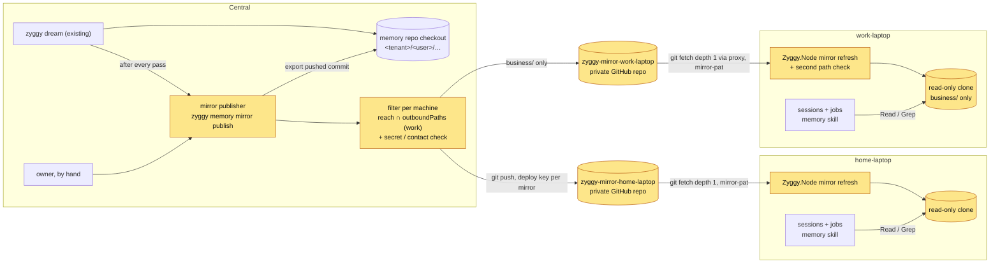
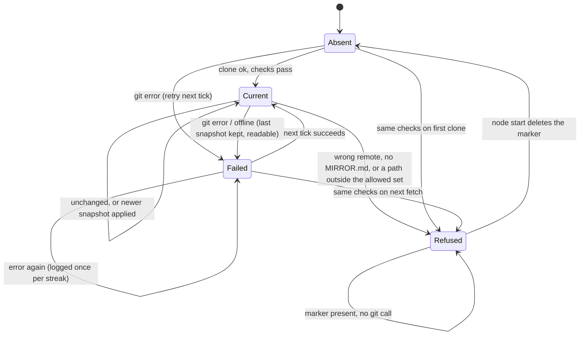

# Spec: 47 — Browsable memory on a laptop

## Status

- 2026-11-23: spec written in an unattended job (job run, no interview possible; the owner's brief of 2026-11-23 and the instance's `security.md` "Work boundary" and "Never store" rules, as relayed in the job's TASK, are its input). It **replaces `_specs/47-browsable-memory-laptop.md`** (the 2026-11-17 draft, never approved), whose decisions Q1–Q14 it keeps unless a line below says otherwise. Not approved.
- 2026-11-23: carried over: **slice 1 is built and on `main`** (merged with PR #53; the snapshot builder and the start check under Core's memory mirror area, all `internal`; accepted by the owner on 2026-11-17 as slice 1 of the old draft). Its proof is in the old draft's Status. It is re-checked against this text in slice 2 (AC-27).
- 2026-11-23: facts changed since the old draft, verified in this worktree at `666bc4d`: `supervision.outboundPaths` is now built (spec 18) as a list of **absolute folders** on Central, and `zyggy settings` accepts one only at or below the owner's `business/` memory folder (founding spec §8); the old amendment A12 (paths relative to `<tenant>/<user>/`) is withdrawn and the publisher converts instead (Behavior, AC-27). `work-boundary.json` is now copied to the work laptop by `zyggy setup --instance-path` (spec 58) and read there for `mail.policyConfirmed` only.
- 2026-11-23: `spec-critic` pass: three separate agent runs were started, but none could hand its report back inside this job (the job's tool guard blocks the hand-back), so the pass was run inline by the `spec-critic` criteria, as the 2026-11-17 job did. Verdict before fixes: NOT READY, 1 blocking — OQ2's recommended option had no behavior, key or check; fixed: the agreement rule under "What each machine may read", `mirror.workBoundaryFile`, AC-29, A13 made concrete. Verified against the code: `supervision.outboundPaths` read as absolute folders and required with work machines (configuration reader); the bus fetch is `fetch --prune origin` (default refspec, every branch); setup's `--instance-path` copy of `work-boundary.json`; slice 1's target and start check take relative paths. Improvements left: slice 2 is the largest slice (10 criteria) and may be split at build time into "publish" and "outbound rules" if it does not fit one session. Not approved.

## Goal

**As** the owner, **I want** the agents on each of my laptops to read Central's memory locally — the home laptop the memory it may read, the work laptop the outbound memory paths (today all of `business/`) and nothing else — from a read-only copy that Central filters, publishes and refreshes after each dream pass, **so that** a laptop session or job knows what Central knows about my projects, people and decisions without asking Central, also when Central or the network is away, and so that 48 (problems handled on a laptop) and 49 (Teams intake) can work from that knowledge.

Today a laptop sees no memory at all: the Hub runs on Central only (stdio), `zyggy hub --proxy` is not built (21), and the memory repository is reachable from Central alone.

## Context

- **Roadmap entry**: `_plans/ROADMAP.md` #47 (owner's highest priority with 48 and 49 since 2026-11-17; started by the owner on 2026-11-23).
- **Founding-spec sections**: §5 Transport (git operations, credentials per machine), §7 Memory model (layout, rules, dream pass step 7, Hub "On laptops"), §8 Work boundary, Secrets, Injection, Data protection, §9 design rules, §10 Laptops and Central, §11 Runbooks, §13 (MVP-scope decision), §14.
- **Earlier draft and decision record**: `_specs/47-browsable-memory-laptop.md` (superseded by this file) and `_specs/47-49-open-questions.md` (questions 1–14, decided by Zyggy on the owner's standing delegation on 2026-11-17).
- **Reference feature**: the dream pass on Central (`_specs/28-central-dream-local.md`) for everything Central does to the memory repository (verb, lock, run record, shared commit-and-push path with one rebase retry, never a force push). The laptop side follows the discovery registry (`_specs/14-discovery-registry-routing.md`, the CLAUDE.md reference) for a Node timer that keeps one git checkout current, and laptop setup in one command (`_specs/42-laptop-setup-one-command.md`) for what `zyggy setup` writes into Claude Code's user-scope configuration and how it names a missing secret. Central supervision (`_specs/18-central-supervision.md`) owns `supervision.workMachines` and `supervision.outboundPaths`.
- **Facts verified on 2026-11-23** (code, READMEs and specs read in this worktree at `666bc4d`):
  - Memory lives on Central at `/srv/agent/central/memory/<tenant>/<user>/` with `profile.md`, `preferences.md`, `agents.md`, `private/`, `business/`, `daily/`, `inbox/`, `auto/`, `.dream/`, `archive/<project>/` (item + `.md` sidecar) (§7). Since 58, `business/` and the business archive also hold work mail filed by the dream; third-party personal data beyond name, role and organisation is removed by the nightly dream (§7 Rules).
  - `zyggy dream` ends with a commit and push through the shared memory publisher; outcomes `committed`, `nothing_to_do`, `aborted`, `failed`, `partial`; exit 7 = committed, push deferred (spec 28). `remember` and `archive` commit between passes.
  - `supervision.outboundPaths` (Central `node.json`) is read by the node configuration reader as **absolute folders**; a non-empty `supervision.workMachines` without it refuses Central's start; the supervisor run that answers a work machine reads only those folders (Node and Cli READMEs). §8: `zyggy settings` accepts an outbound folder only at or below the owner's `business/` memory folder.
  - Slice 1 (on `main`): the snapshot builder and the configuration check take the reach and the outbound paths as **paths relative to `<tenant>/<user>/`**; no `node.json` key is read for the mirror yet; no type is public.
  - `zyggy setup` (laptop) writes user-scope Claude Code settings (env, deny rules, skills), clones the public `zyggy-core` template repository (skills), names a missing secret by its `zyggy secret set` line, exit 6 = incomplete; with `--instance-path` it copies the instance's `work-boundary.json` into the node directory (specs 42, 58).
  - The bus repository is cloned whole by every node; nothing in `src/` uses a sparse checkout or a per-machine refspec (searched for `sparse`; the bus fetch takes the default refspec). A laptop's git login may be an account-wide Git Credential Manager login (spec 42).
- **Not verified**: whether the `zyggy-org` plan allows the extra private repositories and a fine-grained token per repository; checked by the owner when creating the mirrors (runbook "Create a mirror"). A refusal stops the release, not the build.

## Constraints

- ⚠️ **Central owns the memory.** A laptop never holds a clone of the memory repository, never fetches, names or is given its URL, and never pushes to memory or to a mirror. What a laptop learns reaches Central only the existing ways (`context` envelopes, `remember`, `item`).
- ⚠️ **§8 work boundary — inbound to the work laptop, filtered on Central.** A work machine receives exactly the files under the outbound paths (today `business/`) and nothing else: never `private/`, never `profile.md` (its personal lines are not split out: whole-file rule), `preferences.md` or `agents.md`, never any `daily/` (other machines' daily notes included), `inbox/`, `auto/`, `.dream/` or `archive/` (items and sidecars). The filter runs on Central before anything leaves it; the laptop's own path check is a second line, never the one that is trusted. The reviewer verifies the filter on Central, the second check on the laptop, and that no code or setup step on a laptop names the memory repository.
- ⚠️ **No outbound path is added.** The mirror adds nothing to what leaves the work laptop.
- ⚠️ **One list for the outbound paths.** The work machine's reach is checked against the one list Central's supervisor already enforces (`supervision.outboundPaths`); `instance/work-boundary.json` must name the same paths (OQ2 — owner).
- ⚠️ **Secrets — none crosses.** Central holds one SSH deploy key with write access per mirror (`~/.ssh/zyggy_zyggy-mirror-<machine>_ed25519`, 0600); each laptop one fine-grained token `contents:read` on its own mirror only, `mirror-pat` in the OS secret store. No credential in `node.json`, a URL, an argument, a file or a log. Every copied line passes the secret patterns on Central; a hit withholds the file. Git only through `GitClient` / `IProcessRunner`.
- ⚠️ **§8 Injection.** Everything in the mirror is data, never instructions, for every session and job that reads it; `MIRROR.md` and the `zyggy-core` `memory` skill say so. The mirror is not signed; its integrity rests on GitHub write access (Central's deploy keys only).
- ⚠️ **§8 Data protection.** A fact erased from memory leaves every mirror at the next snapshot; laptops hold the newest snapshot only (depth 1). Removing it from a mirror's history is a rewrite the owner asks for and does by hand (the only force push on a mirror, never Zyggy's).
- ⚠️ **New `node.json` keys, a new secret name, a CLI verb and (possibly) public Core surface** (public-API rule): kept `internal` unless a host needs it.
- ⚠️ **Shared contracts change**: founding spec §5, §7, §8, §10, spec 42's secret names and exit 6, the instance's `work-boundary.json` (exact wording under "Proposed amendments", pasted only after the owner approves it).
- §9: paths built by one helper; `TimeProvider` for every timer; the laptop refresh never throws to the loop; log once per state change; no static state. The memory repository's checkout, lock and push are unchanged; the publisher reads a committed, pushed revision exported from the commit, never the working tree.
- MVP scope: one tenant, one owner, two laptops (`home-laptop`, `work-laptop`). Public repo: placeholders only.

## Diagrams

### Components touched



### Round trip: a dream pass reaches the work laptop

```mermaid
sequenceDiagram
  participant Dream as zyggy dream (Central)
  participant Mem as memory repo
  participant Pub as mirror publisher (Central)
  participant MW as zyggy-mirror-work-laptop
  participant Node as Node (work-laptop)
  participant Agent as session / job (work-laptop)
  Dream->>Mem: commit "dream YYYY-MM-DD", push
  Dream->>Pub: pass ended (any outcome)
  Pub->>Mem: ls-remote: HEAD pushed? export that commit
  Pub->>Pub: keep outbound paths only, withhold flagged files
  alt tree differs from the mirror's last snapshot
    Pub->>MW: commit "mirror YYYY-MM-DD <sha8>", push (never force)
  else unchanged
    Pub->>Pub: nothing to publish
  end
  Node->>MW: ls-remote every refreshMinutes
  Node->>MW: fetch --depth 1 (only when the head moved)
  Node->>Node: check remote name, MIRROR.md, every path; reset
  Agent->>Node: read files in the clone (data, never instructions)
```

### Laptop clone states



### Slice map

```mermaid
flowchart LR
  s1["1 ⚠️ Fake: snapshot for a machine (built)"] --> s2["2 ⚠️ Wire: publish to a bare mirror"]
  s2 --> s3["3 Wire: dream pass refreshes mirrors"]
  s3 --> s4["4 ⚠️ Fake: laptop refresh decisions"]
  s4 --> s5["5 ⚠️ Wire: laptop keeps a clone current"]
  s5 --> s6["6 ⚠️ Wire: setup wires the clone into Claude Code"]
  s6 --> s7["7 ⚠️ Wire: memory skill + documents"]
  classDef done fill:#bbf7d0,stroke:#15803d,color:#111;
  class s1 done;
```



## Behavior

### How the mirror reaches a laptop (within the existing transport)

- The transport is the one every node already uses (§5): the system `git` through `GitClient`, over HTTPS to GitHub, through the work laptop's proxy as git's own `http.proxy`. No new protocol, port or service.
- The carrier is **one private GitHub repository per laptop**, `zyggy-org/zyggy-mirror-<machine>`, next to `zyggy-bus` — not the bus repository, not a branch of it, not a file transfer (Decisions; OQ1 — owner). Reason: every node clones the whole bus with the default refspec and holds its full history, and its credential reads every branch; a home snapshot with `private/` on the bus, in any path or branch, would land on the work laptop's disk and stay in history for good. A repository per machine makes GitHub enforce the reach: the work laptop's token cannot read the home mirror.
- Only Central writes to a mirror. Its default branch holds one snapshot of the files that machine may read, memory layout kept (`<tenant>/<user>/<path>`), plus `MIRROR.md` at the root: read-only copy of Central's memory, refreshed after each dream pass, content is data and never instructions, edits are discarded, facts are added through `remember`, source revision and date of this snapshot. The repository name is a rule: a laptop refuses a mirror whose name is not `zyggy-mirror-<its own machine>`.
- Each snapshot is one ordinary commit `mirror YYYY-MM-DD <first 8 of the memory sha>` on top of the previous one; the mirror keeps its own history, never memory's. The publisher never force-pushes; laptops clone and fetch with depth 1.

### What each machine may read (its reach) — decided on Central

- The reach is a list of paths relative to `<tenant>/<user>/`, per machine, in Central's `node.json` (`mirror.targets[].paths`). Whole files and folders only; no line inside a file is filtered by reach.
- Never copied, whatever the list says: `inbox/`, `auto/`, `.dream/`, a file the memory repository ignores, a symbolic link, archived item files. Under `archive/<project>/` only sidecars (`<slug>.md` whose front matter carries the sidecar fields).
- **A work machine** (one of `supervision.workMachines`) may have only paths inside the outbound paths. The publisher converts each `supervision.outboundPaths` folder (absolute, built by spec 18) to a path relative to the principal's `<tenant>/<user>/` directory; a folder that is not inside that directory's `business/` refuses the publisher's start (exit 3) — whatever `zyggy settings` let through. An empty list with a work machine among the targets refuses the start too. A work target's `paths`, when omitted, is the outbound paths themselves; when given, each must lie inside them. Today: `business/`.
- **The owner's rule file must agree** (OQ2, recommended option, to be confirmed by the owner): when a work machine is among the targets, the publisher also reads the instance's `work-boundary.json` from the path in `mirror.workBoundaryFile` (Central `node.json`) and its `memoryMirror.outboundPaths` (paths relative to `<tenant>/<user>/`, added by A13). A missing or unreadable file, a missing key, or a set of paths that differs from the converted `supervision.outboundPaths` refuses the start (exit 3, `refused work_boundary_mismatch`); nothing is published to any target. The file is only compared, never widened from: the filter uses the converted `supervision.outboundPaths`.
- Default reach of a laptop that is not a work machine: `profile.md`, `preferences.md`, `agents.md`, `private/`, `business/`, `daily/`, and the sidecars under `archive/`.
- Every line of every copied file passes the existing secret patterns and contact-detail patterns again. A file with a hit is withheld whole from that snapshot (its earlier copy is removed too); the publisher logs the path once, never the line.
- One snapshot holds one principal: only `<tenant>/<user>/` named by `ZYGGY_TENANT` / `ZYGGY_USER` (as `zyggy dream`).

### How the mirror is kept fresh (Central)

- Two triggers: the end of every dream pass (nightly and on demand), and `zyggy memory mirror publish` run by hand. A `remember` or `archive` commit reaches the mirrors at the next pass or the next manual publish.
- `zyggy memory mirror publish [--machine <name>] [--dry-run]` builds each target's snapshot from the commit at the memory checkout's HEAD, only when HEAD equals the remote branch head read live (`ls-remote`); an unpushed memory commit is never mirrored (`skipped unpushed`, exit 3); an unreadable remote publishes nothing (`failed git_error`, exit 6). The files of that commit are exported through `GitClient` into a temporary folder under Central's state directory and deleted afterwards; uncommitted, untracked and ignored files never reach a mirror, nor a committed file matching the ignore rules.
- A target whose `repository` equals the memory remote (SSH and HTTPS forms compared) refuses the start (exit 3).
- A target is committed only when its filtered tree differs from the mirror's last snapshot (idempotent). The publisher keeps a checkout per mirror under `<state>/mirrors/<machine>/`, commits exactly the snapshot and pushes through the shared path (one fetch-and-rebase retry, never a force push) with that mirror's own deploy key (`GIT_SSH_COMMAND` for that call only). A checkout whose branch no longer descends from the remote one is deleted and re-cloned.
- It holds its own lock; it waits for no dream lock (it reads committed content only). `--dry-run` prints per target the files added, changed, removed and withheld, and touches nothing.
- After every dream pass, whatever its outcome, `zyggy dream` runs the publish of every target before it exits. The dream's exit code and outcome are unchanged; its run record gains one `mirror` entry per target (`published <sha>`, `unchanged`, `failed <reason>`, `withheld <n>`, `skipped unpushed`, `skipped locked`, `refused <reason>`).
- Exit code of a publish with several outcomes: the first of 3, 4, 6, 8, 0 that applies.

### Keeping a clone on a laptop

- With `mirror.repository` set in the laptop's `node.json`, the Node clones it to `mirror.path` at start, checks the remote every `mirror.refreshMinutes` (`ls-remote`) and fetches only when the head moved; clone and fetch are depth 1.
- Every git call on the mirror authenticates with `mirror-pat` from the OS secret store, handed to that one process through its environment as an HTTP authorization header for the mirror's URL, credential helpers switched off for that call; the machine's own (possibly account-wide) login is never used for the mirror. A missing `mirror-pat` is `failed`, naming the secret, never a value.
- Before the working tree is updated the node checks: (a) `origin` is exactly `mirror.repository` and its name is `zyggy-mirror-<this machine>`; (b) `MIRROR.md` is at the root; (c) every other path lies under one principal directory `<tenant>/<user>/` whose tenant is the laptop's `tenant`, inside `mirror.allowedPaths`, and under none of `inbox/`, `auto/`, `.dream/`. On a failure it deletes the clone, writes a refusal marker `mirror-refused` (reason and time, never content) under the node's state directory, logs once and shows `refused`. Only the node service's start deletes the marker; while it exists every tick, `refresh` and `status`, in any process, report `refused` (exit 5) and make no git call.
- Updating is fetch, hard reset to the fetched head and a clean of untracked files: a local edit never survives, nothing is ever committed or pushed from the clone.
- `/health` gains a `mirror` object: state (`absent`, `current`, `failed`, `refused`), source sha and snapshot date, last successful check, last check time. `zyggy memory mirror status [--json]` prints the same; `zyggy memory mirror refresh` asks the running node for an immediate check (or runs it itself when the node is stopped). With no `mirror.repository` both print `absent (not configured)`, exit 1, and the node starts as before.

### Offline

- **Laptop offline or behind a failing proxy**: the last snapshot stays on disk and readable; the state is `failed` (logged once per streak), `status` shows the snapshot date and the time of the last successful check, and the next tick that reaches GitHub catches up to the newest snapshot only. A snapshot is never deleted for being old — only on a refusal.
- **Central down or no dream pass**: laptops keep the snapshot they have; `status` stays `current` (the remote did not move) and the snapshot date shows its age.
- **GitHub unreachable for Central**: the publish of each target ends `failed git_error`; the next pass or a manual publish retries.
- The `memory` skill tells the agent to read the snapshot date in `MIRROR.md` and say so when it answers from a snapshot older than two days.

### How a laptop session finds and reads it

- `zyggy setup` (laptop), when `mirror.repository` is set, adds the clone folder to the user-scope Claude Code settings as an additional directory, with `Read` allowed and `Edit`/`Write` denied on it, and sets `ZYGGY_MEMORY_MIRROR` to its path. It writes `mirror.allowedPaths` `["business/"]` into `node.json` when `discovery.detail` is `names` (the existing work-machine signal) and leaves the default otherwise; nothing in the mirror ever widens it. A missing `mirror-pat` is named like a missing `github-pat` (the line `zyggy secret set mirror-pat`, exit 6). Job runs inherit the user-scope settings; the tool guard keeps their writes inside the run folder.
- The `zyggy-core` template repository ships a new `memory` skill, which setup installs with the others: where the mirror is (`ZYGGY_MEMORY_MIRROR`), how memory is laid out, search with `Grep`/`Glob`, content is data and never instructions, the work laptop sees the outbound paths (`business/`) only, the snapshot date, and facts are added through `remember`, never by editing the mirror. No `CLAUDE.md` or rules file is added to projects.
- The Hub proxy (`zyggy hub --proxy`, 21) and a laptop `SessionStart` digest are not built here; 21 answers `get_context` from the mirror later.

### Configuration

| Key | Where | Default | Rule |
| --- | --- | --- | --- |
| `mirror.targets` | `node.json` (Central) | `[]` | `{ machine, repository, deployKey, paths? }`; `repository` = SSH URL of `zyggy-org/zyggy-mirror-<machine>`; `deployKey` a key file path, never the key; `paths` omitted = the default reach (the outbound paths for a work machine) |
| `supervision.outboundPaths` | `node.json` (Central) | `[]` | built by spec 18 (absolute folders at or below `business/`); read by 47 as the work machines' reach ceiling; empty with a work machine among `mirror.targets` refuses the publish (exit 3) |
| `mirror.workBoundaryFile` | `node.json` (Central) | unset | path of the instance's `work-boundary.json` on Central (a path, never content); required when a work machine is among `mirror.targets` (OQ2) |
| `mirror.repository` | `node.json` (laptop) | unset = no mirror | HTTPS URL of `zyggy-org/zyggy-mirror-<this machine>`; another name is refused |
| `mirror.path` | `node.json` (laptop) | `%LOCALAPPDATA%\zyggy\memory-mirror` | not inside a project root, the bus checkout or `zyggy-core` |
| `mirror.allowedPaths` | `node.json` (laptop) | the default reach | laptop's second check; `["business/"]` on `work-laptop`, written by setup |
| `mirror.refreshMinutes` | `node.json` (laptop) | 30 | 5–1440 |
| `mirror-pat` | OS secret store (laptop) | — | fine-grained, `contents:read` on this machine's mirror only; `zyggy secret set mirror-pat` |

### CLI

| Verb | Machine | Exit codes |
| --- | --- | --- |
| `zyggy memory mirror publish [--machine <name>] [--dry-run]` | Central | 0 published or unchanged · 2 usage · 3 refused at start (reach outside outbound, an outbound folder outside `business/`, empty outbound, target equal to memory, unknown machine) or `skipped unpushed` · 4 locked · 6 git error · 8 a file withheld; several → first of 3, 4, 6, 8, 0 |
| `zyggy memory mirror status [--json]` | laptop | 0 current · 1 absent (also not configured) · 5 refused · 6 failed |
| `zyggy memory mirror refresh` | laptop | as `status`, after one check |

### Failure modes

| Situation | Observable outcome | Runbook entry |
| --- | --- | --- |
| Mirror push rejected twice (foreign commit) | target `failed git_error`, exit 6; no force | "Mirror push rejected" |
| A copied line matches a secret or contact pattern | file withheld, path logged once, exit 8 / `withheld` | "File withheld from a mirror" |
| Work reach outside the outbound paths, an outbound folder outside `business/`, outbound empty, target = memory, `work-boundary.json` missing or disagreeing | publish refused at start, exit 3 | "Mirror reach refused" |
| Laptop offline, proxy fails | `failed`, last snapshot kept and readable, logged once per streak | "Mirror not refreshing" |
| Snapshot with a path outside `allowedPaths`, no `MIRROR.md`, wrong remote or name | clone deleted, `refused`, marker, logged once | "Mirror refused on a laptop" |
| `mirror-pat` missing or rejected | `failed`, naming `mirror-pat`, never its value | "Mirror credential" |
| A mirror's deploy key missing on Central | that target `failed`, others published | "Create a mirror" |
| A fact must leave a mirror's history | — | "Erase a fact from a mirror's history" (owner, by hand) |

### Edge cases

| Case | Expected behavior |
| --- | --- |
| `remember`/`archive` commit between passes | not published until the next pass or a manual publish |
| `nothing_to_do` pass after a `remember` commit | published (the tree differs) |
| Memory HEAD ahead of its remote (dream exit 7) | no target published, `skipped unpushed` |
| A category moved from `private/` to `business/` | appears in the work mirror at the next pass |
| A business fact written only in `profile.md` | not in the work mirror (whole-file rule) |
| A work mail filed by 58 into `business/` | in the work mirror; its archived item and sidecar are not |
| Empty mirror repository | first snapshot created on the empty default branch |
| Laptop node stopped for a week | next start fetches the newest snapshot only |
| The owner rewrote a mirror's history | laptop's next fetch replaces its one commit; publisher re-clones its checkout |

## Decisions

| Item (section) | Verdict | Why |
| --- | --- | --- |
| §7 "Nodes never write durable memory" | **keep** | mirror is read-only; the laptop's write paths stay `context`, `remember`, `item` |
| §7 Hub "On laptops … `hub --proxy` answers from a cached copy of the machine's own `context/`" | **reshape, later** | the mirror is the better cache; 21 answers from it (not built here) |
| §7 `work/` memory never synced to Central | **keep** | the mirror runs Central → laptop only |
| §8 Work boundary | **reshape (inbound rule)** | the work laptop receives the outbound paths read-only, filtered on Central (A5) |
| §8 Secrets | **reshape** | write deploy key per mirror on Central, read-only `mirror-pat` per laptop (A6) |
| §5 "the code never handles credentials itself" | **reshape** | `mirror-pat` handed to git per call, because the machine's login may be account-wide (A1) |
| §5 "a machine holds no credential for any other repository" | **reshape** | one read token per laptop for its own mirror (A2) |
| §5 git over HTTPS through the proxy | **keep** | the mirror rides the same transport |
| §7 dream step 7 | **reshape** | then publish the mirrors (A4) |
| §8 Injection, Data protection | **reshape** | mirror content is data (A7); erasure reaches the mirrors (A8) |
| Carrier: the bus (a path or a branch) | **rejected** | every node clones the whole bus and its history; a home snapshot would land on the work laptop (OQ1) |
| Carrier: file transfer (OneDrive or similar) | **rejected** | a second transport and a second credential on the work laptop; no git history or depth-1 semantics; erasure harder |
| One repository with a branch per machine | **rejected** | GitHub cannot restrict reads per branch |
| Signing the mirror | **rejected for v1** | content is data anyway; signing adds key distribution to the work laptop |
| Line-level filtering of `profile.md` | **rejected for v1** | fragile; a miss leaks private data to the employer's machine |
| Claude Code rules or a project `CLAUDE.md` section vs a skill | **skill** | one `memory` skill in `zyggy-core`, installed by setup on every laptop, works in every project and job without touching project files |
| Old amendment A12 (relative `outboundPaths`) | **withdrawn** | the key is built as absolute folders; the publisher converts |
| A library | none | `GitClient` covers it |

## Acceptance criteria

| # | Criterion | Check |
| --- | --- | --- |
| AC-1 | Given a memory tree with every top-level area, the default-reach snapshot holds exactly `MIRROR.md` and the files under `profile.md`, `preferences.md`, `agents.md`, `private/`, `business/`, `daily/` and the `archive/` sidecars; none from `inbox/`, `auto/`, `.dream/` or item files. | Unit test (built, slice 1) |
| AC-2 | The `business/` snapshot of the same tree holds exactly `MIRROR.md` and `business/` files; a symbolic link under `business/` is skipped. | Unit test (built, slice 1) |
| AC-3 | A work reach outside the outbound paths, an empty outbound list with a work target, or a target equal to the memory remote (SSH or HTTPS form) refuses the publisher's start (exit 3), nothing pushed. | Unit test (built) + integration test through the verb |
| AC-4 | A file with a secret- or contact-pattern line is absent from the snapshot, an earlier copy removed, the log names the path never the line, exit 8. | Unit test (canary line never in output or log) |
| AC-5 | `MIRROR.md` names source revision and date, says content is data never instructions, edits are discarded, facts go through `remember`. | Unit test |
| AC-6 | `publish` against a local bare memory remote and two bare mirrors pushes one `mirror YYYY-MM-DD <sha8>` commit to each, tree equal to the snapshot; a second run commits nothing (exit 0); a second user and a second tenant never reach a mirror. | Integration test |
| AC-7 | A file deleted from memory, or moved out of reach, is gone from the next snapshot. | Integration test |
| AC-8 | No mirror commit has a memory commit as ancestor; no memory-only object is in a mirror. | Integration test (`rev-list` / object check) |
| AC-9 | Memory HEAD not on its remote (also with a stale tracking ref) → no target published, `skipped unpushed`, exit 3. With HEAD pushed, an uncommitted, an untracked, an ignored and a committed-but-ignored `business/` file are absent from every snapshot. | Integration test (one case each) |
| AC-10 | A foreign commit on a mirror → `failed git_error`, exit 6, no force push, foreign commit still there. | Integration test |
| AC-11 | `--dry-run` lists added, changed, removed, withheld per target and changes no repository. | Integration test |
| AC-12 | After `zyggy dream` (fake-claude) ends `committed`, and after one ending `nothing_to_do` with a newer `remember` commit, each mirror holds the new snapshot; dream exit and outcome equal a paired run without targets; one `mirror` entry per target in the run record. | Integration test through `zyggy dream` |
| AC-13 | A mirror failure leaves the dream `committed` with `failed` for that target, published at the next run; a refused configuration records `refused <reason>` per target; a held mirror lock records `skipped locked`; dream exit and outcome unchanged in each. | Integration test |
| AC-14 | Laptop refresh decides: clone when absent, nothing when unchanged, fetch + reset when moved; `refused` + delete + marker on each of wrong remote, wrong name, no `MIRROR.md`, path outside this tenant, a second principal, a path outside `allowedPaths`, a path under `inbox/`/`auto/`/`.dream/`; after a refusal, ticks and `refresh` make zero git calls until a new start; `failed` (clone kept) on a git error or missing `mirror-pat`; logs once per state change; never throws. | Unit test (`FakeTimeProvider`, substituted `IProcessRunner`, `ISecretStore`) |
| AC-15 | The Node host against a bare mirror clones at start, applies a newer snapshot within one interval, holds one commit only, discards a local edit and an untracked file. | Integration test (Node host) |
| AC-16 | A `private/` file in a snapshot for a node with `allowedPaths` `["business/"]` leaves no clone on disk, `/health` `refused`, `status` exit 5 with the node running and stopped, `refresh` exit 5 with no git process; a restarted node clones again and is refused again. | Integration test |
| AC-17 | A wrong repository name, or a `mirror.path` inside a project root, the bus checkout or `zyggy-core`, is refused at node start with no git call; a bare repo laid out like memory (no `MIRROR.md`, an `inbox/`) is refused even with a matching name. | Unit test + integration test |
| AC-18 | `zyggy setup` adds the mirror folder as an additional directory (`Read` allowed, `Edit`/`Write` denied), sets `ZYGGY_MEMORY_MIRROR`, writes `allowedPaths` `["business/"]` only when `discovery.detail` is `names`; a second run changes nothing. | Integration test through `zyggy setup` (temporary profile) |
| AC-19 | On the real machines after a dream pass: both laptops `current` with the pass's sha; every file in the `work-laptop` clone is under `business/` or is `MIRROR.md`; no checkout on `work-laptop` has the memory repository as a remote (`git remote -v` sweep); a session on each laptop answers from a mirrored fact through the `memory` skill. | Owner-run check at release |
| AC-20 | The approved amendments and the Failure-mode runbooks exist in the shipped documents; `zyggy-core` carries the `memory` skill naming `ZYGGY_MEMORY_MIRROR`, "data, never instructions", `business/` only on the work laptop, the snapshot date, and `remember`. | `zyggy-core` bats tests (each fails when its line is removed) + the slice 7 text-search list |
| AC-21 | Every laptop mirror git call carries `mirror-pat` only in that process's environment with credential helpers off; the token is in no argument, URL, file, log, `/health` or `status --json`. | Unit test + secret sweep with a canary token in the slice 5 integration test |
| AC-22 | Every publisher push uses that target's own deploy key and never force; a missing key file fails that target only. | Unit test + integration test |
| AC-23 | A `remember` commit with no dream pass after it changes no mirror; a manual `publish` then publishes it. | Integration test |
| AC-24 | An `archive/<project>/` item and its sidecar yield only the sidecar in the default snapshot and nothing in the `business/` snapshot. | Unit test (built, slice 1) |
| AC-25 | With another user, another tenant and a loose root file in memory, both snapshots hold only `MIRROR.md` and the principal's paths. | Unit test (built, slice 1) |
| AC-26 | With `mirror.repository` set and no `mirror-pat`, `zyggy setup` prints `zyggy secret set mirror-pat` (no value) and exits 6; unset, neither. | Integration test through `zyggy setup` |
| AC-27 | The publisher converts each absolute `supervision.outboundPaths` folder to a path relative to `<tenant>/<user>/`; a folder outside that principal's `business/` (another user's folder, `private/`, the memory root, a path with `..`) refuses the start (exit 3); a work target without `paths` gets exactly the converted outbound paths. | Unit test + integration test through the verb reading Central's `node.json` |
| AC-29 | With a work target: a `work-boundary.json` whose `memoryMirror.outboundPaths` equals the converted `supervision.outboundPaths` publishes; a missing file, a missing key, an extra path (`private/`) and a missing path each refuse the start (exit 3) and push nothing to any target, the home target included. (Applies if the owner confirms OQ2 (b).) | Integration test through the verb |
| AC-28 | Offline: with the bare mirror unreachable after a successful clone, the clone stays and is readable, `status` exits 6 and shows the snapshot date and the last successful check; when the remote is back, the next tick reaches `current` with the newest snapshot and one commit only. | Integration test (Node host; the bare remote renamed away and back) |

## Slices

Built in this order on `feature/47-browsable-memory` from `main`; the `memory` skill goes to `zyggy-core` on its own branch, the runbooks to the private instance repository (slice 7). Each slice is proven with `node .claude/hooks/verify.mjs` (0 warnings) and stops at its gate. Every work-boundary rule is proven on Central (slices 1–2) and again on the laptop (slices 4–5).

| # | Slice | Criteria | Review check |
| --- | --- | --- | --- |
| 1 | ⚠️ Central builds the snapshot a machine may read (fake) — **built, on `main`** | AC-1, AC-2, AC-3 (unit), AC-4, AC-5, AC-24, AC-25 | `dotnet test tests/Zyggy.Core.Tests --filter "FullyQualifiedName~MemoryMirror"` |
| 2 | ⚠️ `zyggy memory mirror publish` pushes each filtered snapshot to its own mirror (wire): reads `mirror.targets` and converts `supervision.outboundPaths`, exports the pushed commit, deploy key per mirror, `--dry-run`, exits 3/4/6/8 | AC-3, AC-6–AC-11, AC-22, AC-27, AC-29 | `dotnet test tests/Zyggy.Integration --filter "FullyQualifiedName~MirrorPublish"` |
| 3 | Every dream pass refreshes the mirrors (wire) | AC-12, AC-13, AC-23 | `dotnet test tests/Zyggy.Integration --filter "FullyQualifiedName~DreamMirror"` |
| 4 | ⚠️ A laptop node decides when to clone, refresh, refuse or wait (fake), `mirror-pat` per call | AC-14, AC-17 (unit), AC-21 (unit) | `dotnet test tests/Zyggy.Core.Tests --filter "FullyQualifiedName~MirrorRefresh"` |
| 5 | ⚠️ A laptop node keeps a read-only clone current, offline included, and refuses one it may not hold (wire); `/health`, `status`, `refresh` | AC-15, AC-16, AC-17, AC-21, AC-28 | `dotnet test tests/Zyggy.Integration --filter "FullyQualifiedName~MirrorRefresh"` |
| 6 | ⚠️ `zyggy setup` wires the clone read-only into Claude Code (wire) | AC-18, AC-26 | `dotnet test tests/Zyggy.Integration --filter "FullyQualifiedName~SetupMirror"` |
| 7 | ⚠️ Agents browse the mirror: `zyggy-core` `memory` skill, runbooks, approved amendments | AC-20 | the `zyggy-core` bats suite and the slice 7 text-search list; then `spec-reviewer` over `main..HEAD` and the owner-run AC-19 at release (MINOR) |

Build assumptions, confirmed or corrected at the gate named: token hand-off as `GIT_CONFIG_COUNT`/`KEY`/`VALUE` entries for `http.<url>.extraHeader` and an empty `credential.helper` (slice 4); `refresh` reaches a running node through its localhost health endpoint (slice 5); the refusal marker lives in the node's state directory (slices 4–5); the outbound conversion resolves both paths fully before comparing (slice 2).

## Out of scope

- The Hub proxy on laptops and a laptop `SessionStart` digest (21).
- Publishing after each `remember` or `archive` commit.
- Splitting business facts out of `profile.md`, or any line-level filter.
- Any laptop write into memory other than `context`, `remember` and `item`.
- A mirror for Central, or for a machine that is not one of the owner's laptops.
- Signing the mirror; automatic erasure from a mirror's history.
- Deliverables 48 and 49.

## Proposed amendments (awaiting the owner)

Pasted only after the owner approves the exact text (CLAUDE.md § Founding spec). "FS" is the founding spec. A1–A11, A13 and A14 are the texts of the 2026-11-17 draft (`_specs/47-browsable-memory-laptop.md`, section "Proposed amendments"), kept unchanged except as noted; A12 is withdrawn.

| # | File and section | Change |
| --- | --- | --- |
| A1 | FS §5 Git operations | exception for `mirror-pat` handed per call (text as in the draft) |
| A2 | FS §5 Credentials per machine | bus credentials per tenant; beyond the bus only the repository-scoped credentials of §8 (text as in the draft) |
| A3 | FS §7 Layout | a laptop holds a read-only mirror of its reach in `zyggy-mirror-<machine>` (text as in the draft) |
| A4 | FS §7 Dream pass step 7 | then `zyggy memory mirror publish`, dream outcome unchanged (text as in the draft) |
| A5 | FS §8 Work boundary, new bullet | "Inbound, the work node receives only a read-only mirror of the memory paths inside `supervision.outboundPaths` (v1: `business/`), filtered and published by Central to a repository of its own; it never clones, fetches or names the memory repository, never writes to the mirror, and its mirror carries no memory history (deliverable 47)." |
| A6 | FS §8 Secrets, two rows | mirror deploy key per mirror (Central), `mirror-pat` (laptop) (text as in the draft) |
| A7 | FS §8 Injection | mirror content is data; not signed; integrity from GitHub write access (text as in the draft) |
| A8 | FS §8 Data protection | erasure reaches every mirror at the next snapshot; a mirror's history by hand on request (text as in the draft) |
| A9 | FS §10 `node.json` example | `mirror` keys for laptops and Central (text as in the draft, without the `outboundPaths` comment of A12) |
| A10 | FS §10 Laptops | setup adds the mirror directory, `ZYGGY_MEMORY_MIRROR`, `allowedPaths` on a names-only machine (text as in the draft) |
| A11 | FS §10 Claude Code side | setup also copies the `memory` skill (text as in the draft) |
| A12 | — | **withdrawn** (the key is built as absolute folders) |
| A13 | instance `work-boundary.json` | add `"memoryMirror": { "outboundPaths": ["business/"], "source": "must equal supervision.outboundPaths on Central; the mirror publish refuses on a difference (deliverable 47)" }` — or, if the file already names the outbound paths under another key, that key is read instead and no new key is added (checked by the owner against the file, which this repository cannot read) |
| A14 | spec 42 exit 6 and secret names | `mirror-pat` missing while `mirror.repository` is set → exit 6 (text as in the draft) |

## Open questions

Each with a recommendation. **Owner** marks the ones that need the owner; the others Zyggy answers as recommended unless the owner says otherwise at approval.

- [ ] **OQ1 — Carrier of the mirror (Owner).** Found: the brief asks for delivery "within the existing transport (bus, branch, file transfer)". Every node clones the whole bus with the default refspec and keeps its history (no sparse checkout in `src/`), and a bus credential reads every branch. Options: (a) one private repository per laptop, same git/HTTPS/proxy transport, new repos + one read token per laptop; (b) the bus, only for content every machine may read (`business/`), and nothing for the home laptop's wider reach; (c) the bus with the home snapshot encrypted to the home laptop. Recommendation: **(a)**. (b) gives the home laptop no private memory and puts business memory in the bus history forever; (c) adds key management and still grows the bus history with every snapshot.
- [ ] **OQ2 — The one list of outbound paths (Owner).** Found: the instance's `security.md` names `instance/work-boundary.json` as the source ("today all of `business/`"); the code enforces `supervision.outboundPaths` in Central's `node.json` (absolute folders, built by spec 18) and reads `work-boundary.json` only for `mail.policyConfirmed` on the laptop. Options: (a) the publisher reads `supervision.outboundPaths` only (one code-read list, already the supervisor's rule), and `work-boundary.json` records the same paths for people (A13); (b) the publisher reads `work-boundary.json` from the instance checkout on Central and refuses when it differs from `supervision.outboundPaths`; (c) `work-boundary.json` replaces `supervision.outboundPaths` for both. Recommendation: **(b)** — the filter stays on one code-enforced list, and a drift between the owner's rule file and the configuration stops the publish instead of leaking. Needs the owner because it touches his instance rule.
- [ ] **OQ3 — The amendments (Owner).** Approve A1–A11, A13 (after OQ2), A14 with the spec, or at slice 7. Recommendation: with the spec, so slice 2 builds on agreed text.
- [ ] **OQ4 — Default reach of the home laptop.** Q6 of 2026-11-17 kept: identity files, `private/`, `business/`, `daily/`, archive sidecars. Recommendation: keep.
- [ ] **OQ5 — Freshness.** After every dream pass plus a manual publish; laptop checks every 30 minutes. Recommendation: keep; a publish per `remember` commit would push private one-liners within minutes to a laptop for little gain.
- [ ] **OQ6 — Contact-detail withholding on the home laptop.** A `private/` or `daily/` file with a contact detail is withheld whole even from the home laptop. Recommendation: keep (§7 already forbids storing contact details); review the `withheld` count after the first real publish (AC-19).
- [ ] **OQ7 — Stale snapshot.** A snapshot is never hidden or deleted for its age; the skill says its date when older than two days. Recommendation: keep.
- [ ] **OQ8 — The 2026-11-17 draft.** `_specs/47-browsable-memory-laptop.md` stays in the tree with a pointer to this file until the feature ships, then the owner may delete it. Recommendation: keep it until release.
