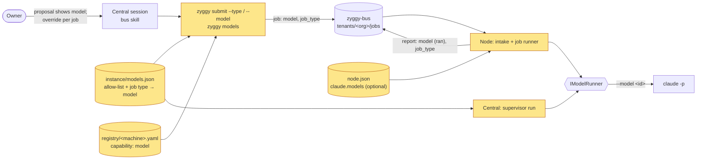
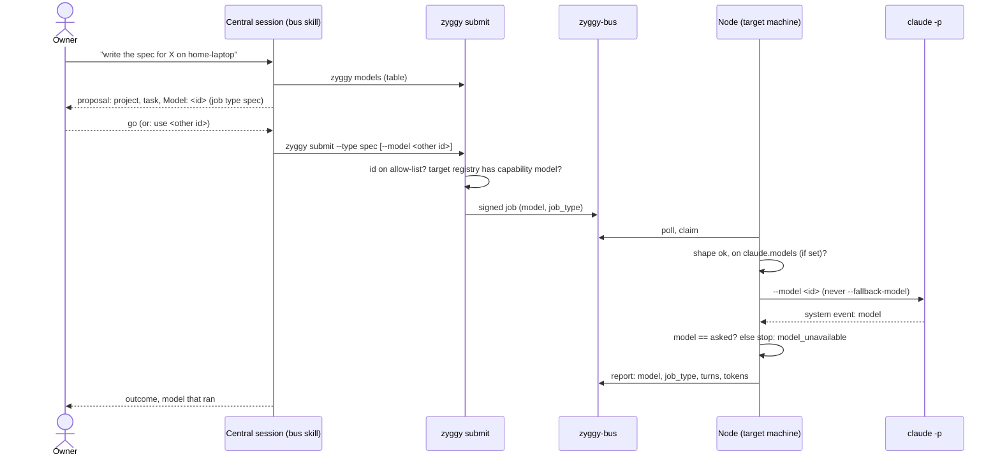
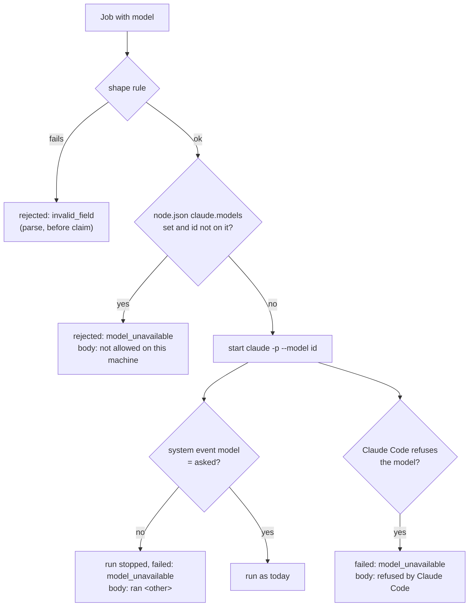
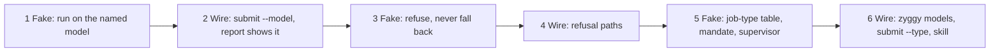

# Spec: 50 — A model per type of job

## Status

- 2026-11-23: spec written in job 01M84MX122VH2GJJGSH7CQGDC8 (no interview: the owner's answers come from roadmap row 50 and the job's TASK). Not approved. Risk areas: ⚠️ §4 shared contract (job and report fields), ⚠️ the closed reason enum (one new code), ⚠️ the command line given to Claude Code, ⚠️ a new instance file read by Central.
- 2026-11-23: review: the `spec-critic` agent ran once but ended without handing back its report (as in spec 60's job; this job cannot message an agent). In its place one self-review against the write-spec checklist (each AC has a failing check, slices vertical with one review check, risk areas marked, no file or test names, diagrams match Behavior): one gap fixed (AC-1 now covers a node refusing `model` on `fetch`/`command` jobs). Not verified: `zyggy submit`'s existing exit-code meanings (2 usage, 3 refusal) — to be confirmed in slice 2. The critic's verdict is owed before approval or at slice 1.
- 2026-11-23: **approved by the owner 2026-11-23** (relayed in job 01M84NJ0AKCGQ6MQJBZXKEW9PZ), with every recommended answer (Q1–Q8). Q1: the owner gave the ids `claude-opus-5-5` (Opus 5.5) and `claude-fable-5-2` (Fable 5.2); the current family also has `claude-sonnet-5-5`, `claude-haiku-5-5` and `claude-fable-5-1`. Starting values: `claude-opus-5-5` for `implementation`, `claude-fable-5-2` for `spec`. Q4: the founding-spec and `PROTOCOL.md` wording approved as proposed (to be pasted when the protocol slices land).
- 2026-11-23: **slice 1 done** (job 01M84NJ0AKCGQ6MQJBZXKEW9PZ). The job fields `model` and `job_type` and the report field `job_type` are parsed, written and signed; the runner passes the job's `model` as `--model <id>` (never `--fallback-model`); every report writer (listener, intake rejection, sweep rejection/exhaustion/session expiry, session hook) copies `job_type`; the sweep's re-queue keeps both. Goldens `job-model` and `report-model` hand-derived (throwaway .NET file-based script outside the solution, proven first on `job-branch` and `report-usage`); every existing golden unchanged. Proof: RED seen (fields null, no `--model`, shape cases accepted); 56 new test cases green (`JobModelEnvelopeTests` 48, `JobTypeReportTests` 4, runner invocation 2, writer round trip 2; the forbidden-flags test now also bars `--fallback-model`); build 0 warnings; unit suite 8882 passed / 0 failed / 61 OS-skipped; format clean; integration 1215 passed / 1 failed / 58 skipped — the failure, `ReadRootTests.WorkMachineQuestion_CanaryOutsideTheRoot_NotInTheDecisionNorOnTheBus` (a supervisor-run path this slice does not touch), passed 4/4 when its class ran alone, so it was a timing failure under full-suite load; review check 1005/1005. `slice-verifier` ran once but ended without handing back its report (as in specs 50 and 60); the tree it left was checked unchanged and the review check re-run green. Decisions: alias list = `opus`, `sonnet`, `haiku`, `fable`, `default`, `best`, `opusplan` (also with a `[…]` suffix); the suffix is `[a-z0-9]+`; `job_type` is accepted on every kind (only `model` needs `kind: model`); `zyggy submit` and its read-back key list stay for slice 2.

## Goal

**As** the owner, **I want** each job to run on the model that suits its type of work — chosen by Central from a table I keep, shown to me when Central proposes the job, and changeable for one job — **so that** spec writing, implementation and testing each run on the right model, and benchmark runs can compare models per type of job.

A job without a model runs exactly as today.

## Context

- **Roadmap entry**: `_plans/ROADMAP.md` #50 (owner's order of 2026-11-23: first, before 48).
- **Founding-spec sections**: §4 "Mandatory fields per type" (`job`, `report` rows; unknown fields "preserved, signed, never interpreted"), §6 Invocation (`[--model <m>]` is already in the contract) and Report assembly, §9 design rules (closed reason enum, `IModelRunner` seam), §11 cost tracking (reports carry `model`).
- **Reference feature**: report turns and tokens (`_specs/60-report-turns-tokens.md`) for the report fields and `zyggy report` lines; the job branch name (`_specs/53-job-branch-name.md`) for optional job fields, goldens and an old-node rule; spec 59's `fetch`/`command` kinds for the registry capability gate ("a sender sends that kind only to such a machine").
- **Facts verified in the code (this branch, from `main` at 666bc4d)**:
  - The runner's argument builder already emits `--model <m>` when the model-run request carries a model, and refuses any value starting with `-` (`Zyggy.Core` `Models/`). Arguments are a list, never a shell string. The job runner never sets a model today (its own comment: "no tool set, extra directory, schema, model or system prompt").
  - The stream reader keeps the `model` of the stream's `system` event, and the job runner copies it into the report's existing `model` field. So a report already says which model Claude Code started with.
  - `tools/fake-claude` writes its full argument vector to a capture file when `ZYGGY_FAKE_CLAUDE_CAPTURE` is set, and replays scripted stream events.
  - The registry document carries `capabilities` (labels); `supervision`, `fetch` and `command` are published by nodes whose version supports them, and senders check them.
  - Central reads instance values from `instance/<name>.json` files (`zyggy.json`, `dream.json`, `archive.json`, `linkedin.json`).
  - Mandate jobs have no free text: `zyggy submit --mandate <id> --kind <kind> --step <label>`; kinds `brief`, `build`, `verify`, `correct`, `merge`, `release`, `deploy` (spec 18). The supervisor run is started by Central's node through `IModelRunner` with no model set.
- **Not verified (no real `claude` may run in this job or any test)**: what Claude Code does when `--model` names a model the account cannot use, and the exact `model` text of the `system` event for each id. Slice 3 builds on a captured stream (Q5).

## Constraints

- ⚠️ **§4 shared contract.** Two optional job fields (`model`, `job_type`) and one optional report field (`job_type`). A job or report without them is written byte for byte as today and still verifies; every existing golden is unchanged. `EnvelopeSigner.Canonicalize` is not changed. `PROTOCOL.md` in `zyggy-core` and the founding spec §4/§6 need the owner's wording (Q4).
- ⚠️ **Closed reason enum.** One new code, `model_unavailable` (Behavior). Adding it is a protocol change.
- ⚠️ **Command line.** A model reaches Claude Code only as the single argument after `--model`, only if it passed the shape rule and the allow-lists. `--fallback-model` is never passed. No alias (`opus`, `sonnet`, `default`, …) is ever passed, so the model that ran can be compared with the one asked.
- ⚠️ **Instance file.** `instance/models.json` is configuration, not a secret; it holds model ids and labels only.
- §8: envelope bodies stay data; the model choice never comes from a report, a mail or any text a run read — only from the table, the owner's override, or the mandate kind.
- §9: everything through `IModelRunner`; no code outside its implementation names `claude`.
- Never a silent fallback: a job that names a model runs on that model or does not run.
- Public repo: placeholders only.

## Diagrams

### Components touched



### Round trip



### Refusal paths



## Behavior

### Job and report fields

| Envelope | Field | Shape | Meaning |
| --- | --- | --- | --- |
| `job` | `model` (new, optional) | a Claude Code model id: 1–64 characters of `[a-z0-9.-]`, starting with a letter, optionally followed by one `[<label>]` suffix of `[a-z0-9]` (for a context-size variant). No alias word (`opus`, `sonnet`, `haiku`, `fable`, `default`, `best`, `opusplan`, …). | The model the job must run on. Absent: the node's default, as today. |
| `job` | `job_type` (new, optional) | a label (`[a-z0-9-]`, 1–63) | The table row the model came from (`spec`, `implementation`, …; for a mandate job its kind). Informational: the node never interprets it. |
| `report` | `model` (existing) | as today | The model Claude Code reported in its `system` event: the model that actually ran. |
| `report` | `job_type` (new, optional) | label | Copied from the job, so a report alone tells which type of job it answered. |

A field of the wrong shape is rejected at parse with `invalid_field`, before claim, as for every field. Both fields are signed like any other.

### On the node

1. **Intake.** A job with `model` is refused before the model, with `status: rejected`, `reason: model_unavailable` and the body `model <id> is not allowed on this machine`, when the node's `node.json` sets `claude.models` and the id is not on that list (compared as text). Without `claude.models` every id that passed the shape rule is allowed (Q3).
2. **Invocation.** The runner passes `--model <id>` as two arguments of the argument list. It never passes `--fallback-model`. A job without `model` gets exactly today's argument list.
3. **The model that ran.** When the stream's `system` event names a model, the runner compares it with the job's `model`: equal, or equal followed by a `[…]` suffix, is a match. On a mismatch the runner stops the process at once (before any turn) and reports `status: failed`, `reason: model_unavailable`, body `asked <id>, Claude Code started <other>`. A job without `model` is never compared.
4. **Claude Code refuses the model.** When the run ends with an error that names the model as unknown or not available to the account (the exact signal is taken from a captured stream, Q5), the report is `status: failed`, `reason: model_unavailable`, body `model <id> refused by Claude Code: <first line of the error>` — not `claude_error`.
5. **Report.** Every report of a job with `job_type` carries `job_type`; `model` is filled from the `system` event as today, also on a refusal at step 3.
6. **Capability.** A node of this version publishes the registry capability `model`.

`model_unavailable` is the eleventh member of the closed run-failure enum. Pre-flight refusals (`unknown_project`, a lock, a mandate) are checked first, in today's order; the model check of step 1 runs after them and before any worktree is made.

### Older nodes (backward compatibility)

An older node treats `model` as an unknown field: preserved, signed, never interpreted — it would run the job on its default model. That silent fallback is prevented on the sender's side: `zyggy submit` with a model refuses (exit 3, `<machine> does not run jobs with a model yet (no capability model); upgrade it or submit without --model`, nothing written) when the target's registry file does not list `model`. A job without a model goes to any node. As a second line, the report's `model` shows what ran, so `zyggy report` marks a mismatch (below) even for a hand-written job sent past the check (Q2).

### Central's table: `instance/models.json`

```json
{
  "models": ["claude-opus-5-5", "claude-fable-5-2"],
  "jobTypes": {
    "spec": "claude-fable-5-2",
    "implementation": "claude-opus-5-5"
  },
  "supervisor": null
}
```

- `models` is the allow-list: 1–20 model ids, each passing the job field's shape rule. Every value in `jobTypes` and `supervisor` must be on it.
- `jobTypes` maps a job type label to a model id. The owner adds, changes or removes rows at any time by editing the file (a commit in the instance repository); there is no fixed list of types. A mandate kind (`brief`, `build`, `verify`, `correct`, `merge`, `release`, `deploy`) is looked up like any other type.
- `supervisor` is the model of Central's supervisor run, or `null` for today's default.
- Owner's starting values (roadmap row 50, ids given by the owner 2026-11-23, Q1): `claude-opus-5-5` (Opus 5.5) for `implementation`, `claude-fable-5-2` (Fable 5.2) for `spec`. Further rows (testing, verify, build, …) are the owner's to add; the spec does not invent them.
- A missing file means "no table": jobs carry a model only through `--model`, which then needs `node.json` `claude.models` on the submitting machine as its allow-list (laptops have no instance file). A file that does not parse, names an id off the allow-list or an id that fails the shape rule makes every verb that reads it refuse with exit 2 and one line naming the key — never a guess, never "ignore the file".

### CLI

- `zyggy models` — prints the allow-list, then one line per job type `<type>  <model id>`, then `supervisor  <id | default>`, and where it read them (`instance/models.json` or `node.json claude.models`). Exit 0; exit 2 on an invalid file.
- `zyggy submit … [--type <job type>] [--model <id>]`
  - `--type t`: the job gets `job_type: t` and the model of row `t`. A type not in the table is refused (exit 2) with the list of types.
  - `--model id`: overrides the table for this one job (with or without `--type`); the id must be on the allow-list, else exit 2 with the allow-list.
  - Neither: no `model`, no `job_type` — today's job.
  - The confirmation line printed after a submit gains `model: <id> (job type <t>)`, `model: <id> (override)` or `model: node default`.
  - With a model, the target-capability check of "Older nodes" applies (exit 3).
- `zyggy submit --mandate <id> --kind <k> …`: the job gets `job_type: <k>` and the model of row `<k>` when the table has it, else no model. `--model` and `--type` together with `--mandate` are refused (exit 2): under a mandate the owner chose by the table he kept, not per job (Q6).
- `zyggy report <id>` prints, after the `tokens:` line of spec 60: `model: <id>` (or `-`) and `job type: <t>` (or `-`). When the job is found on the bus with a `model` that does not match the report's `model`, the line reads `model: <ran> (asked <id>)`.

### Central's proposal (zyggy-core `bus` skill)

When Central proposes a job, it runs `zyggy models`, picks the job type that fits the task, and shows `Model: <id> (job type <t>)` in the proposal; the owner may answer with another model for this job, which Central passes as `--model`. When no type fits, the proposal says `Model: node default` and offers the types. The skill never invents an id that is not on the allow-list.

### Supervisor run

Central's node starts the supervisor run with `instance/models.json` `supervisor` as its model when set, read from Central's own project (`supervision.project`, Q7); absent or `null` → today's run. The same rules hold: an id off the allow-list or failing the shape rule means the run is not started and the node logs `supervisor model <id> not allowed` once; a mismatch or a refused model ends the run as a failure, which the existing rule retries once and then escalates. Never a fallback.

### Benchmark use

A benchmark compares models per type of job by running the same task as jobs with the same `--type` and different `--model`, then reading the reports: each carries `job_type`, `model` (what ran), `cost_usd`, `num_turns`/`max_turns`, the four token counts and `duration_seconds`. A comparison verb is out of scope (Q8); the data needed for it is complete after this spec.

### Configuration

| Key | Where | Default | Override rule |
| --- | --- | --- | --- |
| `models` | `instance/models.json` (Central) | none (no table) | owner edits the file |
| `jobTypes.<type>` | `instance/models.json` | none | `--model` for one job |
| `supervisor` | `instance/models.json` | `null` (today's default) | — |
| `claude.models` | `node.json` (every machine) | absent: any well-formed id | the machine's owner; on a machine without the instance file it is also `zyggy submit`'s allow-list |

### Failure modes

| Situation | Observable outcome | Runbook entry |
| --- | --- | --- |
| `--model` not on the allow-list, `--type` not in the table | `zyggy submit` exit 2, the list printed, nothing written | "Model not allowed" |
| Target node older than this feature | `zyggy submit` exit 3, upgrade line, nothing written | "Node has no capability model" |
| Job's model off the node's `claude.models` | `rejected`, `model_unavailable`, model never started | "Model not allowed on this machine" |
| Claude Code starts another model | run stopped at the `system` event, `failed`, `model_unavailable`, body names both | "Model mismatch" |
| Claude Code refuses the model (unknown id, plan has no access) | `failed`, `model_unavailable`, first error line in the body | "Model unavailable" |
| `instance/models.json` invalid | every reading verb exit 2 naming the key; supervisor run not started, one log line | "Model table invalid" |
| Job field of the wrong shape | `rejected`, `invalid_field` (as today) | — |

### Edge cases

| Case | Expected behavior |
| --- | --- |
| `kind: fetch` / `kind: command` job with `model` | refused by `zyggy submit` (exit 2: no model runs); a node rejects it `invalid_field` |
| Job with `model` and `--continue` (spec 59) | allowed; Claude Code continues with the asked model |
| `deliver: session` task with `model` | refused by `zyggy submit` (exit 2): a live session's model is the owner's, not the job's |
| Sweep re-queues a job (`attempt` + 1) | `model` and `job_type` kept unchanged, re-signed as today |
| Owner removes a model from the allow-list while a job is queued | the queued job runs (the node does not read the instance file); new submits are refused |

## Decisions

| Item | Verdict | Why |
| --- | --- | --- |
| §6 `[--model <m>]` in the invocation | **keep** | Already in the contract and in the argument builder; this spec only fills it from the job. |
| §4 `report.model` | **keep**, filled from the `system` event as today | It already is "the model that actually ran"; a second field would carry the same value. |
| Model names in the envelope | **reshape**: full Claude Code ids only, no aliases | An alias resolves differently over time and across machines; only a full id can be compared with what ran. |
| Allow-list | **reshape**: on Central the instance file; on any machine optionally `node.json claude.models` | The node cannot read Central's instance file; the shape rule plus argument-list passing already keep free text off the command line, the node list lets a machine (the work laptop) narrow it. |
| Old-node compatibility | **capability gate** (`model` in the registry) rather than `schema: 2` | The §4 rule "a node supports exactly `1`" would need a second schema for one optional field; spec 59 already gates new job kinds by capability. Alternative under Q2. |
| Unknown/unavailable model | **one new reason** `model_unavailable` (`rejected` before the model, `failed` after it started) | A named, countable outcome instead of `claude_error` or a silent default. |
| `job_type` on job and report | **new, informational** | The benchmark groups reports by type without reading the jobs. |
| Mandate jobs | **table only** (kind = type) | Spec 18: a job under a mandate carries no free choice; the owner's choice is the table he keeps. Alternative under Q6. |
| Dream, brief and other non-job runs | **defer** | Not jobs; they keep their own settings. |

## Acceptance criteria

| # | Criterion | Check |
| --- | --- | --- |
| AC-1 | A job envelope with `model` and `job_type` parses to them; a hand-derived golden `job-model` signs to its exact bytes; an id that fails the shape rule or is an alias is rejected `invalid_field`, and so is a `kind: fetch` or `kind: command` job that carries `model`; every existing golden is unchanged and verifies. | Unit: envelope parser/writer golden tests |
| AC-2 | A job with `model` gives Claude Code `--model <id>` as two list arguments; `--fallback-model` never appears; a job without `model` gives exactly today's arguments. | Unit (runner request + argument builder); integration: `tools/fake-claude` argv capture through the production listener |
| AC-3 | With `node.json claude.models` set, a job whose model is not on it is reported `rejected` / `model_unavailable` with the "not allowed" body, and the model process is never started; without the key a well-formed id runs. | Unit (intake); integration: fake-claude capture file absent in the refusal case |
| AC-4 | When the `system` event names another model than the job asked, the run is stopped before any turn and reported `failed` / `model_unavailable` naming both; a match (also with a `[…]` suffix) runs on. | Unit (stream reader + runner, `FakeTimeProvider`); integration: fake-claude scripted `system` event |
| AC-5 | A run that Claude Code ends with a model-refusal error is reported `failed` / `model_unavailable` with the first error line, not `claude_error`. | Unit on a captured stream (Q5) |
| AC-6 | A report of a job with `job_type` carries it (golden `report-model`); `zyggy report` prints `model:` and `job type:` after `tokens:`, `-` when absent, and `(asked <id>)` on a mismatch. | Unit golden; integration: `zyggy report` against a local bare repo |
| AC-7 | A node of this version publishes capability `model`; `zyggy submit --model` to a target without it exits 3 and writes nothing; without `--model` it submits as today. | Integration: local bare repo with two registry files |
| AC-8 | `instance/models.json` is read with the rules of "Central's table"; each invalid case (bad JSON, id off the allow-list, bad shape, alias) exits 2 naming the key; `zyggy models` prints allow-list, types and supervisor. | Unit (configuration); integration: `zyggy models` |
| AC-9 | `zyggy submit --type t` puts the table's model and `job_type: t` on the job and prints `model: <id> (job type t)`; `--model` overrides and prints `(override)`; neither prints `model: node default` and adds no field; an unknown type or an id off the list exits 2; `fetch`/`command` kinds and `--session` with a model exit 2. | Integration: verb against a local bare repo, signed job file read back |
| AC-10 | `zyggy submit --mandate --kind k` takes row `k` when present (no model otherwise) and sets `job_type: k`; `--model` or `--type` with `--mandate` exits 2. | Integration: mandate submit against a local bare repo |
| AC-11 | The supervisor run passes `supervisor`'s id when set and today's arguments when `null`/absent; an invalid id starts no run and logs once; a `model_unavailable` run is retried once then escalated, never re-run on another model. | Unit (supervisor wake with substituted `IModelRunner`) |
| AC-12 | The `zyggy-core` `bus` skill shows `Model: <id> (job type <t>)` in every job proposal, taken from `zyggy models`, and passes the owner's override as `--model`. | `zyggy-core` bats test on the skill text |
| AC-13 | Owner-run after release: on the home laptop a `--type spec` job's report shows the Fable id under `model:`; a job with an allow-listed id the account cannot use ends `model_unavailable`. | Owner-run on a real machine |

## Slices

| # | Slice | Criteria | Review check |
| --- | --- | --- | --- |
| 1 | ⚠️ Fake: a job names its model and the node runs Claude Code with it; the report carries the job type | AC-1, AC-2 (unit), AC-6 (golden) | `dotnet test tests/Zyggy.Core.Tests --filter "FullyQualifiedName~Envelope\|FullyQualifiedName~ClaudeArguments\|FullyQualifiedName~JobRunner"` |
| 2 | ⚠️ Wire: `zyggy submit --model` sends it to a node that can run it, `zyggy report` shows what ran | AC-2, AC-6, AC-7 | `dotnet test tests/Zyggy.Integration --filter "FullyQualifiedName~Model"` |
| 3 | ⚠️ Fake: the node refuses rather than falls back (`model_unavailable`: not allowed, mismatch, refused) | AC-3, AC-4, AC-5 (unit) | `dotnet test tests/Zyggy.Core.Tests --filter "FullyQualifiedName~Model"` |
| 4 | ⚠️ Wire: refusal paths end to end with fake-claude | AC-3, AC-4 | `dotnet test tests/Zyggy.Integration --filter "FullyQualifiedName~ModelRefusal"` |
| 5 | ⚠️ Fake: Central's table picks the model per job type, mandate kind and supervisor run | AC-8, AC-9, AC-10, AC-11 (unit) | `dotnet test tests/Zyggy.Core.Tests --filter "FullyQualifiedName~ModelTable\|FullyQualifiedName~SupervisorWake"` |
| 6 | ⚠️ Wire: `zyggy models`, `submit --type`, mandate submit; the bus skill shows the model in the proposal | AC-8, AC-9, AC-10, AC-12 | `zyggy models` and `zyggy submit --type spec --project <p> --to <machine> "..."` against a local bare repo with a sample `instance/models.json` |



Release then AC-13 (owner-run).

## Out of scope

- A benchmark comparison verb or report (Q8); cost or token limits per model.
- Models for the dream, the morning brief, backfills and other non-job runs.
- Choosing a model by the model itself (a run never picks or changes its own model).
- `--fallback-model`, effort levels, `opusplan`-style aliases.
- `zyggy status` columns for the model.

## Open questions

- [x] **Q1 — exact Fable id (needs the owner).** Found: the roadmap row says "Fable 5.2"; the newest Fable id this job can confirm is `claude-fable-5-1`. Why it matters: the allow-list holds full ids only. Options: (a) the id Claude Code's `/model` lists on the owner's machine; (b) `claude-fable-5-1`. Recommendation: (a) — the owner reads the id from `/model` and writes it into `instance/models.json`; the spec stays id-free. **Answered 2026-11-23 (a):** the owner gave `claude-opus-5-5` (Opus 5.5, implementation jobs) and `claude-fable-5-2` (Fable 5.2, spec-writing jobs); the family also has `claude-sonnet-5-5`, `claude-haiku-5-5`, `claude-fable-5-1`.
- [x] **Q2 — older nodes (needs the owner).** Found: §4 makes `model` an unknown field on an older node, which would run its default. Options: (a) registry capability `model` checked by `zyggy submit` (this spec), plus the report's `(asked …)` mark; (b) jobs with a model written as `schema: 2`, which older nodes reject `schema_unsupported` — fail-closed on the node, but needs a second schema and a §4 change; (c) both. Recommendation: (a): same gate as spec 59's kinds; all three machines are upgraded at release anyway. **Answered 2026-11-23: (a).**
- [x] **Q3 — node-side allow-list.** Found: the shape rule plus list arguments already keep free text off the command line. Options: (a) optional `claude.models` in `node.json`, absent = any well-formed id (this spec); (b) mandatory: no list, no model jobs. Recommendation: (a), and set it on the work laptop at release. **Answered 2026-11-23: (a).**
- [x] **Q4 — founding-spec and `PROTOCOL.md` wording (needs the owner).** Proposed §4 `job` row optional fields, after `deliver (run)`: "`model` (none; a full Claude Code model id, never an alias), `job_type` (none; informational)"; `report` row after `model`: "`job_type`". §6 after the invocation block: "`--model` is passed only when the job carries `model`; `--fallback-model` is never passed; a `system` event naming another model stops the run with `model_unavailable`." §9 reason enum: add `model_unavailable`. Recommendation: approve as written; `PROTOCOL.md` follows in `zyggy-core` with the same text. **Answered 2026-11-23: wording approved as proposed.**
- [x] **Q5 — the refusal signal of Claude Code.** Found: not verifiable without a real `claude`. Recommendation: before slice 3, the owner (or an attended session) captures one stream of `claude -p --model <bogus-id> --output-format stream-json --verbose` on a laptop into `tests/` as a fixture, as spec 60 did with `done.jsonl`; slice 3 matches on what it shows. **Answered 2026-11-23: as recommended — a captured stream before slice 3.**
- [x] **Q6 — model under a mandate (needs the owner).** Options: (a) table only, by kind (this spec); (b) the mandate gains a `model` field fixed at grant time (another §4 field, the node checks it); (c) allow `--model` with `--mandate` (the supervisor run would choose). Recommendation: (a) — no new mandate field, no model choice by a model; `zyggy mandate grant` output shows the models the table gives its kinds. **Answered 2026-11-23: (a).**
- [x] **Q7 — where the supervisor run reads the table.** Found: the node reads `node.json`; instance files are read from Central's checkout by the verbs. Recommendation: from `supervision.project`'s `instance/models.json`, the project the supervisor run already runs in; to be confirmed against Central's layout in slice 5. **Answered 2026-11-23: as recommended.**
- [x] **Q8 — benchmark verb.** Recommendation: not now; after a week of reports with `job_type` and `model`, decide whether a `zyggy bench` summary is worth a follow-up. **Answered 2026-11-23: not now.**
