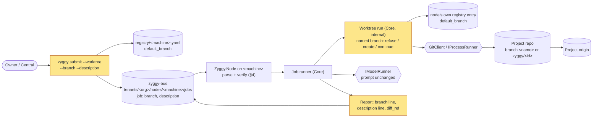
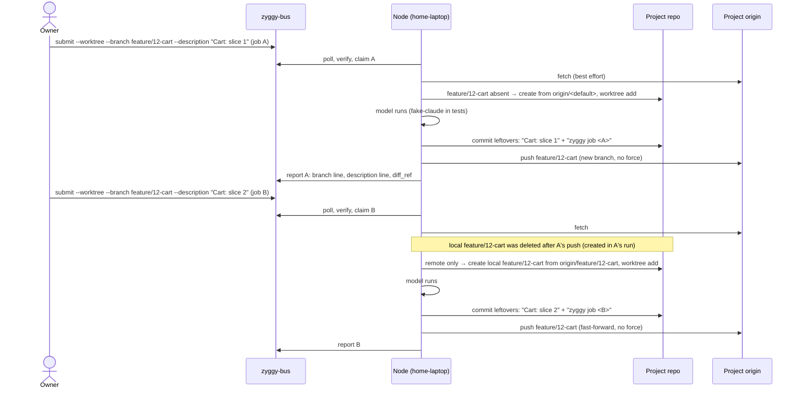
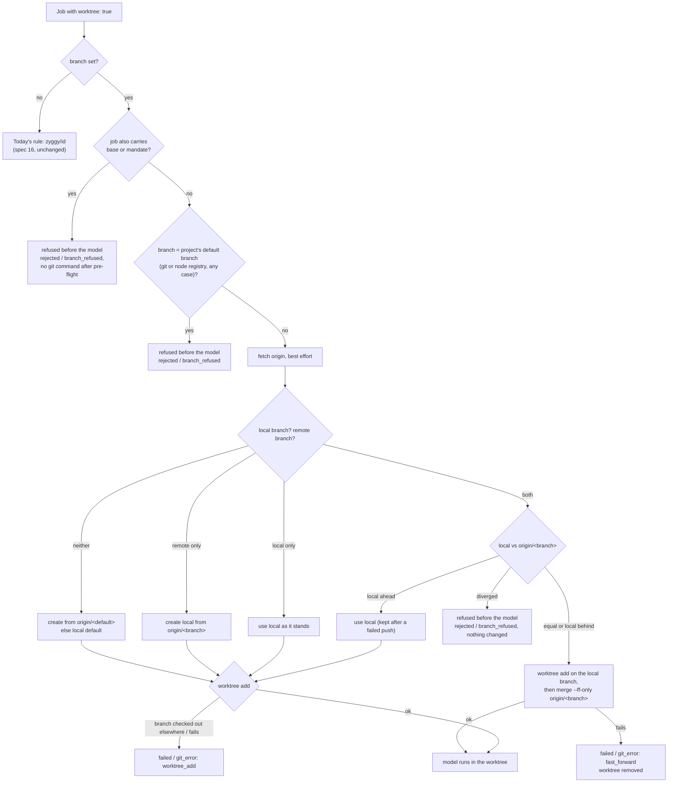
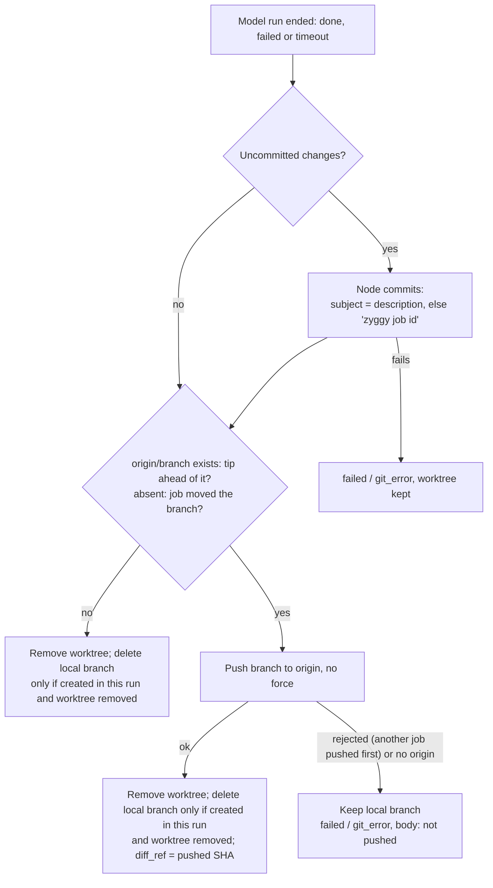
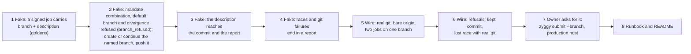

# Spec: 53 — A job's branch gets a meaningful name and a description

## Status

- 2026-11-17: spec written in an unattended job run (the owner could not be interviewed). Not approved. Every gap is under Open questions with a recommendation; questions marked **HIGH** must be answered before slice 1 (Q1 at the latest before slice 4).
- 2026-11-17: `spec-critic` agent (separate, fresh context) verdict **not ready**: 4 blocking, 4 improvements. Fixed: push test now compares with `origin/<branch>` so kept commits are pushed later (AC-7b); refusal state move, per-segment `.lock`, case-insensitive default-branch and `zyggy/` checks, ref-name clash, failed fetch, stale worktree, YAML-quoting golden; registry read at submit stated as new work with a skip rule; slice 2 split (now 6 slices); AC-8/AC-9 given the provisional concrete reason; AC-14 and AC-17 scoped; constraint "named branches only"; amendments marked conditional. Still open by nature: the HIGH questions Q1–Q4 (the critic's first blocker) need the owner.
- 2026-11-17: decisions recorded (unattended job run). The owner, on Central: "I do not have enough context anymore to answer these 4 questions, I trust you to pick best answer" — so Q1–Q4 were decided by Zyggy on his delegation, and Q5–Q8 taken as recommended on his standing delegation (list under "Decided 2026-11-17"). Behavior, criteria, slices and the proposed amendments now carry the decisions; the amendments, including a new one for spec 18 (Q2), still await the owner. Spec not approved. `spec-critic` run 1 (fresh context): **not ready**, 3 blocking, 6 improvements, all fixed: the refusal's bus path stated (report in `reports/`, claimed file removed, nothing in `jobs/rejected/`); the default-branch refusal and `branch_refused` moved into slice 2; the fast-forward mechanism named (`merge --ff-only` in the worktree, failure → `git_error: fast_forward`) and AC-10 tightened; slices now 8 (wire split into happy and failure path, docs separate); amendment 8 lists every `base`; AC-13 same id; re-run leak and default-branch fallback stated (the node also checks its registry `default_branch`).
- 2026-11-17: `spec-critic` run 2 (fresh context, the last allowed): **not ready**, 3 blocking, 5 improvements. Blocking fixed after the run, not re-reviewed: a Finish table combining start tip, `origin/<branch>` and the default base (push, `files_changed`, `diff_ref`, deletion per case); Prepare hands Finish a "created in this run" value, AC-11 covers the remote-only case; the diverged refusal moved into slice 2 with the default-branch refusal, AC-7b's refused first push named (a `pre-receive` hook on the bare origin). Left open (improvements): a `refs/` leading segment is allowed by the name rule; AC-8/AC-9 bundle several checks (the `zyggy status` wording "rejected by <machine>: <reason>" does exist in `StatusCommand`); AC-13's prompt equality assumes no other per-job value; AC-17 checks headings only; the spec repeats the decisions in two tables.
- 2026-11-17: Q2 decided again by Zyggy on the owner's delegation, replacing (b): **(a) keep both fields**. Spec 18's `base` (start and merge target of a mandate job, may be the default branch, non-fast-forward ends `done`) and this spec's `branch` (the job's own result branch, never the default branch, non-fast-forward ends `failed`) are different things, and `base` is already built; spec 18 stays untouched, amendment 8 removed. A job carrying `branch` together with `base` or `mandate` is refused in v1 (`rejected` / `branch_refused`; new AC-9c). Also settled: the name rule refuses a leading `refs/` segment; AC-8 and AC-9 split into single-check criteria (AC-8a–e, AC-9a–c); AC-13 and AC-17 made precise; the decisions kept in one table ("Decided 2026-11-17"); "base" in the Finish rules renamed "default tip" to avoid the field name. Spec not approved.
- 2026-11-17: `spec-critic` run 1 of this revision (fresh context): **not ready**, 2 blocking, 6 improvements, all fixed: the "no git command" claims of AC-8a/9a/9c scoped to after pre-flight, the mandate check placed before Prepare's first git command; push rule decided (Zyggy, owner's delegation): a local-only branch is pushed only when the job moved it, on a branch that exists on `origin` local commits (kept or the owner's) go out, `includes` n = `origin/<branch>..start` (new AC-7c, AC-7b re-set on a remote-existing branch); deletion also needs the worktree removed; Finish table rows complete; sequence diagram job B fixed, node registry read drawn; spec 18 key names cited; AC-12 (I) in slice 5, AC-18 in slice 7, distinct filters for slices 5 and 6; slice 2 test-first order named.
- 2026-11-17: `spec-critic` run 2 of this revision (fresh context, the last allowed): **not ready**, 1 blocking, 7 improvements. Fixed after the run, not re-reviewed: AC-14 lists the rows the new code produces (the older-node row left to AC-17) and names the failed-fetch setup; the git-config constraint admits git's upstream-tracking entry; AC-6 leaves the `includes` line to AC-7b; the wire slices' entry point (hand-written envelopes through the node host) and the `sh` `pre-receive` hook on Windows stated; AC-17 tokens checked inside each section, "without `--branch`" for the mandate entry. Open: Q10 (push after a failed or timed-out run), Q11 (split slice 2, slice 4 tests-only).

## Goal

**As** the owner (and Central acting for him), **I want** to give a worktree job a branch name and a one-line description, **so that** the branch the node pushes says what it holds, and the slices of one deliverable land one after another on one named branch instead of on ten `zyggy/<job id>` branches nobody can tell apart.

What happens today (verified in the code, see Context): `zyggy submit --worktree` always runs on `zyggy/<job id>`, the node's commit message is `zyggy job <id>`, and the report names only that branch. On 2026-11-17 the project repository collected more than ten such branches in one morning, and PRs #44 and #45 carry the title "Zyggy/01 m7 …".

A job without a branch name keeps today's behavior exactly.

## Context

- **Roadmap entry**: `_plans/ROADMAP.md` #53 (slug `53-job-branch-name`); owner request and priority of 2026-11-17.
- **Founding-spec sections**: §4 Bus protocol (job example, "Mandatory fields per type", unknown fields, signature); §6 Job execution (Pre-flight step 4, Report assembly); §9 design rules (closed `reason` enum, `IProcessRunner`, `EnvelopeSigner.Canonicalize` and goldens); §3 / §9 CLI verb list (`submit`); §5 Git operations (commit identity, no force-push).
- **Reference feature**: worktree execution (`_specs/16-worktree-execution.md`) — closer than the discovery registry: this feature changes exactly the worktree run, its node commit, its push and its report lines that 16 built, and follows its Fake → Wire → owner-asks slice shape. The envelope-field part follows the `worktree` field 16 added to `zyggy submit`.
- **Related work**: central supervision (`_specs/18-central-supervision.md`) specifies a job field `base` ("runs on `zyggy/<id>` started from `base`; also pushed to `base` when that is a fast-forward"). That field is **not on `main`** (verified 2026-11-17: no `base` in the job parser, the envelope writer or the submitter on `main`; it is built on spec 18's own branch, group B, not yet released). Decided (Q2, again on 2026-11-17): both fields stay, they mean different things (see Behavior, "`branch` and spec 18's `base`"); spec 18 is not changed by this deliverable.
  - The parsed envelope keeps every front-matter field, known or unknown (`Envelope.FrontMatter`), so a node built from this spec can see a `base` or `mandate` key on a job before spec 18's group B is merged.
- **Facts verified in the code on `main` (963feb0), 2026-11-17, files read:**
  - The worktree run always uses branch `zyggy/<id>`; the node's commit message is `zyggy job <id>`; the push is `refs/heads/<b>:refs/heads/<b>` to `origin`, never forced; after a successful push, and when the branch has no commits, the local branch is deleted with `branch -D`; after a failed push it is kept and the report becomes `failed` / `git_error`.
  - An existing local `zyggy/<id>` is reused as it stands (no fetch into it, no fast-forward); a new one starts at `origin/<default>`, else the local default branch. The default branch comes from git at run time (`origin/HEAD`, else `main`, else `master`, else the current branch).
  - `git worktree add` of a branch that is already checked out in another worktree (for instance the owner's checkout) fails; today that ends as `failed` / `git_error`, body `git_error: worktree_add`, before the model starts.
  - `files_changed` and the "ahead" test compare the base commit with the final tip; `diff_ref` is the pushed tip SHA.
  - §4: "every field not listed here is unknown: preserved, signed, never interpreted". A node built before this feature therefore **accepts** a job carrying the new fields, verifies its signature, ignores the fields, and runs on `zyggy/<id>`.
  - The report parser accepts any snake_case `reason` token; it does not check membership of the closed enum. A Central on an older version can therefore read a report with a new reason member.
  - The job submitter's read-back refuses any front-matter key outside its list of §4 job keys, so the submitter must learn the new keys in the same slice that writes them.
  - The registry publishes each project's `default_branch`; `zyggy submit` has the bus checkout and can read it before sending.
  - This repository's own guard (`.claude/hooks/guard.mjs`) refuses `git commit`, `git push`, `git checkout`, `git switch` and similar commands from any session, including a job's model; job 01M7MSQWSV2ACHMRTSQZ636QRF hit it on 2026-11-17. Zyggy's own tool hook additionally allows only the job's `allowed_tools`. **So the node, not the job's model, creates, names, commits and pushes the branch.** The model is never asked to do any of it.
  - Golden files for the job envelope exist (`job.md`, `job.canonical`, `job.sig`, and a non-canonical variant).
- **Not verified**: whether a Hub `submit_job` tool exists yet (the Hub host is still empty per `CLAUDE.md`); §7 says it takes "envelope fields", so it would accept the new fields when built. Out of scope here.

## Constraints

- ⚠️ **§4 shared contract and signing.** Two new optional job fields, part of the signed front matter. The reviewer verifies: `EnvelopeSigner.Canonicalize` is unchanged; new golden files cover a job with both fields and with `branch` only; the existing job goldens stay byte-identical; a job without the fields is written byte-for-byte as today. `PROTOCOL.md` in `zyggy-core` changes with §4 (listed under Proposed amendments, not edited here).
- ⚠️ **§6 runner I/O and the closed `reason` enum.** One new reason member, `branch_refused`, sent with `status: rejected` (Q1). Adding a member is a protocol change: amendments 6 and 7 carry it to §9 and `PROTOCOL.md`. An older Central reads it (the report parser accepts any snake_case token).
- ⚠️ **Writes into the owner's real repositories.** Widened from 16 only by: the local and remote branch the job names (on a named branch that exists on `origin`, local commits already on it, including the owner's own unpushed ones, go out with the job's push; Finish). Never a force-push, never a push to or a checkout of the project's default branch, never a change to the owner's checkout or git config, except the upstream-tracking entry git writes for a branch created from a remote-tracking start point (as 16's `-b zyggy/<id> origin/<default>` already does; it stays with a kept branch). For **named** branches: never a reset, and never a deletion of a local branch the node did not create in this run (unnamed `zyggy/<id>` branches keep 16's cleanup rule).
- ⚠️ **Public surface of `Zyggy.Core`.** The job request and the job fields gain two optional values; `zyggy submit` gains two options. The worktree handling stays internal; no new seam.
- ⚠️ **The work-laptop boundary (§8).** Unchanged: worktree jobs on the work laptop stay out of scope as in 16. A branch name or description never carries work-laptop data from or to it.
- §9: git only through `GitClient` / `IProcessRunner`, never LibGit2Sharp; no test runs the real `claude` or reaches GitHub; `JobRunner` never throws to the loop; every failure is a report with a closed `reason`; log once per state change.
- **Data, never instructions.** The branch name and the description come from a signed sender, yet they are data: they are never placed in the model's prompt (decision D7), they appear only as a commit-message subject, report body lines and log values, and they are validated for shape before any use.
- **Naming is done by the node.** The prompt template is unchanged; the model is not asked to create, switch, commit or push a branch (see Context: the repository guard refuses it).
- Public repo: placeholders only (`acme`, `home-laptop`, `shop`, `feature/12-cart`).

## Diagrams

### Components touched

### Round trip: two jobs continue one named branch

### Where the run starts (Prepare)

### After the model stops (Finish), named branch

### Slice map

## Behavior

### Envelope and bus

Two new optional job fields (names and shapes decided, Q3):

| Field | Shape | Meaning |
| --- | --- | --- |
| `branch` | A git branch name of 1–100 characters from `[A-Za-z0-9._/-]`; no empty segment, no segment starting with `.` or `-`, no segment ending in `.lock`, no `..`, not ending in `/` or `.`, not `HEAD`, not starting with `zyggy/` in any letter case (that prefix stays reserved for job-id branches), not starting with `refs/` in any letter case (it would name a ref path, not a branch). | The branch the job runs on and pushes. Absent → today's `zyggy/<id>`. |
| `description` | One line of 1–200 characters, no control characters, not only spaces. | What the branch holds after this job. Absent → today's commit message and report. |

- `branch` is valid only with `worktree: true`. A job with `branch` and `worktree: false`, or with a field of the wrong shape, is rejected at parse time as `invalid_field` (existing §4 rejection: the file moves to `jobs/rejected/` with a `rejected` report), before any model call.
- `description` may be given without `branch`: the job then runs on `zyggy/<id>` as today, and only the commit message and the report change (decision D4).
- No new bus path, envelope type or state move. The report gains no field; the branch and description appear as body lines (decision D5).
- The job goldens get three new cases: both fields; `branch` only; a `description` that needs YAML quoting (it contains `: `, ` #`, a leading `-` and both quote characters) and still signs, parses and reads back unchanged. The existing goldens are unchanged.
- **Run-time refusal** (mandate combination, default branch, diverged): `status: rejected`, `reason: branch_refused` (Q1), body `branch_refused: <rule>` with the rule `branch with base or mandate`, `default branch <name>` or `diverged from origin/<name>: local <sha>, origin <sha>`. It travels the path of the runner's existing refusal before the model (`unknown_project`): the node writes the signed `rejected` report to `reports/` and removes the claimed job file; nothing goes to `jobs/rejected/` (that folder holds parse-time and signature refusals only). No new state move. Today the runner maps every worktree-preparation failure to `git_error`; a preparation **refusal** that ends `rejected` / `branch_refused` is new work (slice 2). Whoever follows the job (deliverable 51, `zyggy status`) sees "rejected by <machine>: branch_refused", not a git failure.
- **`branch` and spec 18's `base` (Q2).** Two fields with different meanings. Spec 18's `base` is the branch a mandate job starts from and merges into: the job itself still runs on `zyggy/<id>`, `base` may be the default branch (under a `merge` grant), and when the push to `base` is not a fast-forward the job still ends `done` with `zyggy/<id>` as its result. This spec's `branch` is the name of the job's own result branch: the job runs on it, it is never the default branch, and a refused push ends `failed` / `git_error`. Spec 18 and its `base` are not changed here. A job carrying both cannot be settled from spec 18 and the code: the start point (`base` or `origin/<branch>`), the second push to `base` and its `done` outcome contradict this spec's rules, and spec 18's mandate limit `branches` is checked against `base` only, so a `branch` on a mandate job would escape it. **In v1 the node refuses a job that carries `branch` together with `base` or `mandate`**, before Prepare runs any git command: `rejected` / `branch_refused`, body `branch_refused: branch with base or mandate`. The node reads both keys from the job's front matter (§4 keeps unknown fields), so the refusal holds both before and after spec 18's group B is merged. The key names are spec 18's job fields as listed in its "Envelope and bus" section ("New job fields, all optional: `mandate` (ULID), `step`, `base` (branch name), `deliver`"); on `main` the key `mandate` exists only on decision envelopes, so the builder re-checks the names against 18's built parser when group B merges (recorded in the Status line of the slice). `zyggy submit` does not check the combination; the node does. A `description` with `base` or `mandate` and no `branch` is allowed (commit subject and report line only).

### The named-branch run (Prepare)

Pre-flight and the project lock are unchanged and come first. For a job with `branch`:

0. **Mandate combination.** First thing in the worktree preparation, before its first git command (the origin config read): when the job's front matter also has a `base` or a `mandate` key, the job is refused (`rejected` / `branch_refused`, body `branch_refused: branch with base or mandate`). Pre-flight's own git checks (§6) have already run and are unchanged.
1. **Default branch.** The project's default branch is determined from git at run time, as in 16; when this node's own registry entry for the project carries a `default_branch`, that name is checked too (git's fallback is the branch currently checked out when `origin/HEAD`, `main` and `master` are all absent, which would leave a real default such as `develop` unprotected). If `branch` equals either name, compared without regard to letter case (Windows and macOS refs are case-insensitive on disk), the job is refused before the model starts (`rejected` / `branch_refused`), nothing is fetched into or created on that branch.
2. **Fetch** `origin` once, best effort, as in 16. When the fetch fails, the rules below use the refs already present (a stale or absent `origin/<branch>`); a branch that in fact exists on the remote then fails at the push (no force), ending `failed` / `git_error` with the commits kept locally.
3. **Pick the start point** (Q5, decided):
   - neither a local nor a remote branch of that name → create it from `origin/<default>`, else the local default branch (the same start as 16; this commit is the "default tip" of Finish), with `worktree add -b <branch>` as 16 does for `zyggy/<id>`;
   - only `origin/<branch>` → create the local branch at that commit, the same way (`worktree add -b <branch> <path> origin/<branch>`);
   - only a local branch → use it as it stands;
   - both, and the local branch equals or is an ancestor of `origin/<branch>` → move the local branch forward to `origin/<branch>`, fast-forward only: the worktree is added on the existing local branch (step 4), then `git merge --ff-only origin/<branch>` runs inside the worktree before the model starts. Never `branch -f`, `reset` or `update-ref`. If that fast-forward fails, the job ends `failed` / `git_error`, body `git_error: fast_forward`, the worktree is removed and the local branch is unchanged;
   - both, and `origin/<branch>` is an ancestor of the local branch (a commit kept after a failed push) → use the local branch;
   - both, diverged → refused before the model starts (`rejected` / `branch_refused`); neither branch is touched; the body names both tips.
4. **Create the worktree** on that branch in `<nodeDir>/worktrees/<tenant>/<id>`, as in 16 (stale worktree records are pruned first). If git refuses — the branch is checked out elsewhere (the owner's checkout, a worktree another job left behind), or the name clashes with an existing ref (`a` against `a/b`) — the job ends `failed` / `git_error`, body `git_error: worktree_add` — today's outcome and runbook row, extended with these causes.
5. The start tip (the commit the branch held when the model starts, after any fast-forward) is remembered; `files_changed` compares it with the final tip.

### The run

Unchanged. The model's prompt does not mention the branch or the description (D7); the model works in the worktree as today.

### Finish

Always, whether the run ended `done`, `failed` or `timeout`, as in 16, with these differences for a job with `branch` or `description`:

- **Node commit message**: with `description`, the subject line is the description and the body is `zyggy job <id>`; without it, `zyggy job <id>` as today. Identity and skipped hooks as in 16.
- **Pushed or not**: when `origin/<branch>` exists, the branch is pushed when its final tip is ahead of it — so commits kept locally after an earlier failed push are pushed by the next job on that branch even if that job adds nothing, and the body says `includes <n> earlier unpushed commits`, n = the commits in `origin/<branch>..start`. The node cannot tell kept commits from the owner's own unpushed commits on that branch; both go out, without force (stated plainly: naming a branch that exists on `origin` in a job is the owner's consent to push its local commits). When `origin/<branch>` is absent, the branch is pushed only when this job moved it (tip ≠ start); a local-only branch the job did not move is never pushed, so a branch the owner keeps only locally is not published by a job that did nothing; no `includes` line is written in that case. `files_changed` lists the paths changed between the start tip and the final tip (this job's work, at most 200, as in 16).
- **Push**: once, to the same name on `origin`, never forced. Git refuses a non-fast-forward itself; a refused push (another job or person pushed first) ends `failed` / `git_error` with the local branch kept, as in 16.
- **Local branch afterwards**: deleted only when this run created it (step 3, first two cases), the push succeeded or the branch did not move, **and the worktree was removed** (git refuses to delete a branch still checked out; as in 16, when removal fails the branch is kept and the body says `worktree kept at <path>: remove`). A local branch that existed before the run is never deleted. Prepare hands Finish, besides the start tip, whether it created the local branch in this run; Finish decides deletion from that value and the removal result alone. A branch created in this run and kept (failed push, failed removal) is a pre-existing local branch for every later job.

The comparisons combine as follows (start = start tip; tip = final tip after any node commit; remote = `origin/<branch>` as fetched; default tip = `origin/<default>`, else the local default branch, at Prepare):

| Case | Pushed when | `files_changed` | `diff_ref` | Local branch afterwards |
| --- | --- | --- | --- | --- |
| New branch (existed nowhere; start = default tip) | tip ≠ start | start..tip | pushed tip, else none | deleted after a successful push, or when tip = start, once the worktree is removed; kept with its commits when the push fails |
| Created from remote (remote only; start = remote) | tip ahead of remote | start..tip | pushed tip, else none | deleted after a successful push, or when tip = start, once the worktree is removed; kept with its commits when the push fails |
| Existing local, equal to or fast-forwarded to remote | tip ahead of remote | start..tip | pushed tip, else none | kept |
| Existing local ahead of remote (kept or owner commits) | tip ahead of remote (always: start already is) | start..tip — `[]` when this job changed nothing | pushed tip; body `includes <n> earlier unpushed commits`, n = commits in remote..start | kept |
| Existing local, no remote | tip ≠ start (this job moved it) | start..tip | pushed tip, else none | kept |

A job that changed nothing and pushed nothing is `done` with `files_changed: []` and no `diff_ref`; one that pushed only earlier commits (row 4) is `done` with `files_changed: []`, `diff_ref` = the pushed tip and the `includes` line.
- **Behind the default branch** (Q6, decided): the node does not merge or rebase the default branch into the named branch. When the pushed branch is behind `origin/<default>`, the report body says so in one line, so the owner sees that a merge or an update is due.

### Report body lines

After the summary, as in 16, the result lines become, for a named branch:

- `branch <name> pushed at <sha>` / `branch <name> kept locally, not pushed: <step>` / `worktree kept at <path>: <step>` — 16's lines with the named branch instead of `zyggy/<id>`;
- `description: <description>` — when the job carries one, right after the branch line (also for an unnamed job with a description, and also when the branch did not move);
- `branch <name> is <n> commits behind origin/<default>` — only when n > 0 and the branch was pushed.

A job without `branch` and `description` produces exactly today's body.

### CLI

`zyggy submit ... --worktree --branch <name> [--description <text>]`

- `--branch <name>`: sets `branch`. Requires `--worktree` (Q7, decided: refused without it, never implied). Refused before signing, exit 2 with a one-line message, when the name breaks the shape rule or equals (without regard to letter case) the target project's `default_branch` in the target machine's registry entry as read from the bus checkout. This registry read is new work (the submitter reads no registry today). When the target machine has no registry file, the project is not in it (a path-named project, for instance), or the entry has no `default_branch`, the check is skipped and the node decides at run time. The node checks again in every case; the registry check only saves a round trip.
- `--description <text>`: sets `description`; refused before signing, exit 2, when it breaks the shape rule.
- Without both options: the job is byte-for-byte as today. Other verbs, exit codes and output unchanged.

### Configuration

None.

### Failure modes

| Situation | Observable outcome | Runbook entry |
| --- | --- | --- |
| `branch` or `description` has the wrong shape, or `branch` without `worktree: true` | Parse-time rejection `invalid_field`, file moved to `jobs/rejected/`, `rejected` report to the sender | "Jobs: branch name refused" — fix the name; `zyggy submit` would have refused it |
| `branch` together with `base` or `mandate` (a spec 18 mandate job) | `rejected` / `branch_refused` before any git command, body `branch_refused: branch with base or mandate` | "Jobs: branch on a mandate job" — resubmit without `--branch`; a mandate job's branch is set by spec 18's `base` |
| `branch` is the project's default branch | `rejected` / `branch_refused` before the model, body names the default branch; nothing fetched into, created or pushed | "Jobs: branch name refused" |
| Local and remote branch have diverged | `rejected` / `branch_refused` before the model, body names both tips; neither branch touched | "Jobs: named branch diverged" — on that machine: compare `git log <name>...origin/<name>`, keep one side by hand (merge or delete the local branch), resubmit |
| The branch is checked out elsewhere (owner's checkout, a worktree another job left behind), or its name clashes with an existing ref (`a` against `a/b`) | `failed` / `git_error`, body `git_error: worktree_add` | "Jobs: git_error before the run" (16), extended with: switch the owner's checkout away from that branch; `git worktree list` and remove the stale worktree; choose a name that does not clash |
| The fast-forward of a behind local branch fails (`merge --ff-only` refused) | `failed` / `git_error`, body `git_error: fast_forward`, before the model; worktree removed, local branch unchanged | "Jobs: git_error before the run" (16), extended with: compare the local branch with `origin/<name>` on that machine |
| Fetch failed and the named branch exists only on the remote | Run starts from the default branch; the push is refused (no force) → `failed` / `git_error`, commits kept locally | "Jobs: branch not pushed" (16) |
| Push refused (another job or person pushed first), or no `origin` | `failed` / `git_error`, body `branch <name> kept locally, not pushed: push`; local branch kept with the commits | "Jobs: branch not pushed" (16); on a race: `git pull --ff-only`/merge on that machine, then push or resubmit |
| An older node receives a job with the new fields | Fields ignored (§4 unknown fields); the job runs on `zyggy/<id>`; its report names `zyggy/<id>` | "Jobs: report names zyggy/<id> although --branch was given" — upgrade that node |

### Edge cases

| Case | Expected behavior |
| --- | --- |
| Two named jobs for the same project on one machine | One at a time (project lock), so the second starts from the first's pushed tip |
| Two named jobs for the same branch on two machines | Both may run; the second push is refused (no force) and ends `failed` / `git_error` with its commits kept locally on that machine |
| The model commits its own work (in a project whose guard allows it) and leaves nothing uncommitted | No node commit, so the description is not in any commit; it is in the report body only (no pull request is touched, Q4) |
| The model changes nothing on a named branch | `done`, `files_changed: []`, no `diff_ref`, no push; a branch the run created locally is deleted; an existing branch is untouched; the description line is still in the body |
| The named branch exists only on `origin` and was merged into the default branch meanwhile | Continued from its remote tip; the report line "behind origin/<default>" may appear; the owner decides whether to start a new branch |
| A job is re-run after a restart (same id) | Step 3 applies again; a local branch it created in the interrupted run now exists, so it is used (or fast-forwarded) as it stands. It no longer counts as created by this run, so it is not deleted afterwards: an accepted, safe leak of one local branch (cleaned up by hand, like a kept branch) |
| The project's git has no `origin/HEAD`, `main` or `master` and no registry `default_branch` | git's fallback names the branch currently checked out as default; only that name is refused. Accepted limit: the project's registry entry (discovery publishes `default_branch`) is the remedy |
| `branch` names a branch the owner works on by hand | Allowed (it is not the default branch); continued only by fast-forward; if it is checked out in the owner's checkout the job fails before the model. If the branch exists on `origin` and the owner has unpushed commits on it, they are pushed with the job's push (no force; Finish, row 4); a local-only branch is pushed only when the job moved it |
| A new branch whose first push failed (kept locally, not on `origin`) | The next job on it pushes it only if that job moves it (Finish, last row); otherwise the owner pushes it by hand ("Jobs: branch not pushed") |
| `--description` with an unnamed job | Runs on `zyggy/<id>`; commit subject and body line carry the description |

## Decisions

| Item | Verdict | Why |
| --- | --- | --- |
| Branch `zyggy/<id>` for every worktree job (§6 step 4) | **Reshape**: `branch` when given, else `zyggy/<id>` | The owner's request; a job without a name keeps today's behavior |
| D1 — who names, commits and pushes | **The node**, never the model | The repository guard and the tool hook refuse `git commit`/`git push` to the model (seen in job 01M7MSQWSV2ACHMRTSQZ636QRF); the node already commits and pushes in 16 |
| D2 — validation in two places | Shape at parse time (`invalid_field`) and in `zyggy submit`; default branch in `zyggy submit` (the target's registry entry on the bus) and at run time (git, plus the node's own registry entry; authoritative) | The sender's copy can be stale; the node decides; git's own fallback alone can miss a real default |
| D3 — `zyggy/` prefix reserved | Refused as a `branch` value | Keeps job-id branches and named branches apart, so 16's cleanup rule never touches a named branch |
| D4 — description without a branch | Allowed | Improves even unnamed job branches at no cost |
| D5 — where the description lives | Node commit subject + report body line; no new report field, no git branch-description config (local only, never pushed) | No report contract change; readable on the remote and on the bus |
| D6 — delete a local named branch after the run | Only when this run created it | Never remove a branch the owner or an earlier run owns |
| D7 — prompt | Unchanged; branch and description not shown to the model | The model does not need them; keeps sender-supplied text out of the prompt |
| D8 — `branch` with spec 18's `base` or `mandate` | Refused at run time, `branch_refused` (v1) | The combination cannot be settled from spec 18 and the code (start point, second push, `done` vs `failed`, the mandate's `branches` limit); see Behavior |
| Hub `submit_job` | Out of scope | The Hub is not built; §7 already says it takes envelope fields |

The owner's questions Q1–Q9 and their answers are in the one table under "Decided 2026-11-17". No new package.

## Acceptance criteria

Legend: (U) unit test in `tests/Zyggy.Core.Tests`, git and the model substituted; (Gd) golden-file test; (I) integration test in `tests/Zyggy.Integration` with real git, a bare repository as the project's `origin`, a local bare bus and `tools/fake-claude`; (O) owner-run on a real machine at release.

| # | Criterion | Check |
| --- | --- | --- |
| AC-1 | A job with `branch` and `description` is written, signed, parsed back and passes the submitter's read-back with both fields, also when the description needs YAML quoting; a job without them is byte-for-byte as before (existing goldens unchanged) | (Gd) three new goldens; (U) submitter read-back with the quoting case; existing job goldens pass unchanged |
| AC-2 | A job whose `branch` or `description` breaks the shape rule, or that has `branch` without `worktree: true`, is rejected at parse time with `invalid_field` and never reaches the runner | (U) one case per rule, including `zyggy/x`, `Zyggy/x`, `refs/heads/x`, `Refs/x`, `HEAD`, `a..b`, `x.lock`, `a.lock/b`, 101 characters, a control character in `description` |
| AC-3 | A named job whose branch exists nowhere runs on a new branch of that name started at `origin/<default>` (else local default), and pushes it without force | (U) command sequence; (I) branch on the bare origin, its parent is the default tip |
| AC-4 | A named job whose branch exists on `origin` continues from the remote tip: a local branch that is behind is fast-forwarded first; a local branch that is ahead is used as it stands | (U) each case; (I) a second job continues the first job's pushed branch |
| AC-5 | The node's commit carries the description as subject and `zyggy job <id>` in the body; without a description the message is `zyggy job <id>` | (U); (I) message read from the origin |
| AC-6 | The report body carries the branch line with the named branch, the `description:` line when given, and the "behind origin/<default>" line only when the pushed branch is behind (the `includes` line is asserted by AC-7b in slice 2) | (U); (I) |
| AC-7 | `files_changed` and the push decision compare the start tip with the final tip, so a continued branch lists only this job's changes | (U); (I) the second job lists only its own file |
| AC-7b | On a named branch that exists on `origin`, commits kept locally after a failed push are pushed by the next job on that branch, even when that job changes nothing, and its body says `includes <n> earlier unpushed commits` with n = the kept commits | (U); (I) the branch is first created on the bare origin; the origin carries a `pre-receive` hook that refuses the first job's push and is removed before the second job; the second job's report has `files_changed: []`, `diff_ref` = the pushed tip and `includes 1 earlier unpushed commits` |
| AC-7c | A local named branch with no `origin/<branch>` that the job does not move is not pushed (nothing appears on `origin`, report `done`, no `diff_ref`); when the job moves it, it is pushed | (U) both cases; (I) the unmoved case, the origin's branch list unchanged |
| AC-8a | A named job whose `branch` equals the default branch git reports, in another letter case (`Main` against `main`), ends `rejected` / `branch_refused`, body `branch_refused: default branch main`; the model is never called and, after pre-flight, only read-only git commands run (config read, ref resolution): no `fetch`, `worktree`, `branch`, `merge` or `push` | (U) |
| AC-8b | The same outcome when `branch` equals the node's registry `default_branch` for the project (`develop`) while git's default is another name | (U) |
| AC-8c | `branch_refused` is a member of the closed reason enum and its wire string round-trips through report write and parse | (U) closed-enum test |
| AC-8d | A default-branch refusal reaches the bus as the runner's pre-model refusal: the signed `rejected` report is in `reports/`, the claimed job file is gone, `jobs/rejected/` stays empty, and the origin's default branch tip is unchanged | (I) |
| AC-8e | After a default-branch refusal, `zyggy status --id <id>` prints "rejected by <machine>: branch_refused" | (I) through the `zyggy` verb |
| AC-9a | Diverged local and remote named branches end `rejected` / `branch_refused`, body `branch_refused: diverged from origin/<name>: local <sha>, origin <sha>` with both tips; the model is never called and, after pre-flight, only `fetch` and read-only git commands run: no `worktree`, `branch`, `merge` or `push` | (U) |
| AC-9b | With real git, diverged branches: the report is in `reports/`, `jobs/rejected/` stays empty, and the local and the origin tip are the same before and after the job | (I) |
| AC-9c | A job with `branch` and a `base` key, and a job with `branch` and a `mandate` key, each end `rejected` / `branch_refused`, body `branch_refused: branch with base or mandate`, with no git command run after pre-flight and the model never called; a job with `description` and `base` but no `branch` is not refused by this rule | (U) one case each, the keys set as unknown front-matter fields |
| AC-10 | A push refused because the remote moved (race) ends `failed` / `git_error`; the local branch keeps the commits; a behind local branch is moved only by `merge --ff-only` inside the worktree; no git command of a named run carries `--force`, `-f`, `-B`, `+<ref>` or `--force-with-lease`, and none is `reset` or `update-ref` | (U) every git command of a named run inspected (a builder that uses `branch -f` fails it); (I) a second clone pushes first |
| AC-11 | A local named branch that existed before the run is never deleted; one the run created (from the default base, or from `origin/<branch>` when it existed only on the remote) is deleted after a successful push or when it did not move | (U) one case per row of the Finish table, including remote-only and unchanged; (I) the remote-only unchanged case leaves no local branch |
| AC-12 | A job without `branch` and `description` behaves exactly as today (spec 16 AC-1 … AC-14 stay green unchanged) | (U), (I) existing worktree tests unchanged |
| AC-13 | The prompt the model receives for a job with `branch` and `description` is byte-for-byte the prompt for a job that differs from it only by lacking those two fields (same id, sender, project, agent, tools, body and node directory, hence the same worktree path), and contains neither the branch name nor the description text | (U) both prompts captured at the substituted `IModelRunner` through the production runner, compared byte for byte; distinctive values (`feature/ac13-marker`, `ac13 description marker`) asserted absent |
| AC-14 | No git or validation failure of the run throws to the loop; each Failure-modes row the new code produces ends in its stated report with a reason from the closed enum: mandate combination, default branch, diverged, `worktree_add` (checked out elsewhere, ref clash), `fast_forward`, fetch failed with a remote-only branch (the substituted fetch fails and `origin/<branch>` is absent, so the run starts from the default tip and the substituted push is refused), push refused, no `origin`. Not covered here: the parse-time row (AC-2) and the older-node row (behavior of a node built before this feature; documented by AC-17) | (U) one test per listed row |
| AC-15 | `zyggy submit --worktree --branch <name> --description <text>` writes a signed job that `zyggy verify` accepts; `--branch` without `--worktree`, a malformed name, or the target project's registry default branch exits 2 and writes nothing; with no registry entry for the target project the job is sent and the node decides | (I) against a local bare bus, one case each |
| AC-16 | Through the production host and the CLI: two `zyggy submit --branch feature/12-cart` jobs in a row produce one branch on the project's origin with both jobs' commits, two `done` reports naming it, and the owner's checkout unchanged | (I) round trip through the production DI and the `zyggy` verb |
| AC-17 | The Core README runbook has a section for each new entry of the Failure modes table ("Jobs: branch name refused", "Jobs: branch on a mandate job", "Jobs: named branch diverged", "Jobs: report names zyggy/<id> although --branch was given"), each naming its fix as the table states; the two extended sections ("Jobs: git_error before the run", "Jobs: branch not pushed") name the new causes; the Cli README's `submit` section documents `--branch` and `--description` | Source hygiene test: each heading present, and the section text under that heading (up to the next heading) contains its remedy token (name refused: `zyggy submit`; mandate job: the phrase "without `--branch`"; diverged: `git log <name>...origin/<name>`; report names zyggy/<id>: `upgrade`; git_error before the run: `git worktree list`; branch not pushed: `git pull --ff-only`); both option names in the Cli README's `submit` section |
| AC-18 | On this laptop with the real `claude`: a `--branch docs/<scratch>` job against a scratch repository with a GitHub remote ends `done`, the branch is visible on GitHub with the description as commit subject; a second job with the same branch adds one commit on top | (O) at release, evidence in Status |

## Slices

Each slice starts test first: its tests are written and seen failing for the expected reason before production code (for behavior that already holds, the test is seen failing by breaking the code on purpose, then restored). Each ends with the Verification Commands green and one Status line.

| # | Slice | What it proves | Criteria | Review check |
| --- | --- | --- | --- | --- |
| 1 | ⚠️ A signed job can carry a branch name and a description, and every node and the submitter read them the same way (Fake) | Envelope shape, parse-time refusals, signing goldens, the submitter's read-back (Q2, Q3 decided). Gate: the owner reads the goldens | AC-1, AC-2 | `dotnet test tests/Zyggy.Core.Tests --filter "FullyQualifiedName~Envelope\|FullyQualifiedName~JobSubmitter"` |
| 2 | ⚠️ The node creates or continues the named branch and pushes it without force, and never touches the default branch (Fake) | The mandate-combination, the default-branch and the diverged refusal first (`base`/`mandate` keys; git and registry name, any case; local and remote not ancestors of each other), with the new reason member `branch_refused`, its wire string and the runner's new preparation-refusal outcome (`rejected`, report path of `unknown_project`); then the start-point rules (fast-forward by `merge --ff-only` in the worktree), the push test against `origin/<branch>`, local-branch cleanup; unnamed jobs unchanged. Built together so no committed slice can push a named branch that is the default branch. Large on purpose; test-first order inside the slice: (a) reason member and refusal outcome, (b) the three refusals, (c) start-point rules, (d) push rule and the two `includes`/no-push cases, (e) local-branch cleanup | AC-3, AC-4, AC-7, AC-7b, AC-7c, AC-8a, AC-8b, AC-8c, AC-9a, AC-9c, AC-11, AC-12 (unit) | `dotnet test tests/Zyggy.Core.Tests --filter "FullyQualifiedName~Worktree\|FullyQualifiedName~RunFailureReason"` |
| 3 | ⚠️ The description reaches the node's commit and the report, never the prompt (Fake) | Commit message, report body lines (§6 report assembly), behind-default line, prompt unchanged. A small slice of its own because it is the only part touching the commit message and the report body, which the owner reviews separately from the branch rules | AC-5, AC-6, AC-13 (unit) | `dotnet test tests/Zyggy.Core.Tests --filter "FullyQualifiedName~Worktree\|FullyQualifiedName~JobPrompt"` |
| 4 | ⚠️ Races and git failures on a named branch end in a report, never in a force-push (Fake) | Checked out elsewhere or clashing, fast-forward failed, push refused, failed fetch → `failed` / `git_error`; no forcing command anywhere | AC-10, AC-14 (unit) | `dotnet test tests/Zyggy.Core.Tests --filter "FullyQualifiedName~Worktree"` |
| 5 | ⚠️ Against real git, the happy path: a bare origin, `fake-claude` changing files, a new branch, then a second job continuing it (Wire) | Slices 2–3 hold with real git | AC-3, AC-4, AC-5, AC-6, AC-7, AC-11, AC-12 (integration) | `dotnet test tests/Zyggy.Integration --filter "FullyQualifiedName~NamedBranchRoundTrip\|FullyQualifiedName~Worktree"` (the second term re-runs 16's worktree tests for AC-12) |
| 6 | ⚠️ Against real git, the failure path: a refused default branch, diverged branches, a kept commit pushed later, a lost race (Wire) | Slices 2 and 4 hold with real git, and the refusal reaches the bus as specified | AC-7b, AC-7c, AC-8d, AC-8e, AC-9b, AC-10 (integration) | `dotnet test tests/Zyggy.Integration --filter "FullyQualifiedName~NamedBranchFailure"` |
| 7 | ⚠️ The owner asks for a named branch with `zyggy submit --branch --description` and gets it back through the production host | CLI options, the new registry read and its skip rule, the round trip of AC-16 | AC-15, AC-16; AC-18 at release (owner-run) | `dotnet test tests/Zyggy.Integration --filter "FullyQualifiedName~Submit"` |
| 8 | Runbook and README | The runbook rows of the Failure modes table and both options documented | AC-17 | `dotnet test tests/Zyggy.Core.Tests --filter "FullyQualifiedName~SourceHygiene"` |

Slices 1–6 follow this repository's Fake → Wire convention (`write-spec` skill): the owner validates the contract shape (goldens, unit outcomes) before anything is wired, and first uses the feature in slice 7. In the review-check column `\|` is the table escape of `|` (the filter is `A|B`). Slices 5 and 6 submit hand-written signed job envelopes (`--branch` arrives in slice 7) to a local bare bus and run them through the production node host; AC-7b's `pre-receive` hook is an `sh` script, which Git for Windows runs on `windows-latest`, proven green on both CI runners. Slice 2 also asserts the `includes` and "kept locally" body lines it produces; slice 3 adds the branch, `description:` and "behind" lines. Review-check filters name test areas as they exist today, except `NamedBranchRoundTrip` and `NamedBranchFailure`, the two integration test areas slices 5 and 6 create; the builder may narrow them.

AC-18 is owner-run at release (the `ship` skill runs it on this laptop where it can). No phase gate: this is a follow-up to P2, which is closed.

## Out of scope

- Opening, updating or describing a pull request (Q4, deferred: the owner opens pull requests; no new write credential).
- Merging or rebasing the default branch into a named branch; deleting remote branches; cleaning up old `zyggy/<id>` branches.
- Protected-branch lists beyond the default branch (for example `release/*`).
- Showing the branch in `zyggy status`; the Hub `submit_job` tool; a branch default in `node.json`.
- Any change to spec 18 or its `base` field; a mandate job on a named branch (`branch` with `base` or `mandate` is refused in v1; allowing it is a later decision of spec 18's owner).
- Named branches on the work laptop.

## Decided 2026-11-17

The owner, on Central: "I do not have enough context anymore to answer these 4 questions, I trust you to pick best answer". Q1–Q4 (HIGH) were therefore decided by Zyggy on the owner's delegation; Q5–Q8 were taken as recommended on the owner's standing delegation. The options considered are kept in this file's history (the earlier "Open questions" section).

| # | Question | Decision | Decided by |
| --- | --- | --- | --- |
| Q1 | Which `reason` a run-time branch refusal (default branch, diverged) gets | (b) new member `branch_refused`, `status: rejected`, body `branch_refused: <rule>`. Why: no git command failed, and whoever follows the job (deliverable 51) must see that the node refused; the envelope contract changes in this deliverable anyway. "Checked out elsewhere" and a ref clash stay `failed` / `git_error` (git did fail) | Zyggy, on the owner's delegation |
| Q2 | How `branch` relates to spec 18's `base` | (a) keep both fields; decided again on 2026-11-17, replacing the earlier (b) "one field". Why: they are not the same thing — `base` is the branch a mandate job builds on and merges into, may be the default branch, and a non-fast-forward push to it ends `done`; `branch` is the job's own result branch, never the default branch, and a non-fast-forward ends `failed`; `base` is also already built. Spec 18 stays untouched; a job carrying `branch` with `base` or `mandate` is refused in v1 (D8) | Zyggy, on the owner's delegation (decided again 2026-11-17) |
| Q3 | Field names and shapes | (a) `branch` and `description`, mixed case allowed, 100 and 200 characters (rules under Behavior) | Zyggy, on the owner's delegation |
| Q4 | The description in a pull request | (a) deferred: the owner opens pull requests; no new write credential | Zyggy, on the owner's delegation |
| Q5 | Continue a named branch from the remote | (a) fast-forward only; diverged → refused | As recommended, owner's standing delegation |
| Q6 | Named branch behind the default branch | (a) one report line, no merge, no rebase | As recommended, owner's standing delegation |
| Q7 | `--branch` without `--worktree` | (a) refused, exit 2 | As recommended, owner's standing delegation |
| Q8 | Older nodes | (a) accepted: they ignore the fields; release to Central and the laptops together | As recommended, owner's standing delegation |
| Q9 | Push of local commits the job did not make (raised by `spec-critic`, 2026-11-17) | A local-only branch is pushed only when the job moved it; on a branch that exists on `origin`, local commits ahead of it (kept after a failed push, or the owner's own) go out with the push, no force, with the `includes` line. Why: a job that did nothing never publishes a branch nobody pushed before; on a published branch the commits cannot be told apart and pushing them is what continuing the branch means | Zyggy, on the owner's delegation |

## Open questions

Raised by `spec-critic` run 2 of 2026-11-17, not reviewed again:

- **Q10 — Push after `failed` or `timeout` on a named branch.** Finish pushes after every outcome, as in 16. On a shared named branch the next job continues, a partial run's commits land on that branch. Recommendation: keep "push" (nothing is lost and the report says `failed`/`timeout`), and add a criterion that a `timeout` run's commits are pushed and named in the report. Needs the owner.
- **Q11 — Slice shape.** Slice 2 carries 12 criteria. Slice 4 may add tests only for behavior slice 2 already builds (fast-forward failure, push refused, the no-force inspection of AC-10). Recommendation: split slice 2 into 2a (reason member + the three refusals) and 2b (start point, push, cleanup), and move AC-10's command inspection and the fast-forward and push-refused cases into 2b, so slice 4 keeps only `worktree_add` causes and the failed fetch. Not applied, because it renumbers the slices.

The proposed amendments below still await the owner.

## Proposed amendments (awaiting the owner)

Not applied. Only the owner edits the founding spec; `PROTOCOL.md` lives in `zyggy-core` and changes with §4. Spec 18 is not amended (Q2). The texts below are final (they follow the decisions above) and wait only for the owner's approval.

1. **File** `_specs/00 - Personal Agent Platform — Technical Specification.md`, **§4 job example**. Present: `worktree: true` (one line, followed by `allowed_tools: …`). New: after `worktree: true` insert the two lines
   `branch: feature/12-cart       # optional; requires worktree: true; never the default branch (deliverable 53)`
   `description: Cart, slice 2: totals   # optional; one line, the node's commit subject and a report line`
2. **Same file, §4 "Mandatory fields per type", row `job`**. Present: `` | `job` | `project` | `agent` (none), `worktree` (`false`), `allowed_tools` (…), `report_back` (empty), `timeout_minutes` (…), `deadline` (none), `attempt` (`1`) | ``. New: the Optional column ends with `` …, `attempt` (`1`), `branch` (none; only with `worktree: true`), `description` (none) ``.
3. **Same file, §4, new paragraph after "Report-specific fields: …"**. Present: (none; inserted after the paragraph starting "Report-specific fields:"). New: "Job-specific fields (deliverable 53): `branch` (a git branch name of 1–100 characters from `[A-Za-z0-9._/-]`, no empty segment, no segment starting with `.` or `-`, no segment ending in `.lock`, no `..`, not ending in `/` or `.`, not `HEAD`, not starting with `zyggy/` or `refs/` in any letter case; only with `worktree: true`; not on a job that carries `base` or `mandate`) and `description` (one line of 1–200 characters, no control characters). Both are data, never instructions, and never shown to the model."
4. **Same file, §6 Pre-flight step 4**. Present: "If `worktree: true`: fetch `origin` (best effort), then `git worktree add <nodeDir>/worktrees/<tenant>/<id> -b zyggy/<id> <base>`, … If `false`: run in the project directory, never commit." New: insert before "If `false`": "With `branch` (deliverable 53) the worktree is on that branch instead of `zyggy/<id>`: refused before the model with `status: rejected`, `reason: branch_refused` when the job also carries `base` or `mandate`, when it is the default branch (any letter case) or when the local and remote branch have diverged; otherwise created from `<base>` when it exists nowhere, created from or fast-forwarded to `origin/<branch>` when that exists (fast-forward by `git merge --ff-only` inside the worktree, never `branch -f`, `reset` or `update-ref`), else used as it stands. The node's commit subject is `description` when given, its body `zyggy job <id>`; the branch is pushed without force when its tip is ahead of `origin/<branch>`, or, when that does not exist, when the job moved it; a local branch is deleted afterwards only when the run created it and its worktree was removed."
5. **Same file, §6 Report assembly**. Present: "`diff_ref` = pushed branch SHA, else null." New: keep that line and add the bullet "Body lines after the summary: the branch line (pushed / kept / worktree kept) naming the job's branch, `description: <text>` when the job has one, and `branch <name> is <n> commits behind origin/<default>` when a pushed named branch is behind (deliverable 53)."
6. **Same file, §9 design rules, the `JobRunner` bullet** (two sentences). Present: "… a `reason` code from a closed enum (`unknown_project`, `unknown_agent`, `locked`, `timeout`, `dlp_filter`, `claude_error`, `git_error`, `schema_unsupported`, `budget_exceeded`)." and "A `rejected` report written by the runner itself carries `unknown_project` or `unknown_agent` (§6 pre-flight): the job never ran." New: "… a `reason` code from a closed enum (`unknown_project`, `unknown_agent`, `locked`, `timeout`, `dlp_filter`, `claude_error`, `git_error`, `schema_unsupported`, `budget_exceeded`, `branch_refused`)." and "A `rejected` report written by the runner itself carries `unknown_project` or `unknown_agent` (§6 pre-flight), or `branch_refused` (§6 step 4, a named branch refused, deliverable 53): the job never ran."
7. **File** `PROTOCOL.md` (repository `zyggy-core`), **job fields and reason list** (mirror of §4/§9; not read in this run, other repository). Present: the job field table and the reason list as published. New: the same additions as amendments 1–3 and 6, word for word, published with the release of this deliverable.
