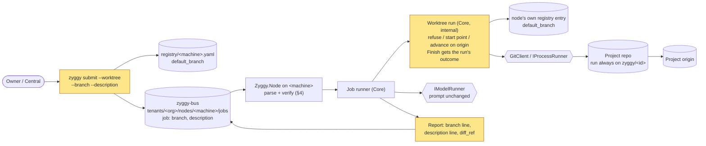
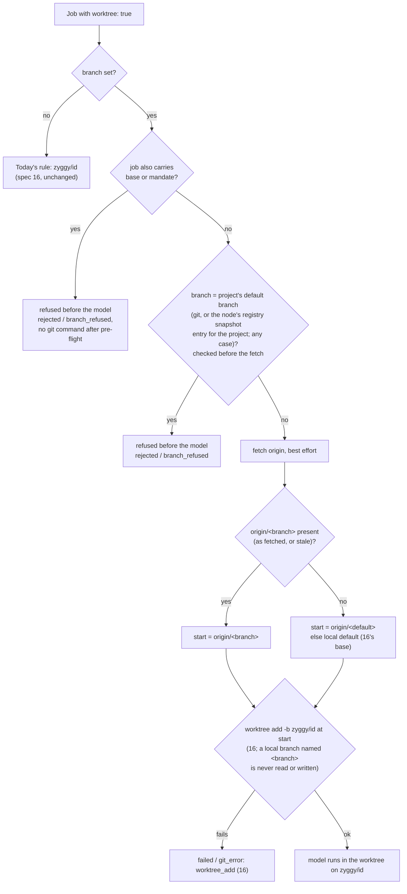
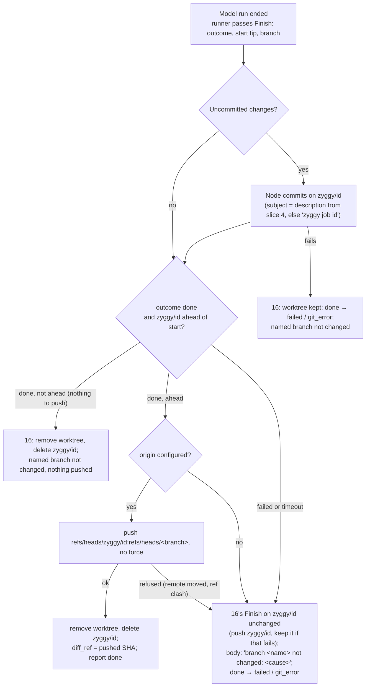

# Spec: 53 — A job's branch gets a meaningful name and a description

## Status

- 2026-11-17: spec written in an unattended job run (the owner could not be interviewed). Not approved. Every gap is under Open questions with a recommendation; questions marked **HIGH** must be answered before slice 1 (Q1 at the latest before slice 4).
- 2026-11-17: `spec-critic` agent (separate, fresh context) verdict **not ready**: 4 blocking, 4 improvements. Fixed: push test now compares with `origin/<branch>` so kept commits are pushed later (AC-7b); refusal state move, per-segment `.lock`, case-insensitive default-branch and `zyggy/` checks, ref-name clash, failed fetch, stale worktree, YAML-quoting golden; registry read at submit stated as new work with a skip rule; slice 2 split (now 6 slices); AC-8/AC-9 given the provisional concrete reason; AC-14 and AC-17 scoped; constraint "named branches only"; amendments marked conditional. Still open by nature: the HIGH questions Q1–Q4 (the critic's first blocker) need the owner.
- 2026-11-17: decisions recorded (unattended job run). The owner, on Central: "I do not have enough context anymore to answer these 4 questions, I trust you to pick best answer" — so Q1–Q4 were decided by Zyggy on his delegation, and Q5–Q8 taken as recommended on his standing delegation (list under "Decided 2026-11-17"). Behavior, criteria, slices and the proposed amendments now carry the decisions; the amendments, including a new one for spec 18 (Q2), still await the owner. Spec not approved. `spec-critic` run 1 (fresh context): **not ready**, 3 blocking, 6 improvements, all fixed: the refusal's bus path stated (report in `reports/`, claimed file removed, nothing in `jobs/rejected/`); the default-branch refusal and `branch_refused` moved into slice 2; the fast-forward mechanism named (`merge --ff-only` in the worktree, failure → `git_error: fast_forward`) and AC-10 tightened; slices now 8 (wire split into happy and failure path, docs separate); amendment 8 lists every `base`; AC-13 same id; re-run leak and default-branch fallback stated (the node also checks its registry `default_branch`).
- 2026-11-17: `spec-critic` run 2 (fresh context, the last allowed): **not ready**, 3 blocking, 5 improvements. Blocking fixed after the run, not re-reviewed: a Finish table combining start tip, `origin/<branch>` and the default base (push, `files_changed`, `diff_ref`, deletion per case); Prepare hands Finish a "created in this run" value, AC-11 covers the remote-only case; the diverged refusal moved into slice 2 with the default-branch refusal, AC-7b's refused first push named (a `pre-receive` hook on the bare origin). Left open (improvements): a `refs/` leading segment is allowed by the name rule; AC-8/AC-9 bundle several checks (the `zyggy status` wording "rejected by <machine>: <reason>" does exist in `StatusCommand`); AC-13's prompt equality assumes no other per-job value; AC-17 checks headings only; the spec repeats the decisions in two tables.
- 2026-11-17: Q2 decided again by Zyggy on the owner's delegation, replacing (b): **(a) keep both fields**. Spec 18's `base` (start and merge target of a mandate job, may be the default branch, non-fast-forward ends `done`) and this spec's `branch` (the job's own result branch, never the default branch, non-fast-forward ends `failed`) are different things, and `base` is already built; spec 18 stays untouched, amendment 8 removed. A job carrying `branch` together with `base` or `mandate` is refused in v1 (`rejected` / `branch_refused`; new AC-9c). Also settled: the name rule refuses a leading `refs/` segment; AC-8 and AC-9 split into single-check criteria (AC-8a–e, AC-9a–c); AC-13 and AC-17 made precise; the decisions kept in one table ("Decided 2026-11-17"); "base" in the Finish rules renamed "default tip" to avoid the field name. Spec not approved.
- 2026-11-17: `spec-critic` run 1 of this revision (fresh context): **not ready**, 2 blocking, 6 improvements, all fixed: the "no git command" claims of AC-8a/9a/9c scoped to after pre-flight, the mandate check placed before Prepare's first git command; push rule decided (Zyggy, owner's delegation): a local-only branch is pushed only when the job moved it, on a branch that exists on `origin` local commits (kept or the owner's) go out, `includes` n = `origin/<branch>..start` (new AC-7c, AC-7b re-set on a remote-existing branch); deletion also needs the worktree removed; Finish table rows complete; sequence diagram job B fixed, node registry read drawn; spec 18 key names cited; AC-12 (I) in slice 5, AC-18 in slice 7, distinct filters for slices 5 and 6; slice 2 test-first order named.
- 2026-11-17: `spec-critic` run 2 of this revision (fresh context, the last allowed): **not ready**, 1 blocking, 7 improvements. Fixed after the run, not re-reviewed: AC-14 lists the rows the new code produces (the older-node row left to AC-17) and names the failed-fetch setup; the git-config constraint admits git's upstream-tracking entry; AC-6 leaves the `includes` line to AC-7b; the wire slices' entry point (hand-written envelopes through the node host) and the `sh` `pre-receive` hook on Windows stated; AC-17 tokens checked inside each section, "without `--branch`" for the mandate entry. Open: Q10 (push after a failed or timed-out run), Q11 (split slice 2, slice 4 tests-only).
- 2026-11-17: Q9 confirmed, Q10 and Q11 decided by Zyggy on the owner's delegation (unattended job run). Q10 **no**: a named run that ends `failed` or `timeout` never pushes the named branch; its commits go to `zyggy/<id>` as in 16 and the report names that branch (new AC-7d; Finish, "failed or timed-out run"). Mechanism chosen here: at Finish the worktree switches to a new `zyggy/<id>` at the current tip (`git switch -c`), so the node's commit never lands on the named branch; a named branch the model itself moved is put back at its start tip with `git branch -f`, the one backward move allowed, and only while `zyggy/<id>` holds those commits (AC-10 narrowed to allow exactly that). Q11: slice 2 split into the refusals (now slice 2) and the start point, push and cleanup (now slice 3), which also takes AC-10's command inspection, the fast-forward and push-refused cases and old slice 4's cases (`worktree_add` causes, failed fetch), since those add no code; the Q10 rule is its own Fake slice (now 4); slices now 9. The owner approved amendments 1–7 on Central on 2026-11-17 on the summary quoted under "Amendments"; amendments 4 and 5 go beyond that summary and are counted as awaiting the owner.

- 2026-11-17: failure path reworked (unattended job run; slice 1, AC-1, AC-2 and amendments 1, 2, 3, 6, 7 untouched — slice 1 is being built in parallel). Simpler mechanism chosen by Zyggy on the owner's delegation, replacing Q10's `switch -c` / `branch -f` and Q5's local fast-forward: **every worktree job runs on `zyggy/<id>`**, started at `origin/<branch>` when that exists, else at the default tip; after a `done` run the node advances the named branch on `origin` by one non-forced push `zyggy/<id>:<branch>`; in every other case (failed, timeout, push refused, no `origin`) the work follows 16's Finish on `zyggy/<id>`. The node never creates, moves or deletes a local branch with the job's name, and no branch is ever moved backwards. Consequences: the diverged refusal, the `merge --ff-only`, the "created in this run" value, the `includes` line and the local named-branch cleanup are gone (AC-9a, AC-9b removed; AC-3, 4, 7b, 7c, 7d, 10, 11, 14, 17 rewritten); slices now 8 (the failed-run rule joins the start/push slice so no committed slice can push failed work to a named branch). Fixes the four blocking findings of the previous `spec-critic` run: Finish receives the run's outcome from the runner (new work, slice 3); the commit message is `zyggy job <id>` for every outcome until slice 4 adds the description; AC-7d (I) covers `failed` and `timeout` and a branch absent from `origin`, with real git refs compared; the failed-fetch case ends `git_error` exactly when `origin/<branch>` has commits the stale start lacks. Amendments 4 and 5 rewritten, still awaiting the owner. The seven improvements of that run were not available to this job (not recorded in the spec); listed under Open questions.
- 2026-11-17: `spec-critic` run on the reworked spec (fresh context, one run; findings listed only, spec not changed after it): **not ready**, 2 blocking. Blocking: (B1) the node's registry `default_branch` has no source in the runner (Prepare gets neither registry nor job; the registry snapshot exposes only name → path) — say where it comes from, whether it is a public `Zyggy.Core` change, and the skip for path-resolved projects; ⚠️ on slice 2 (Prepare step 1, AC-8b). (B2) Slice 3 is too large and mixes two owner-visible outcomes — split into 3a (outcome passed to Finish, start point, `done` push) and 3b (failed / timeout / refused push / no `origin` fall-through, AC-10 inspection); 3a pushes only on `done`, so the ordering still holds. Improvements: (1) say the default-branch check moves before the fetch for named jobs only; (2) AC-13 passes as soon as slice 1 exists — say how it is seen failing, or move it; (3) AC-6's "behind" line has no integration setup — add one or make it unit-only; (4) mark amendments 4–5 as a gate before slice 3 in the slice table; (5) collapse the Status history and the Q-rows D9 supersedes; (6) Finish diagram: label the fall-through edge "not done, or not ahead"; (7) test-area names belong to the builder; (8) AC-7d (I) needs per-case model environment — state one host per case.
- 2026-11-17: the owner's approvals, given on Central in answer to this summary: "Every job with a branch name works on a temporary zyggy/<id> branch; only when the run ends successfully is its work copied onto the named branch on GitHub, by a normal push that only adds commits on top; the named branch is never touched before that and the owner's local copy is never read or written. Amendment 4: a named job is refused if it also carries a mandate or names the default branch; otherwise it runs as described. Amendment 5: the report says where the work went: branch X pushed at ..., or the temporary branch plus branch X not changed and the reason." So: **Q12 (the mechanism, D9) approved by the owner**; **amendments 4 and 5 approved by the owner** as far as they stay within that summary; all seven amendments are approved. The sentences of 4 and 5 that go beyond the summary are listed under "Amendments", "Awaiting the owner".
- 2026-11-17: **slice 1 done** — built test first by job 01M7MXTYZS62V6F5KT3DMRQDQR (branch `zyggy/01M7MXTYZS62V6F5KT3DMRQDQR`, commit 8023643); 54 slice tests passed; unit 6718 passed / 60 skipped / 0 failed; integration 999 passed / 58 skipped / 0 failed; amendments 1–3 applied to the founding spec §4. Decided on the owner's delegation: `branch: ''` counts as absent; the 200-character limit of `description` counts Unicode characters. Accepted by the owner on 2026-11-17.
- 2026-11-17: the two blocking findings of the last `spec-critic` run fixed: (B1) the node's registry `default_branch` comes from the `RegistrySnapshot` the runner already holds, looked up by the job's project name and handed to Prepare as an internal value (Prepare step 1, AC-8b); no new public `Zyggy.Core` surface; (B2) slice 3 split into 3a "a successful run is pushed to the named branch" and 3b "everything else falls back to `zyggy/<id>`".
- 2026-11-17: `spec-critic` (fresh context, run 1 of this revision): **READY**, 0 blocking, 9 improvements not applied (AC-13 cannot fail as placed; AC-6 "behind" line lacks an integration setup; AC-3 unit observables; 3a/3b released together; Q14 not a gate; Status history length; 3b size; one host per AC-7d case; filter names). **Approved by the owner on 2026-11-17** for building slice 2 onwards.
- 2026-11-17: **slice 2 built** (unattended job run 01M7N1H4JFP3VJE7RM26YA6XHM, uncommitted, awaiting the owner): reason `branch_refused` (enum member + wire string); worktree Prepare refuses a named job carrying a `base` or `mandate` front-matter key before its first git command, then refuses git's default branch or the node's `RegistrySnapshot` entry's `default_branch` (looked up by project name, ordinal; skipped when absent), any letter case, before the fetch; the runner answers `rejected` / `branch_refused`, body `branch_refused: <rule>`, through pre-flight's rejection path. No new public surface beyond the enum member (amendment 6). Proof: review-check filter 101 passed / 0 failed (22 new refusal tests); unit 6742 passed / 60 skipped / 0 failed; integration 999 passed / 58 skipped / 0 failed; format clean, 0 warnings. `slice-verifier` (fresh context): PASS, each of 9 rules broken on purpose made tests fail. Amendment 6 pasted into the founding spec §9 (`JobRunner` bullet, both sentences). Key names `base` / `mandate` taken from spec 18's "Envelope and bus"; re-check against 18's parser when group B merges.
- 2026-11-17: the owner, on Central: "yes to all three". So: **slice 2 accepted**; the three parts listed under Q14 **approved** — the commit subject is the description; a run that ends `done` but leaves the named branch unchanged is reported `failed` / `git_error`; the report gets a `description:` line and a "behind" line — so **amendments 4 and 5 are approved in full**; and `branch_refused` is added to the reason list in this repository's `CLAUDE.md` (one-line change, made in the run of slices 3a and 3b). Q14 closed.
- 2026-11-17: **slice 3a built** (unattended job run 01M7N2YP70V2MBMNYQXN510PJD, uncommitted, awaiting the owner; built together with 3b, they ship together): the runner passes Finish the run's outcome and the job's `branch` (empty = absent); Prepare starts a named job at `origin/<branch>` (resolved after the fetch, stale if it failed), else the default tip; a `done` run ahead of its start is pushed by one `push origin refs/heads/zyggy/<id>:refs/heads/<branch>` (new internal `GitClient` method, no force), then the worktree removed and the local `zyggy/<id>` deleted, `diff_ref` = tip, body `branch <name> pushed at <sha>`; unnamed jobs unchanged. Proof: 20 new tests; review-check filter 215 passed / 0 failed; unit 6802 passed / 60 skipped / 0 failed; integration 999 passed / 58 skipped / 0 failed; format clean, 0 warnings. Decision: AC-10's "only command naming `<name>`" read as excluding the read of `refs/remotes/origin/<name>`, which Prepare step 3 requires; no command names `refs/heads/<name>` except the push destination.
- 2026-11-17: **slice 3b built** (same run, uncommitted, awaiting the owner): a `failed` / `timeout` run keeps its status; a refused named push (race, ref clash, failed fetch with a stale start) and a `done` run without `origin` end `failed` / `git_error`; each follows 16 on `zyggy/<id>` with 16's line plus `branch <name> not changed: <cause>` (`run ended failed|timeout`, `push refused`, `no origin`, `worktree kept` for a failed status/commit/rev-parse step). Proof: 40 new tests (AC-10 inspection over 9 Finish rows), same totals as 3a. Decided in the build: a `failed` / `timeout` named run with no commits beyond its start pushes nothing (16) but still writes `branch <name> not changed: run ended <status>`; a `done` one writes no line (spec). `slice-verifier` (fresh context): PASS, 19 rules broken on purpose, each made tests fail; a timeout-only break was not isolated (covered by theory rows). Amendments 4 and 5 pasted in full into the founding spec §6 (Pre-flight step 4, Report assembly). Commit message and `description:` / "behind" lines not built (slice 4).
- 2026-11-17: **slices 3a and 3b accepted by the owner** (on Central: "1 accepted"). The two decisions their job took are confirmed by Zyggy on the owner's delegation: a failed or timed-out named run with no commits pushes nothing but still writes the `not changed` line; reading `refs/remotes/origin/<name>` to find the start point does not count against AC-10. The owner also allowed slices 4 to 8 to be built one after another without asking in between.
- 2026-11-17: **slice 4 built** (unattended job run 01M7N60Y2CPMDXBKYTCDR21JJA, uncommitted, awaiting the owner): the node's commit message is `<description>\n\nzyggy job <id>` when the job has a description, for every outcome, named or not, else `zyggy job <id>` as before; the body gets `description: <text>` after the branch lines (also unnamed, nothing pushed, failed or timeout), then `branch <name> is <n> commits behind origin/<default>` when the named branch was pushed and n > 0 (`rev-list --count <tip>..refs/remotes/origin/<default>`, git's default name from Prepare; no line when it is unknown); the prompt is unchanged. Proof: 19 new tests (AC-5, AC-6, AC-13); one slice 3a test now reads the first of two `rev-list` calls; review-check filter 162 passed / 0 failed; unit 6820 passed / 60 skipped / 1 failed (`ProbeSenderTests.SendOneAsync_ReportWithTamperedSignature_UnverifiedReportNotTimeout`, a fake-clock race under full-suite load in unchanged probe code; passes alone 3/3); integration 998 passed / 58 skipped / 1 failed (`SweepHostTests.Central_StaleClaims_…`, the fixture's own bus push lost a race; passes on re-run 6/6); format clean, 0 warnings. `slice-verifier` (fresh context): PASS, 10 of 11 rules broken on purpose each made tests fail (the body-only break of the commit message was not applied; covered by the subject+body assertion). Decided in the build: a project-directory job (`worktree: false`) with a description also gets the `description:` line; a job refused or failed before the model gets none. Amendments 4 and 5 already in the founding spec in full; nothing to paste.
- 2026-11-17: slice 4 recorded as built by job 01M7N60Y2CPMDXBKYTCDR21JJA, `slice-verifier` PASS. Its decision that a job without a worktree that has a description also gets the `description:` line is **confirmed by Zyggy on the owner's delegation**. Its final full run had two failures it called timing races: one unit test (`ProbeSenderTests.SendOneAsync_ReportWithTamperedSignature_UnverifiedReportNotTimeout`, a probe timing race that passed alone) and one integration test (`SweepHostTests.Central_StaleClaims_…`, a sweep fixture race that passed on rerun). Before slice 5, a full run of the code as it was: unit 6821 passed / 60 skipped / 0 failed, integration 999 passed / 58 skipped / 0 failed. Neither test failed again. Both are unchanged against `main`, and deliverable 53 does not change the probe or sweep code they exercise. The only shared code is `Envelope.CreateJob`, whose output for a job without the new fields stays byte-identical (golden-tested).
- 2026-11-17: **slice 5 built** (unattended job run 01M7N7769HV9YH5Z8BFCHHCVH2, uncommitted, awaiting the owner). It adds tests only: 9 integration tests in the test area `NamedBranchRoundTrip`. They send hand-written signed jobs through the production node composition root, using real git, a bare origin and `fake-claude`. AC-3: the branch is created on origin from `main`, and no local `<name>` or `zyggy/<id>` remains. AC-4: a second job continues the first job's pushed tip. AC-5: the commit message is read from the origin for a named job with a description, a named job without one, and an unnamed job with one. AC-6: the body ends with the `pushed at` and `description:` lines; it also has the "behind" line once a second clone has moved `main` on the origin, which supplies the integration setup an earlier `spec-critic` found missing. AC-7: the second job's `files_changed` lists only its own file. AC-11: no `zyggy/<id>` remains locally or on the origin. No production code changed; the behavior already held. Each test was seen failing under a deliberate break, then restored: push destination, commit message, start point, behind threshold (`> 100`, `>= 0`), `zyggy/<id>` deletion, `files_changed` start, `description:` line. Proof: review-check filter 31 passed / 0 failed; unit 6821 passed / 60 skipped / 0 failed; integration 1008 passed / 58 skipped / 0 failed; format clean, 0 warnings. `slice-verifier` (fresh context): **PASS**, AC-3–7, AC-11 and AC-12 met; each of 6 breaks made tests fail (AC-12: breaking the unnamed push failed 7 spec-16 worktree and P2 gate tests). Decision: the second job's fake-claude edits are changed through the host's `JobRunnerOptions` between the two runs, so one host and one bus checkout serve both jobs. Nothing to paste: no amendment concerns this slice.
- 2026-11-17: slice 5 recorded as built by job 01M7N7769HV9YH5Z8BFCHHCVH2: 9 integration tests with real git and a bare origin, `slice-verifier` PASS, all suites green. The two failures seen after slice 4 (`ProbeSenderTests.SendOneAsync_ReportWithTamperedSignature_UnverifiedReportNotTimeout`, `SweepHostTests.Central_StaleClaims_…`) did not recur, in that run or in slice 6's final run.
- 2026-11-17: **slice 6 built** (unattended job run 01M7N9TAKMEE42P6XDPVMFGAMC, uncommitted, awaiting the owner). Tests only: 8 integration tests in the test area `NamedBranchFailure`. They send hand-written signed jobs through the production node composition root, with real git, a bare origin and `fake-claude`. AC-8d: a `Main` branch is refused. The signed `rejected` / `branch_refused` report is in `reports/`, its body is `branch_refused: default branch main`, the job is gone from `jobs/` and from `claimed/`, `jobs/rejected/` holds no envelope, and the origin's `main` and branch list are unchanged. AC-8e: after the refusal, `zyggy status --id` on Central's checkout prints `state   rejected by home-laptop: branch_refused`. AC-7b: an `sh` `pre-receive` hook refuses `refs/heads/<name>` only. The run ends `failed` / `git_error` with `push refused`, the origin's named tip is unchanged, and the work is on `origin/zyggy/<id>`. AC-7c: the owner's local branch has diverged. Its local tip is unchanged, and the origin's named branch = start + 1 commit. AC-7d: case (1) is `failed` (`fake-claude` `error` scenario, exit 1), with the branch on the origin and the owner's local branch one commit ahead. Case (2) is `timeout` (3 s), with the branch absent everywhere. In both, the refs are unchanged (or still absent), the `run ended <status>` line is written, and the file is on `origin/zyggy/<id>`. AC-10: a second clone pushes to the named branch just before the node's push, through the node's process runner hook. The run ends `failed` / `git_error`, the colleague's tip is kept, and the work is on `zyggy/<id>`. The project's git commands carry no force, reset, merge, rebase, switch or checkout, and only the one `zyggy/<id>:<name>` push names the branch. No production code changed. Each test was seen failing under a deliberate break, then restored: named push after a failed or timed-out run, a case-sensitive default check, a forced named push, the start at the local branch, the cause text. Proof: review-check filter 8 passed / 0 failed; unit 6821 passed / 60 skipped / 0 failed; integration 1016 passed / 58 skipped / 0 failed; format clean, 0 warnings. `slice-verifier` (fresh context): **PASS**, 8 breaks, each made tests fail. Its note: the integration test of AC-7c covers the diverged state (and AC-7d (1) the ahead state); behind and local-only are unit-level, as the spec assigns. Decisions: Central's checkout is pulled before `zyggy status` (its listener would do so); the race is staged through the node's process runner hook, just before the named push. Nothing to paste: no amendment concerns this slice.
- 2026-11-17: slice 6 recorded as built by job 01M7N9TAKMEE42P6XDPVMFGAMC: 8 integration tests on the failure paths with real git, `slice-verifier` PASS, all suites green.
- 2026-11-17: **slice 7 built** (unattended job run 01M7NC0FHFY722YJ9CSKKM2MW3, uncommitted, awaiting the owner): `zyggy submit` gains `--branch` and `--description`. Before signing, the new public `JobRequest.TryWithBranch` (the only new `Zyggy.Core` surface) applies these checks in order: `--branch` requires `--worktree`; the §4 shape of both values (the parser's own rules); the branch is not the target project's `default_branch`, in any letter case, in the target machine's registry file as it stands in the bus checkout. A refusal exits 2 with one line `zyggy: branch|description: …` and writes nothing. The registry check is skipped when the file is absent or unreadable, belongs to another tenant or machine, or the project is not in it by name (so always for a path-given project), or has no `default_branch`; the node decides. Tests: 29 unit (`JobRequestNamedBranchTests`) and 11 integration. `SubmitNamedBranchTests` covers AC-15: a signed job `zyggy verify` accepts, `--branch` without `--worktree`, malformed name and description, registry default `main` / `Main`, and no entry. `SubmitNamedBranchRoundTripTests` covers AC-16: two `zyggy submit --branch feature/12-cart` jobs through the production node host give one origin branch with both commits, two `done` reports naming it, the owner's checkout (HEAD, branches, status) unchanged, and no local `feature/12-cart`. All were seen failing before the code (unknown option, stub). Proof: review-check filter 36 passed / 0 failed; unit filter `JobRequest` 55 / 0; final full run unit 6850 passed / 60 skipped / 0 failed; integration 1026 / 58 / 1 failed (`SweepHostTests.Central_StaleClaims_RequeuedAfterStartupPickupAndAfterEveryInterval`, the sweep fixture race seen after slice 4; passes alone 3/3; the run before was 1027 / 58 / 0). Two earlier unit runs each lost one `DiscoveryLoopTests` wall-clock wait (`RunAsync_ScanThrows_…`, `RunAsync_Schedule_…`), in code this deliverable does not touch; they pass alone 3/3. Format clean, 0 warnings. `slice-verifier` (fresh context): **FAIL** on one rule — removing the path-project guard left every test green. Fixed after its run by removing that guard: a registry name never equals an absolute path, so the guard was redundant. Not re-verified. Its other breaks each failed tests. The node side of AC-16 was not broken by it; slices 5 and 6 cover that side. Decisions: the registry file is read from the checkout as it is, with no pull; an unreadable or foreign file means skip; the check order is worktree, shape, default, description; `--description` without `--worktree` is allowed (D4). Nothing to paste: amendment 7 goes with the release in `zyggy-core`.
- 2026-11-17: slice 7 recorded as built by job 01M7NC0FHFY722YJ9CSKKM2MW3 (29 unit and 11 integration tests, `zyggy submit --branch` and `--description`). Its report gave no test counts and no verifier verdict, and the fix after its `slice-verifier` FAIL was not re-verified, so `slice-verifier` was run again by job 01M7NE4XGJ9XDF3GB3W8P1CC0E (fresh context, committed code at 4721098): **FAIL** on one rule. Removing the skip for a registry file of **another tenant** left every test green (unit `JobRequest` 55 / 0, integration `Submit` 36 / 0): no test puts a foreign-tenant registry file in the bus checkout. The other 9 breaks each made tests fail: `--worktree` required, branch shape, description shape, default branch case-insensitive, foreign machine (unit only), no entry, absent file (integration only), refusal path, exit 2. Not fixed in this job (slice 8 only); a test for the foreign-tenant skip is still owed before release.
- 2026-11-17: **slice 8 built** (unattended job run 01M7NE4XGJ9XDF3GB3W8P1CC0E, uncommitted, awaiting the owner). Docs and tests only: the Core README's jobs runbook gains the four rows "Jobs: branch name refused", "Jobs: branch on a mandate job", "Jobs: named branch not changed" and "Jobs: report names zyggy/<id> although --branch was given". The Cli README's `submit` verb row documents `--branch <name>` and `--description <text>`, and its exit-2 row names both fields. Tests: 5 source-hygiene tests (a theory over the four rows, checking each remedy token in the row's "What to do" cell, plus the `submit` row), seen failing before the text existed (5 failed); one row then failed again on `Upgrade` against the spec's token `upgrade`, and its wording was fixed. Proof: review-check filter `SourceHygiene` 105 passed / 0 failed. Final full run on the finished worktree: build 0 warnings, 0 errors; unit 6855 passed / 60 skipped / 0 failed; integration 1026 passed / 58 skipped / 1 failed (`NodeHostPickupTests.Central_WithInstanceDir_BusItemPushedWhileRunning_FiledWithinTenSeconds`, filed after 13.5 s against 10 s under full-suite load; pickup code unchanged by this deliverable; passes alone 3/3); format clean. `slice-verifier` (fresh context): **PASS**, 14 breaks (each row renamed, each token removed, each token moved to another cell, each option removed from the `submit` row) each made a test fail. Decision: a runbook "entry" is a row of the existing jobs table, as the Core README has always held them; "the section text under that heading" is read as that row's "What to do" cell. Nothing to paste: amendment 7 goes with the release in `zyggy-core`.
- 2026-11-17: **slice 7 closed** (unattended job run 01M7NFWB1W7B1SAXQWN69VNV4M, uncommitted, awaiting the owner). Added the test owed for the foreign-tenant skip: integration `SubmitNamedBranchTests.Submit_RegistryFileOfAnotherTenant_SkippedAndJobSentWithBranch` puts a registry file that names tenant `globex` at `acme`'s path for `home-laptop` (project `shop`, `default_branch: main`) and submits `--branch main`: the job is sent with that branch. With the tenant skip removed it failed for the expected reason (exit 2, "main is the default branch main of project shop on home-laptop"); restored, `SubmitNamedBranchTests` 11 passed / 0 failed. No code fix needed: another tenant's registry file cannot influence a job. `slice-verifier` re-run (fresh context): **PASS**, every rule broken on purpose made a test fail, the tenant skip now in integration only and the other-machine skip in unit only; the absent-file guard was not broken (removing it throws). Final full run on the finished worktree: build 0 warnings, 0 errors; unit 6855 passed / 60 skipped / 0 failed; integration 1027 passed / 58 skipped / 1 failed (`NodeHostPickupTests.Central_WithInstanceDir_BusItemPushedWhileRunning_FiledWithinTenSeconds`, the same 10 s pickup wait as after slice 8, now its second full-suite failure; pickup code unchanged by this deliverable; passes alone 3/3); format clean.
- 2026-11-18: **released as v0.22.1.** Slices 1–8 merged through PRs #44–#51. Tag v0.22.0 was cut first, but its tag CI (run 44253001013) was red on ubuntu on a pre-existing `BusListener.DrainAsync` race (`JobsRunning` 1 after drain). It got no GitHub release; the fix (PR #54) ships with this one. Tag CI run 44260159398 green on windows-latest and ubuntu-latest, smoke included. Instance pin zyggy-geoffrey PR #17. Central and home-laptop run 0.22.1: `/health` version 0.22.1, `zyggy status` health green, claude auth ok. `zyggy verify` reports 228 ok and 1 failed, `tenants/<org>/archive/.gitkeep` `unexpected_path`, a seed file from 2026-10-13 that predates this release. No `spec-reviewer` pass was run on this deliverable before release. Left open: amendment 7 (`zyggy-core` `PROTOCOL.md` §4 and the `bus` skill documenting `branch` and `description`) is not yet in `zyggy-core`; the work laptop's upgrade (owner-run `install.ps1`); a live `zyggy submit --worktree --branch` round trip on a real project (owner-run).

## Goal

**As** the owner (and Central acting for him), **I want** to give a worktree job a branch name and a one-line description, **so that** the branch the node pushes says what it holds, and the slices of one deliverable land one after another on one named branch instead of on ten `zyggy/<job id>` branches nobody can tell apart.

What happens today (verified in the code, see Context): `zyggy submit --worktree` always runs on `zyggy/<job id>`, the node's commit message is `zyggy job <id>`, and the report names only that branch. On 2026-11-17 the project repository collected more than ten such branches in one morning, and PRs #44 and #45 carry the title "Zyggy/01 m7 …".

A job without a branch name keeps today's behavior exactly.

## Context

- **Roadmap entry**: `_plans/ROADMAP.md` #53 (slug `53-job-branch-name`); owner request and priority of 2026-11-17.
- **Founding-spec sections**: §4 Bus protocol (job example, "Mandatory fields per type", unknown fields, signature); §6 Job execution (Pre-flight step 4, Report assembly); §9 design rules (closed `reason` enum, `IProcessRunner`, `EnvelopeSigner.Canonicalize` and goldens); §3 / §9 CLI verb list (`submit`); §5 Git operations (commit identity, no force-push).
- **Reference feature**: worktree execution (`_specs/16-worktree-execution.md`) — closer than the discovery registry: this feature changes exactly the worktree run, its node commit, its push and its report lines that 16 built, and follows its Fake → Wire → owner-asks slice shape. The envelope-field part follows the `worktree` field 16 added to `zyggy submit`.
- **Related work**: central supervision (`_specs/18-central-supervision.md`) specifies a job field `base` ("runs on `zyggy/<id>` started from `base`; also pushed to `base` when that is a fast-forward"). That field is **not on `main`** (verified 2026-11-17: no `base` in the job parser, the envelope writer or the submitter on `main`; it is built on spec 18's own branch, group B, not yet released). Decided (Q2, again on 2026-11-17): both fields stay, they mean different things (see Behavior, "`branch` and spec 18's `base`"); spec 18 is not changed by this deliverable.
  - The parsed envelope keeps every front-matter field, known or unknown (`Envelope.FrontMatter`), so a node built from this spec can see a `base` or `mandate` key on a job before spec 18's group B is merged.
- **Facts verified in the code on `main` (963feb0), 2026-11-17, files read:**
  - The worktree run always uses branch `zyggy/<id>`; the node's commit message is `zyggy job <id>`; the push is `refs/heads/<b>:refs/heads/<b>` to `origin`, never forced; after a successful push, and when the branch has no commits, the local branch is deleted with `branch -D`; after a failed push it is kept and the report becomes `failed` / `git_error`.
  - An existing local `zyggy/<id>` is reused as it stands (no fetch into it, no fast-forward); a new one starts at `origin/<default>`, else the local default branch. The default branch comes from git at run time (`origin/HEAD`, else `main`, else `master`, else the current branch).
  - `git worktree add` of a branch that is already checked out in another worktree (for instance the owner's checkout) fails; today that ends as `failed` / `git_error`, body `git_error: worktree_add`, before the model starts.
  - `files_changed` and the "ahead" test compare the base commit with the final tip; `diff_ref` is the pushed tip SHA.
  - The runner calls the worktree Finish step with the project, the worktree, the job id, the base commit and the commit identity only; the run's outcome (the mapped `done` / `failed` / `timeout` reply) is known to the runner before that call but is not passed. Finish today behaves the same for every outcome.
  - §4: "every field not listed here is unknown: preserved, signed, never interpreted". A node built before this feature therefore **accepts** a job carrying the new fields, verifies its signature, ignores the fields, and runs on `zyggy/<id>`.
  - The report parser accepts any snake_case `reason` token; it does not check membership of the closed enum. A Central on an older version can therefore read a report with a new reason member.
  - The job submitter's read-back refuses any front-matter key outside its list of §4 job keys, so the submitter must learn the new keys in the same slice that writes them.
  - The registry publishes each project's `default_branch`; `zyggy submit` has the bus checkout and can read it before sending.
  - This repository's own guard (`.claude/hooks/guard.mjs`) refuses `git commit`, `git push`, `git checkout`, `git switch` and similar commands from any session, including a job's model; job 01M7MSQWSV2ACHMRTSQZ636QRF hit it on 2026-11-17. Zyggy's own tool hook additionally allows only the job's `allowed_tools`. **So the node, not the job's model, creates, names, commits and pushes the branch.** The model is never asked to do any of it.
  - Golden files for the job envelope exist (`job.md`, `job.canonical`, `job.sig`, and a non-canonical variant).
- **Not verified**: whether a Hub `submit_job` tool exists yet (the Hub host is still empty per `CLAUDE.md`); §7 says it takes "envelope fields", so it would accept the new fields when built. Out of scope here.

## Constraints

- ⚠️ **§4 shared contract and signing.** Two new optional job fields, part of the signed front matter. The reviewer verifies: `EnvelopeSigner.Canonicalize` is unchanged; new golden files cover a job with both fields and with `branch` only; the existing job goldens stay byte-identical; a job without the fields is written byte-for-byte as today. `PROTOCOL.md` in `zyggy-core` changes with §4 (amendment 7, approved; applied with the release, not edited here).
- ⚠️ **§6 runner I/O and the closed `reason` enum.** One new reason member, `branch_refused`, sent with `status: rejected` (Q1). Adding a member is a protocol change: amendments 6 and 7 carry it to §9 and `PROTOCOL.md`. An older Central reads it (the report parser accepts any snake_case token).
- ⚠️ **Writes into the owner's real repositories.** Widened from 16 only by: the branch the job names **on `origin`**, advanced after a `done` run by one push of `refs/heads/zyggy/<id>:refs/heads/<branch>`, never forced (git refuses anything but a fast-forward or a new branch). The run itself stays on `zyggy/<id>` as in 16. The node never creates, checks out, moves, resets or deletes a **local** branch with the job's name, and never pushes one; an owner's local branch of that name and its unpushed commits are left exactly as they are. No branch is ever moved backwards. A `failed` or `timeout` run never pushes the named branch. Never a force-push, never a push to or a checkout of the project's default branch, never a change to the owner's checkout or git config, except the upstream-tracking entry git writes for a branch created from a remote-tracking start point (as 16's `-b zyggy/<id> origin/<default>` already does; it stays with a kept branch). `zyggy/<id>` keeps 16's cleanup rule.
- ⚠️ **Public surface of `Zyggy.Core`.** The job request and the job fields gain two optional values; `zyggy submit` gains two options. The worktree handling stays internal; no new seam.
- ⚠️ **The work-laptop boundary (§8).** Unchanged: worktree jobs on the work laptop stay out of scope as in 16. A branch name or description never carries work-laptop data from or to it.
- §9: git only through `GitClient` / `IProcessRunner`, never LibGit2Sharp; no test runs the real `claude` or reaches GitHub; `JobRunner` never throws to the loop; every failure is a report with a closed `reason`; log once per state change.
- **Data, never instructions.** The branch name and the description come from a signed sender, yet they are data: they are never placed in the model's prompt (decision D7), they appear only as a commit-message subject, report body lines and log values, and they are validated for shape before any use.
- **Naming is done by the node.** The prompt template is unchanged; the model is not asked to create, switch, commit or push a branch (see Context: the repository guard refuses it).
- Public repo: placeholders only (`acme`, `home-laptop`, `shop`, `feature/12-cart`).

## Diagrams

### Components touched



### Round trip: two jobs continue one named branch

```mermaid
sequenceDiagram
  actor Owner
  participant Bus as zyggy-bus
  participant Node as Node (home-laptop)
  participant Repo as Project repo
  participant Origin as Project origin
  Owner->>Bus: submit --worktree --branch feature/12-cart --description "Cart: slice 1" (job A)
  Node->>Bus: poll, verify, claim A
  Node->>Origin: fetch (best effort)
  Node->>Repo: origin/feature/12-cart absent → worktree add -b zyggy/<A> at origin/<default>
  Node->>Node: model runs (fake-claude in tests), outcome done
  Node->>Repo: commit leftovers on zyggy/<A>: "Cart: slice 1" + "zyggy job <A>"
  Node->>Origin: push zyggy/<A>:feature/12-cart (new branch, no force)
  Node->>Repo: remove worktree, delete local zyggy/<A>
  Node->>Bus: report A: branch line, description line, diff_ref
  Owner->>Bus: submit --worktree --branch feature/12-cart --description "Cart: slice 2" (job B)
  Node->>Bus: poll, verify, claim B
  Node->>Origin: fetch
  Note over Node,Repo: no local feature/12-cart exists or is created; any local branch of that name is never read or written
  Node->>Repo: worktree add -b zyggy/<B> at origin/feature/12-cart
  Node->>Node: model runs, outcome done
  Node->>Repo: commit leftovers on zyggy/<B>: "Cart: slice 2" + "zyggy job <B>"
  Node->>Origin: push zyggy/<B>:feature/12-cart (fast-forward, no force)
  Node->>Bus: report B
```

### Where the run starts (Prepare)



### After the model stops (Finish), named branch



### Slice map

```mermaid
flowchart LR
  s1["1 Fake: a signed job carries<br/>branch + description (goldens)"] --> s2["2 Fake: mandate combination and<br/>default branch refused (branch_refused)"]
  s2 --> s3a["3a Fake: run on zyggy/id from the named start;<br/>a successful run is pushed to origin/&lt;name&gt;"]
  s3a --> s3b["3b Fake: everything else<br/>(failed, timeout, refused push, no origin)<br/>falls back to zyggy/id"]
  s3b --> s4["4 Fake: the description reaches<br/>the commit and the report"]
  s4 --> s5["5 Wire: real git, bare origin,<br/>two jobs on one branch"]
  s5 --> s6["6 Wire: refusal, lost race, failed and<br/>timed-out runs with real git"]
  s6 --> s7["7 Owner asks for it:<br/>zyggy submit --branch, production host"]
  s7 --> s8["8 Runbook and README"]
```



## Behavior

### Envelope and bus

Two new optional job fields (names and shapes decided, Q3):

| Field | Shape | Meaning |
| --- | --- | --- |
| `branch` | A git branch name of 1–100 characters from `[A-Za-z0-9._/-]`; no empty segment, no segment starting with `.` or `-`, no segment ending in `.lock`, no `..`, not ending in `/` or `.`, not `HEAD`, not starting with `zyggy/` in any letter case (that prefix stays reserved for job-id branches), not starting with `refs/` in any letter case (it would name a ref path, not a branch). | The branch the job starts from (when it exists on `origin`) and that its finished work is pushed to (Prepare, Finish). Absent → today's `zyggy/<id>` only. |
| `description` | One line of 1–200 characters, no control characters, not only spaces. | What the branch holds after this job. Absent → today's commit message and report. |

- `branch` is valid only with `worktree: true`. A job with `branch` and `worktree: false`, or with a field of the wrong shape, is rejected at parse time as `invalid_field` (existing §4 rejection: the file moves to `jobs/rejected/` with a `rejected` report), before any model call.
- `description` may be given without `branch`: the job then runs on `zyggy/<id>` as today, and only the commit message and the report change (decision D4).
- No new bus path, envelope type or state move. The report gains no field; the branch and description appear as body lines (decision D5).
- The job goldens get three new cases: both fields; `branch` only; a `description` that needs YAML quoting (it contains `: `, ` #`, a leading `-` and both quote characters) and still signs, parses and reads back unchanged. The existing goldens are unchanged.
- **Run-time refusal** (mandate combination, default branch): `status: rejected`, `reason: branch_refused` (Q1), body `branch_refused: <rule>` with the rule `branch with base or mandate` or `default branch <name>`. (A diverged local branch is no longer a refusal: the node never reads a local branch of the job's name; Status 2026-11-17, failure-path rework.) It travels the path of the runner's existing refusal before the model (`unknown_project`): the node writes the signed `rejected` report to `reports/` and removes the claimed job file; nothing goes to `jobs/rejected/` (that folder holds parse-time and signature refusals only). No new state move. Today the runner maps every worktree-preparation failure to `git_error`; a preparation **refusal** that ends `rejected` / `branch_refused` is new work (slice 2). Whoever follows the job (deliverable 51, `zyggy status`) sees "rejected by <machine>: branch_refused", not a git failure.
- **`branch` and spec 18's `base` (Q2).** Two fields with different meanings. Spec 18's `base` is the branch a mandate job starts from and merges into: the job itself still runs on `zyggy/<id>`, `base` may be the default branch (under a `merge` grant), and when the push to `base` is not a fast-forward the job still ends `done` with `zyggy/<id>` as its result. This spec's `branch` is the name of the job's own result branch: the job starts from it and a `done` run is pushed to it, it is never the default branch, and a refused push ends `failed` / `git_error`. Spec 18 and its `base` are not changed here. A job carrying both cannot be settled from spec 18 and the code: the start point (`base` or `origin/<branch>`), the second push to `base` and its `done` outcome contradict this spec's rules, and spec 18's mandate limit `branches` is checked against `base` only, so a `branch` on a mandate job would escape it. **In v1 the node refuses a job that carries `branch` together with `base` or `mandate`**, before Prepare runs any git command: `rejected` / `branch_refused`, body `branch_refused: branch with base or mandate`. The node reads both keys from the job's front matter (§4 keeps unknown fields), so the refusal holds both before and after spec 18's group B is merged. The key names are spec 18's job fields as listed in its "Envelope and bus" section ("New job fields, all optional: `mandate` (ULID), `step`, `base` (branch name), `deliver`"); on `main` the key `mandate` exists only on decision envelopes, so the builder re-checks the names against 18's built parser when group B merges (recorded in the Status line of the slice). `zyggy submit` does not check the combination; the node does. A `description` with `base` or `mandate` and no `branch` is allowed (commit subject and report line only).

### The named-branch run (Prepare)

Pre-flight and the project lock are unchanged and come first. For a job with `branch`:

0. **Mandate combination.** First thing in the worktree preparation, before its first git command (the origin config read): when the job's front matter also has a `base` or a `mandate` key, the job is refused (`rejected` / `branch_refused`, body `branch_refused: branch with base or mandate`). Pre-flight's own git checks (§6) have already run and are unchanged.
1. **Default branch.** For a named job this check runs **before the fetch** (an unnamed job keeps 16's order: fetch, then default branch). The project's default branch is determined from git at run time, as in 16 (`origin/HEAD`, else local `main`, else `master`, else the branch currently checked out). A second name comes from **this node's registry snapshot** (the in-memory `RegistrySnapshot` of its own latest discovery scan, the same object pre-flight already resolves the project name from; never the bus copy): the runner looks up the entry whose name equals the job's `project` and hands its `default_branch` to Prepare as an internal value. The check is skipped for that second name when there is no entry (a project given by path, or no scan yet) or the entry has no `default_branch`. Discovery computes `default_branch` with the same git rule, so the second name differs from git's only when the repository changed since the last scan — typically when `origin/HEAD`, `main` and `master` are all absent and the owner has since checked out another branch, which would otherwise leave the real default (for instance `develop`, checked out at scan time) unprotected. Cost: one lookup in a list the runner already holds and one internal parameter on Prepare; no new public `Zyggy.Core` type or member (`RegistrySnapshot.Current` and `RegistryProject.DefaultBranch` are already public). If `branch` equals either name, compared without regard to letter case (Windows and macOS refs are case-insensitive on disk), the job is refused before the model starts (`rejected` / `branch_refused`), nothing is fetched into or created on that branch.
2. **Fetch** `origin` once, best effort, as in 16. When the fetch fails, step 3 uses the remote-tracking ref already present (a stale or absent `origin/<branch>`); see "Failed fetch" under Finish for when that ends in a git error.
3. **Pick the start point** (Q5, re-decided 2026-11-17): `origin/<branch>` when that remote-tracking ref exists, else the default tip (`origin/<default>`, else the local default branch — 16's base). A local branch named `<branch>` is not read: whether it is absent, behind, ahead of or diverged from `origin/<branch>`, the start is the same and the local branch is never touched.
4. **Create the worktree** on `zyggy/<id>` at that start, exactly as 16 does (`worktree add -b zyggy/<id> <path> <start>`; stale worktree records pruned first; an existing local `zyggy/<id>` from an interrupted run of the same id reused as it stands). A failure ends `failed` / `git_error`, body `git_error: worktree_add`, as in 16. The named branch is never checked out, so the owner's checkout or another worktree on it cannot block the job.
5. Prepare hands Finish the start tip (the commit in step 3) and the job's `branch`; `files_changed` compares the start tip with the final tip of `zyggy/<id>`.

### The run

Unchanged. The model's prompt does not mention the branch or the description (D7); the model works in the worktree as today.

### Finish

Always, whether the run ended `done`, `failed` or `timeout`, as in 16. An unnamed job (with or without a `description`) follows 16's Finish for every outcome; a `description` changes only the commit message and adds the body line (slice 4).

**The outcome reaches Finish (new work, slice 3a).** Today the runner calls Finish with the base commit only. From slice 3a the runner passes Finish, besides the start tip, the job's `branch` (or none) and the run's outcome: the status of the reply it has already mapped from the model result, `done`, `failed` or `timeout`. Finish uses the outcome only for a named job; for an unnamed job it is ignored and 16's behavior is unchanged. A `done` reply that Finish turns into `failed` / `git_error` (failed commit, refused push) is decided by Finish's own result, as in 16.

**Named job, in this order:**

1. **Node commit** of the leftovers on `zyggy/<id>`, for every outcome, as in 16 (identity and skipped hooks as in 16). A failed status or commit keeps the worktree and ends as 16 says (a `done` run becomes `failed` / `git_error`); the named branch is not changed.
2. **Advance the named branch** — only when the outcome is `done`, `zyggy/<id>` is ahead of the start tip, and `origin` is configured: one push `refs/heads/zyggy/<id>:refs/heads/<branch>` to `origin`, never forced. git accepts it only when it creates the branch on `origin` or fast-forwards it; anything else (another job or person pushed first, a ref-name clash such as `a` against `a/b`) is refused by git. On success: the worktree is removed, the local `zyggy/<id>` is deleted once the worktree is gone (16's rule), `diff_ref` = the pushed tip, status `done`.
3. **Otherwise the work stays on `zyggy/<id>`**, which follows 16's Finish unchanged: pushed to `origin` under its own name, without force, when it is ahead of the start tip; deleted locally after a successful push or when it has no commits beyond the start; kept locally with its commits when that push fails or there is no `origin`; worktree removed. This applies to: a `failed` or `timeout` run (status stays `failed` / `timeout`); a `done` run whose push in step 2 was refused, or whose project has no `origin` (status `failed` / `git_error`, as a refused push is in 16). A `done` run with no commits beyond the start pushes nothing and is `done` (16).

`files_changed` is always start..tip of `zyggy/<id>` (this job's work, at most 200, as in 16), `diff_ref` the tip that was pushed (named branch or `zyggy/<id>`), else none. The named branch on `origin` therefore only ever receives the commits of a run that ended `done`, only forwards; the local named branch, if any, is never touched; and every commit the job made is on `origin/<branch>`, `origin/zyggy/<id>` or the local `zyggy/<id>`.

| Outcome | Named branch on `origin` | `zyggy/<id>` | Status |
| --- | --- | --- | --- |
| `done`, ahead, push accepted | created or fast-forwarded to the tip | deleted locally (once the worktree is removed), never pushed | `done` |
| `done`, not ahead | unchanged | deleted locally (16) | `done` |
| `done`, push refused, or no `origin` | unchanged | 16: pushed under its own name if `origin` accepts it, else kept locally | `failed` / `git_error` |
| `failed` or `timeout` | unchanged | 16: pushed under its own name if ahead, else deleted; kept locally if that push fails | the run's own |
| node commit failed | unchanged | 16: kept, worktree kept | 16 (`done` → `failed` / `git_error`) |

- **Failed fetch.** When the fetch in Prepare failed, the start is the stale `origin/<branch>` (or the default tip when the ref is absent). The run ends in a git error exactly when the branch on `origin` holds a commit that the start does not contain (it was created or moved on `origin` since the last successful fetch): the push in step 2 is then not a fast-forward, git refuses it, and step 3 applies (`failed` / `git_error`, work on `zyggy/<id>`). When `origin`'s branch still equals the stale ref, or the branch is absent on `origin` and in the stale refs, the push succeeds and the run is `done`.
- **Behind the default branch** (Q6, decided): the node does not merge or rebase the default branch into the named branch. When the pushed named branch is behind `origin/<default>`, the report body says so in one line, so the owner sees that a merge or an update is due.
- **Node commit message** (slice 4): with `description`, the subject line is the description and the body is `zyggy job <id>`, for every outcome and also for an unnamed job; without it, `zyggy job <id>` as today. Until slice 4 is built every node commit, named or not, keeps the message `zyggy job <id>`, so no rule of slices 3a and 3b depends on slice 4.


### Report body lines

After the summary, as in 16, the result lines become, for a named branch:

- named branch advanced (Finish step 2): `branch <name> pushed at <sha>`;
- otherwise: 16's line for `zyggy/<id>` when 16 writes one (`branch zyggy/<id> pushed at <sha>`, `branch zyggy/<id> kept locally, not pushed: push`, `worktree kept at <path>: <step>`), followed by `branch <name> not changed: <cause>`, cause one of `run ended failed`, `run ended timeout`, `push refused`, `no origin`, `worktree kept`. A `done` run with no commits beyond the start writes no branch line (as 16);
- `description: <description>` — when the job carries one, right after the branch lines (also for an unnamed job with a description, and also when nothing was pushed) (slice 4);
- `branch <name> is <n> commits behind origin/<default>` — only when n > 0 and the named branch was pushed (slice 4).

Slice 3a writes the `pushed at` line, slice 3b the `not changed` lines; slice 4 adds the `description:` and "behind" lines.

A job without `branch` and `description` produces exactly today's body.

### CLI

`zyggy submit ... --worktree --branch <name> [--description <text>]`

- `--branch <name>`: sets `branch`. Requires `--worktree` (Q7, decided: refused without it, never implied). Refused before signing, exit 2 with a one-line message, when the name breaks the shape rule or equals (without regard to letter case) the target project's `default_branch` in the target machine's registry entry as read from the bus checkout. This registry read is new work (the submitter reads no registry today). When the target machine has no registry file, the project is not in it (a path-named project, for instance), or the entry has no `default_branch`, the check is skipped and the node decides at run time. The node checks again in every case; the registry check only saves a round trip.
- `--description <text>`: sets `description`; refused before signing, exit 2, when it breaks the shape rule.
- Without both options: the job is byte-for-byte as today. Other verbs, exit codes and output unchanged.

### Configuration

None.

### Failure modes

| Situation | Observable outcome | Runbook entry |
| --- | --- | --- |
| `branch` or `description` has the wrong shape, or `branch` without `worktree: true` | Parse-time rejection `invalid_field`, file moved to `jobs/rejected/`, `rejected` report to the sender | "Jobs: branch name refused" — fix the name; `zyggy submit` would have refused it |
| `branch` together with `base` or `mandate` (a spec 18 mandate job) | `rejected` / `branch_refused` before any git command, body `branch_refused: branch with base or mandate` | "Jobs: branch on a mandate job" — resubmit without `--branch`; a mandate job's branch is set by spec 18's `base` |
| `branch` is the project's default branch | `rejected` / `branch_refused` before the model, body names the default branch; nothing fetched into, created or pushed | "Jobs: branch name refused" |
| `worktree add` of `zyggy/<id>` fails | `failed` / `git_error`, body `git_error: worktree_add`, as in 16 (the named branch is never checked out, so a checkout of it elsewhere is no cause) | "Jobs: git_error before the run" (16), unchanged |
| A named run ends `failed` or `timeout` | Status `failed` / `timeout` as the run ended; the work follows 16 on `zyggy/<id>` (pushed under that name, or kept locally); body `branch <name> not changed: run ended <status>`; the named branch unchanged on `origin`, the local one never touched | "Jobs: named branch not changed" — the work is on `zyggy/<id>` (on `origin`, else on that machine); merge it into the named branch by hand if wanted, or resubmit on the named branch |
| Push of a `done` named run refused: another job or person moved the branch on `origin`, its name clashes with a ref there (`a` against `a/b`), or the fetch failed and `origin` holds commits the stale start lacks (Finish, "Failed fetch") | `failed` / `git_error`; work on `zyggy/<id>` per 16; body `branch <name> not changed: push refused` | "Jobs: named branch not changed" |
| A `done` named run in a project without `origin` | `failed` / `git_error`; `zyggy/<id>` kept locally per 16; body `branch <name> not changed: no origin` | "Jobs: named branch not changed" |
| An older node receives a job with the new fields | Fields ignored (§4 unknown fields); the job runs on `zyggy/<id>`; its report names `zyggy/<id>` | "Jobs: report names zyggy/<id> although --branch was given" — upgrade that node |

### Edge cases

| Case | Expected behavior |
| --- | --- |
| Two named jobs for the same project on one machine | One at a time (project lock), so the second starts from the first's pushed tip |
| Two named jobs for the same branch on two machines | Both may run; the second push to the named branch is refused (no force) and ends `failed` / `git_error`, its work on `zyggy/<id>` per 16 |
| The model commits its own work (in a project whose guard allows it) and leaves nothing uncommitted | No node commit, so the description is not in any commit; it is in the report body only (no pull request is touched, Q4) |
| The model changes nothing on a named branch | `done`, `files_changed: []`, no `diff_ref`, no push; `zyggy/<id>` deleted (16); the named branch untouched; the description line is still in the body |
| The model commits its own work on `zyggy/<id>` and the run then fails or times out | Those commits stay on `zyggy/<id>` (pushed under that name per 16); the named branch is not changed. Nothing ever has to be moved back |
| The named branch exists only on `origin` and was merged into the default branch meanwhile | Continued from its remote tip; the report line "behind origin/<default>" may appear; the owner decides whether to start a new branch |
| A job is re-run after a restart (same id) | As in 16: the interrupted run's local `zyggy/<id>` is reused as it stands. The start tip is computed again (step 3); if `zyggy/<id>` does not descend from it, the push to the named branch is not a fast-forward, git refuses it, and the work stays on `zyggy/<id>` (`push refused`) |
| The project's git has no `origin/HEAD`, `main` or `master` and no registry `default_branch` | git's fallback names the branch currently checked out as default; only that name is refused. Accepted limit: the project's registry entry (discovery publishes `default_branch`) is the remedy |
| `branch` names a branch the owner works on by hand | Allowed (it is not the default branch). The job starts from `origin/<branch>` (or the default tip when it is not on `origin`) and only fast-forwards `origin`'s branch. The owner's local branch of that name, checked out or not, with or without unpushed commits, is never read, moved or pushed; after the job it may be behind `origin/<branch>` (the owner pulls) or, when the owner had unpushed commits, diverged from it (the owner merges, as after any collaborator's push) |
| A `done` run whose named push was refused | Its work is on `zyggy/<id>`; the next job on the named branch starts from `origin/<branch>` without it. The owner merges `zyggy/<id>` into the named branch by hand if wanted ("Jobs: named branch not changed") |
| `--description` with an unnamed job | Runs on `zyggy/<id>`; commit subject and body line carry the description |
| A named run times out after changing files | The leftovers are committed on `zyggy/<id>` and pushed there; the named branch does not move; the next job on the named branch starts without them |
| The `zyggy/<id>` push after a failed run or a refused named push is itself refused, or there is no `origin` | As in 16: `zyggy/<id>` kept locally with the commits, body says so; the named branch is not changed |

## Decisions

| Item | Verdict | Why |
| --- | --- | --- |
| Branch `zyggy/<id>` for every worktree job (§6 step 4) | **Keep** the run on `zyggy/<id>`; **reshape** its start (`origin/<branch>` when given and present) and, after `done`, its push target (`<branch>` on `origin`) | The owner's request; a job without a name keeps today's behavior (D9) |
| D1 — who names, commits and pushes | **The node**, never the model | The repository guard and the tool hook refuse `git commit`/`git push` to the model (seen in job 01M7MSQWSV2ACHMRTSQZ636QRF); the node already commits and pushes in 16 |
| D2 — validation in two places | Shape at parse time (`invalid_field`) and in `zyggy submit`; default branch in `zyggy submit` (the target's registry entry on the bus) and at run time (git, plus the node's own registry entry; authoritative) | The sender's copy can be stale; the node decides; git's own fallback alone can miss a real default |
| D3 — `zyggy/` prefix reserved | Refused as a `branch` value | Keeps job-id branches and named branches apart, so 16's cleanup rule never touches a named branch |
| D4 — description without a branch | Allowed | Improves even unnamed job branches at no cost |
| D5 — where the description lives | Node commit subject + report body line; no new report field, no git branch-description config (local only, never pushed) | No report contract change; readable on the remote and on the bus |
| D6 — the local named branch | Never created, read, moved, pushed or deleted by the node | The run is on `zyggy/<id>` (D9); a local branch of that name belongs to the owner |
| D9 — where a named run works and how the named branch moves (2026-11-17 rework, replaces the `switch -c` / `branch -f` mechanism and the local fast-forward) | **Every worktree job runs on `zyggy/<id>`** (16), started at `origin/<branch>` when present; after a `done` run the named branch on `origin` is advanced by one non-forced push `zyggy/<id>:<branch>`; in every other case 16's Finish on `zyggy/<id>` applies | The owner's wish with the fewest rules: the named branch only ever holds finished work and only moves forward (git refuses anything else without force); nothing is lost (every commit is on `origin/<branch>`, `origin/zyggy/<id>` or the local `zyggy/<id>`); no branch is ever moved backwards; the diverged refusal, the fast-forward step, the "created in this run" value and the local cleanup rules disappear. Cost: an owner's unpushed local commits on the named branch are no longer pushed by a job (safer), and the work of a refused named push is not picked up by the next job automatically |
| D7 — prompt | Unchanged; branch and description not shown to the model | The model does not need them; keeps sender-supplied text out of the prompt |
| D8 — `branch` with spec 18's `base` or `mandate` | Refused at run time, `branch_refused` (v1) | The combination cannot be settled from spec 18 and the code (start point, second push, `done` vs `failed`, the mandate's `branches` limit); see Behavior |
| Hub `submit_job` | Out of scope | The Hub is not built; §7 already says it takes envelope fields |

The owner's questions Q1–Q11 and their answers are in the one table under "Decided 2026-11-17". No new package.

## Acceptance criteria

Legend: (U) unit test in `tests/Zyggy.Core.Tests`, git and the model substituted; (Gd) golden-file test; (I) integration test in `tests/Zyggy.Integration` with real git, a bare repository as the project's `origin`, a local bare bus and `tools/fake-claude`; (O) owner-run on a real machine at release.

| # | Criterion | Check |
| --- | --- | --- |
| AC-1 | A job with `branch` and `description` is written, signed, parsed back and passes the submitter's read-back with both fields, also when the description needs YAML quoting; a job without them is byte-for-byte as before (existing goldens unchanged) | (Gd) three new goldens; (U) submitter read-back with the quoting case; existing job goldens pass unchanged |
| AC-2 | A job whose `branch` or `description` breaks the shape rule, or that has `branch` without `worktree: true`, is rejected at parse time with `invalid_field` and never reaches the runner | (U) one case per rule, including `zyggy/x`, `Zyggy/x`, `refs/heads/x`, `Refs/x`, `HEAD`, `a..b`, `x.lock`, `a.lock/b`, 101 characters, a control character in `description` |
| AC-3 | A named `done` job whose branch is not on `origin` runs on `zyggy/<id>` started at `origin/<default>` (else local default), and its commits create the branch on `origin` with one push `refs/heads/zyggy/<id>:refs/heads/<name>` without force; afterwards no local branch `<name>` and no local `zyggy/<id>` exist | (U) command sequence; (I) branch on the bare origin, its parent is the default tip, local refs checked with `git for-each-ref` |
| AC-4 | A named job whose branch exists on `origin` starts at `origin/<branch>` whatever the local branch of that name is (absent, behind, ahead, diverged): the start tip equals `origin/<branch>` in each case | (U) each of the four local states; (I) a second job continues the first job's pushed branch |
| AC-5 | The node's commit carries the description as subject and `zyggy job <id>` in the body; without a description the message is `zyggy job <id>` | (U); (I) message read from the origin |
| AC-6 | The report body carries the branch line with the named branch, the `description:` line when given, and the "behind origin/<default>" line only when the pushed branch is behind (the `pushed at` and `not changed` lines are asserted by AC-3 in slice 3a and by AC-7b and AC-7d in slice 3b) | (U); (I) |
| AC-7 | `files_changed` and the push decision compare the start tip with the final tip, so a continued branch lists only this job's changes | (U); (I) the second job lists only its own file |
| AC-7b | A `done` named run whose push to the named branch is refused, or whose project has no `origin`, ends `failed` / `git_error` with body `branch <name> not changed: push refused` (resp. `no origin`); its work follows 16 on `zyggy/<id>` (pushed under that name when `origin` accepts it, else kept locally); the named branch on `origin` is unchanged | (U) refused push, no `origin`; (I) the bare origin carries an `sh` `pre-receive` hook that refuses updates of `refs/heads/<name>` only: the origin's named tip is unchanged and `origin/zyggy/<id>` carries the job's commit |
| AC-7c | The node never reads or writes a local branch named `<name>`: an owner's local branch of that name — behind, ahead of, or diverged from `origin/<branch>`, or local-only — has the same tip after the job as before, and none of its own commits reaches `origin` | (U) the four states, every git command inspected for `refs/heads/<name>` other than as the push destination; (I) the diverged case: local tip unchanged, origin's named branch = start + the job's commit only |
| AC-7d | A named run that ends `failed` or `timeout` never pushes the named branch: its commits (the node's leftovers commit and any the model made itself on `zyggy/<id>`) follow 16 on `zyggy/<id>`, the report keeps the run's status, its body has 16's `zyggy/<id>` line and `branch <name> not changed: run ended <status>`, `diff_ref` is the pushed `zyggy/<id>` tip; afterwards the named branch on `origin` is unchanged (or still absent) and no local branch `<name>` was created, moved or deleted | (U) `failed` and `timeout`, each with the named branch present on and absent from `origin`, and the case of a model commit; (I) with real git, two cases: (1) `fake-claude` writes a file and exits non-zero, named branch present on the bare origin and an owner's local branch of that name one commit ahead; (2) `fake-claude` writes a file and then sleeps past the runner's timeout, named branch absent from origin and locally. In both, refs are read with real git before and after: the origin's `refs/heads/<name>` is unchanged (case 2: still absent), the local `refs/heads/<name>` is unchanged (case 2: still absent), `origin/zyggy/<id>` carries the written file, reports `failed` resp. `timeout` |
| AC-8a | A named job whose `branch` equals the default branch git reports, in another letter case (`Main` against `main`), ends `rejected` / `branch_refused`, body `branch_refused: default branch main`; the model is never called and, after pre-flight, only read-only git commands run (config read, ref resolution): no `fetch`, `worktree`, `branch`, `merge` or `push` | (U) |
| AC-8b | The same outcome when `branch` equals the `default_branch` of the project's entry in the node's registry snapshot (`develop`) while git's default is another name; with no entry for the project (or none with a `default_branch`) only git's name is refused | (U) the runner built with a `RegistrySnapshot` holding the entry, the substituted git reporting `feature-x` as default; a second case with an empty snapshot and a path-given project, where `develop` is not refused |
| AC-8c | `branch_refused` is a member of the closed reason enum and its wire string round-trips through report write and parse | (U) closed-enum test |
| AC-8d | A default-branch refusal reaches the bus as the runner's pre-model refusal: the signed `rejected` report is in `reports/`, the claimed job file is gone, `jobs/rejected/` stays empty, and the origin's default branch tip is unchanged | (I) |
| AC-8e | After a default-branch refusal, `zyggy status --id <id>` prints "rejected by <machine>: branch_refused" | (I) through the `zyggy` verb |
| AC-9c | A job with `branch` and a `base` key, and a job with `branch` and a `mandate` key, each end `rejected` / `branch_refused`, body `branch_refused: branch with base or mandate`, with no git command run after pre-flight and the model never called; a job with `description` and `base` but no `branch` is not refused by this rule | (U) one case each, the keys set as unknown front-matter fields |
| AC-10 | A push to the named branch refused because the remote moved (race) ends `failed` / `git_error` with the work on `zyggy/<id>`; no git command of a named run carries `--force`, `-f`, `-B`, `+<ref>` or `--force-with-lease`, none is `reset`, `update-ref`, `merge`, `rebase`, `switch` or `checkout`, and the only command naming `<name>` is the one push `refs/heads/zyggy/<id>:refs/heads/<name>`, issued only after a `done` run | (U) every git command of a named run inspected, for `done`, `failed` and `timeout` runs and for each Finish table row; (I) a second clone pushes to the named branch first |
| AC-11 | The local `zyggy/<id>` of a named run follows 16's cleanup: after an accepted named push it is deleted once the worktree is removed and never pushed under its own name; in the other rows of the Finish table it is pushed, deleted or kept exactly as 16 says | (U) one case per Finish table row; (I) after a `done` named run no local `zyggy/<id>` and no `origin/zyggy/<id>` exist |
| AC-12 | A job without `branch` and `description` behaves exactly as today (spec 16 AC-1 … AC-14 stay green unchanged) | (U), (I) existing worktree tests unchanged |
| AC-13 | The prompt the model receives for a job with `branch` and `description` is byte-for-byte the prompt for a job that differs from it only by lacking those two fields (same id, sender, project, agent, tools, body and node directory, hence the same worktree path), and contains neither the branch name nor the description text | (U) both prompts captured at the substituted `IModelRunner` through the production runner, compared byte for byte; distinctive values (`feature/ac13-marker`, `ac13 description marker`) asserted absent |
| AC-14 | No git or validation failure of the run throws to the loop; each Failure-modes row the new code produces ends in its stated report with a reason from the closed enum: mandate combination, default branch, `worktree_add` of `zyggy/<id>`, a failed or timed-out named run, push refused (race, ref clash), failed fetch (two cases: the substituted fetch fails, `origin/<branch>` is absent locally and the substituted named push is refused → `failed` / `git_error`; the same with the named push accepted → `done`), no `origin`, and a failed node commit on a named run (worktree kept, named branch not pushed). Not covered here: the parse-time row (AC-2) and the older-node row (behavior of a node built before this feature; documented by AC-17) | (U) one test per listed row |
| AC-15 | `zyggy submit --worktree --branch <name> --description <text>` writes a signed job that `zyggy verify` accepts; `--branch` without `--worktree`, a malformed name, or the target project's registry default branch exits 2 and writes nothing; with no registry entry for the target project the job is sent and the node decides | (I) against a local bare bus, one case each |
| AC-16 | Through the production host and the CLI: two `zyggy submit --branch feature/12-cart` jobs in a row produce one branch on the project's origin with both jobs' commits, two `done` reports naming it, the owner's checkout unchanged, and no local branch `feature/12-cart` created | (I) round trip through the production DI and the `zyggy` verb |
| AC-17 | The Core README runbook has a section for each new entry of the Failure modes table ("Jobs: branch name refused", "Jobs: branch on a mandate job", "Jobs: named branch not changed", "Jobs: report names zyggy/<id> although --branch was given"), each naming its fix as the table states; the Cli README's `submit` section documents `--branch` and `--description` | Source hygiene test: each heading present, and the section text under that heading (up to the next heading) contains its remedy token (name refused: `zyggy submit`; mandate job: the phrase "without `--branch`"; named branch not changed: `zyggy/<id>`; report names zyggy/<id>: `upgrade`); both option names in the Cli README's `submit` section |
| AC-18 | On this laptop with the real `claude`: a `--branch docs/<scratch>` job against a scratch repository with a GitHub remote ends `done`, the branch is visible on GitHub with the description as commit subject; a second job with the same branch adds one commit on top | (O) at release, evidence in Status |

## Slices

Each slice starts test first: its tests are written and seen failing for the expected reason before production code (for behavior that already holds, the test is seen failing by breaking the code on purpose, then restored). Each ends with the Verification Commands green and one Status line.

| # | Slice | What it proves | Criteria | Review check |
| --- | --- | --- | --- | --- |
| 1 | ⚠️ A signed job can carry a branch name and a description, and every node and the submitter read them the same way (Fake) | Envelope shape, parse-time refusals, signing goldens, the submitter's read-back (Q2, Q3 decided). Gate: the owner reads the goldens | AC-1, AC-2 | `dotnet test tests/Zyggy.Core.Tests --filter "FullyQualifiedName~Envelope\|FullyQualifiedName~JobSubmitter"` |
| 2 | ⚠️ The node refuses a named branch it must not touch: on a mandate job or the default branch (Fake) | The new reason member `branch_refused`, its wire string and the runner's new preparation-refusal outcome (`rejected`, report path of `unknown_project`); then the mandate-combination and the default-branch refusal (`base`/`mandate` keys; git and registry name, any case). No named branch is pushed yet, so the refusals land before any push can exist | AC-8a, AC-8b, AC-8c, AC-9c; AC-14 (unit) for the two refusal rows | `dotnet test tests/Zyggy.Core.Tests --filter "FullyQualifiedName~Worktree\|FullyQualifiedName~RunFailureReason"` |
| 3a | ⚠️ A successful run is pushed to the named branch (Fake) | The runner passes Finish the run's outcome and the job's `branch` (new); the start point (`origin/<branch>`, else the default tip; the local named branch never read); when the outcome is `done`, `zyggy/<id>` is ahead of the start and `origin` is configured, the one non-forced push `zyggy/<id>:<branch>`, then worktree removal and deletion of the local `zyggy/<id>`, `diff_ref` and the `pushed at` line; unnamed jobs unchanged. Every other case — any outcome other than `done`, nothing to push, no `origin`, a refused named push — runs 16's Finish on `zyggy/<id>` unchanged (today's code), so from this slice on failed work can never reach the named branch. Interim until 3b, not released: a refused named push or a missing `origin` still ends with 16's status (`done` when 16's own push of `zyggy/<id>` succeeds) and without the `not changed` line. Node commits keep the message `zyggy job <id>` (the description comes in slice 4). Test-first order: (a) outcome and branch passed to Finish, start point, (b) the `done` push and its cleanup, (c) a `failed` and a `timeout` run never issue the named push | AC-3, AC-4, AC-7, AC-7c, AC-11 (accepted-push row), AC-12 (unit) | `dotnet test tests/Zyggy.Core.Tests --filter "FullyQualifiedName~Worktree\|FullyQualifiedName~JobRunner"` |
| 3b | ⚠️ Everything else falls back to `zyggy/<id>` (Fake) | A `failed` or `timeout` run keeps its status; a refused named push (race, ref clash, failed fetch with a stale start) and a `done` run without `origin` end `failed` / `git_error`; in each case the work follows 16 on `zyggy/<id>` and the body carries 16's `zyggy/<id>` line plus `branch <name> not changed: <cause>`; a failed node commit leaves the named branch unpushed; AC-10's inspection of every git command over every Finish table row. Test-first order: (a) failed / timeout lines, (b) refused push and no `origin`, (c) failed fetch, (d) the remaining Finish table rows and the command inspection | AC-7b, AC-7d, AC-10, AC-11 (other rows), AC-12 (unit, re-run); AC-14 (unit) for its git-failure rows | `dotnet test tests/Zyggy.Core.Tests --filter "FullyQualifiedName~Worktree\|FullyQualifiedName~JobRunner"` |
| 4 | ⚠️ The description reaches the node's commit and the report, never the prompt (Fake) | Commit message for every outcome (`done`, `failed`, `timeout`, named or not), the `description:` and behind-default body lines (§6 report assembly), prompt unchanged. A small slice of its own because it is the only part touching the commit message and the report body, which the owner reviews separately from the branch rules | AC-5, AC-6, AC-13 (unit) | `dotnet test tests/Zyggy.Core.Tests --filter "FullyQualifiedName~Worktree\|FullyQualifiedName~JobPrompt"` |
| 5 | ⚠️ Against real git, the happy path: a bare origin, `fake-claude` changing files, a new branch, then a second job continuing it (Wire) | Slices 3a and 4 hold with real git | AC-3, AC-4, AC-5, AC-6, AC-7, AC-11, AC-12 (integration) | `dotnet test tests/Zyggy.Integration --filter "FullyQualifiedName~NamedBranchRoundTrip\|FullyQualifiedName~Worktree"` (the second term re-runs 16's worktree tests for AC-12) |
| 6 | ⚠️ Against real git, the failure path: a refused default branch, a refused named push, an owner's diverged local branch left alone, a lost race, a failed and a timed-out run (Wire) | Slices 2 and 3b hold with real git, and the refusal reaches the bus as specified | AC-7b, AC-7c, AC-7d, AC-8d, AC-8e, AC-10 (integration) | `dotnet test tests/Zyggy.Integration --filter "FullyQualifiedName~NamedBranchFailure"` |
| 7 | ⚠️ The owner asks for a named branch with `zyggy submit --branch --description` and gets it back through the production host | CLI options, the new registry read and its skip rule, the round trip of AC-16 | AC-15, AC-16; AC-18 at release (owner-run) | `dotnet test tests/Zyggy.Integration --filter "FullyQualifiedName~Submit"` |
| 8 | Runbook and README | The runbook rows of the Failure modes table and both options documented | AC-17 | `dotnet test tests/Zyggy.Core.Tests --filter "FullyQualifiedName~SourceHygiene"` |

Slices 1–6 follow this repository's Fake → Wire convention (`write-spec` skill): the owner validates the contract shape (goldens, unit outcomes) before anything is wired, and first uses the feature in slice 7. Slice 2 comes before slice 3 so that no committed slice can push a named branch that is the default branch; slice 3a pushes the named branch only after a `done` run, so no committed slice can push failed work to a named branch; 3b then gives every other case its own status and body line. In the review-check column `\|` is the table escape of `|` (the filter is `A|B`). Slices 5 and 6 submit hand-written signed job envelopes (`--branch` arrives in slice 7) to a local bare bus and run them through the production node host; AC-7b's `pre-receive` hook is an `sh` script, which Git for Windows runs on `windows-latest`, proven green on both CI runners; AC-7d's failed run uses `fake-claude`'s file edits with a non-zero exit (`ZYGGY_FAKE_CLAUDE_EDITS`, `ZYGGY_FAKE_CLAUDE_EXIT`), its timed-out run the same edits with `ZYGGY_FAKE_CLAUDE_DELAY_MS` beyond the runner's timeout override. Slice 2 asserts the `branch_refused: <rule>` bodies; slice 3a the `pushed at` line, slice 3b the `not changed` lines; slice 4 adds the `description:` and "behind" lines. Review-check filters name test areas as they exist today, except `NamedBranchRoundTrip` and `NamedBranchFailure`, the two integration test areas slices 5 and 6 create; the builder may narrow them.

AC-18 is owner-run at release (the `ship` skill runs it on this laptop where it can). No phase gate: this is a follow-up to P2, which is closed.

## Out of scope

- Opening, updating or describing a pull request (Q4, deferred: the owner opens pull requests; no new write credential).
- Merging or rebasing the default branch into a named branch; deleting remote branches; cleaning up old `zyggy/<id>` branches.
- Protected-branch lists beyond the default branch (for example `release/*`).
- Showing the branch in `zyggy status`; the Hub `submit_job` tool; a branch default in `node.json`.
- Any change to spec 18 or its `base` field; a mandate job on a named branch (`branch` with `base` or `mandate` is refused in v1; allowing it is a later decision of spec 18's owner).
- Named branches on the work laptop.

## Decided 2026-11-17

The owner, on Central: "I do not have enough context anymore to answer these 4 questions, I trust you to pick best answer". Q1–Q4 (HIGH) were therefore decided by Zyggy on the owner's delegation; Q5–Q8 were taken as recommended on the owner's standing delegation; Q9–Q11 (raised by `spec-critic`) were decided by Zyggy on the owner's delegation. The options considered are kept in this file's history (the earlier "Open questions" section).

| # | Question | Decision | Decided by |
| --- | --- | --- | --- |
| Q1 | Which `reason` a run-time branch refusal (default branch, diverged) gets | (b) new member `branch_refused`, `status: rejected`, body `branch_refused: <rule>`. Why: no git command failed, and whoever follows the job (deliverable 51) must see that the node refused; the envelope contract changes in this deliverable anyway. "Checked out elsewhere" and a ref clash stay `failed` / `git_error` (git did fail) | Zyggy, on the owner's delegation |
| Q2 | How `branch` relates to spec 18's `base` | (a) keep both fields; decided again on 2026-11-17, replacing the earlier (b) "one field". Why: they are not the same thing — `base` is the branch a mandate job builds on and merges into, may be the default branch, and a non-fast-forward push to it ends `done`; `branch` is the job's own result branch, never the default branch, and a non-fast-forward ends `failed`; `base` is also already built. Spec 18 stays untouched; a job carrying `branch` with `base` or `mandate` is refused in v1 (D8) | Zyggy, on the owner's delegation (decided again 2026-11-17) |
| Q3 | Field names and shapes | (a) `branch` and `description`, mixed case allowed, 100 and 200 characters (rules under Behavior) | Zyggy, on the owner's delegation |
| Q4 | The description in a pull request | (a) deferred: the owner opens pull requests; no new write credential | Zyggy, on the owner's delegation |
| Q5 | Continue a named branch from the remote | (a) fast-forward only; diverged → refused. **Re-decided 2026-11-17 (failure-path rework, D9)**: still fast-forward only, now on `origin` by git's own non-forced push rule; the start is `origin/<branch>` and the local named branch is never read, so there is no divergence to refuse | As recommended, owner's standing delegation; reshaped by Zyggy on the owner's delegation |
| Q6 | Named branch behind the default branch | (a) one report line, no merge, no rebase | As recommended, owner's standing delegation |
| Q7 | `--branch` without `--worktree` | (a) refused, exit 2 | As recommended, owner's standing delegation |
| Q8 | Older nodes | (a) accepted: they ignore the fields; release to Central and the laptops together | As recommended, owner's standing delegation |
| Q9 | Push of local commits the job did not make (raised by `spec-critic`, 2026-11-17) | A local-only branch is pushed only when the job moved it; on a branch that exists on `origin`, local commits ahead of it (kept after a failed push, or the owner's own) go out with the push, no force, with the `includes` line. Why: a job that did nothing never publishes a branch nobody pushed before; on a published branch the commits cannot be told apart and pushing them is what continuing the branch means. Confirmed as decided on 2026-11-17. **Superseded by D9 (2026-11-17 rework)**: the node never pushes a local branch of the job's name, so neither kept nor owner commits on it go out | Zyggy, on the owner's delegation (confirmed, then superseded 2026-11-17) |
| Q10 | Push the commits of a `failed` or `timeout` run to the shared named branch? | **No.** They are pushed to `zyggy/<id>` as today and the report names that branch, so nothing is lost and the named branch only holds finished work (Finish, "Failed or timed-out run"; AC-7d). Mechanism (2026-11-17 rework, D9, replacing `switch -c` / `branch -f`): the run is on `zyggy/<id>` from the start, so a failed run's commits are already there and the named branch is never touched; no backward move exists | Zyggy, on the owner's delegation |
| Q11 | Slice shape | The proposed split applied: the reason member and the refusals (slice 2) before the start point, push and cleanup (slice 3), which takes AC-10's inspection and the push-refused cases. **2026-11-17 rework**: Q10's rule joins slice 3 (it is the same Finish branch on the outcome), slices now 8 | Zyggy, on the owner's delegation |

## Open questions

- Q12 (the rework, D9) was approved by the owner on 2026-11-17 (Status). Q13 (the unrecorded improvements of an earlier `spec-critic` run) is replaced by the `spec-critic` run recorded in Status.
- **Q14 — the parts of amendments 4 and 5 beyond the approved summary**: closed, approved by the owner on 2026-11-17 ("yes to all three", Status).

## Amendments (approved by the owner 2026-11-17)

On 2026-11-17 the owner approved, on Central, amendments 1–3, 6 and 7 on this summary: "two new optional signed fields on the job envelope (`branch` and `description`), a new refusal reason (`branch_refused`), and the matching text in the published protocol". Later that day the owner approved amendments 4 and 5 on the summary quoted in Status ("Every job with a branch name works on a temporary zyggy/<id> branch; … Amendment 4: … Amendment 5: …"). **All seven amendments are approved**; the sentences of 4 and 5 that went beyond that summary (listed below, Q14) were approved by the owner on 2026-11-17 ("yes to all three"), so 4 and 5 are approved in full.

Applied so far: 1–3 to the founding spec §4 in slice 1; 6 to §9 in slice 2; 4 (§6 Pre-flight step 4) and 5 (§6 Report assembly) in full, word for word, in the run of slices 3a and 3b (the commit-subject sentence of 4 and the `description:` / "behind" lines of 5 describe slice 4, which builds them). Still to apply: 7 with the release of this deliverable (in `zyggy-core`). Only the owner edits the founding spec, or the main session pastes the approved wording and lists every edit. Spec 18 is not amended (Q2).

### Approved

1. **File** `_specs/00 - Personal Agent Platform — Technical Specification.md`, **§4 job example**. Present: `worktree: true` (one line, followed by `allowed_tools: …`). New: after `worktree: true` insert the two lines
   `branch: feature/12-cart       # optional; requires worktree: true; never the default branch (deliverable 53)`
   `description: Cart, slice 2: totals   # optional; one line, the node's commit subject and a report line`
2. **Same file, §4 "Mandatory fields per type", row `job`**. Present: `` | `job` | `project` | `agent` (none), `worktree` (`false`), `allowed_tools` (…), `report_back` (empty), `timeout_minutes` (…), `deadline` (none), `attempt` (`1`) | ``. New: the Optional column ends with `` …, `attempt` (`1`), `branch` (none; only with `worktree: true`), `description` (none) ``.
3. **Same file, §4, new paragraph after "Report-specific fields: …"**. Present: (none; inserted after the paragraph starting "Report-specific fields:"). New: "Job-specific fields (deliverable 53): `branch` (a git branch name of 1–100 characters from `[A-Za-z0-9._/-]`, no empty segment, no segment starting with `.` or `-`, no segment ending in `.lock`, no `..`, not ending in `/` or `.`, not `HEAD`, not starting with `zyggy/` or `refs/` in any letter case; only with `worktree: true`; not on a job that carries `base` or `mandate`) and `description` (one line of 1–200 characters, no control characters). Both are data, never instructions, and never shown to the model."
6. **Same file, §9 design rules, the `JobRunner` bullet** (two sentences). Present: "… a `reason` code from a closed enum (`unknown_project`, `unknown_agent`, `locked`, `timeout`, `dlp_filter`, `claude_error`, `git_error`, `schema_unsupported`, `budget_exceeded`)." and "A `rejected` report written by the runner itself carries `unknown_project` or `unknown_agent` (§6 pre-flight): the job never ran." New: "… a `reason` code from a closed enum (`unknown_project`, `unknown_agent`, `locked`, `timeout`, `dlp_filter`, `claude_error`, `git_error`, `schema_unsupported`, `budget_exceeded`, `branch_refused`)." and "A `rejected` report written by the runner itself carries `unknown_project` or `unknown_agent` (§6 pre-flight), or `branch_refused` (§6 step 4, a named branch refused, deliverable 53): the job never ran."
7. **File** `PROTOCOL.md` (repository `zyggy-core`), **job fields and reason list** (mirror of §4/§9; not read in this run, other repository). Present: the job field table and the reason list as published. New: the same additions as amendments 1–3 and 6, word for word, published with the release of this deliverable.

4. **Same file, §6 Pre-flight step 4**. Present: "If `worktree: true`: fetch `origin` (best effort), then `git worktree add <nodeDir>/worktrees/<tenant>/<id> -b zyggy/<id> <base>`, … If `false`: run in the project directory, never commit." New: insert before "If `false`": "With `branch` (deliverable 53) the job is refused before the model with `status: rejected`, `reason: branch_refused` when it also carries `base` or `mandate`, or when `branch` is the default branch (any letter case). Otherwise the worktree is still on `zyggy/<id>`, started at `origin/<branch>` when that exists, else at `<base>`; a local branch named `branch` is never read, created, moved, pushed or deleted. The node's commit subject is `description` when given, its body `zyggy job <id>`. After a `done` run whose `zyggy/<id>` is ahead of its start, the node pushes `refs/heads/zyggy/<id>:refs/heads/<branch>` to `origin`, never forced, so the named branch is only created or fast-forwarded; when that push succeeds `zyggy/<id>` is deleted locally once the worktree is removed. In every other case — a `failed` or `timeout` run, a refused push, no `origin` — the named branch is not changed and `zyggy/<id>` is pushed, kept or deleted as for an unnamed job; a `done` run then ends `failed` / `git_error`. No branch is ever moved backwards."
5. **Same file, §6 Report assembly**. Present: "`diff_ref` = pushed branch SHA, else null." New: keep that line and add the bullet "Body lines after the summary (deliverable 53): `branch <name> pushed at <sha>` when the named branch was advanced; otherwise the `zyggy/<id>` line of an unnamed job (pushed / kept / worktree kept) followed by `branch <name> not changed: <cause>` (`run ended failed`, `run ended timeout`, `push refused`, `no origin`, `worktree kept`); then `description: <text>` when the job has one, and `branch <name> is <n> commits behind origin/<default>` when a pushed named branch is behind."

### Beyond the first summary (Q14, approved 2026-11-17)

These sentences of amendments 4 and 5 said more than the summary the owner first approved; the owner approved them on 2026-11-17 ("yes to all three"):

- Amendment 4: "The node's commit subject is `description` when given, its body `zyggy job <id>`." (the summary does not mention the commit message).
- Amendment 4: "; a `done` run then ends `failed` / `git_error`" (the summary does not state the status of a `done` run whose named branch was not changed).
- Amendment 5: the `description: <text>` line and the `branch <name> is <n> commits behind origin/<default>` line (the summary names only where the work went).
