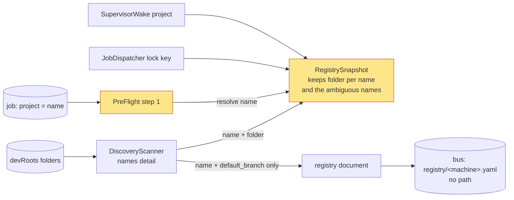
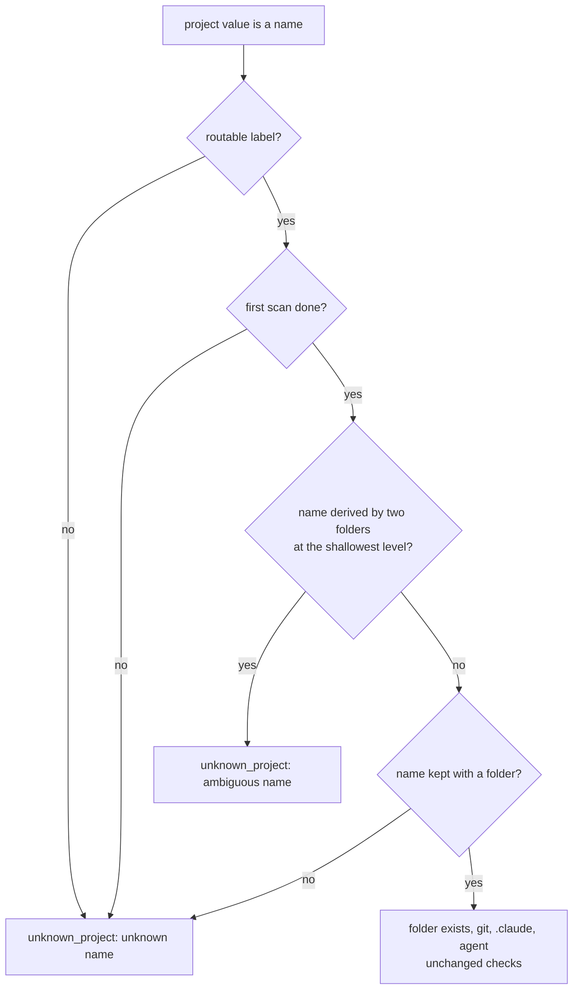
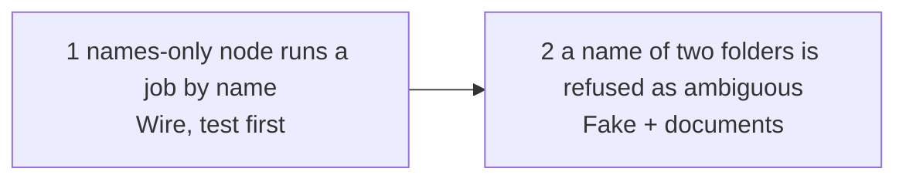

# Spec: 56 — A names-only node runs jobs sent by registry name

## Status

- 2026-11-19: drafted from main at v0.24.0 (`7c90993`), awaiting the owner's go. Not approved.
- 2026-11-19: owner's go for both slices; Open questions 1–3 confirmed as written (tie only is ambiguous, spec 45 shallowest-wins stays; `ambiguous name`, no new reason code, zyggy-core `PROTOCOL.md` lists no detail words; the §4 sentence plus the "are both left out" correction go in with slice 2).
- 2026-11-19: slice 1 built test first (integration RED `unknown name`, unit RED against stubs, then code). Approach: `ScanResult.Folders` (init property, name → folder, every detail) and `RegistrySnapshot.Replace(document, folders)` keep the folder beside the published document; `TryResolve` looks there first, then the entry's own path; `DiscoveryLoop` passes `scan.Folders`; the publisher still only sees the document. The two named tests changed on purpose. Leak check: emitting a path for `names` entries fails both the integration test and `FromScan_NamesScanWithFolders_FileHasNoPath`. Proof: build 0 warnings, unit 7331 passed / 60 skipped, integration 1101 passed / 58 skipped, format clean. Committed as 872d26d, pushed on `feature/56-names-only-routing`; PR #60 open with CI green, awaiting the owner's merge.
- 2026-11-19: slice 2 built test first (unit RED against stubs: 5 failing on the missing behaviour, then code). Approach: the scanner adds a same-level tie's name to `ScanResult.Ambiguous` (init property, names only, no folder); `RegistrySnapshot.Replace(document, folders, ambiguous)` keeps it beside the document and `IsAmbiguous(name)` (same label rules as `TryResolve`) lets pre-flight answer `unknown_project: ambiguous name`; different levels keep spec 45's shallowest-wins. One integration test added through the Node host (`JobByTiedName_NamesOnlyNode_RejectedAmbiguousName_ModelNeverStarted`), written after the code and seen failing by dropping the `DiscoveryLoop` wiring, then restored. Documents: spec 14 Resolution line and Status, Node/Core/Cli READMEs, `PreFlightResult` comment, roadmap row 56, and the founding spec §4 (the approved sentence plus the duplicate-name wording corrected to spec 45's shallowest-wins). Proof: build 0 warnings, unit 7348 passed / 60 skipped, integration 1102 passed / 58 skipped, format clean (`verify.mjs` green twice); `ProbeSenderTests.SendOneAsync_ReportSignedWithKeySenderDoesNotHold_UnverifiedReportNotTimeout` failed in 3 of 5 full unit runs and passes alone (untouched by this slice, timing under load). Committed as 4dab225, pushed on `feature/56-names-only-routing`; PR #60 open with CI green, awaiting the owner's merge.

## Goal

**As** the owner, **I want** a job that names a project by its registry name to run on every node — also a node that publishes names only, such as the work laptop — **so that** I and Central never have to know or send a folder path, while the registry file of such a node still never shows one.

## Problem

A node with `discovery.detail: names`, or with `full` but no secret patterns registered (the scan then runs as `names`), refuses every job sent by registry name with `unknown_project: unknown name`. The scanner builds a `names`-detail project entry without its folder, the node keeps exactly that entry in its in-memory snapshot, and the snapshot's name lookup only matches entries that carry a path. Pre-flight, the dispatcher's project lock and the supervisor wake all resolve through that lookup, so on such a node a name never resolves; jobs must carry a full path under `devRoots`. Spec 14 deferred this on purpose ("on such a machine every name is `unknown name` and jobs must name a path under `devRoots` (the work laptop's mode; 20 may revisit)").

## Decision (owner, 2026-11-19)

Resolving a job by registry name works on every node, names-only and work machines included. The node keeps the folder of each discovered project in its own in-memory snapshot and resolves the name there; the registry file a names-only node publishes still never contains a path. Nothing else about the work boundary changes: the `devRoots` check for a path-named job, the `allowed_tools` ceiling and every pre-flight refusal stay as they are. A name that matches two folders is refused with a clear reason, never guessed.

## Context

- **Roadmap entry**: none yet; the owner calls this the highest priority on the roadmap. A row `56 | names-only-routing` is added to `_plans/ROADMAP.md` with this spec's approval.
- **Reference feature**: the discovery registry and routing by project name (`_specs/14-discovery-registry-routing.md`), whose resolution rule this reshapes, with the nested-folder follow-up (`_specs/45-discovery-nested-folders.md`) for the duplicate-name rule. Spec 55 (`_specs/55-central-self-maintenance.md`) is the model for form and for a small discovery change with an integration test through the Node host.
- **Founding-spec sections**: §4 Registry file ("a node resolves job names against its own scan (§6)"; "with `discovery.detail: names` … a project entry carries only `name` and `default_branch`"), §6 pre-flight step 1 (as amended by A14-3), §8 Work boundary, §9 design rules.
- **Facts verified in the code at `7c90993`** (files read):
  - The scanner always knows the folder of each project it keeps; only for the `names` detail does it build the entry without `path`. `full` without secret patterns runs as `names` (one `PatternsUnavailable` notice).
  - The discovery loop turns the scan into the registry document, puts that same document in the snapshot, then publishes it. The snapshot is the only source pre-flight, the dispatcher (project lock key) and the supervisor wake resolve a name from; the bus copy is never read for this.
  - The snapshot's lookup accepts a routable label only (`[a-z0-9-]`, ordinal) and skips an entry without a path.
  - Of folders deriving one name, the shallowest keeps it (spec 45 Q9); a tie at that level publishes none and logs `discovery: duplicate name <name>: <paths>`. A job by such a name now gets `unknown name`.
  - Exactly two existing unit tests assert the refusal this spec removes: `RegistrySnapshotTests.TryResolve_NamesEntryWithoutPath_False` and `PreFlightTests.CheckAsync_NamesOnlySnapshot_UnknownName`. No integration test expects it.

## Constraints

- ⚠️ **Work-laptop boundary (§8).** The published registry file of a names-only node carries no `path` key, before and after this change, in every commit. The folder lives only in the node's memory; it is never logged, never written to the bus, never put in a report or `/health`. The `devRoots` check on a path-named job, the `allowed_tools` ceiling, the hook policy and every other pre-flight refusal (`missing`, `not a git repository`, `no .claude`, `unknown agent`, `outside devRoots`) are unchanged. The reviewer checks that a test fails when a path leaks into the published file.
- ⚠️ **Shared contract (§6 runner I/O).** The reason enum is unchanged: a refused name is still `unknown_project`. One refusal detail word is added: `ambiguous name` (see Behavior). `zyggy-core`'s `PROTOCOL.md` copy lists the detail words, if it does (Open questions).
- ⚠️ **Public `Zyggy.Core` type.** `RegistrySnapshot` is public; how it receives the folders (beside the document, not inside the published document) is a change to its surface, shown to the owner as the slice 1 approach before code.
- The snapshot still resolves from the node's own scan only, never the bus copy (A14-3). No new seam, no static state, no new package.
- Log once per state change: no new log line per job; the duplicate-name Warning stays as it is.
- Public repository: placeholders only (`acme`, `alice`, `C:\src`, `/srv/acme`).

## Diagrams

### Components touched



### Round trip on a names-only node

```mermaid
sequenceDiagram
  participant Sender as Central / owner
  participant Bus as zyggy-bus
  participant Node as Node (work-laptop, detail: names)
  Node->>Node: scan devRoots: Clients/AcmePortal -> name acmeportal, folder kept in memory
  Node->>Bus: registry/work-laptop.yaml (name, default_branch; no path)
  Sender->>Bus: job project: acmeportal
  Node->>Bus: claim
  Node->>Node: pre-flight: snapshot resolves acmeportal -> C:\src\Clients\AcmePortal; git, .claude, agent checks as before
  Node->>Node: run (fake claude in tests)
  Node->>Bus: report done
```

### Name resolution (pre-flight step 1, name-shaped value)



### Slice map



## Behavior

### Resolution

- The node's snapshot holds, for every project of its latest scan, the name and the folder the scanner found, whatever the discovery detail. A job's `project` that is a name resolves to that folder on a `full` node and on a `names` node alike. The folder is the one on disk, in its real case (a mixed-case folder `Clients/AcmePortal` is found and run as such; its name stays the lowercase label `acmeportal`, or `clients-acmeportal` with `discovery.naming: path`).
- The lookup rules are otherwise unchanged: routable label only, ordinal comparison (`AcmePortal` as a job's `project` is still `unknown name`), nothing before the first scan, never the bus copy.
- After the name resolves, every later pre-flight check runs as today. A path-named job is checked against `devRoots` as today.
- The dispatcher's project lock and the supervisor wake's `supervision.project` use the same lookup, so they work on a names-only node too; no other change to them.

### Two folders, one name

- When two or more folders derive one name at the same (shallowest) level, the scan publishes none of them and logs the duplicate-name Warning, as today. The snapshot now remembers the name as ambiguous, and a job by that name is refused `unknown_project: ambiguous name` instead of `unknown name`. The node never picks one.
- When the folders are at different levels, spec 45's rule stands: the shallowest keeps the name, is published and resolves; the deeper ones are left out with the same Warning. This is the published, owner-approved rule, not a guess (Open questions, item 1).

### The published file

- Unchanged in every respect: a `names`-detail project entry carries `name` and `default_branch` only, never `path`, agents, skills or summary. A `full` node's file is unchanged too.

### Edge cases

- A folder removed or renamed after the scan: the name still resolves until the next scan, then pre-flight answers `missing`, as on a `full` node today.
- A `devRoots` entry removed while running (spec 55): the discovery cycle that follows the change replaces the snapshot; until then the snapshot behaves as on a `full` node today. Unchanged.
- A name that is ambiguous in one scan and unique in the next resolves after the next scan, and the reverse.

## Decisions

| Item | Verdict | Why |
| --- | --- | --- |
| Spec 14 "Resolution": a `names` snapshot has no paths, every name is `unknown name` | **reshape** (owner's decision) | The path was missing from the snapshot only because the snapshot is the published document; keeping the folder in memory gives routing by name without publishing anything more. |
| Keep the folder inside the published document and strip it at publish time | **refused** | One forgotten strip leaks the work laptop's folder layout to the bus. The folder is kept beside the document, so the publisher never sees it. |
| Tie of two folders for one name: `unknown name` | **reshape** to `ambiguous name` (reason stays `unknown_project`) | The owner asked for a clear reason; the sender then knows to rename a folder or set `discovery.naming: path`, rather than suspecting a typo. |
| Shallowest-wins for one name at different levels (spec 45 Q9) | **keep** | Decided and published; the registry shows which folder the name belongs to on a `full` node, and the Warning names both on any node. |
| A new reason code | **refused** | The closed enum is a protocol change; a detail word under `unknown_project` is enough. |
| Founding spec | **one sentence proposed** | §4, after "With `discovery.detail: names` (the work laptop, §8) a project entry carries only `name` and `default_branch`.": "The node still keeps each project's folder in its own scan, so a job by name runs there too; a name two folders derive at the same level is refused as ambiguous." Pasted only after the owner approves the wording. |

No new package.

## Acceptance criteria

| # | Criterion | Check |
| --- | --- | --- |
| AC-1 | A node with `discovery.detail: names`, one `devRoots` entry and a project in a nested mixed-case folder (`Clients/AcmePortal`, `discovery.depth` 2) claims a job whose `project` is the registry name, runs it in that folder (fake `claude` sees it as its working directory) and reports `done` | Integration test through the Node host, bare repo, `tools/fake-claude` |
| AC-2 | In the same test, the registry file on the bare repo lists the project and has no `path` key (and no agents, skills or summary) in any commit the node made | Same integration test, asserted on the bare repo |
| AC-3 | A snapshot built from a `names` scan resolves a project name to its folder; an unknown name, a non-label (`AcmePortal`) and a lookup before the first scan still do not resolve | Unit tests on the snapshot; the existing `RegistrySnapshotTests.TryResolve_NamesEntryWithoutPath_False` is changed on purpose to expect the folder |
| AC-4 | The registry document built from a `names` scan whose snapshot holds folders carries no path for any project, and its serialised file has no `path` key; a `full` scan's file is unchanged | Unit tests on the document and its serialisation |
| AC-5 | Pre-flight on a names-only snapshot accepts a job by name and returns the discovered folder; every later refusal (`missing`, `not a git repository`, `no .claude`, `unknown agent`) and `outside devRoots` for a path-named job are unchanged | Unit tests on pre-flight; the existing `PreFlightTests.CheckAsync_NamesOnlySnapshot_UnknownName` is changed on purpose to expect acceptance |
| AC-6 | Two folders deriving one name at the same level: nothing is published for that name (as today), and a job by that name is refused `unknown_project: ambiguous name` on a `names` and on a `full` node; at different levels the shallowest resolves | Unit tests on the snapshot and pre-flight; the existing scanner duplicate-name tests stay green |
| AC-7 | Spec 14's Resolution line, the Node README routing paragraph, the Core README duplicate-name row and the Cli README `discovery.detail` row describe the new rule; the roadmap has entry 56 | Read in the slice review (docs, no test) |

## Slices

| # | Slice | Criteria | Review check |
| --- | --- | --- | --- |
| 1 | ⚠️ A names-only node runs a job sent by registry name, and still publishes no path (Wire; test first: the integration test of AC-1/AC-2 red, then the unit tests of AC-3–AC-5 red, the two existing tests changed on purpose, then the code) | AC-1 – AC-5 | `dotnet test tests/Zyggy.Integration --filter "FullyQualifiedName~RoutingByName"` then `dotnet test tests/Zyggy.Core.Tests --filter "FullyQualifiedName~RegistrySnapshot|FullyQualifiedName~PreFlight|FullyQualifiedName~RegistryDocument"` |
| 2 | ⚠️ A name two folders share is refused as `ambiguous name`, never guessed (Fake; documents and roadmap; founding-spec sentence after approval) | AC-6, AC-7 | `dotnet test tests/Zyggy.Core.Tests --filter "FullyQualifiedName~RegistrySnapshot|FullyQualifiedName~PreFlight|FullyQualifiedName~DiscoveryScanner"` and reading the four document changes |

Owner-run at release: on the work laptop (once upgraded), `zyggy submit` a read-only job by registry name and see it reported `done`, and `zyggy registry --machine work-laptop` still shows no path.

## Out of scope

- Any change to the published registry file, its schema or the `full` detail.
- Publishing a path, a folder hint or a hash of it from a names-only node.
- The `devRoots` check, `allowed_tools`, the hook policy, DLP (19) or the rest of the work laptop as a product node (20).
- A new reason code; changing shallowest-wins (spec 45); a per-name override of the duplicate rule.
- Resolving a name from the bus copy or from another machine's registry.

## Documents to update

- `_specs/14-discovery-registry-routing.md` — the Resolution line (line 244): a `names`-detail snapshot keeps folders in memory and resolves names; a tie is `ambiguous name`. Plus a Status line pointing here.
- `src/Zyggy.Node/README.md` — the Routing paragraph (names resolve on every node through the node's own scan; `ambiguous name`).
- `src/Zyggy.Core/README.md` — the "Discovery: duplicate name" row (`ambiguous name` instead of `unknown name` at equal level).
- `src/Zyggy.Cli/README.md` — the `discovery.detail` row (`names` still routes jobs by name).
- `src/Zyggy.Core/Jobs/PreFlightResult.cs` doc comment — the list of detail words.
- `_plans/ROADMAP.md` — entry 56, highest priority.
- Founding spec §4 — the one sentence under Decisions, after the owner approves it.

## Open questions

1. **Different levels.** The owner's "a name that matches two folders is refused" is read as the tie case only; spec 45's shallowest-wins (one folder at a lower level keeps the name) stays. Confirm, or ask for every duplicate to be refused (that would also change what a `full` node publishes).
2. **Detail word.** `ambiguous name` under the existing `unknown_project` reason is proposed. Confirm the wording, and whether `zyggy-core`'s `PROTOCOL.md` copy lists detail words and needs the same line (not read in this job).
3. **Founding spec drift, not this feature.** §4 still says two folders deriving one name "are both left out"; spec 45 made the shallowest win. Worth one owner edit when the §4 sentence above is pasted.
