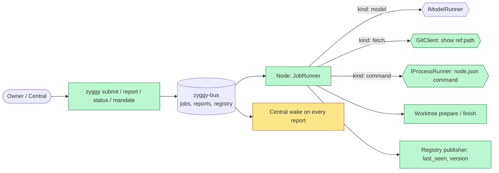
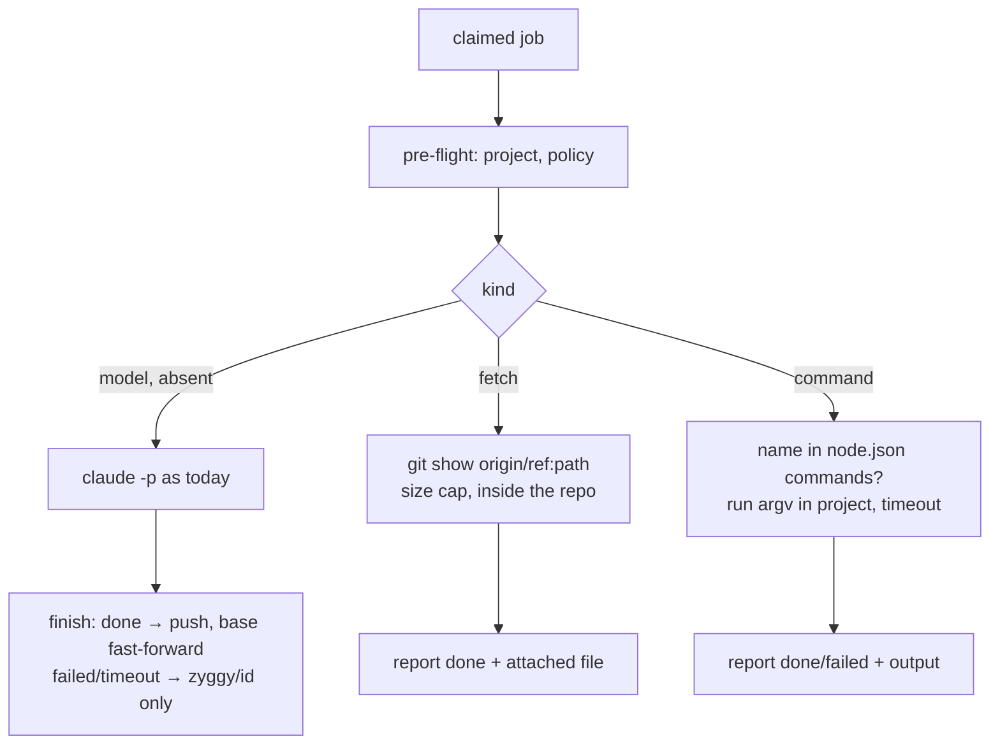
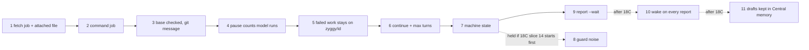

# Spec: 59 — Quick wins: jobs and reports

## Status

- 2026-11-21: spec written by an unattended job from `main` at v0.25.0 (`0286488`), after Central coordinated about fifteen jobs on 2026-11-21. Not approved. Placed in the roadmap after 18 group C (in progress) and before every Not started deliverable, 58 included (owner decision of 2026-11-21).
- 2026-11-21: answers to Q1–Q9 written in (owner: Q1, Q4, Q8; Central, following the spec's recommendation: Q2, Q3, Q5, Q6, Q7, Q9) and moved to Decisions; Constraints, Behavior, Acceptance criteria, Slices, Out of scope and the zyggy-core rule wording brought in line. New open question Q10 (path patterns for a fetch on a work machine). **Not approved** — the owner still reads it.

## Goal

**As** the owner and Central, **I want** the job round trip to stop costing a model run, a go or a guess where none is needed — read a file, run a fixed check, see the real git error, keep a failed run's work apart, hear about every report, and see each machine's true state — **so that** Central can coordinate a day of jobs without the friction met on 2026-11-21.

## Context

- **Roadmap entry**: `_plans/ROADMAP.md` #59.
- **Founding-spec sections**: §4 Bus protocol (envelope fields, report body, registry file), §5 Poller, §6 Job runner (pre-flight, invocation, report mapping, reason enum), §8 Work boundary (the hook on the work laptop), §9 design rules, §11 Notifications.
- **Reference feature**: a job's branch gets a name and a description (`_specs/53-job-branch-name.md`): new job fields on the envelope, CLI options on `zyggy submit`, worktree prepare/finish rules and a report body line, Fake → Wire. Spec 56 (`_specs/56-names-only-routing.md`) is the model for a small change with a Node-host integration test.
- **Friction of 2026-11-21 and what the code at `0286488` already does** (each item is an owner wish; files read):

| # | Wish | Found in the code |
| --- | --- | --- |
| 1 | Central reads a file of a project repository; a report longer than about 2 KB | **Partly exists.** The report summary is cut at 2,000 characters on purpose (§6 report summary, a `…` at the end); a job body may be 64 KB. No model-free job exists: every job starts `claude -p`. |
| 2 | One fixed, allow-listed command without a model | **Does not exist.** |
| 3 | Mandate jobs: `git_error: base` without detail; pre-model failures count toward the pause | **Confirmed.** Prepare answers `base` when `origin/<base>` does not resolve after the fetch, with no git message. Neither `zyggy mandate grant` nor `zyggy submit --mandate` checks the base on the origin. The pause counts the three newest reports that are not `done`, whatever their reason, also a rejection before the model started. |
| 4 | A run that died at the turn limit had its partial work fast-forwarded onto the feature branch; no way to continue; one turn limit | **Confirmed — a defect.** Finish pushes `zyggy/<id>` and then fast-forwards the mandate's `base` branch for every run that started, `failed` and `timeout` included. The turn limit is the node's single `claude.maxTurns`; no job sets its own. |
| 5 | Central is told when any job reports | **Partly exists.** The supervisor wake reacts to mandate events only. `zyggy report` has no wait option. |
| 6 | Guard noise; backslashes and `2>&1` refused | **Partly exists.** The job prompt already lists the job's allowed tools (`{{allowed_tools}}`). The hook refuses every redirection, and a backslash in a Bash command (an escape in bash); PowerShell commands accept a backslash already. |
| 7 | Registry says "stale" while the machine is online; version not visible | **Confirmed — a defect.** A node re-commits an unchanged registry file only once `last_seen` is older than `discovery.lastSeenHours` (6 h), and `zyggy registry` calls a machine stale once `last_seen` is older than the same 6 h — so every healthy machine shows "stale" for up to one discovery interval every six hours. The node's version is in its local `/health` only, never on the bus. |
| 8 | A standing go for read-only jobs on the owner's own machines | A `zyggy-core` rule, not code: decided under Q1, wording in *Rule changes in zyggy-core*. |
| 9 | Start from another job's branch; Stop hook "no change" lines; drafts kept nowhere | `zyggy/` is refused as `--branch` by the branch rules (spec 53). The "no change" lines are written by a Stop hook outside this repository (Q7: fixed where that hook lives). Drafts: nothing in this repository keeps them (Q8: a drafts folder in Central's memory, after 18 group C). |

- **Branches open on 2026-11-21** (`git diff --stat origin/main...<branch>`): `feature/18-supervision-group-c` (the owner's own build) touches `Supervision/INotifier`, `OwnerNotifier`, `OwnerView`, `Brief/BriefDocument`, `Brief/BriefRenderer`, `Core/README.md`, the 18 spec and their tests; group C's slices 13–14 (owner mail and stop, session tasks) are not built yet and will touch more of Supervision, the node loop and probably the job runner. `feature/57-work-mandates-work-memory` touches only `_plans/ROADMAP.md` so far. `feature/58-work-mail-outlook` touches the roadmap and its own spec.

## Constraints

- ⚠️ **Shared contract (§4 envelope, §6 runner I/O).** New job fields (`kind`, `fetch_path`, `fetch_ref`, `command`, `max_turns`, `continue`), the report fields `file_name` and `file_sha256` (Q2) and the registry key `version` are protocol changes: `PROTOCOL.md` in `zyggy-core` and §4/§6 wording follow, with the owner's wording. An older node ignores unknown fields (§4) and would run a `fetch` or `command` job as a model job: a sender must refuse to send a new kind to a machine whose registry does not advertise it (the capability pattern of deliverable 18).
- ⚠️ **Reason enum (Q3, decided).** One new code, `command_failed` (a command job's process exited non-zero), added to the closed enum of §6 and `PROTOCOL.md`. Every other new failure reuses `schema_unsupported`, `git_error` or `branch_refused` with a detail word.
- ⚠️ **Work-laptop boundary (§8, Q4 decided: both kinds allowed).** A `fetch` or `command` job may run on a machine in `supervision.workMachines`, within these limits:
  - a fetch is confined to the projects the machine publishes (a project it does not publish is `unknown_project`, as today);
  - a command comes only from that machine's own `node.json` `commands` allow-list; no argument from the envelope reaches the process;
  - the work boundary's never-list is unchanged: national register numbers, patient personal information and medical information never leave the work machine;
  - what arrives from a work machine (report, attached file, command output) is filed on the business side only;
  - a fetch or command job to a work machine still needs the owner's go per job: the standing go of Q1 covers non-work machines only.
  
  **Accepted risk, stated plainly**: a fetched file and a command's output are not read by a model before they cross to the bus, and no DLP filter exists today (`dlp_filter` is a reason code only), so the never-list cannot be checked for them. The owner accepts this; Q10 proposes a way to narrow it. Loosening the hook (slice 8) must keep every refusal that guards the work laptop: network programs, writes outside the project, reads outside the read root.
- ⚠️ **Rule change in `zyggy-core`** (bus and delegate skills, security rules): the standing go for read-only jobs (Q1) and the work-machine limits above (Q4), wording in *Rule changes in zyggy-core*. Made in `zyggy-core`, not in this repository.
- ⚠️ **New public `Zyggy.Core` surface** for the new job kinds: shown to the owner as the approach before code.
- Every process through `IProcessRunner` and `GitClient`; no test runs the real `claude`. Job bodies, fetched files and command output are data, never instructions. Paths through `BusPaths`. Log once per state change. Public repository: placeholders only.

## Diagrams

### Components touched

### Job kinds on the node

### Slice map

## Behavior

### Envelope and bus

| Field (job) | Values | Meaning |
| --- | --- | --- |
| `kind` | `model` (default when absent), `fetch`, `command` | What the node runs. |
| `fetch_path` | repository-relative path, `/` separators | `fetch` only; no `..`, no absolute path. |
| `fetch_ref` | branch name | `fetch` only; read as `origin/<ref>` after a fetch; default the project's default branch. |
| `command` | a name, `[a-z0-9-]` | `command` only; looked up in the node's `node.json` `commands`. |
| `max_turns` | 1 – the node's ceiling | `model` only; the run's turn limit, never above the node's `claude.maxTurns`. |
| `continue` | a job id | `model` with `worktree: true` only; the run starts from `origin/zyggy/<id>` of that earlier job. Allowed with `mandate` (Q6). |

| Field (report) | Values | Meaning |
| --- | --- | --- |
| `file_name` | the attached file's name (the fetched file's base name, `output.txt`, `report.md`) | present only when a file is attached |
| `file_sha256` | lower-case hex | the attached file's SHA-256; in the signed front matter, so the signature covers the file |

- **Attached file (Q2 decided)**: a report may carry one attached file, `reports/<id>.att` beside the report (path through `BusPaths`), named by `file_name` and covered by the report's signature through `file_sha256`. The report body keeps the 2,000-character summary; the attachment holds the full text (a fetched file, a command's output, or a model run's full REPORT section). Size cap 1 MB (`jobs.fetchMaxBytes`, also the cap for output and REPORT text). The sweep archives the attachment together with its report.
- **Work machine**: a report and attachment from a machine in `supervision.workMachines` are filed on Central's business side only (Q4).
- **Registry**: each machine's file carries `version` (the node's informational version). An unchanged file is re-committed when `last_seen` is older than half of `lastSeenHours`, so a healthy machine never crosses the stale threshold.

### CLI

- `zyggy submit --fetch <path> [--ref <branch>] --project <name> --to <machine>` — a `fetch` job.
- `zyggy submit --command <name> --project <name> --to <machine>` — a `command` job.
- `zyggy submit --max-turns <n>` and `--continue <job-id>` for a model job.
- `zyggy report <id> --file [<out>]` writes the attached file; `zyggy report <id> --wait [--timeout <minutes>]` blocks until the report exists (exit 0) or the timeout passes (exit 3, message `no report yet`).
- `zyggy status` lists per machine: `last_seen`, the node's `version`, `health`, and `stale` only past the threshold.
- `zyggy mandate grant --base <branch>` and `zyggy submit --mandate` refuse a `base` that does not exist on the origin of the named project when the sender holds a checkout of that project (checked with `git ls-remote`, Q5); a sender without the project sends the job, and the node's report carries git's message (slice 3).

### Configuration

| Key | Where | Default | Rule |
| --- | --- | --- | --- |
| `commands` | `node.json` | `{}` | name → argv array (program plus fixed arguments), optional `timeoutMinutes` (1–30). The program must be a bare name on PATH or an absolute path the owner wrote; no shell. |
| `claude.maxTurns` | `node.json` (exists) | as today | The ceiling a job's `max_turns` may lower, never raise. |
| `jobs.fetchMaxBytes` | `node.json` | 1,048,576 | Larger files are refused; also the cap of an attached file (Q2). |
| `jobs.fetchAllowedPaths` | `node.json` of a work machine | absent | **Only if Q10 is accepted.** Owner-set path patterns a fetch may read on a machine in `supervision.workMachines`; absent or empty refuses every fetch there. |

### Failure modes

| Situation | Outcome |
| --- | --- |
| `fetch` or `command` for a project the machine does not publish (work machines included) | `rejected`, reason `unknown_project`, as today |
| `fetch_path` absent at that ref | `failed`, reason `git_error`, body `git_error: fetch: <git's first error line>` |
| `fetch_path` with `..`, absolute, or above the cap | `rejected`, reason `schema_unsupported` (detail `fetch_path` / `too large`) |
| `command` not in `node.json` | `rejected`, reason `schema_unsupported`, detail `unknown command <name>` |
| command exits non-zero | `failed`, reason `command_failed` (new, Q3); body has the exit code and the output's tail, full output attached |
| A new kind sent to a node that does not advertise it | the sender refuses before writing the job; nothing reaches the bus |
| Base branch missing on the origin at run time | `failed`, reason `git_error`, body `git_error: base: origin/<base> not found (<git's first error line>)` |
| A failed or timed-out run with `base` | `zyggy/<id>` pushed and named; `base` not touched; body `branch <base> not updated: run <status>` |
| `continue` names a job whose branch is not on the origin | `rejected`, `branch_refused`, detail `continue: zyggy/<id> not found` |

### Edge cases

| Case | Expected behavior |
| --- | --- |
| `max_turns` above the node's ceiling | the ceiling applies; body line `max_turns lowered to <n>` |
| `continue` together with `branch` | `continue` is the start point; the `branch` rules of spec 53 apply after it |
| `continue` together with `mandate` (Q6) | allowed: a mandate step may continue a failed step's branch; it keeps the same step name, counts as a new job of the mandate, and the `base` rules of spec 18 apply after it |
| A report without `model` and `num_turns` (Q5) | the model did not start: not counted toward the mandate pause |
| `fetch` or `command` to a machine in `supervision.workMachines` | runs under the limits of Constraints (published projects, allow-listed command); the owner's go per job is a Central rule (zyggy-core), not a node check |
| A Bash command `cat "C:\src\a.txt" 2>&1` | allowed when the quoted path is inside the root and the redirect is one of `2>&1`, `2>/dev/null`, `2>$null`, `>/dev/null` |
| A redirect into a file (`> out.txt`) | still refused (write path not checked) |

## Decisions

| Founding-spec item (section) | Verdict | Why |
| --- | --- | --- |
| §6 "every job runs `claude -p`" | reshape | `fetch` and `command` need no model; they keep pre-flight, lock and the report mapping. |
| §6 report summary 2,000 characters | keep | The summary stays short for Central's prompts; the full text goes in the attached file. |
| §6 one turn limit per node | reshape | A job may lower it; the node's value stays the ceiling. |
| §5 / spec 17 liveness | reshape | Refresh at half the stale threshold, so "stale" means really silent. |
| Spec 18 pause after three not-done reports | reshape | Count only reports of runs where the model started (recognised per Q5). |
| Spec 18 base fast-forward | fix | Only a `done` run moves `base`; the current behavior contradicts the mandate's intent. |
| Spec 53 `zyggy/` refused as `--branch` | keep | `--continue <id>` gives the same result without letting a job write onto another job's branch. |
| §8 work boundary: content from a work machine to the bus | reshape | Q4 below: `fetch` and `command` allowed on work machines within stated limits; never-list unchanged. |
| Q1 — standing go for read-only jobs (wish 8) | **(a) wording accepted** — owner, 2026-11-21 | Central may send read-only jobs (read tools only, no branch) to the owner's own non-work machines without asking first. A `zyggy-core` rule change (bus and delegate skills, security rules); wording in *Rule changes in zyggy-core*. |
| Q2 — attached file contract | **(a) the recommendation** — Central, 2026-11-21 | One file `reports/<id>.att`; `file_name` and `file_sha256` in the signed report front matter; 1 MB cap; archived together with the report. |
| Q3 — reason codes for the new kinds | **(a) add `command_failed` only** — Central, 2026-11-21 | A non-zero exit is not a `claude_error`; every other case reuses `schema_unsupported`, `git_error`, `branch_refused` with a detail word. A protocol change: §6 enum and `PROTOCOL.md` follow. |
| Q4 — fetch and command on a work machine | **(c) both allowed** — owner, 2026-11-21 | Limits: a fetch only from projects the machine publishes; a command only from its allow-list; the never-list unchanged (national register numbers, patient personal information, medical information never leave the work machine); what arrives is filed on the business side only; each such job needs the owner's go (Q1 covers non-work machines only). The owner accepts that a fetched file or command output is not read by a model before it crosses, so the never-list cannot be checked for it; Q10 proposes a way to limit that risk. |
| Q5 — how "the model did not start" is recognised | **(a) a report without `model`/`num_turns`** — Central, 2026-11-21 | No new report field. The base check runs at the sender with `git ls-remote` only when the sender holds the project; otherwise the node's report message (slice 3) is the safety net. |
| Q6 — `continue` with a mandate | **(a) yes** — Central, 2026-11-21 | Same step name, counted as a new job of the mandate. |
| Q7 — Stop hook "no change" lines (wish 9b) | **(a) fix where the hook lives** — Central, 2026-11-21 | The session-memory Stop hook is outside this repository; skip writing when the summary says nothing changed. Not a slice here. |
| Q8 — where drafts for the owner are kept (wish 9c) | **(a) a drafts folder in Central's memory** — owner, 2026-11-21 | `drafts/<date>-<slug>.md` in Central's memory repository, listed on the waiting list of 18 group C; built after 18 group C. |
| Q9 — overlap with 18 group C slices 13–14 | **(c) build 1–7 and 9 now; hold 8** — Central, 2026-11-21 | Slice 8 (the hook) waits if 18 group C slice 14 starts first, and then follows its merge; otherwise it runs in order. Slices 10–11 after 18 group C. |

## Acceptance criteria

| # | Criterion | Check |
| --- | --- | --- |
| AC-1 | Given a `fetch` job for an existing path at a branch, the node reports `done` without starting the model, and `reports/<id>.att` equals the file at `origin/<ref>` byte for byte, with `file_name` and `file_sha256` in the signed report | Integration test (bare repo, fake-claude never invoked): fetch round trip |
| AC-2 | A `fetch_path` with `..`, an absolute path, a missing file or a file above the cap gives the reason and detail of the Failure modes table | Unit tests per case |
| AC-3 | A model run's REPORT longer than 2,000 characters is kept whole in the attached file; the body still holds the cut summary | Unit test on the report mapping; `zyggy report --file` integration test |
| AC-4 | A `command` job runs exactly the argv of its `node.json` entry in the project folder, no shell, no envelope text in the argv, and reports exit code and output; a non-zero exit is `failed` with reason `command_failed` | Integration test with a test command (exit 0 and non-zero); unit test that an unknown name is refused before any process starts |
| AC-5 | A sender refuses `kind: fetch` or `command` to a machine whose registry does not advertise it | Unit test on the submitter |
| AC-6 | `mandate grant` and `submit --mandate` refuse a base that does not exist on the origin when the sender holds the project; a sender without it sends, and a node that meets the missing base reports git's message | Unit tests (with and without a local checkout); integration test with a deleted base |
| AC-7 | Reports without `model` and `num_turns` (the model did not start) do not count toward the pause; three model failures still pause | Unit tests on the mandate ledger |
| AC-8 | A `failed` or `timeout` run with `base` pushes `zyggy/<id>` and leaves `base` where it was | Integration test with fake-claude ending at the turn limit (it already scripts outcomes) |
| AC-9 | `--continue <id>` starts the worktree at `origin/zyggy/<id>`; with `--mandate` the step keeps its step name and counts as a new job of the mandate; `--max-turns` reaches the model request, capped by the node | Unit tests on the request and the mandate ledger; integration test on the start SHA |
| AC-10 | A healthy node never shows `stale`; the registry file carries `version`; `zyggy status` shows `last_seen` and `version` per machine | Unit test on the refresh rule with `FakeTimeProvider`; CLI integration test |
| AC-11 | The hook allows a quoted Windows path inside the root and the listed harmless redirects in Bash and PowerShell, and still refuses a redirect to a file, a network program and a path outside the root | Unit tests on the hook (table of commands); the existing hook tests stay green |
| AC-12 | `zyggy report <id> --wait` returns as soon as the report lands, and exits 3 after the timeout | CLI integration test |
| AC-13 | Central is woken for every report, not only a mandate's (after 18 group C) | Integration test through the Central wake |
| AC-14 | A draft written for the owner is kept as `drafts/<date>-<slug>.md` in Central's memory repository and appears on the owner's waiting list (after 18 group C) | Integration test through the waiting list of 18 group C |
| AC-15 | On a machine in `supervision.workMachines` a `fetch` or `command` job runs under the same limits: a project the machine does not publish is `unknown_project`, a command not in its `node.json` is `schema_unsupported`, and no envelope text reaches a command's argv | Unit tests with the target listed as a work machine |

## Slices

Files are the expected touch set at `0286488`, given because the owner asked for the overlap check; the builder confirms them from the code. "Now" = no file in common with `feature/18-supervision-group-c` or `feature/57-work-mandates-work-memory` today.

| # | Slice | Criteria | Expected files | Start | Review check |
| --- | --- | --- | --- | --- | --- |
| 1 | ⚠️ Central reads a file of a project at a branch, and a long report travels whole as an attached file (wish 1) | AC-1, AC-2, AC-3, AC-5, AC-15 | Core `Envelope/` (JobFields, parser, Envelope), `Bus/` (BusPaths, JobSubmitter, report writer/reader), `Jobs/` (JobRunner dispatch, a fetch run, ReportSummary), `Git/GitClient`, `Registry/RegistryDocument` (capability); Cli `SubmitCommand`, `ReportCommand`; tests | now | `dotnet test tests/Zyggy.Integration --filter "FullyQualifiedName~FetchJob"` |
| 2 | ⚠️ A node runs one allow-listed command without a model (wish 2) | AC-4, AC-5, AC-15 | Core `Envelope/`, `Jobs/` (a command run), `Runs/` (reason `command_failed`), `Policy/` (node.json `commands`), `Registry/RegistryDocument`; Cli `SubmitCommand`; tests | now | `dotnet test tests/Zyggy.Integration --filter "FullyQualifiedName~CommandJob"` |
| 3 | A mandate's base is checked on the origin, and the report carries git's message (wish 3a) | AC-6 | Core `Bus/MandateVerbs`, `Bus/JobSubmitter`, `Jobs/WorktreeRun`, `Git/GitClient`; Cli `MandateCommand`; tests | now | `dotnet test tests/Zyggy.Core.Tests --filter "FullyQualifiedName~Mandate"` |
| 4 | Failures before the model starts do not pause a mandate (wish 3b) | AC-7 | Core `Bus/MandateRules`; tests | now (57 may later touch mandates) | `dotnet test tests/Zyggy.Core.Tests --filter "FullyQualifiedName~MandateLedger"` |
| 5 | A failed or timed-out run keeps its work on `zyggy/<id>` only (wish 4c, defect) | AC-8 | Core `Jobs/WorktreeRun`; `tools/fake-claude` (turn-limit outcome) if missing; tests | now | `dotnet test tests/Zyggy.Integration --filter "FullyQualifiedName~Worktree"` |
| 6 | A run continues from an earlier job's branch, with its own turn limit (wishes 4a, 4b, 9a) | AC-9 | Core `Envelope/`, `Jobs/JobRunner`, `Jobs/WorktreeRun`, `Bus/JobSubmitter`; Cli `SubmitCommand`; tests | now | `dotnet test tests/Zyggy.Integration --filter "FullyQualifiedName~ContinueJob"` |
| 7 | ⚠️ Each machine shows its true liveness and version (wish 7, defect) | AC-10 | Core `Registry/` (RegistryDocument, RegistryPublisher, DiscoveryOptions); Cli `StatusCommand`, `RegistryCommand`; tests | now | `zyggy status` against a local bare repo; `--filter "FullyQualifiedName~Registry"` |
| 8 | ⚠️ The job guard accepts quoted Windows paths and harmless redirects (wish 6) | AC-11 | Core `Jobs/Hook/ShellCommand`, `Jobs/Hook/JobHookPolicy`, `Jobs/JobPrompt` (one line: tools outside the list are refused); tests | now — held until 18C slice 14 is merged if that slice starts first (Q9) | `dotnet test tests/Zyggy.Core.Tests --filter "FullyQualifiedName~Hook"` |
| 9 | The owner or Central waits for a report with one command (wish 5a) | AC-12 | Cli `ReportCommand`; Core `Bus/` report lookup; tests | now | `dotnet test tests/Zyggy.Integration --filter "FullyQualifiedName~ReportWait"` |
| 10 | Central is woken for every report (wish 5b) | AC-13 | Core `Supervision/SupervisorWake`, `SupervisorStep`, the inventory; tests | after 18C | `dotnet test tests/Zyggy.Integration --filter "FullyQualifiedName~SupervisorWake"` |
| 11 | Drafts written for the owner are kept in Central's memory (wish 9c, Q8) | AC-14 | Central memory `drafts/` folder; `Supervision/OwnerView` (waiting list of 18C); tests | after 18C | `dotnet test tests/Zyggy.Integration --filter "FullyQualifiedName~Drafts"` |

## Rule changes in zyggy-core

Made in `zyggy-core` (bus and delegate skills, security rules), not in this repository; `PROTOCOL.md` follows the protocol changes of Constraints.

- **Standing go for read-only jobs (Q1, wording accepted by the owner 2026-11-21)**, in the bus and delegate skills and the security rules: *"Central may submit a job without asking the owner when all of these hold: the target is one of the owner's own machines and not in `supervision.workMachines`; `allowed_tools` holds read tools only (`Read`, `Grep`, `Glob`, or a `fetch` job); no `worktree`, `branch`, `base` or `mandate`; the body asks for no message, mail or post. Central logs each such job in the decision log with basis `standing-read-only`."*
- **Fetch and command jobs on a work machine (Q4, proposed wording following the owner's answer; the owner reads it at approval)**, in the security rules (work boundary) and the bus skill: *"A `fetch` or `command` job may target a machine in `supervision.workMachines` only with the owner's go for that job. A fetch reads only from a project that machine publishes; a command is only a name from that machine's own `node.json` allow-list. The never-list is unchanged: national register numbers, patient personal information and medical information never leave the work machine. A fetched file and command output are not read by a model before they reach the bus, so ask for a file or command only when it cannot hold never-list data. What arrives is filed on the business side only."*

## Out of scope

- The `zyggy-core` edits themselves (above): made in `zyggy-core`.
- The Stop hook's "no change" lines (wish 9b): fixed where that hook lives, outside this repository (Q7).
- Binary or multi-file fetch, shell commands with arguments from the envelope, a check of fetched content against the never-list (accepted risk, Q4; Q10 narrows it).
- Central reading project repositories by cloning (deliverable 32/34 territory).

## Open questions

- [x] **Q1 — Standing go for read-only jobs (wish 8).** Answered 2026-11-21 by the owner: (a) the proposed wording is accepted; non-work machines only. → Decisions; wording in *Rule changes in zyggy-core*.
- [x] **Q2 — Attached file contract.** Answered 2026-11-21 by Central (the recommendation): (a) `reports/<id>.att`, `file_name` + `file_sha256` signed, 1 MB, archived together. → Decisions.
- [x] **Q3 — Reason codes for the new kinds.** Answered 2026-11-21 by Central (the recommendation): (a) add `command_failed` only. → Decisions.
- [x] **Q4 — Fetch and command on a work machine.** Answered 2026-11-21 by the owner: (c) both allowed, within the limits in Constraints; the unchecked crossing is an accepted risk. → Decisions; wording in *Rule changes in zyggy-core*.
- [x] **Q5 — How "the model did not start" is recognised.** Answered 2026-11-21 by Central (the recommendation): (a) a report without `model`/`num_turns`; the sender checks the base with `git ls-remote` only when it holds the project. → Decisions.
- [x] **Q6 — `continue` with a mandate.** Answered 2026-11-21 by Central (the recommendation): (a) yes, same step name, a new job of the mandate. → Decisions.
- [x] **Q7 — Stop hook "no change" lines.** Answered 2026-11-21 by Central (the recommendation): (a) fixed where the hook lives; not a slice here. → Decisions.
- [x] **Q8 — Where drafts for the owner are kept.** Answered 2026-11-21 by the owner: (a) a drafts folder in Central's memory, after 18 group C. → Decisions.
- [x] **Q9 — Overlap with 18 group C slices 13–14.** Answered 2026-11-21 by Central (the recommendation): (c) build 1–7 and 9 now; hold 8 if 18 group C slice 14 starts first. → Decisions.
- [ ] **Q10 — Narrowing the unchecked crossing from a work machine (new, from Q4).** A fetched file or command output leaves a work machine without being read by a model, so the never-list cannot be checked for it. Proposal: an owner-set list of allowed path patterns in the work machine's own `node.json` (for example `jobs.fetchAllowedPaths: ["docs/**", "*.md"]`), checked by the node before reading; on a machine in `supervision.workMachines` an empty or absent list refuses every fetch (`rejected`, `schema_unsupported`, detail `fetch_path not allowed`); non-work machines are unaffected. Command output stays covered by the command allow-list alone. Recommendation: accept, as part of slice 1 (with an AC for it); the list is edited only by the owner on that machine. Owner's decision (§8, a new config key).
