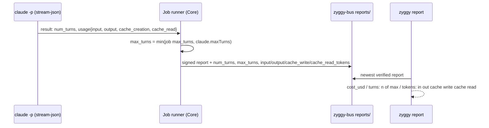

# Spec: 60 — A job report says how many turns and tokens the run used

## Status

- 2026-11-23: spec written and built in one unattended job run (01M8479QSJBT20P911ESXFYM8Y) on the owner's request of 2026-11-23 relayed by Central: the job's TASK is the go for the spec and both slices. Risk area: ⚠️ §4 shared contract (the signed `report` front matter gains three optional fields); `EnvelopeSigner.Canonicalize` is not changed.
- 2026-11-23: **slices 1 and 2 built** (same job, test first: unit tests failed to compile on the missing members, the three `ReportCommandTests` failed on the missing lines, then green). New golden `report-usage` (canonical bytes and HMAC from a throwaway .NET script, not `Zyggy.Core`). Proof: build 0 warnings, 0 errors; unit 8818 passed / 61 skipped / 0 failed; integration 1216 passed / 58 skipped / 0 failed; format clean; review-check filters 309/0 and 33/0, re-run after the verifier. Decisions: existing §4 names reused, three flat fields added (Decisions table); `max_turns` minimum 1 at parse. Reviewers: `spec-critic` and `slice-verifier` each ran once, but neither delivered its report (both ended without a hand-back, and this job cannot message an agent); the tree was checked unchanged after the verifier. `spec-reviewer` not run for the same reason. Their verdicts are owed before release.

## Goal

**As** the owner, **I want** every job report to say how many turns the run used out of how many it was allowed, and how many tokens it spent (input, output, cache write, cache read), next to `cost_usd`, **so that** benchmark runs can be compared on more than cost.

## Context

- **Owner request** 2026-11-23 (job TASK). Small, no roadmap row of its own before this spec; number 60 is the next free one in `_plans/ROADMAP.md`.
- **Founding-spec sections**: §4 "Mandatory fields per type", row `report` (optional `cost_usd`, `input_tokens`, `output_tokens`, `num_turns`, `model`, …) and its unknown-field rule ("preserved, signed, never interpreted"); §6 Invocation (stream-json `result` event) and Report assembly; §11 cost tracking.
- **Reference feature**: the per-job turn limit and attached report of quick wins (`_specs/59-quick-wins-jobs-reports.md`, slice 6: `max_turns` on a job, never above the node's `claude.maxTurns`), the closest feature: same runner, same report.
- **Facts verified in the code (main at b2743e1):**
  - The stream reader already keeps `num_turns`, `duration_ms`, `usage.input_tokens` and `usage.output_tokens` of the `result` event, on success **and** on every error subtype (`error_max_turns` included); the job runner already copies `num_turns`, `input_tokens`, `output_tokens`, `cost_usd` and `model` into the report.
  - Not kept today: `usage.cache_creation_input_tokens`, `usage.cache_read_input_tokens`, and the turn limit the run had (`min(job max_turns, node claude.maxTurns)`, computed by the runner but not reported).
  - `zyggy report` prints `cost_usd` but no turn or token value.

## Constraints

- ⚠️ **§4 signed report.** Three new optional report fields, written only when known; a report without them is written byte for byte as today and still verifies (existing goldens unchanged). An older reader keeps them as unknown fields (§4): preserved, signed, verified, ignored. A newer reader reads a report without them as absent. No new envelope type, path or state move; `EnvelopeSigner.Canonicalize` unchanged.
- The token counts are flat scalar fields like the existing `input_tokens` / `output_tokens` (front-matter values are scalars or flat lists in every report field today).
- Counts above `int.MaxValue` are clamped, as `input_tokens` already is.
- Public repo: placeholders only.

## Behavior

### Report fields

| Field | Shape | Source |
| --- | --- | --- |
| `num_turns` (existing) | integer ≥ 0 | `result.num_turns` — the turns used, also on `error_max_turns` |
| `max_turns` (new) | integer ≥ 1 | the turn limit the run had: the job's `max_turns` when lower than the node's `claude.maxTurns`, else the node's |
| `input_tokens`, `output_tokens` (existing) | integer ≥ 0 | `result.usage.input_tokens`, `output_tokens` |
| `cache_write_tokens` (new) | integer ≥ 0 | `result.usage.cache_creation_input_tokens` |
| `cache_read_tokens` (new) | integer ≥ 0 | `result.usage.cache_read_input_tokens` |

`max_turns` is written on every report of a model run (the runner knows it before the model starts); the token fields only when the `result` event carried them. A report of a job refused before the model (pre-flight, lock) carries none of them, as today.

### `zyggy report`

After the `cost_usd:` line, two lines:

```
turns: 57 of 60
tokens: in 1200 out 300 cache write 25000 cache read 49279
```

- `turns: <n> of <max>`; `turns: <n>` without a limit; `turns: -` without `num_turns`.
- `tokens: in <a> out <b> cache write <c> cache read <d>`, each absent count as `-`; `tokens: -` when all four are absent (an older node's or a pre-model report).



## Decisions

| Item | Decision | Why |
| --- | --- | --- |
| The TASK's field names `turns` and `tokens (input, output, cache_write, cache_read)` | **reshape**: keep the existing §4 fields `num_turns`, `input_tokens`, `output_tokens`; add flat `max_turns`, `cache_write_tokens`, `cache_read_tokens` | Reports already carry turns and two token counts under §4 names that Central's mandate pause rule reads (`num_turns`); a second `turns` / nested `tokens` map would carry the same values twice and add the first nested report field |
| `max_turns` name | same key as the job's `max_turns` | in a report it means the limit that applied to that job's run; no clash, different envelope type |
| The founding spec §4 `report` row | not edited here (only the owner edits it) | proposed wording under Open questions |

## Acceptance criteria

- **AC-1** The stream reader keeps `cache_creation_input_tokens` and `cache_read_input_tokens` of the `result` usage; absent stays absent. Check: unit `StreamJsonReaderTests`.
- **AC-2** A model run's reply carries `num_turns`, the four token counts, and `max_turns` = the node's `claude.maxTurns`, or the job's lower `max_turns`. Check: unit `JobRunnerTests`.
- **AC-3** A run cut by `error_max_turns` still reports the turns used and the limit. Check: unit `JobRunnerTests`; integration `JobRunnerFailureTests` (fake-claude `max-turns` scenario through the production listener).
- **AC-4** The signed report carries the three new fields: a hand-derived golden `report-usage` parses to them, the factory signs the same fields to its exact bytes, a negative value is rejected; every existing golden is unchanged and still verifies. Check: unit `ReportUsageEnvelopeTests`, `EnvelopeParserGoldenTests`, `EnvelopeWriterTests`.
- **AC-5** End to end with the real capture (`done.jsonl`): the report on the bus carries `cache_write_tokens` 25000, `cache_read_tokens` 49279 and `max_turns` 60. Check: integration `JobRunnerRoundTripTests`.
- **AC-6** `zyggy report` prints `turns: <n> of <max>` and `tokens: in … out … cache write … cache read …` after `cost_usd`, and `-` for absent values. Check: integration `ReportCommandTests`.
- **AC-7** The CLI and Node READMEs and the golden README name the new fields and lines. Check: read in review.

## Slices

| # | Slice | Review check |
| --- | --- | --- |
| 1 | Fake: the runner records turns, limit and four token counts; the signed report carries them (golden) | `dotnet test tests/Zyggy.Core.Tests --filter "FullyQualifiedName~StreamJsonReaderTests\|FullyQualifiedName~JobRunnerTests\|FullyQualifiedName~ReportUsageEnvelopeTests"` |
| 2 | Wire: fake-claude round trip and `zyggy report` prints them; docs | `dotnet test tests/Zyggy.Integration --filter "FullyQualifiedName~ReportCommandTests\|FullyQualifiedName~JobRunnerRoundTripTests\|FullyQualifiedName~JobRunnerFailureTests"` |

## Out of scope

- `zyggy status` lines, Central's brief or mandate summaries showing tokens; duration (`duration_seconds` already exists).
- Dream, brief and backfill runs (they are not job reports).

## Open questions

- **Q1 (owner, founding spec)**: proposed §4 `report` row optional-field list after `num_turns`: "`max_turns` (the turn limit the run had), `cache_write_tokens`, `cache_read_tokens`". And §11: "Each report carries `cost_usd`, `input_tokens`, `output_tokens`, `cache_write_tokens`, `cache_read_tokens`, `model`, `num_turns` and `max_turns` …". Not pasted: needs the owner's approved wording.
- **Q2**: `zyggy-core` `PROTOCOL.md` §4 report fields — same three names, to be added in that repository with the release.
