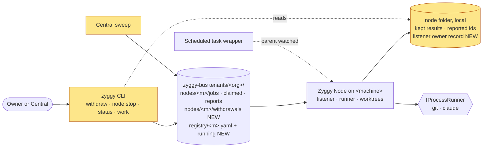
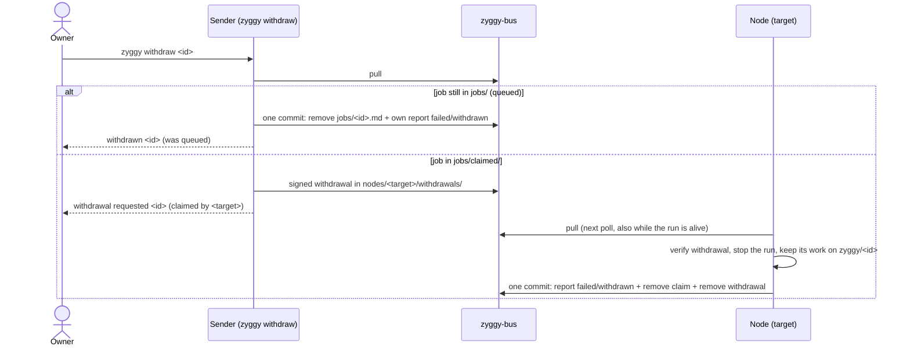
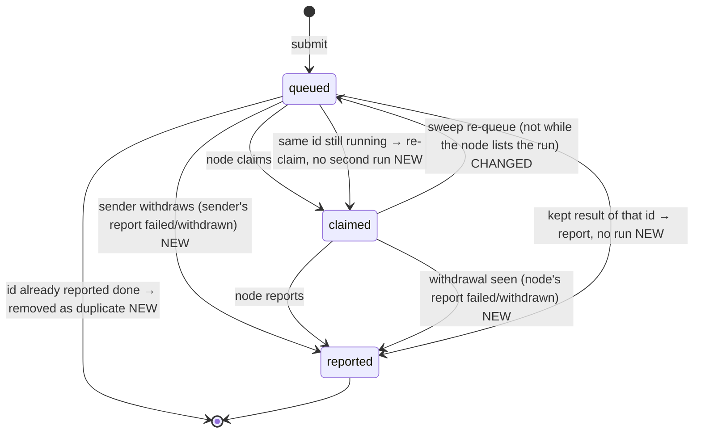
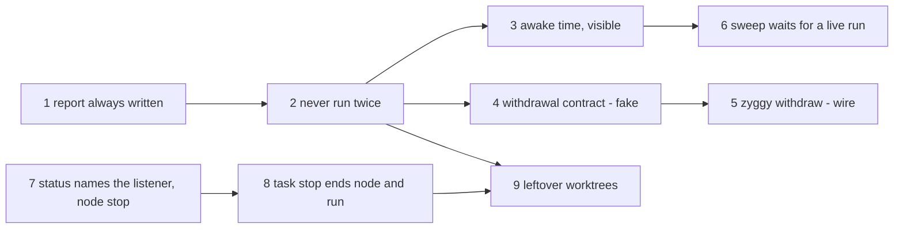

# Spec: 61 — Job run reliability: withdraw a job, no lost report, sleep, a stray node, leftover worktrees

## Status

- 2026-11-24: spec written by an unattended job run (01M86X83DFHW3AY8AH700CYBQ9) on the owner's decision of 2026-11-24 that the next deliverable is the reliability release v0.30.1. **Not approved.** No production code written. Nobody could be interviewed during the run: every gap is under Open questions with a recommendation, and the spec is written on the recommended answers.
- 2026-11-24: code investigation done on `main` at `f24ad77` (results under Context). Two read-only exploration agents were started for it and ended without handing back a report; every finding below was read in the code by the main session.
- 2026-11-24: `spec-critic` ran once (same job) and ended without handing back its findings, as the two exploration agents did; this job cannot message an agent. In its place the main session checked the spec against the write-spec list (every criterion has a check, one review check per slice, no slice depends on a later one, risk areas marked, diagrams present). **The critic's verdict is owed before approval or before slice 1.**
- 2026-11-24: **approved 2026-11-24** by the owner ("implement spec v0.30.1", relayed in job 01M86YBCWYAWEGR01HGCX65V11) with every recommended answer: Q1 (b), Q2 (b), Q3 (a), Q4 (a), Q5 as listed, Q6 (a). The critic's verdict owed above was waived by that approval. The Q5 wording is pasted into the founding spec by the same job: §4 layout (`withdrawals/`), §4 write rules (one rule), §4 envelope type list and the mandatory-fields table (`withdrawal`), §4 state machine (three rows: the report written wherever the job's file is, the sender's withdrawal of a queued job, the node's withdrawal of a claimed job; the re-queue row gains "unless the machine's registry lists the job under `running`"), §4 registry file (`running`), §6 kill rule, §9 reason enum (`withdrawn`), §11 `/health` (`pid`, `startedUtc`).
- 2026-11-24: **slice 1 done** (job 01M86YBCWYAWEGR01HGCX65V11) — a finished run's report reaches the bus. The node signs the report, keeps it in `<nodeDir>/work/<tenant>/kept-reports/<job id>.md` (+ `.file` for an attached file) before the bus write, and removes it once the commit is on the remote (`Pushed`, or at a later pass once `origin/<branch>` holds the report file). The report write, after its pull, removes the job's file wherever it is (`jobs/claimed/`, `jobs/` after a re-queue, or nothing after Central answered it). Every pass (after each pull and at start-up) first writes the kept results whose run has ended: already on the remote → forgotten; committed but unpushed → the unpushed commits are pushed (conflicting ones skipped, never the tip blindly); otherwise written anew with the same signed bytes. Logs: Warning `report of job <id> kept in the node folder; it is written at a later pass`, Information `report of job <id> written from the node folder`; a node folder that cannot be written is one Warning (`kept result of job <id> not stored in the node folder: …`) and never stops the report. **Decisions**: (a) the inbox skips a file whose id has a kept result, so a job re-queued after its run ended is answered by the kept report, not run again — the queued-file half of AC-5, needed for AC-2's "not run again"; the resumed-claim half and the live-run re-claim (AC-4) stay in slice 2. (b) A report whose *signing* fails is not kept (nothing signed exists to keep; the node refuses to start without a usable key). (c) No new public `Zyggy.Core` surface: `KeptReports` and the new repository methods are internal. **Proof**: RED seen — 2 repository unit tests (old write `rm`s an absent claimed file), 4 listener unit tests (listener without the kept store), 4 integration tests `LateReportTests` (old behaviour restored on purpose: report lost and the job run twice); then GREEN; one more unit test for the unwritable node folder (failed first with a second Warning from the remove, fixed). Build 0 warnings, format clean, unit tests 9006 passed / 0 failed (61 skipped, Linux-only); full integration suite 1267 passed / 0 failed (58 skipped) on the code before the last hardening edit, then the touched area (Bus, Sweep, Gates, Node, job round trips, session tasks, fetch) 253 passed / 0 failed on the final code. The `slice-verifier` agent ran once and ended without handing back a report (as in earlier jobs; this job cannot message an agent); the tree was checked unchanged after it and the review check re-run by the main session: 4 passed. AC-1 met (unit: kept before the write, kept on a failed write with one Warning, kept while deferred, written at the next pass; integration: every push of the report write refused → kept, next pass puts it on the remote and clears it). AC-2 met (integration: re-queue pushed while the model runs → report removes the queued file, model started once; re-queue pushed between the report commit and its push → kept, next pass writes it, model started once). AC-3 met (integration: attempts exhausted while the model runs → the node's report commit holds the report file alone). Review check: `dotnet test tests/Zyggy.Integration --filter "FullyQualifiedName~LateReport"` → 4 passed. Runbook: Node README step 7 and the Sweep rows "Sweep: a job ran twice" (rewritten) and "Report: kept, not yet written" (new).
- 2026-11-24: **slice 1 verified** by an independent job (01M872197517YKA4D91VAAN0FF): PASS with two minor corrections, made by job 01M872EY7E179J4JQV5BGKV12T test first. (a) A kept file that fails verification (corrupt, foreign, or a report on another job than its name) is moved to `kept-reports/quarantined/` with one Warning, never run nor written to the bus, and no longer counts as a kept report, so intake runs that job normally. (b) **Decision**: a report whose signing fails is held in memory (nothing signed exists to keep on disk) and signed again at each later pass, **10 tries in all**, then given up with one Error and the claim left for the sweep; while held, the id is not run again. A restart loses it (as 0.30.0). Both rows are under Failure modes; this replaces slice 1's decision (b). Proof: 5 new listener unit tests, RED seen (5 failed), then GREEN (listener class 157 passed). **For the owner**: the founding-spec paste of Q5 carries two small additions beyond Q5's listed wording — the §4 state-machine row "kept until pushed" for a finished run's result, and the §4 registry paragraph saying when `running` is written (claim and report commits, start-up, wake-up). Revert either if unwanted.
- 2026-11-24: **slice 2 done** (job 01M872EY7E179J4JQV5BGKV12T) — a job is never run a second time. At intake, after verification and before the mandate check and the gate: a file whose id has a live run on this node is claimed (`<tenant> claim …`) without starting anything, one Information line `job <id> is back in the inbox while its run is alive; claimed again without a second run`; a file whose id this node finished `done` within 14 days is removed in one commit `<tenant> duplicate <id> <me>→<from>`, one Warning, no run, no report. At start-up a resumed claim with a kept result (or one waiting to be signed) is skipped (the kept report answers it), and one with a `done` id is removed the same way. **Decisions**: (a) the `done` id is noted when the run's signed result is kept (just before the bus write), not when the report reaches the remote — the kept report covers the gap, and a done result always reaches the bus; files `<nodeDir>/work/<tenant>/reported-done/<id>` holding the instant, pruned at each note. (b) The live-run re-claim skips the gate and the mandate check (the run already passed them). (c) No new public surface: `ReportedDone` and `RemoveDuplicateAsync` are internal. **Proof**: RED seen — 5 listener unit tests failed before the code (the two "runs again" cases — after 14 days, after `failed` — passed, as they guard today's behaviour); integration `NoSecondRunTests` written after the code, then seen failing with the behaviour broken on purpose (live-run check disabled → AC-4 test failed; resume kept filter *and* done check disabled → AC-5 test failed; with only the kept filter disabled the done check still held it), then restored. Build 0 warnings, format clean, unit tests 9018 passed / 0 failed (61 skipped, Linux-only); integration of the touched area (Bus, Sweep, Gates, Node, round trips, session, fetch) 324 passed / 1 failed — `NodeHostJobFlowTests.DoorbellFrozen_SafetyFetchAfterOneMinuteClaimsAndReports`, a one-minute safety-fetch timing under the 7-minute parallel load; passed alone and in its class (4/4) on the same code. AC-4 met (integration: Central re-queues while the model runs, the node's next pass re-claims; model started once, one `done` report, two claim commits, files gone; unit: second pass with a live run claims, handler once). AC-5 met (integration: report commits refused through a restart, resumed claim not run, kept report written once writes work; unit: resumed claim with a kept result not run; the queued-file half from slice 1, AC-2's test). AC-6 met (unit: `done` id re-delivered 1 min before 14 days → removed with the `duplicate` commit, not run; 1 min after → runs; `failed` → runs again; resumed claim with a `done` id → removed). Review check: `dotnet test tests/Zyggy.Integration --filter "FullyQualifiedName~NoSecondRun"` → 2 passed. The `slice-verifier` agent was not run (sub-agents are not available in this job); the review check was run by the main session, and an independent verify job follows. Runbook: Node README rows "Sweep: a job ran twice" (rewritten) and "Report: kept, not yet written" (quarantine and signing lines from the slice 1 corrections).
- 2026-11-24: **slice 2 corrections** (job 01M874M0XP0SF2H88S9QNV1E84) after the independent verify (job 01M8747N78AQHQ2VPM743AM421) failed slice 2 on three points. (1) **The same job is decided by a fingerprint**, not by the file id: SHA-256 of the canonical form with `attempt` = 1 and without `key_id` and `sig` (see Behavior §2 "The same job"). The node holds it for each live run (memory, and `work/<tenant>/running/<id>` until the report is on the remote, so it survives a restart) and for each `done` id (`reported-done/<id>` now holds the instant and the fingerprint). A different envelope under a running, recorded or `done` id is refused with the existing reason `invalid_field` (field `id`): moved to `jobs/rejected/` (also from `jobs/claimed/` at start-up) with a signed `rejected` report whose body names the id and `envelope differs from the job this id belongs to`, one Warning; never run, claimed, resumed or removed silently (the run's report write leaves a file that is not the same job). **Decisions**: the verify job asked for a hash of the *exact bytes*; that would refuse every legitimate re-queue (the sweep raises `attempt` and re-signs), so the hash leaves out exactly those three fields — every other change still differs. `invalid_field` because the fault is the value of the `id` field; no new reason. The header-id check stays one Warning: §4 does not list it as an intake rejection (file name = `id` is a `zyggy verify` rule), and a replay with another header id has another fingerprint anyway. (2) **Order**: the result is kept first and the `done` id noted only after the keep succeeded (replaces slice 2 decision (a)'s order); a quarantined kept file forgets its `done` id. (3) An unreadable, fingerprint-less or future-dated `reported-done` / `running` record never counts: removed with one Warning `<store> record of job <id> is invalid (<why>); ignored and removed`. **Proof**: 14 new listener unit tests; RED seen — 6 failed on the code before the change (one more hung there: the restarted listener ran the job inline with a blocked handler; the test now uses a gate), then every new test seen failing with its behaviour broken on purpose (fingerprint check off → 7 failed; note without keep, no forget on quarantine, no future check, no kept filter at resume → 5 failed), then restored; `RequeuedByCentral…` guards the re-queue and passes both ways. Integration `NoSecondRunReplayTests` (changed body under a live run; changed `allowed_tools` under a `done` id; changed body under a run's id across a restart with the report kept): 3 failed with the check off, pass restored. Build 0 warnings, format clean, unit tests 9031 passed / 0 failed (61 skipped, Linux-only); integration NoSecondRun, LateReport, Bus, NodeHostJobFlow 100 passed / 0 failed. Review check `dotnet test tests/Zyggy.Integration --filter "FullyQualifiedName~NoSecondRun"` → 5 passed. Runbook: Node README row "Sweep: a job ran twice" gains the refusal and invalid-record lines.
- 2026-11-24: **slice 2 correction 2** (job 01M8779BZJPZ8K4HT390SQBVSX) after the re-verify (jobs 01M876GEP4V544PKVFHCNA42JJ, 01M8773V9SN9GQ1S93K9GDSNVJ) found a renamed-copy replay: a byte-identical copy of a signed job under another file name was claimed and run again (the records are keyed by the file name; the fingerprint covers the signed `id`). **Fix**: intake refuses a signed job whose `id` differs from its file name — `invalid_field` (`id`), `jobs/rejected/` with the signed `rejected` report, one Warning, never claimed or run. This **replaces** the earlier decision that kept the header-id check as a Warning (Decisions row reshaped). Submit and `--continue` write `<header id>.md`, claim and report move the file under its name, Central's re-queue refuses another `id`, so nothing legitimate is refused. **Proof**: RED seen — 2 repository unit tests and 2 integration tests `NoSecondRunRenamedCopyTests` (copy of a done job; copy of a running job) failed before the change; then GREEN. Build 0 warnings, format clean, unit tests 9032 passed / 0 failed (61 skipped); integration NoSecondRun, LateReport, Bus, NodeHostJobFlow, Intake 124 passed / 0 failed; ContinueJob, Sweep, SessionTask 53 passed / 0 failed (the legitimate re-queue and `--continue` still run). Review check `dotnet test tests/Zyggy.Integration --filter "FullyQualifiedName~NoSecondRun"` → 7 passed. Three remaining limits listed under "Known limits", not built. Runbook: Node README row "Sweep: a job ran twice" gains the renamed-copy line.
- 2026-11-24: **slice 3 done** (job 01M87825SMCWZE2D5XM07PEWZB) — a run's limit counts awake time, ends at 24 h of wall-clock age, and the report says how long the machine slept. The job runner keeps an awake clock on the injected `TimeProvider` while the model runs: a note every 30 s (sooner when less awake time is left), a gap of more than 5 minutes is asleep, a backward jump counts zero, a last note when the run ends; the awake limit is `timeout_minutes` (or the tests' override), the wall-clock limit 24 h from the run's start. Reaching either cancels a new internal signal on the model request (`LimitReached`); the CLI runner ends the session as `timeout` with its partial text, as for its own timer. Body: `timeout after <n> min` (awake limit) or `timeout after 24 h (asleep <h>h<mm>)`; a run that slept gets the last body line `asleep <h>h<mm> during the run`; `duration_seconds` stays wall-clock. **Decisions**: (a) **the hook deadline is dropped**: `ZYGGY_JOB_ENDS` is no longer set (a configured value is removed) — a process environment cannot be rewritten once the model runs, the spec's "dropped" branch; `zyggy ask` in a job then waits its own `--wait` (5 min default) without the cap. (b) The model process's own timer (the runtime timer, not `TimeProvider`) is kept only as a backstop at 24 h + 5 min, so it never ends a run before the awake clock; `ProcessRunner` itself is unchanged. (c) "At a noted wake-up the node pulls and refreshes its registry file" is **not built here**: it belongs with the registry `running` key (slice 6). (d) No new public surface: `AwakeClock` and `ModelRunRequest.LimitReached` are internal. **Proof**: RED seen — 15 unit tests failed on the stubbed clock (`AwakeTimeTests`, the CLI-runner limit test, the reshaped `JobRunnerTests` limit theory and two `JobRunnerInvocationTests` that pinned the request timeout and `ZYGGY_JOB_ENDS`); the three "not ended" guards passed both ways and were then seen failing with the gap rule broken on purpose (8 unit + the integration asleep test failed), the 24 h test with the wall check broken; restored. Integration `AwakeTimeRoundTripTests` (listener, fake-claude, node host clock jumping 9 h during the run → `done` with `asleep 9h00 during the run`; awake → no line) written after the code and seen failing with the gap rule broken. Build 0 warnings (no-incremental), format clean, unit tests 9046 passed / 0 failed (61 skipped, Linux-only); full integration suite 1275 passed / 1 failed (58 skipped) — `SupervisorWakeTests.Wake_SupervisorModelNotAllowed_NoRun_LoggedOnce`, its log line not yet there within the wait under the 15-minute parallel load, on a path this slice does not change (the supervisor's request carries no limit signal); the class passed alone, 17/17, on the same code. AC-7 met (unit: 9 h jump between two notes not ended, 149.5 awake min not ended, 150 → `timeout after 150 min`). AC-8 met (unit: 23 h 59 min 30 s not ended, 24 h → `timeout after 24 h (asleep 22h00)`). AC-9 met (unit: slept → line, sleep in the last interval → line, timeout after sleep → line, awake → none; integration both ways). Review check: `dotnet test tests/Zyggy.Core.Tests --filter "FullyQualifiedName~AwakeTime"` → 16 passed (run by the main session; sub-agents are not available in this job, an independent verify job follows). Runbook: Core README row "Jobs: timeout" (awake time) and new row "Jobs: timeout after a sleep"; Core and Cli READMEs no longer name `ZYGGY_JOB_ENDS` as set by the node.
- 2026-11-24: Behavior §3 reworded (job 01M87ANE1DV0QKJ28JGWFW5F05, from the slice 3 verify job 01M87A25Y9Q9A3XVJ87X4FMDEB): the registry refresh at a noted wake-up belongs to slice 6, as the slice map and slice 3's entry say.
- 2026-11-24: **slice 4 done** (job 01M87ANE1DV0QKJ28JGWFW5F05) — the withdrawal contract, fake. `EnvelopeType.Withdrawal` (`withdrawal`, appended last) with `Envelope.CreateWithdrawal`: no field beyond the common ones, `in_reply_to` mandatory, body empty or one `--why` line of 1–200 characters (one final line break allowed); signed and verified like a job; hand-derived golden `tests/golden/withdrawal.*` (`central` → `home-laptop`, `in_reply_to` = the `job` case; the `sed`/`openssl` steps by a throwaway .NET script, never `Zyggy.Core`; README row). `RunFailureReason.Withdrawn` (`withdrawn`, appended last) — the approved §9 wording adds it. **What a 0.30.0 reader does with it**: `src/Zyggy.Core/Envelope/` is unchanged between `v0.30.0` and this slice's base (`git diff v0.30.0 HEAD` empty), and its report rule accepts any snake_case reason token, so a 0.30.0 machine reads a `failed` / `withdrawn` report like any other failure; the test runs that same rule. `BusFolder.Withdrawals` / `BusPaths.Withdrawals` (`nodes/<machine>/withdrawals/`, parsed back); `zyggy verify` now holds that folder to withdrawals addressed to its machine (a 0.30.0 `verify` still names them unexpected paths, as the Compatibility table says). Write rule: internal, pure `WithdrawalRules` — `MayRemoveQueued`, `MayWriteWithdrawal` (sender side) and `Accept` (node side), each a `WithdrawalVerdict`. Mandates: `MandateLedger.Paused` skips a `withdrawn` report also when the model had started; `max_jobs` counting unchanged (a `failed` report counts). **Decisions**: (a) **a withdrawal written before the job it names is refused** (`BeforeTheJob`): the task asks that a withdrawal replayed against a re-submitted id is refused, and the approved envelope has no field that binds it to one envelope of the id; a withdrawal can never predate its job, and Central's re-queue keeps the job's `created`, so a withdrawal still stops a re-queued copy (tested). No new field. (b) An unknown id gives `UnknownJob`; slice 5 removes such a withdrawal as "nothing to stop" (Behavior §1 table). (c) The guard is internal; the new public surface is the envelope type and its factory, the reason member, the folder and its `BusPaths` method. (d) The verb, the node's acting on a withdrawal and the runbook rows are slice 5. **Proof**: RED seen — 67 failed on stubs (the new tests, plus the wire tests meeting an unmapped member); the guards of today's behaviour (pause around a withdrawn report, `max_jobs` counting, the 0.30.0 reason-token rule, another tenant refused by the parser) passed both ways; then GREEN. Three `BusAuditorTests` for `withdrawals/` written after the change, seen failing (2 of 3) with the rule removed on purpose, restored. Build 0 warnings (`--no-incremental`), format clean, unit tests 9117 passed / 0 failed (61 skipped, Linux-only); integration of the touched area (Verify, Audit, Mandate, Sweep, Ask, Decide, Bus, Hygiene) 299 passed / 0 failed. AC-12 met (golden parses to its fields, canonical bytes and signature equal the files and verify, the factory signs to the exact bytes, a missing `in_reply_to` is `missing_field`, existing goldens untouched: `git status` shows only the three new files and the README row). AC-13 met (every member's string, `withdrawn` included; a signed `failed` / `withdrawn` report verifies). AC-14 met (sender removes and writes for its own job, Central for any job of the tenant; another machine, the target, another tenant, a wrong folder or path and a claimed session task refused; node side: another tenant, a node that did not send the job, an unknown id, another job, another recipient, an unsigned one and a replay older than the job refused). AC-20 met (three withdrawn runs → not paused; failures around a withdrawn report → paused; withdrawn counted in `max_jobs`, rejected not). Review check: `dotnet test tests/Zyggy.Core.Tests --filter "FullyQualifiedName~Withdraw"` → 64 passed (run by the main session; sub-agents are not available in this job, an independent verify job follows). README: Core README section "Withdrawing a job: the contract".
- 2026-11-24: **slice 4 correction** (job 01M87D9EW2PCW061FRY32YCFPA) after the slice 4 verify (job 01M87CM73XEDCC6YM77DCE0WHY: PASS, one correction). The replay rule had no clock tolerance, so a withdrawal written on a machine whose clock is behind the job sender's was refused. **Fix**: a withdrawal is refused as `BeforeTheJob` only when its `created` lies more than 5 minutes (`WithdrawalRules.ClockSkewTolerance`, fixed) before the job's `created`. **Decision**: the fingerprint binding was considered and left out (it needs a new signed field, i.e. protocol wording the owner has not approved); Behavior §1, Edge cases and Decisions carry the rule. **Proof**: 3 new unit tests — 4:59 before → accepted, 5:01 before → refused, a skewed withdrawal of a re-queued attempt → accepted; RED seen (the two "accepted" tests failed on the old rule; the 5:01 guard passed both ways and was seen failing with the tolerance set to 10 min on purpose, then restored). Review check `dotnet test tests/Zyggy.Core.Tests --filter "FullyQualifiedName~Withdraw"` → 67 passed.
- 2026-11-24: **slice 5 done** (job 01M87D9EW2PCW061FRY32YCFPA) — `zyggy withdraw` removes a queued job and stops a running one; `status` and `work` show it. Sender: `JobWithdrawer` (internal) behind the new verb, pull → find the id in every machine's `jobs/` / `jobs/claimed/` → queued: one commit `<tenant> withdraw <id> <me>→<target>` (job file removed, own `failed` / `withdrawn` report), claimed: one commit adding the signed withdrawal; the slice 4 rule guards both writes in the repository too. Node: the listener reads its `withdrawals/` at every pass (after the kept reports, before the inbox; so at start-up before the claims are resumed). A live run is stopped through `RunWithdrawals`, one per-node signal registered with the job runner and linked into the model request's limit signal (slice 3's path): the process tree is killed, the run ends `failed` / `withdrawn` with its partial text, its worktree is finished as for a failed run (Q6: work on `zyggy/<id>`, never `base` or a named branch); the report body starts `withdrawn by <from> at <time>` and the `--why` line, and its commit removes the claim (or the re-queued file) and the withdrawal. A claimed job without a run (gate-deferred, waiting to be resumed) or a queued copy is answered the same way without a run. **Decisions**: (a) a withdrawal of a job whose result is kept (or waits to be signed) is left until that report is written; it then has nothing to stop and is removed — never a second report. (b) A run that finished before the signal took effect keeps its own report; the withdrawal is removed as "nothing to stop" at the next pass (Edge cases, first row). (c) The second line for an old target reads `<target> runs <version>: the run is not stopped before 0.30.1`, with `unknown` for an absent version; a pre-release of 0.30.1 counts as 0.30.1. (d) A rule refusal on the node (`NotSender`, `BeforeTheJob`, `WrongRecipient`, …) is treated like a withdrawal that does not verify: left in place, one Warning per file per process. (e) No new public surface: the verb's types, the signal and the new inventory fields are internal. **Proof**: RED seen — 2 runner unit tests (`WithdrawnRunTests`, the run never stopped) and all 13 integration tests `WithdrawRoundTripTests` (no verb; the running job ran its full 2 minutes) failed before the code; the two runner guards (another job's signal, a closed signal) and the version rule (`JobWithdrawerTests`) were seen failing with the keying, `Close` and the threshold broken on purpose, then restored (the closed-signal test was tightened when it passed with `Close` broken). Build 0 warnings, format clean, unit tests 9134 passed / 0 failed (61 skipped, Linux-only); integration of the touched area: Bus, Hygiene, Status, Work, Verify 281 passed / 0 failed (2 skipped, Linux-only); Jobs, Node, Sweep, Mandate, Submit, Gates 402 passed / 1 failed — `P1_WalkingSkeleton.Part1b…`, a registry `health amber` instead of `green` under the 8-minute parallel load, a path this slice does not change; the class passed alone, 7/7, on the same code. AC-15 met (integration: one commit, file gone, the sender's report verifies `failed` / `withdrawn` with the why line, the node then starts no model). AC-16 met (integration: real listener, fake-claude writing a file then running 2 minutes, withdrawn on Central mid-run: model started once and stopped well before its end, report `failed` / `withdrawn` starting `withdrawn by central at`, its commit removes claim and withdrawal, the file on origin's `zyggy/<id>`, the named branch unchanged; unit: the runner's reply). AC-17 met (integration: a withdrawal of a reported job removed with `… nothing to stop`, no second report; a withdrawal from a machine that is neither sender nor Central left, the claim untouched, one Warning over two passes; unit: slice 4's `Accept` tests). AC-18 met (integration: unknown id exit 1, reported id exit 1, another sender's job on a laptop exit 5, claimed session task exit 5 — no commit in each). AC-19 met (integration: the pending line in `status --id`, `claimed, withdrawal requested` in `work`, `withdrawals pending 1` in the overview, and `withdrawn, reported by home-laptop` with `failed withdrawn` after the node acted). The 0.30.0 target line: integration test. Not covered by a test: the queued removal losing the race with the node's claim (built: one re-read, then the claimed path). Review check: `dotnet test tests/Zyggy.Integration --filter "FullyQualifiedName~WithdrawRoundTrip"` → 13 passed (run by the main session; sub-agents are not available in this job, an independent verify job follows). READMEs: Cli verb row `withdraw`; Node README "Troubleshooting — Withdraw" (rows "Withdraw: the run was not stopped", "Withdraw: not accepted", and where a stopped run's work is); Core README section "Withdrawing a job" (wire).
- 2026-11-24: **slice 5 regression guard** (job 01M87GK2G7EARZCD9D1ZB75GY8), the case the slice 5 verify named: Central reads the queued job (`FindJobFilesAsync`), the node claims and pushes it from its own clone, then `WithdrawQueuedAsync` gives `WriteFailed("rm")` and writes nothing; a second `zyggy withdraw` follows the claimed path (`Requested`); the node answers it `failed` / `withdrawn` without starting the model. Passed on the slice 5 code (no gap); seen failing with the queued file's re-check broken on purpose (report written, the job's file left), then restored. `WithdrawRoundTrip` → 14 passed.
- 2026-11-24: **slice 6 done** (job 01M87GK2G7EARZCD9D1ZB75GY8) — Central's sweep waits for a run the node lists as alive. Registry key `running` (`RegistryDocument.Running`, the one new public member: ids in ordinal order, flow list, omitted when empty so 0.30.0 files and the goldens are unchanged; an entry that is not a job id refuses the file, field `running`). The node writes it inside the claim's commit (live runs + the job), the report's commit (live runs − the job; also the kept-report and the withdrawal-answer report commits), after a resume, at start-up only when the bus copy lists other ids (a clean start adds no commit), and at a noted wake-up (a loop wait that ended more than 5 min after its due instant: a pull at once unless this tick pulled, then the refresh) — the wake-up refresh slice 3 left here. A machine without a registry file is left alone; the discovery publish keeps the bus copy's list. The sweep, for a claim past its limit: listed under `running` on its own machine's registry and at most 24 h + 15 min old → left in place, `waiting <id> <machine> still running, last seen <time>` from `zyggy sweep` (also `--dry-run`), one Information line per claim per process; otherwise today's rule. **Decisions**: (a) the bound is the spec's own 24 h run limit + grace from the claim time (Behavior §3, replaces "keeps its claim until the job is withdrawn"); the job's fallback (timeout + 15 min from `last_seen`) was not taken, see §3. (b) `zyggy status --id` "running (last seen …)" (§3 last sentence) is not built: it is outside AC-10/AC-11 and the slice's review check; left for the release check or slice 7's owner. (c) No other new public surface: `SweepWaiting`, `SweepResult.Waiting` and the repository methods are internal. **Proof**: RED seen — 9 unit tests failed on stubs (`RegistryDocumentRunningTests` 4, `SweepRunningTests` 4, publisher 1); the guards (no key, another id, another machine, past the bound, key omitted, file without the key) passed both ways and were seen failing with the rule broken on purpose. Integration `RunningRegistryTests` (7) written after the code, seen failing with each behaviour broken on purpose (claim stamp off, start-up refresh off, wake-up off, sweep wait off → 5 failed; start-up always writing and waiting on a 0.30.0 file → the 2 guards failed), then restored. Build 0 warnings (`--no-incremental`), format clean, unit tests 9149 passed / 0 failed (61 skipped); integration of the touched area (Bus, Sweep, Registry, Discover, Node, Gates, Jobs) 503 passed / 4 failed under a 21-minute parallel load: `P2_RegistryWorktreeSweep.Part3a` was this slice's (a stopped node's claim is now listed as running, so Central's clock in the gate moved from 1 h to 25 h ahead, past the bound — the gate still proves a dead node's claim is re-queued and run again); `SupervisorWakeTests…LoggedOnce`, `JobRunnerFailureTests…Linger…` and `JobModelRefusalWireTests…MismatchThenHang…` are real-time tests on paths the slice does not change, and passed alone on the final code (23/23, 1/1) — a rerun of RunningRegistry, JobRunnerFailure, WithdrawRoundTrip, NoSecondRun, LateReport and P2 together: 48/48. The wake-up test jumps the clock once the loop has polled (a sleep while the loop is busy can be noted only at the next late tick). AC-10 met (unit: round trip, key omitted, 0.30.0 file parses; integration: claim commit lists the id, report commit does not, restart republishes without a lost run, clean start no commit). AC-11 met (unit: listed → waiting no commit, no key → re-queued, unlisted → re-queued, dry run, one log line; integration through `zyggy sweep`: waits then re-queues once unlisted; 0.30.0 file re-queued as today). Review check: `dotnet test tests/Zyggy.Integration --filter "FullyQualifiedName~RunningRegistry"` → 7 passed (`SweepDryRun_ClaimListedAsRunning_PrintsWaitingLine` prints the `waiting` line). Sub-agents are not available in this job; an independent verify job follows.
- 2026-11-24: **slice 6 correction** (job 01M87NNWCVKBPRN8QE07D6A3GN) after the slice 6 verify (job 01M87KXFM4WHRJA2A19G3G8SDN) failed it on one point, plus one minor. (1) `zyggy status --id <id>` of a claimed job now shows `claimed by <machine>, running (last seen <time>)` when that machine's registry lists the id under `running`, and today's line for a 0.30.0 registry or one that does not list the id; this replaces slice 6 decision (b). New **AC-34** on the slice 6 row (the verify found no criterion covering §3's last sentence); Cli README `status` row. (2) The sweep's claim time is now the committer time of the commit that **added** the claimed file (this attempt's claim; a re-queue removes the file, so each attempt adds it anew) instead of the newest commit touching it, so a node re-committing its own claim cannot move the 24 h + 15 min bound (Behavior §3); the unused "newest commit touching" git query is removed. The rest is under Known limits (d). **Proof**: RED seen — 2 integration tests failed before the code (`StatusId_ClaimListedAsRunning_ShowsRunningLastSeen`: today's `since` line; `Sweep_LaterCommitTouchingTheClaim_DoesNotExtendTheBound`, claim added 26 h before and touched 10 min before Central's clock: `waiting` instead of re-queued); the guard theory `StatusId_ClaimNotListed_ShowsTodaysLine` (0.30.0, not listed) passed both ways. The unit sweep harness answers the claim time on the `--diff-filter=A` query only, so a return to the old query fails the sweep unit tests (it did: `SweepRunningTests`, `MandateIntakeTests` and others failed until the harness was updated). Build 0 warnings, format clean, unit tests 9149 passed / 0 failed (61 skipped); integration Sweep, Running, Registry, Status 171 passed / 0 failed (2 skipped). Review check `dotnet test tests/Zyggy.Integration --filter "FullyQualifiedName~RunningRegistry"` → 11 passed. Slice 7 not started.
- 2026-11-24: **slice 7 done** (job 01M87PP0T7REH24ZCQGX9SXWRC) — `zyggy status` names the listener and a refused start; `zyggy node stop` ends it; `/health` `pid`, `startedUtc`. The listener writes `.git/zyggy-listen.owner` (pid, process start, version, started UTC) when it takes the lock and removes it at a clean stop; a refused start writes `.git/zyggy-listen.refused` (time, holder pid) and the node logs `refusing to start: listener already running (pid <n> since <time>, zyggy-node <version>) — stop it with: zyggy node stop`. `zyggy status` prints the four lines of §4 (stray and version-differs make a green verdict amber, with the reasons `stray listener` / `listener runs <v>, installed <v>`). `zyggy node stop` per §4 and its slice 7 decisions (a)–(g) there. **Decisions**: (h) new internal surface only — `ListenerOwner`, `ListenerInspection`, `NodeStopper`, `IProcessTable` / `OsProcessTable` (internal seam so tests substitute the process table; not a sixth public seam); the one public change is `NodeHealth`'s two optional trailing parameters. (i) The Windows owner check reads the process token's user SID through the documented API sets (`api-ms-win-core-processthreads-l1-1-0`, `api-ms-win-security-base-l1-1-0`) — a token query, not a credential call, so the spec 09 rule against credential P/Invoke stands unchanged; Linux compares `/proc/<pid>`'s owner uid with the effective uid (the existing `lstat`/`geteuid` helpers). (j) Two node test hooks so a test runs `zyggy-node` as a real process: `ZYGGY_NODE_HEALTH_PORT` (the health port; still loopback) and a loopback `ZYGGY_BUS_API_BASE` (as the CLI's); neither is a `node.json` key. (k) The record is written by every listener (also `zyggy probe listen`, whose process name is `zyggy`: `node stop` refuses it, exit 5). **Proof**: RED seen — 24 unit tests on stubs (`ListenerOwnerTests`, `NodeStopperTests`), 9 integration tests (`StrayListenerTests`, `StatusListenerTests`: no verb, no lines, `/health` without `pid`, the real node unable to bind a test port); then GREEN. Written after the code and seen failing with the behaviour broken on purpose: `NodeStop_RealNodeWithARunningJob…` (interrupted count zeroed), `NodeStop_ForeignListenerOnHealthPort…` (pid check loosened: the real node was ended), `OsProcessTableTests` (owner check inverted, 2 failed); the guards `Stop_LockFree…`, `Dispose_Holder…`, `Inspect_RefusedBeforeHolderStarted…` with the lock-first order, the release and the time order broken (6 unit failed); restored. Hygiene rules met by using `ProjectLock.CurrentProcessId`, keeping `GitHub` out of the Node and `ZYGGY_HEALTH_URL` in `BusHost` alone. Build 0 warnings (`--no-incremental`), format clean, unit tests 9178 passed / 0 failed (61 skipped, Linux-only); integration of the touched area (Node, Cli Status, Gates, Probe, Health, RunningRegistry) 196 passed / 3 failed under an 8-minute run — `HealthEndpointTests` (14 fields pinned, now 16) and `P1_WalkingSkeleton.Part1b` (the new listener line shifts the read-out by one) were updated for this slice's additive output; `SupervisorWakeTests…LoggedOnce` is the real-time test already named under load in slices 3 and 6; then those three, the slice's classes and `RunningRegistry` (slice 6 and its correction) together 57 passed / 0 failed. AC-21 met (integration: second in-process host on the held checkout → exit 6, the one `[ERR]` line with the first host's pid, start and version, the refused record names the holder; `/health` `pid` and `startedUtc` equal the process and the owner record; unit: record, refusal sentence, refused record, holder record kept by a refused listener, removed at a clean stop; JSON: 16 fields, a 0.30.0 body parses with both `null`). AC-22 met (integration through the verb: listener line green; stray line with the remedy, amber, exit 1; version line, amber; stale line, still green; no record, no line). AC-23 met (unit over a substituted table: ended → stopped line, records cleared; another program / another user / a later start on the pid → exit 5, nothing ended; a foreign answer on the health port (other pid, no pid, other machine, HTTP 404, unparsable) → exit 5; end failed → exit 6 with `Stop-Process -Id <n> -Force` (Windows) or `kill <n>` (Linux); no record → exit 6 by name; lock still held → exit 6; integration: a real `zyggy-node` process ended, lock free, records gone; the same with a running job → `1 run(s) interrupted`, claim still in `jobs/claimed/` on the remote, no report; a foreign listener on the health port → exit 5, the real node still running; the record naming this test process → exit 5; nothing holds the checkout → `no listener is running`, exit 0). Review check: the owner-run form (`zyggy status` on a machine with a second start refused, then `zyggy node stop`) is the release check; run here by the main session as `dotnet test tests/Zyggy.Integration --filter "FullyQualifiedName~StrayListener|FullyQualifiedName~StatusListener"` → 11 passed (sub-agents are not available in this job; an independent verify job follows). READMEs: Node README exit-code row, `/health` rows `pid` / `startedUtc`, section "Troubleshooting — A stray node" (rows "Node: refused to start", "Listener record is stale"); Core README "Node: refused to start" row (`ListenerRunning`); Cli README verb row `node stop` and the `status` row.

## Goal

**As** the owner, **I want** the five failures seen on 2026-11-23/24, while Central ran about 80 jobs on the work laptop, to stop happening, **so that** a long unattended day of jobs needs no repair by hand in a bus checkout, a process list or a project folder:

1. a job that is no longer wanted can be withdrawn with one command;
2. a finished run's report always reaches the bus, and a job is never run a second time for nothing;
3. a laptop's sleep neither kills a healthy run at wake-up nor lets it run without a limit, and Central does not re-queue a run that is only asleep;
4. a node process that survived its scheduled task is named by `zyggy status`, with the remedy, and stopping the task stops the node and its run;
5. a leftover worktree never blocks a job and never costs unpushed work.

## Context

- **Roadmap entry**: `_plans/ROADMAP.md` #61. Released as **v0.30.1** (owner decision 2026-11-24: a patch release, although it adds a verb).
- **Founding-spec sections**: §4 (layout, write rules, envelope types, state machine, registry file), §5 (start-up rule, write sequence), §6 (pre-flight step 4, invocation, timeout), §9 (design rules, closed reason enum), §11 (`/health`, alerts "Job stuck"), §13.
- **Reference feature**: the Central sweep (`_specs/17-central-sweep.md`) — closer than the discovery registry: same claim, re-queue and report paths, same two-checkout integration tests. For the worktree part: `_specs/16-worktree-execution.md` and `_specs/53-job-branch-name.md`. For the laptop task: `_specs/42-laptop-setup-one-command.md`.
- **Reference implementation elsewhere**: none.

### What the code shows, per problem (read on `main` at `f24ad77`)

| # | Problem | Finding | Verdict |
| --- | --- | --- | --- |
| 1 | No way to withdraw a job | No verb, envelope type, folder or reason exists for it (the CLI's verbs: `submit`, `status`, `report`, `work`, `ask`, `decide`, `sweep`, `mandate`, `supervise`, …; `supervise stop` and `mandate revoke` stop *future* mandate jobs only). A run is cancelled only by the host's stop token; then no report is written and the claim stays. | **Real gap. In.** |
| 2 | Lost report after a re-queue | By design of the sweep spec (its decision D3, "late result"): the report write removes the claimed file in the same commit; when Central re-queued the claim, that removal fails, the write returns failed, the listener logs one line and **drops the result** — it is held in memory only, never kept, never retried. The same loss happens for any failed report write (sign, add, commit). Intake treats the re-queued file as a new job: it checks neither a live run of the same id (the run table is keyed by job id and is simply overwritten) nor an earlier report. | **Real, and wider than reported. In.** |
| 3 | Timeout across sleep | The runner's limit is a timer armed once for `timeout_minutes` on the process wait; no code looks at the wall clock, a suspend or a time jump. The .NET runtime's timers do not advance while the machine is suspended (runtime behaviour, not verifiable in this repository), which matches the observation exactly: a 150-minute job that lived 11.9 h was not killed at wake-up and was still bounded in *awake* time. So "not killed at wake-up" and "bounded" already hold on the node — by accident, with no test and no trace in the report. Not handled: (a) the sweep compares the claim commit's time with Central's wall clock (`timeout_minutes` + 15 min) and never reads the registry; (b) `last_seen` is refreshed only every `discovery.lastSeenHours` / 2 (3 h by default), too coarse to tell "asleep" from "stuck"; (c) nothing bounds a run in wall-clock time; (d) the deadline handed to the job's hook environment is start + timeout by the wall clock. | **Node side: already holds, made explicit and tested. Central side: real gap. In.** |
| 4 | A stray node | The listen lock is an exclusively held, empty file in the bus checkout's `.git` folder: a second start only learns "held" and logs `refusing to start: ListenerRunning`, without pid or start time. `/health` carries neither pid nor start time; `zyggy status` reads only `/health` and the bus. The scheduled task's action is a `powershell.exe` wrapper that starts `zyggy-node.exe`; `Stop-ScheduledTask` ends the wrapper and the node survives — already recorded in `install.ps1` ("seen 2026-10-26"), whose own stop helper waits and then ends the survivor, but only during an install. On a host stop the runner kills the model's process tree and the claim stays for the next start (20 s shutdown limit); when the node is killed from outside, its `claude` child processes are not ended by anything. | **Real gap. In.** |
| 5 | A stale worktree on a named branch | The worktree folder and the local branch are per **job id** (`<nodeDir>/worktrees/<tenant>/<id>`, branch `zyggy/<id>`); a named branch is never checked out locally — a `done` run pushes `zyggy/<id>` to it. Two different jobs on the same named branch therefore cannot collide on a folder or a local branch. `worktree_add` can only come from the **same job id** met again (a re-queue or a resumed claim, problems 2–4): the leftover folder cannot be deleted because a process still holds it, or git refuses the add. Two defects found on the way: the leftover folder is deleted outright **with whatever uncommitted work it holds**, and the `worktree_add` report carries no git message (the `base` step has one since quick wins), so the cause of the 2026-11-24 failure cannot be proven from the report. Nothing cleans leftover worktrees at start-up or later. | **The stated cause ("another job's worktree for that branch") is not what the code does; the failure and a work-loss defect are real. In, restated.** |

No problem goes out as already handled. Problem 3's node side is handled by runtime behaviour only and is kept in scope as "make it explicit, tested and visible".

## Constraints

- ⚠️ **§4 shared contract** — one new envelope type (`withdrawal`), one new folder (`nodes/<machine>/withdrawals/`), one new write rule (a sender removes its own queued job), three new state moves, one optional registry key (`running`). `PROTOCOL.md` in `zyggy-core` and the founding spec follow (Q5). `EnvelopeSigner.Canonicalize` is **not** changed; the new type gets a hand-derived golden file like every type.
- ⚠️ **§6/§9 closed reason enum** — one new member, `withdrawn`.
- ⚠️ **§11 `/health`** — two additive fields (`pid`, `startedUtc`).
- ⚠️ **New public `Zyggy.Core` surface** — the envelope type and its fields, the reason, the health fields; no new seam interface.
- **Patch compatibility (the release rule).** Every addition can be ignored by a 0.30.0 machine, shown per item under *Compatibility*. No machine has to upgrade first. What a 0.30.0 machine cannot do is listed there too.
- This spec **reverses decision D3 of the sweep spec** ("a late result is dropped") and its edge-case rows that follow from it.
- §8: a withdrawal is verified (tenant, signature, recipient, sender) before the node acts on it; its body is data, never instructions, and is never shown to a model. No secret in any new file. The owner records beside the listen lock hold a pid, two timestamps and a version, nothing else.
- §9: no test invokes the real `claude` or GitHub; time through `TimeProvider`; processes through `IProcessRunner`; all bus paths through `BusPaths`; the job runner never throws to the loop; log once per state change.
- Public repository: placeholders only.

## Diagrams

### Components touched



### Round trip: withdrawing a job



### Round trip: a run that outlives its claim (sleep, re-queue)

```mermaid
sequenceDiagram
  participant Central as Central (sweep)
  participant Bus as zyggy-bus
  participant Node as Node (laptop)
  Node->>Bus: claim <id> (registry: running [<id>])
  Note over Node: laptop sleeps; awake run time stops counting
  Central->>Bus: pass: claim past its limit
  alt registry lists <id> as running (0.30.1 node)
    Central-->>Central: waiting <id>, not re-queued
  else no running key (0.30.0 node)
    Central->>Bus: requeue <id>, attempt 2
  end
  Note over Node: wake-up: the same run goes on
  Node->>Bus: pull: <id> back in jobs/ ?
  Node->>Bus: re-claim without a second run
  Node->>Node: run ends, result kept locally first
  Node->>Bus: report (removes the file wherever it is: claimed/ or jobs/)
```

### Job states after this spec



### Slice map



## Behavior

### 1. Withdrawing a job

`zyggy withdraw <id> [--why <line>]` — run on the machine that submitted the job (its `from`), or on Central for any job of the tenant (Q1).

- Starts with a pull, then looks for `<id>` in every machine folder of the tenant.
- **Queued** (the file is in a machine's `jobs/`): one commit removes the job file and adds a report in the withdrawing machine's own `reports/` — `from` the withdrawing machine, `to` the job's `from`, `in_reply_to` the job id, `status: failed`, `reason: withdrawn`, `mandate` and `step` copied, body `withdrawn before it started` and the `--why` line. This is the shape of the sweep's `attempts_exhausted` report. Commit subject `<tenant> withdraw <id> <me>→<target>`. Output `withdrawn <id> (was queued on <target>)`.
- **Claimed** (the file is in `jobs/claimed/`): one commit adds a signed `withdrawal` envelope to `nodes/<target>/withdrawals/<ulid>.md`. Output `withdrawal requested <id> (claimed by <target>)`, and a second line `<target> runs <version>: the run is not stopped before 0.30.1` when the target's registry `version` is older or absent.
- **Already reported, or unknown**: nothing is written. Output `<id>: already reported (<status>)` or `<id>: not found`; exit 1.
- A session task (`deliver: session`) that is already claimed is not withdrawn: `<id>: a session task; finish it with zyggy work --failed`; exit 5. Queued, it is withdrawn like any job.
- A job of another sender, on a machine that is not Central: `<id>: submitted by <from>; withdraw it there or on Central`; exit 5.
- The queued removal can lose a race with the node's claim: the existing conflicting-commit recovery drops the verb's commit; the verb then re-reads the state once and follows the claimed path.
- Exit codes (existing numbers): `0` withdrawn or requested, `1` not found or already reported, `2` usage, `3` configuration, `4` checkout lock busy, `5` refused, `6` a git step failed, `7` committed, push deferred.

**The `withdrawal` envelope.** `type: withdrawal`; mandatory beyond the common fields: `in_reply_to` (the job id). `to` is the machine that claimed the job. Body: empty or the `--why` line (1–200 characters, one line, data). Signed with the sender's `signWith` like a job.

**On the node (0.30.1).** After every pull, also while a run is alive, the node reads its own `withdrawals/` folder:

| Withdrawal | Node does |
| --- | --- |
| verifies; `from` is the job's `from` or Central; the job is claimed and running | stops the run (process tree), finishes a worktree as for a failed run (work committed, `zyggy/<id>` pushed; never `base`, never a named branch), then one commit: report `failed` / `withdrawn` + claimed file removed + withdrawal removed |
| the same, the job is claimed but not running (deferred by the gate, or resumed at start) | no run; the same commit |
| the same, the job is back in `jobs/` (re-queued meanwhile) | no run; the same commit, removing the queued file |
| verifies; no job with that id in `jobs/` or `jobs/claimed/` (reported meanwhile) | removes the withdrawal, commit `<tenant> withdrawal <id> <me>→<from> nothing to stop`; no report |
| does not verify, or its sender is neither the job's sender nor Central | left in place, one Warning per file per process; `zyggy verify` names it |
| verifies, but its `created` lies more than **5 minutes** before the job's `created` (a replay against a job re-submitted under the same id) | left in place like one that does not verify; one Warning per file per process |

**Clock skew.** A withdrawal can never predate its job, but the withdrawing machine's clock may be a few minutes behind the job sender's. A withdrawal whose `created` is at most 5 minutes (a fixed value, `ClockSkewTolerance`) before the job's `created` is therefore accepted; only an older one is refused as a replay. Central's re-queue keeps the job's `created`, so a withdrawal also stops a re-queued attempt of the same job.

The report body starts `withdrawn by <from> at <time>`, then the `--why` line, then whatever REPORT text the run had produced. A stop that is itself interrupted (the host stops) leaves claim and withdrawal in place; the next start handles the withdrawal before resuming the claim.

**Visible.**

- `zyggy status --id <id>`: a line `withdrawal requested <time> by <from>, waiting for <machine>` while the withdrawal file exists; afterwards the report, shown as `withdrawn`: the state line reads `withdrawn, reported by <machine>` and the report line `failed withdrawn`.
- `zyggy status` (overview): the bus block counts `withdrawals pending <n>` when n > 0.
- `zyggy work`: the job's line reads `claimed, withdrawal requested`.

**Mandates.** A withdrawn job keeps its place in the mandate's `max_jobs` count (it has a report that is not `rejected`); a `withdrawn` report never counts toward the mandate's pause (Q4).

### 2. A finished run's report is always kept; a job with a result is never run again

**Kept result.** When a run ends (any status), the node first writes the result — the report fields, body and attached file — into its own node folder (local, not on the bus), then writes the report to the bus. The kept result is removed only once the report's commit is on the remote. Until then the write is retried after every pull and at start-up. One Warning when a result is first kept past a failed write, one Information when it is finally written.

**The report write no longer needs the claimed file.** After its pull, the write removes the job's file wherever it is and adds the report in one commit:

| The job's file is | The commit |
| --- | --- |
| in `jobs/claimed/` | report + remove claim (today) |
| back in `jobs/` (Central re-queued it) | report + remove the queued file |
| nowhere (Central answered it `attempts_exhausted`, or withdrew it) | report alone |

If a commit of the node that carried the report is dropped by the existing conflicting-commit recovery, the result is still kept and the next write follows the table.

**The same job.** A file is *the same job* as one this node runs, ran or reported `done` only when its **fingerprint** is equal: the SHA-256 of the job's canonical form (`EnvelopeSigner.Canonicalize`, unchanged) with `attempt` set to 1 and without `key_id` and `sig`. Those three are exactly what Central's re-queue changes (it raises `attempt` and re-signs), so a re-queued copy is the same job; any other change — the body, `allowed_tools`, the front-matter `id`, any field — is another envelope. The node remembers the fingerprint of each live run (in memory, and in its node folder under `work/<tenant>/running/<id>` from the run's start until its report is on the remote, so it holds across a restart) and of each `done` id it remembers (`work/<tenant>/reported-done/<id>`: the instant and the fingerprint). Because these records are keyed by the file name, intake first refuses a signed job whose front-matter `id` differs from its file name (`invalid_field`, field `id`, to `jobs/rejected/` with a signed `rejected` report): a renamed copy of a job is never a new job.

**Never a second run.** At intake (a file in `jobs/`) and at start-up (resumed claims):

| The job id | Node does |
| --- | --- |
| has a live run, a run recorded in the node folder, or a remembered `done`, and the file is **not the same job** | refuses it: moved to `jobs/rejected/` (from `jobs/`, or from `jobs/claimed/` at start-up) with a signed `rejected` report, reason `invalid_field` (field `id`), body `rejected: invalid_field (id)` and `job <id>: envelope differs from the job this id belongs to`; one Warning. Never run, never claimed in the job's place, never resumed, never removed silently |
| has a live run on this node (the same job) | claims the file without starting anything (`<tenant> claim …`, as today); the live run's report answers it |
| has a kept result | writes that report (table above); no run |
| was reported `done` by this node in the last 14 days (the same job) | removes the file, commit `<tenant> duplicate <id> <me>→<from>`, one Warning; no run, no second report |
| none of these | today's behavior |

The node remembers the ids it reported `done` for 14 days (the archive age), in its node folder. A job that ended `failed` or `timeout` may be run again by a re-queue, as today. The report write removes the job's file (table above) only when that file is the same job; another envelope there is left for intake to refuse, and the report is committed alone.

**Order.** When a run ends `done`, the node keeps the signed result first and notes the `done` id only once the keep succeeded. A failed keep, or a crash between the two, therefore never leaves a `done` id without a kept result or a report on the bus: the job is then reported from the kept result, or run again — never dropped. A kept file that is quarantined (it does not verify) also forgets its `done` id, so the job is run or reported, never removed as a duplicate. A `reported-done` or `running` record that cannot be read, carries no fingerprint, or is dated after the instant it is read at never counts: it is removed with one Warning `<store> record of job <id> is invalid (<why>); ignored and removed`.

### 3. Sleep

**On the node.** The run limit is counted in **awake time**, by the node itself: while a run is alive the node notes the clock at a fixed short interval; a gap of more than 5 minutes between two notes is time asleep and is not counted. The run ends `timeout` when its awake time reaches `timeout_minutes`, as today. A run whose wall-clock age reaches **24 hours** is ended `timeout` whatever its awake time (Q2). The report of a run that slept carries one body line `asleep <h>h<mm> during the run`; `duration_seconds` stays wall-clock. The deadline given to the job's hook environment is dropped (`ZYGGY_JOB_ENDS` is no longer set: an environment cannot be rewritten once the model runs — decided in slice 3, recorded in Status). At a noted wake-up the node pulls and refreshes its registry file at once — built in slice 6 with the registry key `running` (below), not in slice 3, as the slice map and slice 3's Status entry say.

**On Central (Q3).** The registry file gains an optional key `running`: the ids of the jobs with a live run on that machine. The node writes it in the claim's and the report's own commit (no extra commit per run), at start-up, and at a noted wake-up, each time with a fresh `last_seen`. The sweep, for a claim past its limit:

- the machine's registry lists the id under `running` → **not re-queued**. `zyggy sweep` prints `waiting <id> <machine> still running, last seen <time>`; one Information line per claim per process.
- otherwise → today's rule (re-queue, exhausted, rejected).

A node that crashed republishes at start-up without the id, so the claim is re-queued at the next pass (and the node has resumed it by then: see "Never a second run"). **Bound (slice 6 decision)**: the sweep waits for a listed claim only while the claim is at most 24 h + the 15-minute grace old — the longest a run can live, since the node itself ends every run at 24 h of wall-clock age (§3 "On the node"). Past that, the claim is settled by today's rule (re-queue, exhausted, rejected) whatever the registry says, so a `running` entry left by a node that died, or by a machine that never comes back, never holds a claim forever. (The job's suggested fallback — the job's timeout + 15 min counted from the registry's `last_seen` — was not taken: the registry is refreshed only every 3 h and not at all while a laptop sleeps, so it would re-queue every healthy run longer than its timeout and every run across a sleep, the very case this rule is for.) The claim time is the committer time of the commit that **added** the claimed file (this attempt's claim; a re-queue removes the file, so each attempt adds it anew): a later commit that only changes the file — the node re-committing its own claim — does not move it, so it cannot extend the bound. `zyggy status --id` shows `claimed by <machine>, running (last seen <time>)` when the machine's registry lists the id under `running`, and today's `claimed by <machine> since <age>` otherwise (a 0.30.0 target, or the id not listed).

### 4. A stray node

**Owner record.** The listener writes, beside its listen lock, who holds it: pid, process start time, version, started (UTC). A start that finds the lock held logs `refusing to start: listener already running (pid <n> since <time>, zyggy-node <version>) — stop it with: zyggy node stop` and leaves a record of the refused start (time, holder). `/health` gains `pid` and `startedUtc`.

**`zyggy status`** (node block), from the owner record, `/health` and the refused-start record:

- always: `listener pid <n> since <time>`;
- `stray listener: pid <n> since <time> (zyggy-node <version>) holds the bus checkout; a start was refused at <time>. Stop it with: zyggy node stop` when a start was refused after the holder started and the holder is still alive — health amber;
- `listener runs <version>, installed <version>: restart the node` when they differ — health amber;
- `listener record names pid <n>, which is not running` when the record is stale (lock free): information only; the next start replaces it.

**`zyggy node stop`.** Ends the listener that holds this machine's bus checkout: checks that the recorded pid is a `zyggy-node` process with the recorded start time, ends its process tree (the node and the model processes of its runs), waits until the lock is free. Output `stopped zyggy-node pid <n> (<k> run(s) interrupted; their claims resume at the next start)`, or `no listener is running`. Exit `0` in both cases, `6` when the process could not be ended, `5` when the recorded pid belongs to another program (nothing is touched). **Slice 7 decisions**: (a) the order is lock first — a free listen lock is `no listener is running` whatever a record says; (b) "a `zyggy-node` process" means the process name `zyggy-node`, **this OS user** (the token user on Windows, `/proc/<pid>`'s uid on Linux) and the recorded start time (1 s tolerance); (c) the node answering on the health URL, when one answers, must be the recorded pid for this tenant and machine — another pid, a body without a pid, another machine, or something that is no node (`HTTP <code>`, an unparsable body) is exit 5, nothing touched; no answer (refused, timeout: a hung or starting node) leaves the decision to the process identity; (d) a held lock with no record, or a record whose pid runs no more, is exit 6 with the remedy by name (`Stop-Process -Name zyggy-node -Force` / `pkill -u "$(id -u)" -x zyggy-node`): the holder predates the record; (e) inside a job (`ZYGGY_JOB` set) the verb refuses, exit 5 — a job runs under the node and must never stop it; (f) after a stop the owner and refused-start records are removed, and a clean stop of the listener removes its own owner record; (g) `<k>` is `/health`'s `jobsRunning` (0 when it does not answer).

**Stopping the task stops the node.** `zyggy-node --exit-with-parent`: the node watches the process that started it and, when that process ends, stops as on a normal host stop (runs ended by the runner, claims kept, lock released). `install.ps1` passes the option in the task's action, and its own stop helper calls `zyggy node stop` before its wait-then-force fallback. Linux (systemd) is unchanged.

**Model processes left by a killed node.** The node records, per run, the pid and start time of the model process it started. At start-up, before resuming claims, it ends every recorded process that is still alive with the recorded start time (tree), logs one Warning per process, and clears the records.

### 5. Leftover worktrees

**The same job id met again** (Prepare):

- The folder exists and is a worktree of the project with uncommitted changes: the node commits them on `zyggy/<id>` (its own identity, message `zyggy job <id> (recovered)`) before anything is removed. The branch is reused as today, so the next run starts from that work.
- The folder is then removed through git; a plain delete is used only for a folder git does not know.
- Still not removable, or `worktree add` refused: `failed` / `git_error`, body `git_error: worktree_add (<git's first error line>)` and `worktree kept at <path>`; nothing deleted.

**Leftovers of finished jobs.** At start-up and after each run, for every folder under `<nodeDir>/worktrees/<tenant>/` whose id has no claim and no live run:

| State | Node does |
| --- | --- |
| clean, branch not ahead of what the origin has | removes the folder and the local branch |
| uncommitted changes or commits the origin does not have | commits, pushes `zyggy/<id>`; then removes folder and branch |
| the push fails, or the folder is held | keeps everything; one Warning per folder per process |

`zyggy status` (node block) prints `kept worktrees: <n>` with one line per folder (`<id> <path>: <why>`) when n > 0. Nothing here ever pushes to a named branch, to `base` or to a default branch, and no branch with commits the origin lacks is deleted.

### Compatibility with 0.30.0 machines

| Addition | A 0.30.0 machine |
| --- | --- |
| `withdrawals/` folder, `withdrawal` type | a node never lists the folder (the folder list is closed): ignored. `zyggy verify` names each file as an unexpected path until the target acts on it. A claimed job on a 0.30.0 target is **not stopped**: it finishes and reports; the verb says so. |
| a queued job removed by its sender | the node simply never sees it |
| report `reason: withdrawn` | read: a report's reason is accepted as any snake_case token |
| sender's own report in reply to its own job | same shape as the sweep's `attempts_exhausted` report; `status --id` lists it |
| report + removal of a file in `jobs/`; `duplicate` commit | moves inside the node's own folders; Central reads reports, not commit subjects |
| registry `running` | unknown registry keys are ignored by the reader |
| `/health` `pid`, `startedUtc` | additive JSON |

Upgrade order: none required. Each fix takes effect on the machine that runs 0.30.1: the node fixes (2, 3 node side, 4, 5, stopping a withdrawn run) on that node; the sweep rule on Central, and only for nodes that publish `running`.

### Configuration

No new key. The 5-minute gap, the 24-hour limit and the 14 days are fixed values.

### Failure modes

| Situation | Observable outcome | Runbook entry |
| --- | --- | --- |
| Report write fails (lock, git, push) | result kept in the node folder; one Warning; written at a later pass | "Report: kept, not yet written" |
| Report signing fails (key store unavailable) | nothing signed, so nothing kept on disk: the result is held in the node's memory and signed again at each later pass, 10 tries in all; one Warning at the first failure (`report of job <id> could not be signed (…); signing is tried again at each pass, 10 tries in all`), one Error when given up (`… could not be signed after 10 tries; it is given up and the claim stays for the sweep`); while held, a re-queued file of that id is not run. A restart loses the held result: the claim is resumed and run again, as in 0.30.0 | "Report: kept, not yet written" |
| A kept file does not verify (corrupt, foreign, or not this machine's report on the job it is named after) | moved to `kept-reports/quarantined/`, never run, never written to the bus, no longer counts as a kept report for its id; one Warning `kept result of job <id> does not verify (…); moved to <path>, never written to the bus` | "Report: kept, not yet written" |
| Job re-queued while its run is alive | re-claimed, no second run; one Information line | "Sweep: a job ran twice" (rewritten: no longer happens) |
| A different signed envelope reuses the id of a running, recorded or `done` job (changed body, tools or any field) | refused: `jobs/rejected/<id>.md` + a signed `rejected` report, reason `invalid_field` (`id`), body names the id and `envelope differs from the job this id belongs to`; one Warning; never run, claimed or resumed in the job's place; the job's own report still answers it, so `status --id` lists both | "Sweep: a job ran twice" |
| A signed job in `jobs/` whose signed `id` differs from its file name (a renamed copy of a done, running or any other job) | refused: `jobs/rejected/<file id>.md` + a signed `rejected` report answering the file id, reason `invalid_field` (`id`); one Warning; never claimed or run | "Sweep: a job ran twice" |
| Keeping a `done` result fails, or the node dies between keeping it and noting the id | the id is not noted `done`: the job is reported from the kept result or run again, never dropped as a duplicate | "Report: kept, not yet written" |
| A `reported-done` or `running` record is unreadable, has no fingerprint, or is dated in the future | ignored and removed; one Warning | "Report: kept, not yet written" |
| Withdrawal for a job on a 0.30.0 node | the verb's second line; the job reports normally; the withdrawal file stays until that node is upgraded | "Withdraw: the run was not stopped" |
| Withdrawal that does not verify | left in place; one Warning; `zyggy verify` | "Withdraw: not accepted" |
| Start refused, listener already running | the new log line; `zyggy status` amber with the remedy | "Node: refused to start" (rewritten) |
| `zyggy node stop` cannot end the process | exit 6 with the pid and `Stop-Process -Id <n> -Force` / `kill <n>` | "Node: refused to start" |
| Leftover worktree cannot be removed or pushed | kept; Warning; `kept worktrees` in `zyggy status` | "Jobs: stale worktree folder" (rewritten) |
| Run reaches 24 h wall-clock | `timeout`, body `timeout after 24 h (asleep <h>h<mm>)` | "Jobs: timeout after a sleep" |

### Edge cases

| Case | Expected behavior |
| --- | --- |
| Withdraw and report cross (the node reports while the withdrawal is pushed) | the report stands; the node removes the withdrawal ("nothing to stop") |
| Queued job withdrawn while the node holds an unpushed claim and a live run | the node's claim commit is dropped by the existing recovery; the run ends and its report is written alone; two reports (`withdrawn`, then the node's) — `status --id` lists both |
| Two withdrawals for one job | the first is acted on; the second is removed as "nothing to stop" |
| Withdrawal written on a machine whose clock is behind the job sender's | accepted when its `created` is at most 5 minutes before the job's; more than 5 minutes before → refused as a replay, left in place |
| Job re-queued three times while asleep, by a Central without the `running` rule | Central writes `attempts_exhausted`; the node's own report is still written when the run ends |
| Kept result whose job the sender withdrew meanwhile | the report is written alone |
| Node folder lost (reinstall) | kept results and reported ids are gone: behavior as 0.30.0 for those jobs |
| Clock set back or forward by hours while a run is alive | a forward jump counts as sleep; a backward jump counts as zero time; the 24 h limit uses the recorded start |
| `--exit-with-parent` when the parent is already gone at start | the node stops at once, exit 0, one line |
| `zyggy node stop` while no task is installed | works the same: it reads the owner record, not the task |
| Leftover worktree whose project folder no longer exists | folder kept; listed with `project not found` |

## Decisions

| Item | Verdict | Why |
| --- | --- | --- |
| Sweep spec D3: a late result is dropped (founding spec §4 state machine, row 3) | **reshape** | The loss cost an 11.9 h run; the report is now written whatever became of the claim |
| §4 "a job's file is deleted when its report is written" | **keep**, widened to the file's current folder | Same invariant, one more place the file can be |
| §4 `attempt`, three attempts, 15-minute grace | **keep** | Unchanged; the sweep only gains "not while the node lists the run" |
| §6 "kill the process tree at `timeout_minutes`" | **reshape**: awake minutes, 24 h wall-clock limit | What the runtime already did by accident, now a tested rule |
| Withdrawal as a new envelope type in a new folder, not a `decision` of kind `stop` | **new** | A decision is Central-only; the submitter may be a laptop. A file in `jobs/` of an unknown type would be rejected, not ignored, by a 0.30.0 node; a new folder is ignored |
| Withdrawn = `status: failed` + `reason: withdrawn`, no new status | **new reason only** | A new status value would be refused by 0.30.0 readers; a reason token is not |
| Registry `last_seen` alone as the sleep signal | **reshape**: `running` list + `last_seen` | Refreshed every 3 h it cannot tell asleep from stuck; a faster heartbeat would add a commit every few minutes per machine |
| §11 `/health` field list | **keep**, plus `pid`, `startedUtc` | Needed to name the listener |
| The task's `powershell.exe` wrapper | **keep** | It sets the environment and returns the exit code; the node watches it instead |
| "The same job" by a hash of the exact envelope bytes (the verify job's wording) | **reshape**: hash of the canonical form with `attempt` = 1, without `key_id` and `sig` | Central's re-queue raises `attempt` and re-signs, so exact bytes would refuse every legitimate re-queue (AC-2, AC-4); these three fields are the only ones it changes, and the canonical form is what is signed, so every other change still differs |
| The reason for refusing a different envelope under a known id | **existing `invalid_field`** (field `id`), no new reason in a patch | The envelope's `id` field is the fault: it names a job that is another envelope. `malformed` is a parse failure; the signature, tenant, key and recipient checks all pass; `invalid_field` is §4's reason for a field of the wrong value |
| Front-matter `id` different from the file name | **reshape**: refused at intake as `invalid_field` (`id`), no longer a Warning only | The done, running and kept lookups are keyed by the file name and the fingerprint covers the signed `id`, so a byte-identical copy of a signed job under a new file name had a fingerprint no record held and was claimed and run again. Every legitimate writer keeps file name = signed `id` (submit and `--continue` write `<id>.md` from the header, the claim and the report move the file under its name, Central's re-queue refuses a job whose `id` is not the claim's), so the refusal costs nothing legitimate. `invalid_field` because the `id` field's value is the fault; no new reason |
| A withdrawal replayed against a job re-submitted under the same id | **new**: refused when its `created` lies more than 5 minutes (`ClockSkewTolerance`) before the job's `created` | A withdrawal can never predate its job, but machine clocks differ: a legitimate withdrawal from a machine whose clock is behind the sender's must not be refused. Binding the withdrawal to one envelope by the job's fingerprint was considered and left out: it needs a new signed field, i.e. protocol wording the owner has not approved |
| Fake and Wire in one slice for slices 1–3 and 6–9 | **deviation from the slice rule, stated** | Each behavior is small and its one review check is the integration test; the withdrawal, which adds a signed contract, keeps the pair (slices 4–5) |

No new NuGet package.

## Acceptance criteria

| # | Criterion | Check |
| --- | --- | --- |
| AC-1 | A run's result is written to the node folder before the bus write and removed only after its commit is on the remote; a failed write leaves it, and the next pass writes the report. | Unit test (fake bus write failing once); integration test (bare repo, remote refusing one push) |
| AC-2 | Central's re-queue is pushed while the node's run is ending: the node's report is on the remote, the file is gone from `jobs/` and `jobs/claimed/`, and the job is not run again. | Integration test: two checkouts of one bare repo, real git, `tools/fake-claude` (replaces the sweep spec's AC-9a expectation) |
| AC-3 | A report whose job file is nowhere (exhausted by Central) is written alone. | Integration test, two checkouts |
| AC-4 | A file arriving in `jobs/` whose id has a live run is claimed and the model is started once in total. | Integration test: fake-claude start count = 1 |
| AC-5 | A file in `jobs/` or a resumed claim whose id has a kept result is reported without a run. | Unit test; integration test (node restarted between run end and report) |
| AC-6 | A file in `jobs/` whose id this node reported `done` within 14 days is removed with the `duplicate` commit and not run; after 14 days, or after a `failed` report, it runs. | Unit test with `FakeTimeProvider`, both sides |
| AC-7 | With the clock jumping 9 h between two notes, a 150-minute run is not ended at the jump and is ended `timeout` after 150 awake minutes in total. | Unit test with `FakeTimeProvider` |
| AC-8 | A run whose wall-clock age reaches 24 h is ended `timeout` with the 24 h body line. | Unit test with `FakeTimeProvider` |
| AC-9 | The report of a run that slept carries `asleep <h>h<mm> during the run`; one that did not carries no such line. | Unit test; integration test (fake clock in the node host) |
| AC-10 | The registry file lists a job id under `running` from its claim commit until its report commit, and not after a restart without that run; a file without the key parses as today. | Unit test (document round trip, existing goldens unchanged); integration test (commits on the bare repo) |
| AC-11 | The sweep leaves a claim past its limit untouched while the machine's registry lists it, prints the `waiting` line, and re-queues it once the registry no longer lists it; for a machine without the key it acts as today. | Unit test, three cases; integration test through `zyggy sweep` |
| AC-12 | A `withdrawal` envelope: a hand-derived golden parses to its fields, the factory signs the same fields to its exact bytes, a missing `in_reply_to` is rejected; every existing golden is unchanged. | Unit test (golden) |
| AC-13 | `withdrawn` has its wire string and is accepted in a report. | Unit test asserting every reason member's string |
| AC-14 | The write-rule guard lets a sender remove its own queued job and write a withdrawal for it, lets Central do so for any job of the tenant, and refuses another machine and another tenant. | Unit test on the guard |
| AC-15 | `zyggy withdraw <id>` on a queued job: one commit, the job file gone, the sender's `failed` / `withdrawn` report verifies, the node never runs it, exit 0. | Integration test through the verb, bare repo |
| AC-16 | `zyggy withdraw <id>` on a running job: the model process is ended, the node's `failed` / `withdrawn` report verifies, claim and withdrawal are gone in one commit, a worktree job's work is on `origin/zyggy/<id>` and its `base` or named branch is unchanged. | Integration test: real listener, fake-claude long run, bare repo |
| AC-17 | Withdrawal for a job already reported: removed with "nothing to stop", no second report. A withdrawal that does not verify, or from a machine that is neither the sender nor Central, is left and logged once. | Integration test; unit test |
| AC-18 | `zyggy withdraw` exits 1 for an unknown or reported id, 5 for another sender's job on a laptop and for a claimed session task, and writes nothing. | Integration test through the verb |
| AC-19 | `zyggy status --id` shows the pending withdrawal line and then the report as `withdrawn`; `zyggy work` shows `claimed, withdrawal requested`; the overview counts pending withdrawals. | Integration test through the verbs |
| AC-20 | A `withdrawn` report does not count toward a mandate's pause and does count in `max_jobs`. | Unit test on the mandate rules |
| AC-21 | A second start against a held checkout logs the new refusal line with the holder's pid and start time and leaves the refused-start record; `/health` carries `pid` and `startedUtc`. | Integration test through the real node host, two hosts on one checkout |
| AC-22 | `zyggy status` prints the listener line, the stray line with the remedy (amber) after a refused start, the version-differs line (amber), and the stale-record line. | Integration test through the verb, one case per line |
| AC-23 | `zyggy node stop` ends the recorded process tree and frees the lock (exit 0); says `no listener is running` (exit 0); touches nothing when the pid belongs to another program (exit 5). | Unit test with a substituted process runner; integration test against a started node host process |
| AC-24 | With `--exit-with-parent`, the node stops when its starting process ends: the run's model process is gone, the claim is still in `jobs/claimed/`, the lock is free. | Integration test (parent stand-in process ended by the test) |
| AC-25 | `install.ps1` passes `--exit-with-parent` in the task action and calls `zyggy node stop` in its stop helper before the fallback. | Script hygiene test (the existing kind) |
| AC-26 | At start-up a recorded model process that is still alive is ended before claims are resumed; a pid reused by another program is not touched. | Unit test (start time mismatch); integration test with a fake-claude left running |
| AC-27 | A leftover folder of the same job id with an uncommitted file: after Prepare the file's content is in a commit on `zyggy/<id>` and the new run starts from it. | Integration test, real git |
| AC-28 | `worktree add` refused: the report body carries git's first error line and `worktree kept at <path>`; the folder still exists. | Unit test; integration test (folder held open) |
| AC-29 | Start-up clean-up: a clean leftover is removed with its branch; one with unpushed work is pushed to `origin/zyggy/<id>` and then removed; one whose push fails is kept and listed by `zyggy status` as `kept worktrees`. | Integration test, three cases, bare origin |
| AC-30 | The Core, Cli and Node READMEs carry the runbook rows of the Failure modes table and the new verbs; no published string or fixture carries a real machine name, tenant or id. | Hygiene test (row titles, verb names); the existing source-hygiene test |
| AC-31 | On the real work laptop: `Stop-ScheduledTask zyggy-node` during a run → no `zyggy-node` and no `claude` process of that run after 30 s; `Start-ScheduledTask` → the claim is resumed and reported. | Owner-run at release, evidence in Status |
| AC-32 | On the real machines: a job with a 5-minute timeout, the laptop put to sleep for 30 minutes mid-run; `zyggy sweep` on Central prints `waiting …`; after wake-up one report arrives, `done`, with the `asleep` line, and the model ran once. | Owner-run at release, evidence in Status |
| AC-33 | On the real machines: `zyggy withdraw` of a queued and of a running job from Central; `zyggy status --id` shows both as `withdrawn`. | Owner-run at release, evidence in Status |
| AC-34 | `zyggy status --id <id>` of a claimed job shows `claimed by <machine>, running (last seen <time>)` when that machine's registry lists the id under `running`, and today's `claimed by <machine> since <age>` for a registry without the key (0.30.0) or one that does not list the id. The sweep's claim time is the commit that added the claimed file: a later commit touching it does not extend the 24 h + 15 min bound. | Integration test through `zyggy status --id`, three cases; integration test through `zyggy sweep` with dated commits |

## Slices

| # | Slice | Criteria | Review check |
| --- | --- | --- | --- |
| 1 | ⚠️ A finished run's report reaches the bus even when Central re-queued or answered the claim, and after a failed write (§4 state move) | AC-1, AC-2, AC-3 | `dotnet test tests/Zyggy.Integration --filter "FullyQualifiedName~LateReport"` |
| 2 | ⚠️ A job is never run a second time: live run re-claimed, kept result reported, `done` id removed as duplicate | AC-4, AC-5, AC-6 | `dotnet test tests/Zyggy.Integration --filter "FullyQualifiedName~NoSecondRun"` |
| 3 | A run's limit counts awake time, ends at 24 h, and the report says how long it slept | AC-7, AC-8, AC-9 | `dotnet test tests/Zyggy.Core.Tests --filter "FullyQualifiedName~AwakeTime"` |
| 4 | ⚠️ Fake: the withdrawal contract — envelope and golden, reason `withdrawn`, write rule, mandate counting | AC-12, AC-13, AC-14, AC-20 | `dotnet test tests/Zyggy.Core.Tests --filter "FullyQualifiedName~Withdraw"` |
| 5 | ⚠️ Wire: `zyggy withdraw` removes a queued job and stops a running one; `status` and `work` show it | AC-15, AC-16, AC-17, AC-18, AC-19 | `zyggy withdraw <id>` then `zyggy status --id <id>` against a local bare repo (the steps are the integration test `WithdrawRoundTrip`) |
| 6 | ⚠️ Central's sweep waits for a run the node lists as alive (registry `running`) | AC-10, AC-11, AC-34 | `zyggy sweep --dry-run` against a local bare repo prints `waiting <id> …` |
| 7 | ⚠️ `zyggy status` names the listener and a refused start; `zyggy node stop` ends it (`/health` fields) | AC-21, AC-22, AC-23 | `zyggy status` on a machine with a second start refused, then `zyggy node stop` |
| 8 | Stopping the task stops the node and its run; model processes of a killed node are ended at start | AC-24, AC-25, AC-26 | `dotnet test tests/Zyggy.Integration --filter "FullyQualifiedName~NodeStop"` |
| 9 | Leftover worktrees are recovered, cleaned or listed, never lost; `worktree_add` says why; READMEs and runbook rows | AC-27, AC-28, AC-29, AC-30 | `dotnet test tests/Zyggy.Integration --filter "FullyQualifiedName~LeftoverWorktree"` |

Each slice carries its own README and runbook rows. AC-31..AC-33 are owner-run at the release. The test filters name areas; the tests themselves are named when built.

## Out of scope

- Withdrawing a claimed session task; pausing or resuming a run; withdrawing a mandate (it has `mandate revoke`).
- A new report status `withdrawn`; a `sleep` field in the report front matter.
- A faster registry heartbeat; a "node silent" alert; Telegram delivery of anything here.
- Archiving of `withdrawals/` by the sweep (the folder empties itself once targets run 0.30.1).
- A Windows service or a job object for the node; changes to the Linux unit.
- Resuming a model run from where it stopped (a resumed claim starts the run again, as today).
- `zyggy-core` skill text for the new verbs (a follow-up in that repository, with `PROTOCOL.md`).

## Known limits (owner to decide, not built here)

- (a) A `done` record lasts 14 days (`src/Zyggy.Core/Bus/ReportedDone.cs:22`) and intake has no job age check (`src/Zyggy.Core/Bus/BusRepository.cs:203`), so the same file re-placed after 14 days runs again.
- (b) Only `done` ids are remembered (`src/Zyggy.Core/Bus/BusListener.cs:1005`), so the same file of a job that ended `failed` runs again if re-placed.
- (c) `done` and `running` records are fail-open: an unreadable record is deleted and the job can run again (`src/Zyggy.Core/Bus/ReportedDone.cs:92`); this needs local write access to the node folder.
- (d) The sweep's claim time is the committer time of the commit that added the claimed file, which the claiming node writes: a node that removes and re-adds its claim in two commits, or commits with its clock set ahead, still moves it. Git has no time the node cannot set; a signed claim time would need a new envelope field (protocol wording the owner has not approved). A later commit that only changes the claimed file no longer moves it (slice 6 correction).

## Open questions

- [x] **Q1 — Who may withdraw.** **Answered 2026-11-24: (b) sender and Central.** Found: only the sender writes into a target's `jobs/`; Central's sweep is the one other writer there. Options: (a) the job's sender only; (b) the sender, and Central for any job of the tenant. Why it matters: the owner talks to Central, and jobs are also submitted from laptop sessions. **Recommendation: (b)** — written so.
- [x] **Q2 — A wall-clock limit for a run that sleeps.** **Answered 2026-11-24: (b) a fixed 24 hours.** Found: nothing bounds a run in wall-clock time; a laptop closed over a weekend resumes the run on Monday. Options: (a) no limit, awake time only; (b) a fixed 24 hours from the run's start; (c) a `node.json` key. **Recommendation: (b)** — written so; no new key in a patch.
- [x] **Q3 — Central's sleep rule.** **Answered 2026-11-24: (a) registry key `running`.** Found: with slices 1–2 a re-queue of a sleeping run is harmless (re-claimed, one report), but each sleep past the limit still uses one of the three attempts and can end in a false `attempts_exhausted`. `last_seen` alone (3 h refresh) cannot tell asleep from stuck. Options: (a) the optional registry key `running`, written in the claim's and the report's commit (slice 6); (b) leave the sweep as it is; (c) refresh `last_seen` every few minutes while a run is alive (many commits). **Recommendation: (a)** — written so. Dropping slice 6 leaves the rest intact.
- [x] **Q4 — A withdrawn mandate job.** **Answered 2026-11-24: (a) it keeps its place.** Options: (a) it keeps its place in `max_jobs` and never counts toward the pause; (b) it frees its place. **Recommendation: (a)** — no change to the counting rule, written so.
- [x] **Q5 — Founding-spec wording (only the owner approves it).** **Answered 2026-11-24: approved as listed; pasted into the founding spec (see Status).** Proposed, to paste after approval: §4 layout line `withdrawals/  # withdrawals of jobs this machine claimed, written by the job's sender or Central; removed by <machine> (deliverable 61)`; §4 type list gains `withdrawal` (mandatory `in_reply_to`); §4 write rules: "A sender may remove its own job from a target's `jobs/` in the commit that adds its `withdrawn` report, and writes a `withdrawal` into the target's `withdrawals/`; Central may do both for any job of its tenant."; §4 state machine: the three rows of *Job states after this spec* and, on the re-queue row, "unless the machine's registry lists the job under `running`"; §4 registry file: optional `running` (list of job ids); §6: "Kill the process tree at `timeout_minutes` of awake time, or 24 hours after the start"; §9 reason enum gains `withdrawn`; §11 `/health` gains `pid`, `startedUtc`. **Recommendation: approve as listed**; `PROTOCOL.md` in `zyggy-core` follows in its own pull request.
- [x] **Q6 — The work of a withdrawn worktree run.** **Answered 2026-11-24: (a) work kept on `zyggy/<id>`.** Options: (a) kept: committed and pushed on `zyggy/<id>` like a failed run; (b) discarded. **Recommendation: (a)** — written so; nothing is ever lost by a withdrawal.
